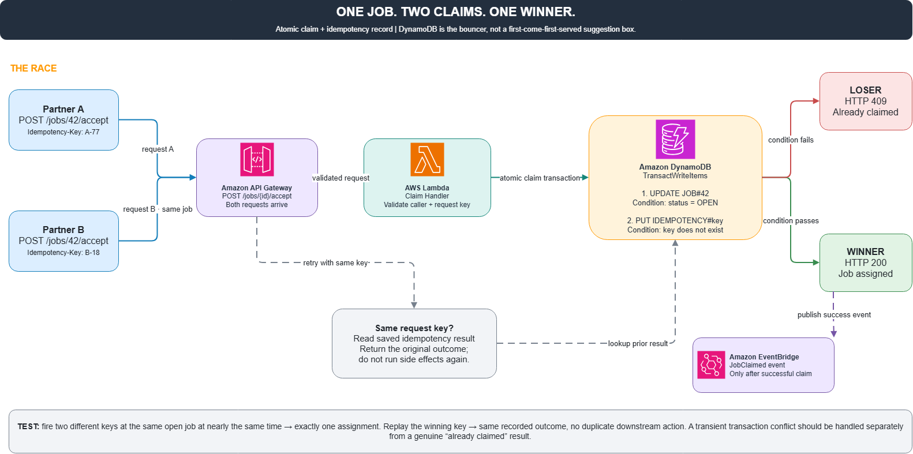

# One Chair, Two People, and an Unforgiving Database

Imagine a platform connecting customers with service partners, where each job can only be accepted by one person. Partner A and Partner B see the same listing, and both click "Accept Job" almost simultaneously.

If the backend handles it naively:

1. Check if the job is still available.  
2. If available, update the assignee.

Congratulations, you've just assigned two owners to a single job. One chair, two people trying to sit at once.

**How to Solve This?**

Instead of having two sides negotiate with each other, we appoint Amazon DynamoDB as the strict gatekeeper:

* AWS Lambda receives the request and builds a transaction using `TransactWriteItems`.  
* DynamoDB executes two atomic operations in the same transaction: it updates the job status only if its current state is `OPEN`, and simultaneously persists an Idempotency Key to guard against duplicate processing.  
* Only one transaction wins the job. The competing transaction receives a conditional check failure/conflict error.  
* If the winner resends the request due to a network timeout, the backend reads the stored idempotency result rather than re-executing side effects.

The elegance here is that we don't need to guess who clicked a few milliseconds faster. The database decides deterministically based on real-time state at the exact moment of write.

**What Needs Verification?**

Fire two concurrent requests from different users targeting the same job record. The expected outcome is that exactly one user claims the job. Then, replay the winner's request and verify that no duplicate side effects are triggered.

One transaction, one winner, no human referee required.

*Note: This architecture and testing design is a proposed pattern.*

#AWS #DynamoDB #Serverless #RaceCondition #Engineering

