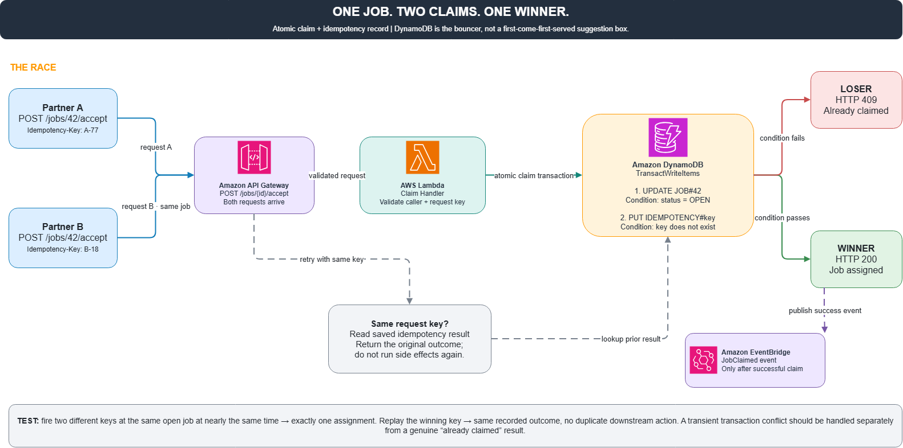

# Một cái ghế, hai người, và một database không biết nhường nhịn

Hãy tưởng tượng một nền tảng kết nối khách hàng với đối tác, nơi mỗi công việc chỉ được một người nhận. Partner A và Partner B cùng thấy một công việc, và cả hai cùng bấm “Nhận việc” gần như cùng lúc.

Nếu backend xử lý theo kiểu:

1. Kiểm tra xem công việc còn trống không.  
2. Nếu còn thì cập nhật người nhận.

thì chúc mừng, bạn vừa tạo ra một công việc có hai chủ. Một cái ghế mà hai người cùng ngồi.

**Giải quyết thế nào?**

Thay vì để hai bên tự “thương lượng” với nhau, ta giao việc đó cho Amazon DynamoDB làm người gác cửa. Cách làm như sau:

* AWS Lambda nhận request và tạo một transaction bằng `TransactWriteItems`.  
* DynamoDB thực hiện hai thao tác nguyên tử trong cùng một transaction: cập nhật công việc chỉ khi trạng thái vẫn là `OPEN`, đồng thời ghi lại Idempotency Key để chống xử lý trùng.  
* Chỉ một transaction giành được công việc. Người còn lại nhận về kết quả xung đột.  
* Nếu người thắng gửi lại request vì bị timeout, backend sẽ đọc kết quả idempotency đã lưu thay vì chạy lại các side effect.

Cái hay ở đây là mình không cần đoán xem ai bấm nhanh hơn vài mili giây. Database sẽ quyết định dựa trên trạng thái thực tế ngay tại thời điểm ghi.

**Cần kiểm chứng điều gì?**

Bắn hai request từ hai người khác nhau vào cùng một công việc, gần như đồng thời. Kết quả đúng phải là chỉ một người nhận được việc. Sau đó replay request của người thắng và kiểm tra xem có phát sinh tác dụng phụ trùng lặp nào không.

Một transaction, một người thắng, không cần trọng tài.

*Lưu ý: đây là kiến trúc và thiết kế kiểm thử đề xuất, chưa phải kết quả triển khai thực tế.*

#AWS #DynamoDB #Serverless #RaceCondition #Engineering

