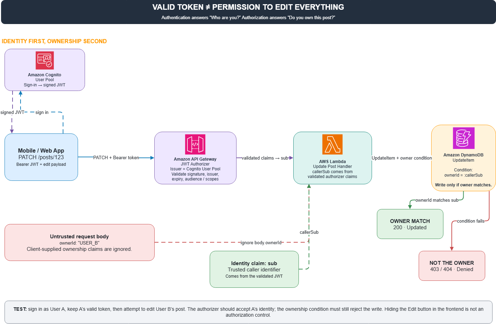

# You Have a Valid Passport, But Do You Have the Right to Renovate Your Neighbor's House?

There is an intriguing security vulnerability in web application development that is easy to overlook. A user signs in successfully, provides a cryptographically valid token, and the API responds normally. But does that mean they have the right to edit every post in the system? Absolutely not.

Consider this scenario:

* User A logs in successfully.  
* User B creates a post with ID `123`.  
* User A issues a `PATCH /posts/123` request to update B's post.

If the backend only verifies that the JWT signature is valid, User A can alter User B's data at will (IDOR vulnerability).

**Two Distinct Concepts**

* **Authentication**: Who are you?  
* **Authorization**: What are you permitted to do with this specific resource?

**How to Solve This?**

An architectural pattern that handles this cleanly:

1. Amazon Cognito manages user identities and issues signed JWTs.  
2. API Gateway JWT Authorizer verifies token authenticity before the request ever reaches backend compute.  
3. AWS Lambda extracts the caller's unique `sub` from the verified token claims, rather than trusting any `ownerId` sent in the request payload.  
4. When updating the record, Lambda issues a DynamoDB `UpdateItem` guarded by a condition expression: `ownerId = :callerSub`.

If the caller is not the owner, the condition fails atomically and the operation is rejected.

Key takeaway: Hiding the Edit button on the frontend is NOT security. An attacker can always forge HTTP calls directly against the endpoint.

**What Needs Verification?**

Log in with User A's credentials, use A's valid token to attempt modifying User B's post. The expected result is successful authentication but strict authorization failure (403 Forbidden).

Holding a valid passport doesn't mean you own every house in the city.

*Note: This architecture and testing design is a proposed pattern.*

#AWS #Cognito #APIGateway #DynamoDB #CyberSecurity #Authorization

