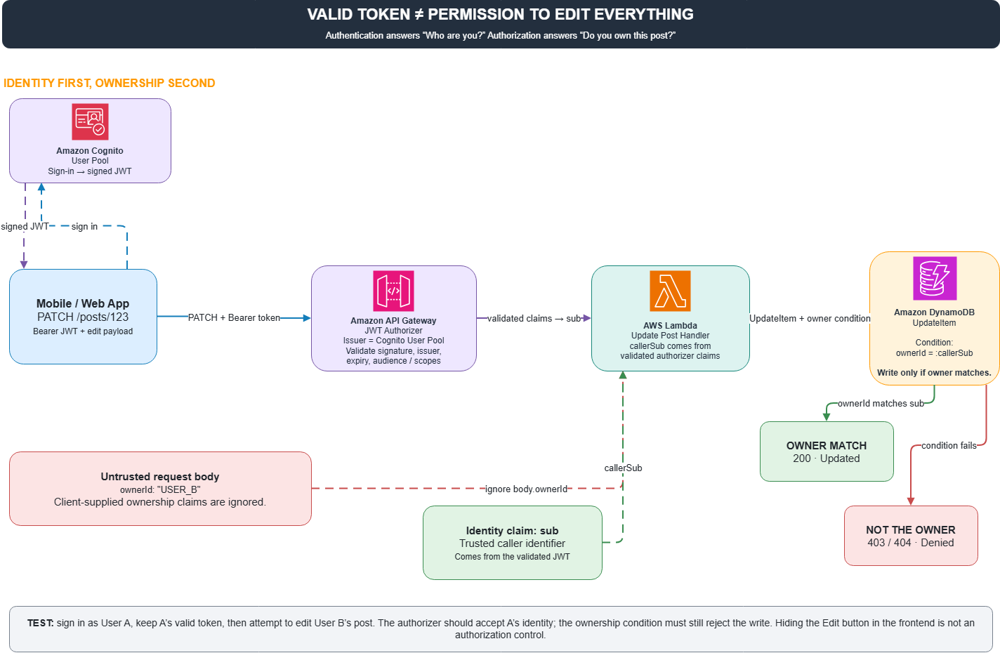

# Bạn có hộ chiếu hợp lệ, vậy có được quyền sửa nhà hàng xóm không?

Có một lỗi bảo mật khá thú vị trong phát triển ứng dụng mà nhiều người dễ bỏ sót. Người dùng đăng nhập thành công, token hợp lệ, API trả dữ liệu bình thường. Nhưng điều đó có nghĩa là họ được quyền sửa mọi bài đăng trong hệ thống không? Tất nhiên là không.

Thử hình dung:

* User A đăng nhập thành công.  
* User B tạo một bài đăng có ID `123`.  
* User A gửi request `PATCH /posts/123` để sửa bài của B.

Nếu backend chỉ kiểm tra token có hợp lệ hay không, A hoàn toàn có thể sửa dữ liệu của B.

**Hai khái niệm cần tách bạch**

* **Authentication**: bạn là ai?  
* **Authorization**: bạn được làm gì với tài nguyên này?

**Giải quyết thế nào?**

Một kiến trúc có thể xử lý vấn đề này:

1. Amazon Cognito quản lý danh tính người dùng.  
2. API Gateway JWT Authorizer xác thực token trước khi request chạm tới backend.  
3. AWS Lambda lấy `sub` từ claims đã được xác thực, thay vì tin vào `ownerId` do client gửi lên.  
4. Khi cập nhật bài đăng, Lambda dùng DynamoDB `UpdateItem` kèm điều kiện `ownerId = :callerSub`.

Nếu người gửi không phải chủ sở hữu, điều kiện không thỏa và thao tác bị từ chối.

Một chi tiết quan trọng: ẩn nút Edit trên frontend không phải là bảo mật. Người dùng vẫn có thể tự tạo request gọi thẳng vào API.

**Cần kiểm chứng điều gì?**

Đăng nhập bằng tài khoản A, dùng token hợp lệ của A để sửa bài đăng của B. Kết quả đúng là authentication thành công nhưng authorization thất bại.

Vì có hộ chiếu không có nghĩa là bạn sở hữu mọi căn nhà trong thành phố.

*Lưu ý: đây là kiến trúc và thiết kế kiểm thử đề xuất, chưa phải kết quả triển khai thực tế.*

#AWS #Cognito #APIGateway #DynamoDB #CyberSecurity #Authorization

