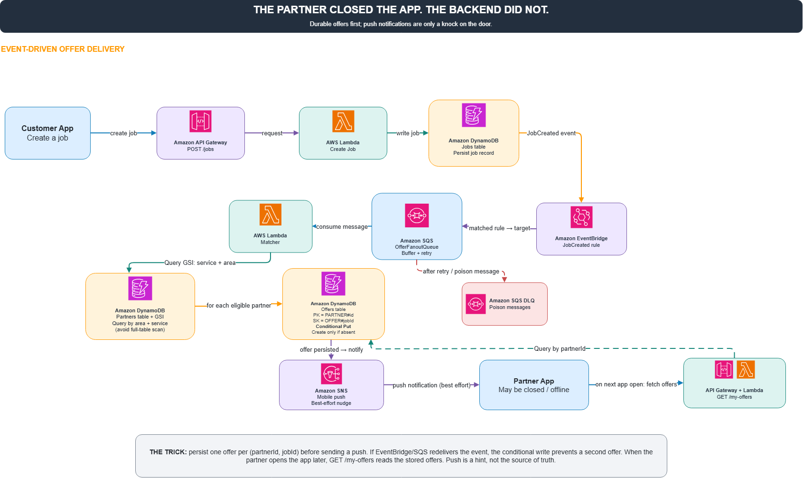

# The Partner Has Closed the App, But Work Still Has to Find Them

A familiar challenge: A customer posts a service request, and the system needs to match qualified partners and send quote invitations. But the partner is currently offline. Their app is closed, their phone is resting on the table.

Must we wait until they come online to dispatch the invitation? Not at all. We build a decoupled, event-driven system where the backend executes reliably regardless of user connectivity.

**Proposed Architecture**

1. Customer submits a request via Amazon API Gateway.  
2. AWS Lambda persists the job record in DynamoDB and emits a `JobCreated` event to Amazon EventBridge.  
3. EventBridge routes the event into Amazon SQS for durable asynchronous buffering.  
4. A Lambda Matcher worker queries eligible partners via DynamoDB Global Secondary Indexes (GSIs) filtered by geohash and service category.  
5. The worker writes individual offer invitations into an Offers table, using compound key `partnerId + jobId` to prevent duplicates.  
6. Amazon SNS sends push notifications as optional alerts—never as the primary data store.

**The Key Insight**

State is saved first; notifications are delivered second. Even if the partner was offline during job creation, the invitation rests safely in the database. When they reopen the app, frontend queries `GET /my-offers`, and backend returns all persisted offers.

We don't gamble on push notifications arriving reliably. A push notification is merely a knock on the door; DynamoDB holds the letter.

What if EventBridge replays events, or SQS delivers a message twice? Idempotent conditional writes prevent duplicate offers. Poison messages failing retries route safely to a Dead-Letter Queue (DLQ) for inspection.

**What Needs Verification?**

* Create a job while the candidate partner is offline.  
* Verify that the offer record is persisted in DynamoDB.  
* Open the app subsequently and confirm the offer renders correctly.  
* Replay the exact event payload multiple times to prove offers are never duplicated.  
* Inject an unparseable payload to verify DLQ redirection.

A resilient system finishes its work without depending on 24/7 client connectivity.

*Note: This architecture and testing design is a proposed pattern.*

#AWS #EventDrivenArchitecture #SQS #EventBridge #Lambda #DynamoDB #SNS

