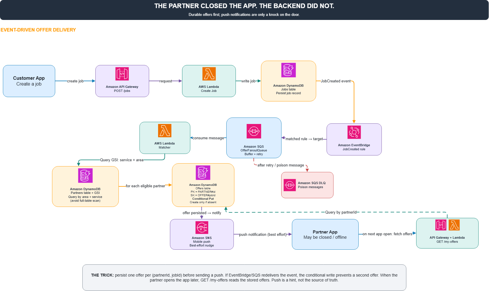

# Đối tác đã tắt ứng dụng, nhưng công việc vẫn phải tìm đến họ

Một tình huống khá quen thuộc: khách hàng đăng yêu cầu dịch vụ, hệ thống cần tìm các đối tác phù hợp và gửi lời mời báo giá. Nhưng đối tác lại đang offline. Họ không mở app, không có mạng, có khi điện thoại còn đang nằm úp trên bàn.

Vậy có phải ta phải chờ họ online rồi mới gửi lời mời được không? Không cần. Hãy thử xây một hệ thống mà backend vẫn làm việc bình thường ngay cả khi người nhận chưa xuất hiện.

**Kiến trúc đề xuất**

1. Khách hàng tạo công việc qua Amazon API Gateway.  
2. AWS Lambda lưu công việc vào DynamoDB và phát sự kiện `JobCreated` tới Amazon EventBridge.  
3. EventBridge chuyển sự kiện vào Amazon SQS để xử lý bất đồng bộ.  
4. Một Lambda Matcher tìm danh sách đối tác phù hợp qua GSI của DynamoDB, dựa trên khu vực và loại dịch vụ.  
5. Hệ thống lưu từng lời mời vào bảng Offers, dùng cặp `partnerId + jobId` làm định danh để chống trùng.  
6. Amazon SNS gửi push notification như một lời nhắc, chứ không phải nơi lưu lời mời.

**Điểm mấu chốt**

Lời mời được lưu trước, thông báo gửi sau. Nên dù đối tác đang offline lúc công việc được tạo, lời mời vẫn nằm yên trong database. Khi họ mở app trở lại, frontend gọi `GET /my-offers` và backend trả về những lời mời đã lưu.

Mình không cần hy vọng push notification lúc nào cũng đến nơi. Push chỉ là tiếng gõ cửa, còn DynamoDB mới là nơi giữ lá thư.

Còn nếu EventBridge phát lại sự kiện, hoặc SQS giao một message nhiều lần thì sao? Conditional Put sẽ ngăn việc tạo ra nhiều lời mời giống hệt nhau. Những message cứ lỗi mãi có thể được chuyển sang Dead-Letter Queue để kiểm tra sau.

**Cần kiểm chứng điều gì?**

* Tạo một công việc khi đối tác đang offline.  
* Xác nhận lời mời vẫn được lưu.  
* Mở app sau đó và lấy lại lời mời.  
* Replay cùng một event nhiều lần, kiểm tra số lượng offer không bị nhân đôi.  
* Thử một message lỗi để kiểm tra DLQ.

Một hệ thống tốt không cần người dùng online 24/7 thì backend mới hoàn thành được việc của mình.

*Lưu ý: đây là kiến trúc và thiết kế kiểm thử đề xuất, chưa phải kết quả triển khai thực tế.*

#AWS #EventDrivenArchitecture #SQS #EventBridge #Lambda #DynamoDB #SNS

