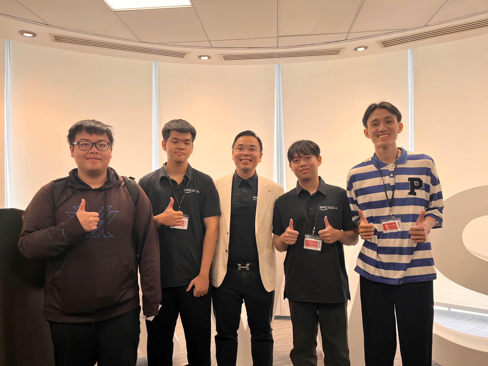

# **Event 1: Buildrathon – Kickoff: Code the Future with CMC Global**

**Date:** Saturday, September 26, 2026  
**Time:** 10:30 AM – 12:00 PM (GMT+7)  
**Location:** Bitexco Financial Tower, 02 Hai Trieu Street, Ho Chi Minh City, Vietnam.  
**Role:** Participant  

### **Event Objectives**

* Introduce the Buildrathon challenge, its objectives, and judging criteria.  
* Provide an overview of AWS Cloud, Generative AI, and AI Agent technologies.  
* Encourage collaboration and innovation among participants.  
* Share career opportunities and development paths in Cloud Computing and AI.  
* Provide practical exposure to building AI-powered solutions.

### **Speakers**

The event featured industry professionals and AWS practitioners sharing their experiences in cloud computing, artificial intelligence, and career development.

### **Key Highlights**

#### **Introduction to Buildrathon**
* Overview of the development challenge, problem statements, and judging rubrics.  
* Understanding how modern cloud architectures and AI empower innovative software products.

#### **Cloud Computing and Generative AI**
* Real-world applications of foundational AWS services.  
* Introduction to Agentic AI workflows interacting with external tool APIs.

#### **Building a Career in Cloud & AI**
* Career trajectories, emerging industry trends, and the value of hands-on project portfolio building.

#### **AI Agent Challenge**
* Prompt engineering best practices and Retrieval-Augmented Generation (RAG) concepts.

### **Key Takeaways & Application**

* Connected AWS serverless backends with multimodal AI agent reasoning.  
* Applied prompt engineering and context knowledge base patterns into our ReLoop capstone project.

### **Event Photos**

 
