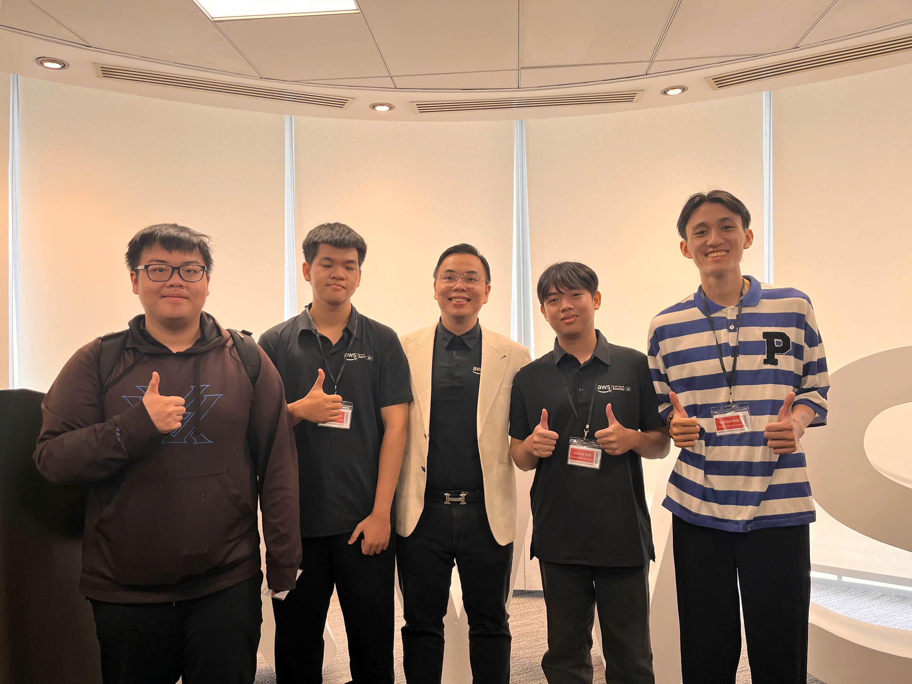

# **Sự kiện 1: Buildrathon – Khởi động: Kiến tạo tương lai cùng CMC Global**

**Ngày:** Thứ Bảy, ngày 26 tháng 09 năm 2026  
**Thời gian:** 10:30 AM – 12:00 PM (GMT+7)  
**Địa điểm:** Tòa nhà Bitexco Financial Tower, số 02 Hải Triều, TP. Hồ Chí Minh, Việt Nam.  
**Vai trò:** Người tham gia  

### **Mục tiêu sự kiện**

* Giới thiệu cuộc thi thử thách công nghệ Buildrathon, mục tiêu và tiêu chí đánh giá.  
* Cung cấp góc nhìn tổng quan về điện toán đám mây AWS, Generative AI và công nghệ AI Agent.  
* Thúc đẩy tinh thần đổi mới sáng tạo và làm việc nhóm giữa các thành viên tham gia.  
* Chia sẻ định hướng phát triển nghề nghiệp trong lĩnh vực Cloud Computing và Trí tuệ nhân tạo.

### **Diễn giả**

Chương trình có sự góp mặt của các chuyên gia công nghệ và kỹ sư giàu kinh nghiệm từ AWS và CMC Global.

### **Nội dung nổi bật**

#### **Tổng quan về Buildrathon**
* Giới thiệu đề bài thử thách phát triển sản phẩm công nghệ và tiêu chí chấm điểm từ ban giám khảo.

#### **Điện toán đám mây và Generative AI**
* Ứng dụng thực tế của hệ sinh thái đám mây AWS trong việc hiện thực hóa các giải pháp phần mềm hiện đại.  
* Cơ chế hoạt động của AI Agents khi tương tác với các công cụ và API bên ngoài.

#### **Định hướng nghề nghiệp Cloud & AI**
* Xu hướng phát triển thị trường công nghệ và tầm quan trọng của việc tích lũy kinh nghiệm qua các dự án thực chiến.

#### **Thử thách AI Agent**
* Kỹ thuật thiết kế prompt (Prompt Engineering) và kiến trúc Retrieval-Augmented Generation (RAG).

### **Bài học rút ra & Ứng dụng**

* Nắm vững mối quan hệ tương hỗ giữa hạ tầng đám mây và các mô hình AI Agent.  
* Vận dụng trực tiếp các kỹ thuật prompt và quản lý ngữ cảnh vào module phân loại thiết bị của dự án ReLoop.

### **Hình ảnh sự kiện**

 
