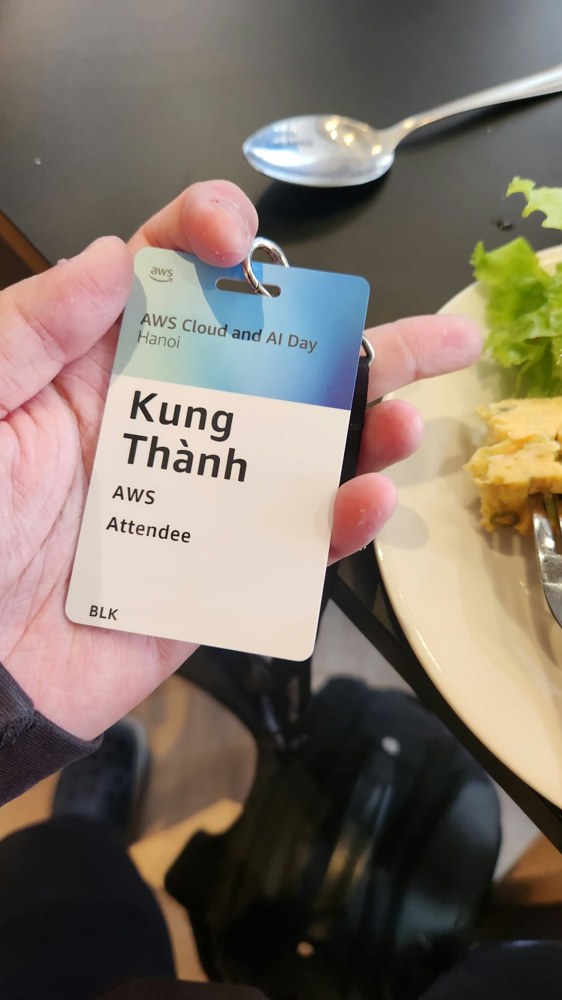
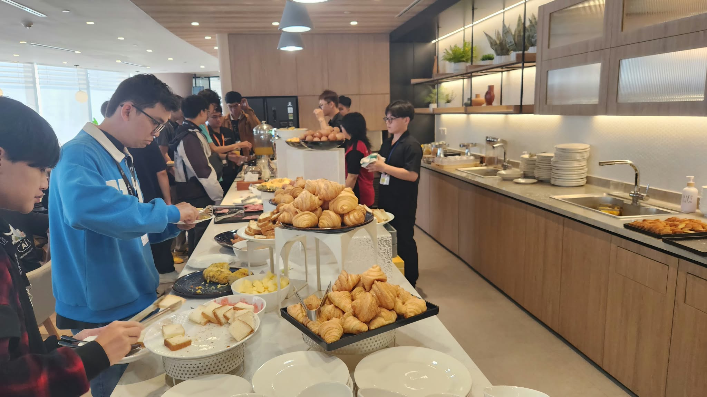
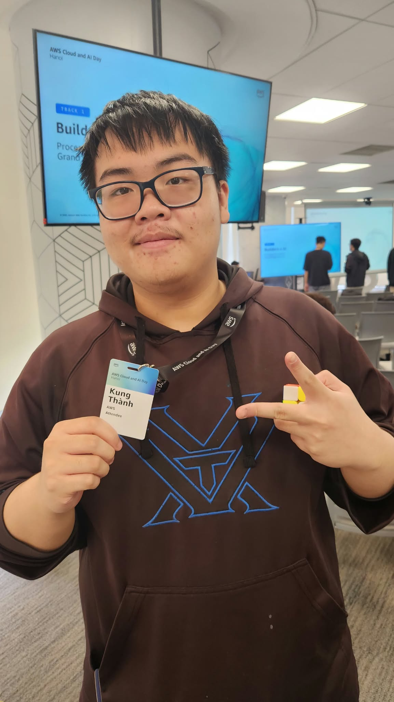

# **Sự kiện 2: AWS Cloud and AI Day Hanoi – Sự kiện Watch Party TP.HCM**

**Ngày:** Thứ Ba, ngày 29 tháng 09 năm 2026  
**Thời gian:** 08:00 AM – 05:00 PM (GMT+7)  
**Địa điểm:** Văn phòng AWS Việt Nam, Tầng 26, Bitexco Financial Tower, TP. Hồ Chí Minh, Việt Nam.  
**Vai trò:** Người tham dự  

### **Mục tiêu sự kiện**

* Cập nhật những bước tiến mới nhất trong hệ sinh thái đám mây AWS và Trí tuệ nhân tạo doanh nghiệp.  
* Khám phá các mô hình hiện đại hóa ứng dụng quy mô lớn kết hợp AI và Kubernetes.  
* Kết nối cộng đồng chuyên gia giải pháp đám mây và các kỹ sư phần mềm tại Việt Nam.

### **Nội dung nổi bật**

#### **Agentic AI & Phát triển phần mềm hiện đại**
* Sự chuyển dịch từ trợ lý ảo hội thoại truyền thống sang hệ thống AI Agent có khả năng chủ động giải quyết tác vụ phức tạp.

#### **Platform Engineering & Hạ tầng đám mây**
* Xây dựng nền tảng cho lập trình viên nội bộ (IDP), điều phối container với Amazon EKS và mở rộng hạ tầng phân tán.

#### **Tối ưu hóa quy trình với công cụ AI**
* Gia tăng hiệu suất phát triển phần mềm song song với kiểm soát chi phí vận hành, độ trễ và tính sẵn sàng của hệ thống.

### **Bài học rút ra & Ứng dụng**

* Lựa chọn kiến trúc dịch vụ phù hợp bài toán quan trọng hơn việc chạy theo công nghệ mới nhất.  
* Tích hợp tự động hóa triển khai và giám sát độ trễ CloudWatch vào dự án thực tập.

### **Hình ảnh sự kiện**

   
