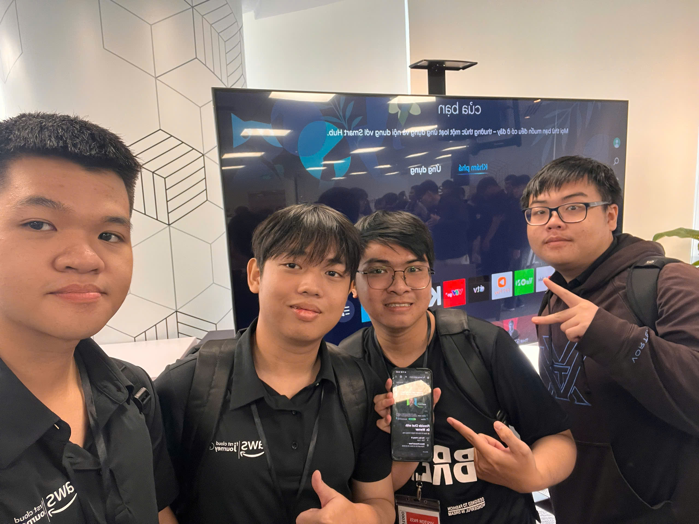

# **Event 3: Fireside Chat with Dr. Werner – Navigating the Future of Cloud & AI in Vietnam**

**Date:** Friday, October 2, 2026  
**Time:** 10:30 AM – 12:00 PM (GMT+7)  
**Location:** Bitexco Financial Tower, 02 Hai Trieu Street, Ho Chi Minh City, Vietnam.  
**Role:** Attendee  

### **Event Objectives**

* Gain high-level architectural insights from Dr. Werner Vogels, CTO of Amazon.  
* Understand how globally resilient distributed systems are engineered and operated at massive scale.  
* Discuss technology evolution and the strategic opportunities for Vietnam's software ecosystem.

### **Key Highlights**

#### **Engineering at Global Scale**
* "Everything fails, all the time" — designing systems that embrace continuous failure through decoupling and fault isolation.  
* Prioritizing long-term maintainability, asynchronous communication, and idempotency over fragile synchronous chains.

#### **Generative AI & Practical Engineering Mindset**
* Building systems for real-world reliability rather than theoretical benchmarks.  
* The intersection of FinOps, cost awareness, and sustainable cloud computing.

### **Key Takeaways & Application**

* Reinforced our ReLoop design decisions: single-table isolation, versioned concurrency control, and graceful offline degradation.

### **Event Photos**

 
