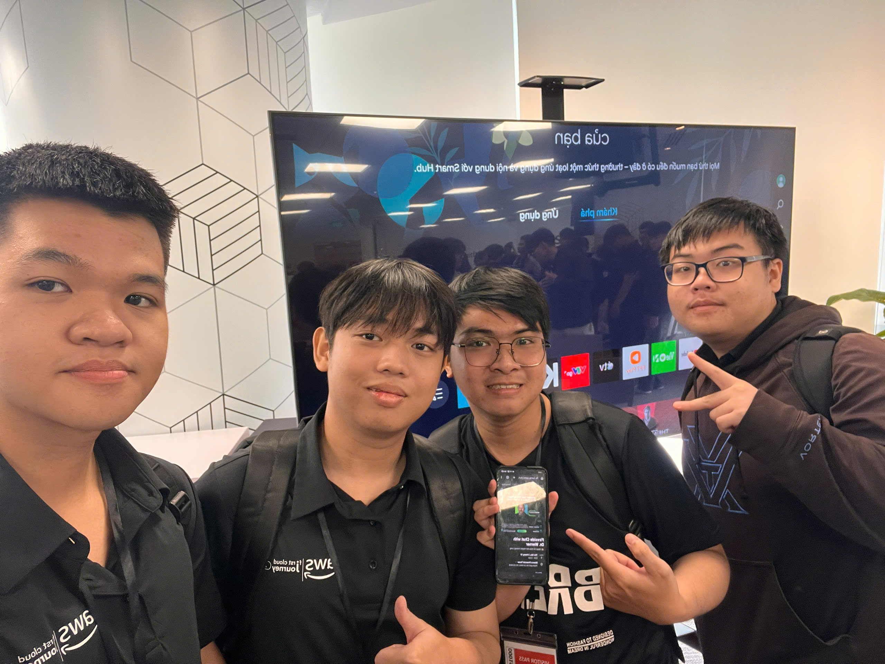

## **Sự kiện 3: Trò chuyện thân mật cùng TS. Werner Vogels – Định hình tương lai Điện toán đám mây & AI tại Việt Nam**

**Ngày:** Thứ Sáu, ngày 02 tháng 10 năm 2026  
**Thời gian:** 10:30 – 12:00 (GMT+7)  
**Địa điểm:** Văn phòng AWS Việt Nam, Tầng 26, Tòa nhà Bitexco Financial Tower, số 02 Hải Triều, TP. Hồ Chí Minh, Việt Nam.  
**Vai trò:** Người tham dự  

### **Mục tiêu sự kiện**

* Lắng nghe chia sẻ tầm nhìn công nghệ từ Tiến sĩ Werner Vogels – Phó Chủ tịch kiêm Giám đốc Công nghệ (CTO) của Amazon.  
* Tiếp thu triết lý thiết kế và vận hành các hệ thống phân tán quy mô toàn cầu với độ tin cậy cao.  
* Trao đổi về làn sóng chuyển đổi số và cơ hội phát triển cho thế hệ kỹ sư phần mềm tại Việt Nam.

### **Nội dung nổi bật**

#### **Triết lý kỹ thuật hệ thống quy mô lớn**
* Nguyên tắc "Everything fails, all the time" — thiết kế hệ thống luôn sẵn sàng ứng phó với sự cố bằng cơ chế cô lập lỗi và phân tách độc lập.  
* Đề cao kiến trúc bất đồng bộ, tính lũy đẳng (idempotency) và khả năng bảo trì lâu dài hơn là các chuỗi gọi đồng bộ dễ đứt gãy.

#### **Đổi mới sáng tạo cùng Trí tuệ nhân tạo**
* Ứng dụng AI vào giải quyết vấn đề thực tế thay vì theo đuổi các thử nghiệm thiếu tính khả thi trong sản xuất.  
* Tư duy tối ưu hóa chi phí (FinOps) đi liền với trách nhiệm vận hành bền vững.

### **Bài học rút ra & Ứng dụng**

* Củng cố các quyết định kiến trúc cho dự án ReLoop: thiết kế DynamoDB một bảng, ghi có điều kiện chống xung đột và xử lý nền bất đồng bộ.

### **Hình ảnh sự kiện**

