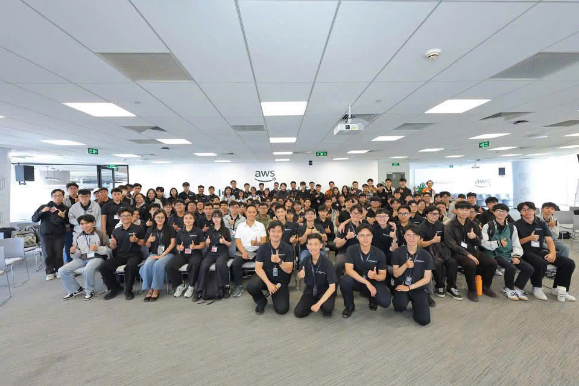
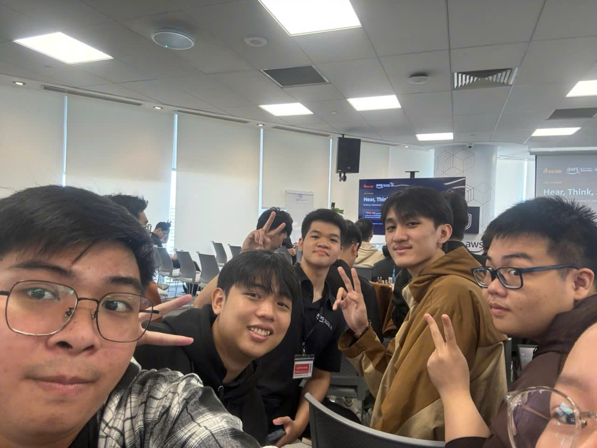

# **Event 4: Cloud & AI Infrastructure Meetup**

**Date:** Saturday, October 24, 2026  
**Time:** 10:30 AM – 12:00 PM (GMT+7)  
**Location:** Bitexco Financial Tower, 02 Hai Trieu Street, Ho Chi Minh City, Vietnam.  
**Role:** Attendee  

### **Event Objectives**

* Deep-dive into modern data infrastructure, object storage, and GPU cluster optimization for LLM serving.  
* Analyze S3-compatible open-source storage solutions (Ceph, MinIO, SeaweedFS).  
* Explore intelligent request routing, KV-cache management, and enterprise Agentic AI.

### **Speakers**

* **Hà Mạnh Đông** – Tech Lead, OMZ JSC.  
* **Nguyễn Thế Anh** – CNCF Ambassador and Kubestronaut, Viettel AI/GPU Platform.  
* **Phùng Quang Minh** – Software Engineer, Viettel Networks.  
* **Quân Phương** – Senior Solutions Architect, AWS Vietnam.

### **Key Highlights**

#### **Object Storage Architecture for AI Data**
* Throughput bottlenecks, metadata management, and S3 API compatibility at scale.

#### **GPU Infrastructure & LLM Serving**
* Multi-cluster GPU scheduling, NVIDIA Dynamo inference optimization, and token throughput balancing.

#### **Agent Router & Memory Graphs**
* Long-term AI memory structures and stateful agent coordination across distributed microservices.

### **Event Photos**

  
