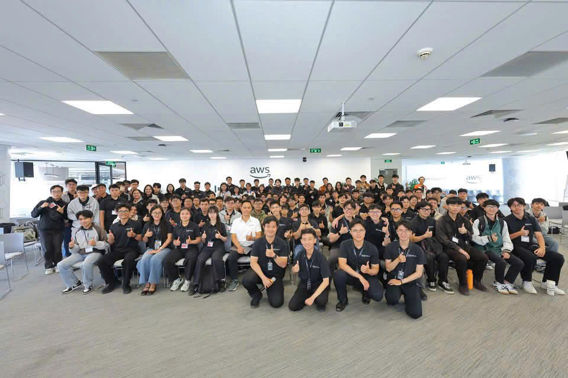
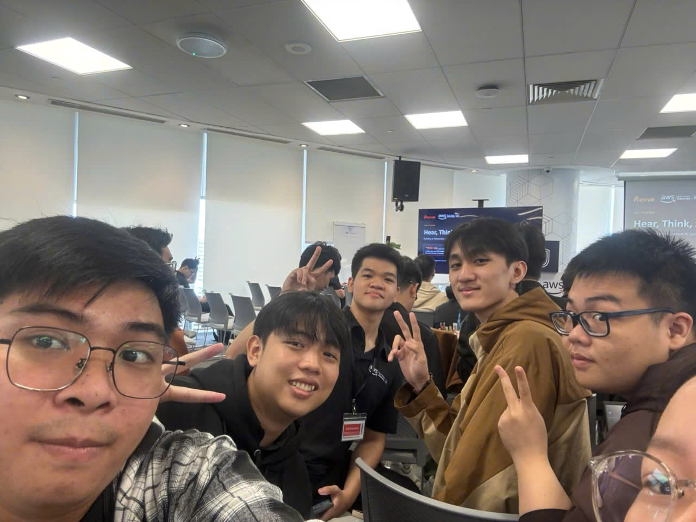

## **Sự kiện 4: Hội thảo chuyên sâu về Hạ tầng Điện toán đám mây & AI (Cloud & AI Infrastructure Meetup)**

**Ngày:** Thứ Bảy, ngày 24 tháng 10 năm 2026  
**Thời gian:** 10:30 – 12:00 (GMT+7)  
**Địa điểm:** Văn phòng AWS Việt Nam, Tầng 26, Tòa nhà Bitexco Financial Tower, số 02 Hải Triều, TP. Hồ Chí Minh, Việt Nam.  
**Vai trò:** Người tham dự  

### **Mục tiêu sự kiện**

* Phân tích chuyên sâu về hạ tầng dữ liệu hiện đại, lưu trữ đối tượng và kỹ thuật tối ưu hóa cụm GPU để phục vụ mô hình ngôn ngữ lớn (LLM Serving).  
* So sánh các giải pháp lưu trữ mã nguồn mở tương thích chuẩn S3 (Ceph, MinIO, SeaweedFS).  
* Tìm hiểu giải pháp định tuyến thông minh (Agent Router), quản lý bộ nhớ đệm KV-cache và kiến trúc Agentic AI.

### **Diễn giả**

* **Hà Mạnh Đông** – Tech Lead, OMZ JSC.  
* **Nguyễn Thế Anh** – CNCF Ambassador và Kubestronaut, Viettel AI/GPU Platform.  
* **Phùng Quang Minh** – Software Engineer, Viettel Networks.  
* **Quân Phương** – Senior Solutions Architect, AWS Vietnam.

### **Nội dung nổi bật**

#### **Kiến trúc Object Storage cho dữ liệu AI**
* Xử lý điểm nghẽn băng thông, tối ưu hóa metadata và quản lý dữ liệu lớn qua giao thức S3 tương thích.

#### **Hạ tầng GPU & Tối ưu hóa suy luận LLM**
* Điều phối tài nguyên GPU đa cụm, tăng thông lượng token và giải pháp NVIDIA Dynamo trong môi trường sản xuất.

#### **Agent Router & Đồ thị ghi nhớ cho AI**
* Xây dựng bộ nhớ dài hạn cho AI Agent và cơ chế điều phối agent có trạng thái giữa các thành phần backend phân tán.

### **Bài học rút ra & Ứng dụng**

* Củng cố lựa chọn Amazon S3 riêng tư kết hợp chính sách presigned POST và quy tắc vòng đời (lifecycle) của ReLoop để xử lý ảnh thiết bị do người dùng tải lên mà không phải tự vận hành máy chủ lưu trữ.  
* Làm rõ đánh đổi giữa chi phí và thông lượng suy luận cho tác vụ AI, xác nhận tính hợp lý của việc dùng Amazon Bedrock serverless kèm schema đầu ra chặt và hạn mức theo ngày cho từng người dùng.

### **Hình ảnh sự kiện**

