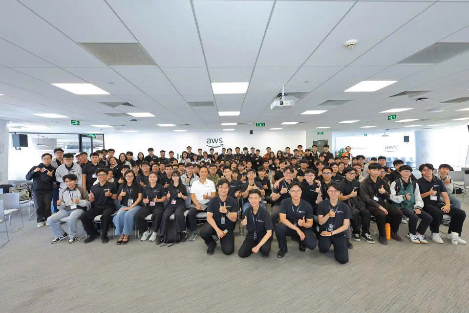
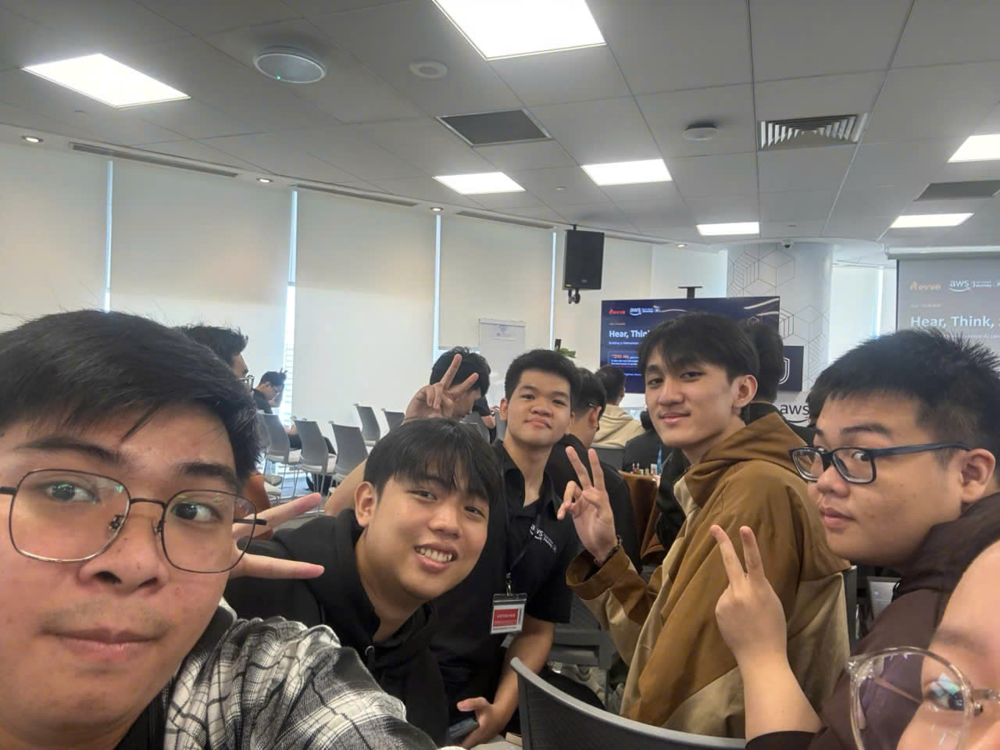

# **Sự kiện 4: Hội thảo chuyên sâu về Hạ tầng Điện toán đám mây & AI (Cloud & AI Infrastructure Meetup)**

**Ngày:** Thứ Bảy, ngày 24 tháng 10 năm 2026  
**Thời gian:** 10:30 AM – 12:00 PM (GMT+7)  
**Địa điểm:** Tòa nhà Bitexco Financial Tower, số 02 Hải Triều, TP. Hồ Chí Minh, Việt Nam.  
**Vai trò:** Người tham dự  

### **Mục tiêu sự kiện**

* Phân tích chuyên sâu về hạ tầng dữ liệu hiện đại, lưu trữ đối tượng và kỹ thuật tối ưu hóa cụm GPU cho phục vụ mô hình ngôn ngữ lớn (LLM Serving).  
* So sánh các giải pháp lưu trữ mã nguồn mở tương thích chuẩn S3 (Ceph, MinIO, SeaweedFS).  
* Tìm hiểu giải pháp định tuyến thông minh (Agent Router), quản lý bộ nhớ đệm KV-cache và kiến trúc Agentic AI.

### **Diễn giả**

* **Hà Mạnh Đông** – Tech Lead, OMZ JSC.  
* **Nguyễn Thế Anh** – CNCF Ambassador and Kubestronaut, Viettel AI/GPU Platform.  
* **Phùng Quang Minh** – Software Engineer, Viettel Networks.  
* **Quân Phương** – Senior Solutions Architect, AWS Vietnam.

### **Nội dung nổi bật**

#### **Kiến trúc Object Storage cho dữ liệu AI**
* Xử lý điểm nghẽn băng thông, tối ưu hóa metadata và quản lý dữ liệu lớn qua giao thức S3 tương thích.

#### **Hạ tầng GPU & Tối ưu hóa suy luận LLM**
* Điều phối tài nguyên GPU đa cụm, tăng thông lượng token và giải pháp NVIDIA Dynamo trong môi trường sản xuất.

#### **Agent Router & Đồ thị ghi nhớ cho AI**
* Xây dựng bộ nhớ dài hạn cho AI Agent và cơ chế ủy quyền tác vụ giữa các thành phần backend phân tán.

### **Hình ảnh sự kiện**

  
