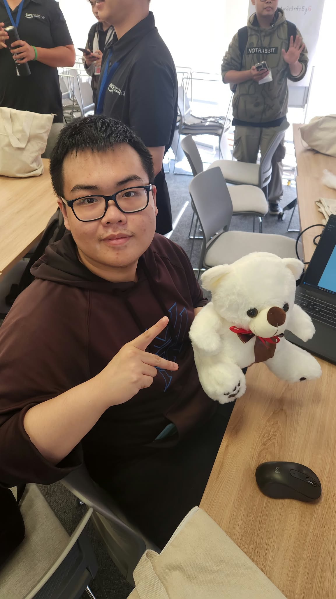
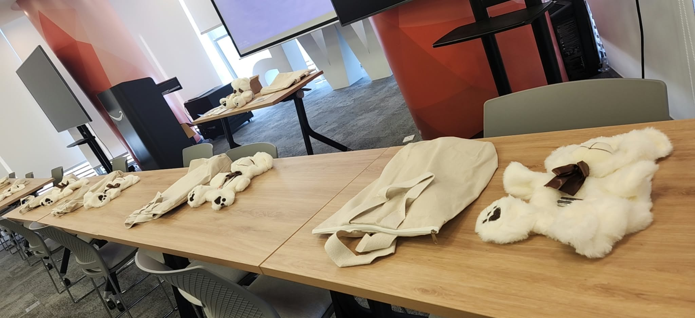

## **Event 5: Teddy-Bear Gift Kits for Children – Volunteering with Operation Smile Vietnam**

**Date:** Monday, October 26, 2026  
**Time:** 01:30 PM – 03:30 PM (GMT+7)  
**Location:** EC2 Room, Level 36, AWS Vietnam Office, Bitexco Financial Tower, Ho Chi Minh City, Vietnam.  
**Role:** Participant  

### **Event Objectives**

* Apply technology and creative engineering toward meaningful social impact.  
* Assemble teddy-bear gift kits with interactive audio modules for pediatric patients.  
* Collaborate with Operation Smile Vietnam to bring comfort to hospitalized children.

### **Key Highlights**

#### **Technology for Social Impact**
* Demonstrating that engineering skills create tangible value when channeled toward empathetic, human-centric solutions.

#### **Hands-on Assembly & Collaboration**
* Fitting simple audio modules into the teddy bears and finishing the gift kits together with other volunteers.

### **Event Experience**

This event was a special and memorable part of my internship at AWS. Alongside hours of technical cloud work, it reminded me that the best purpose of technology is to serve people and bring smiles to children.

### **Event Photos**

