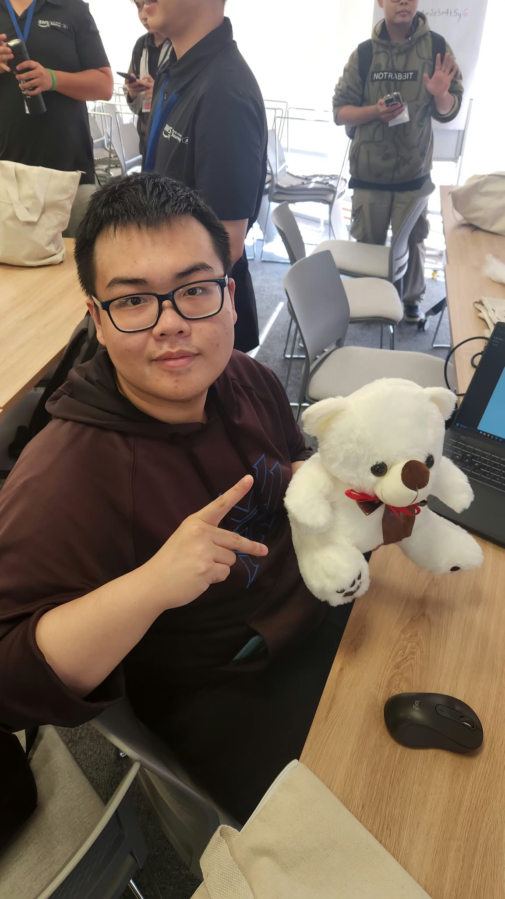
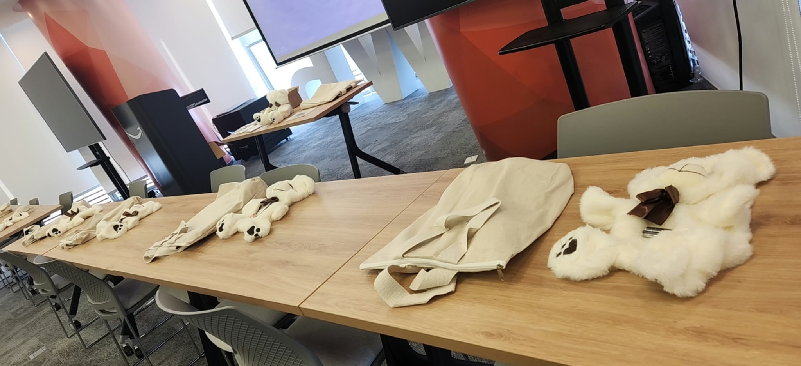

# **Event 5: Smart Plushies for Children – In Collaboration with Operation Smile Vietnam**

**Date:** Monday, October 26, 2026  
**Time:** 01:30 PM – 03:30 PM (GMT+7)  
**Location:** EC2, Level 36, AWS Vietnam Office, Bitexco Financial Tower, Ho Chi Minh City, Vietnam.  
**Role:** Participant  

### **Event Objectives**

* Apply technology and creative engineering toward meaningful social impact.  
* Introduce interactive, IoT-enabled educational plush toys for pediatric patients.  
* Collaborate with Operation Smile Vietnam to bring comfort to hospitalized children.

### **Key Highlights**

#### **Technology for Social Impact**
* Demonstrating that engineering skills create tangible value when channeled toward empathetic, human-centric solutions.

#### **Hands-on Assembly & Collaboration**
* Interactive sensor integration, audio feedback programming, and working alongside cross-functional colleagues.

### **Event Experience**

Participating in this workshop stood out from purely technical cloud sessions. It served as a powerful reminder that technology achieves its highest purpose when improving human lives and bringing smiles to children.

### **Event Photos**

  
