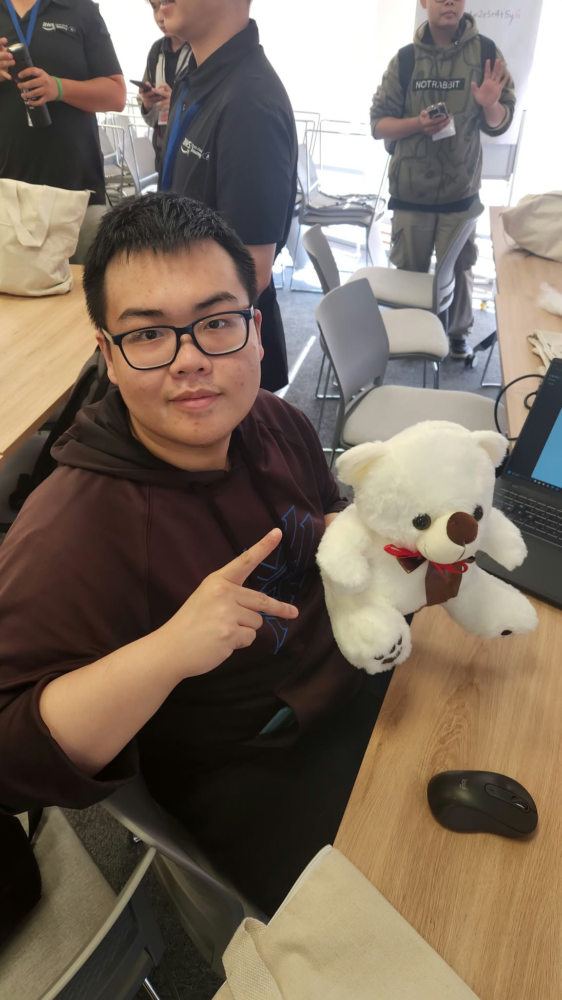
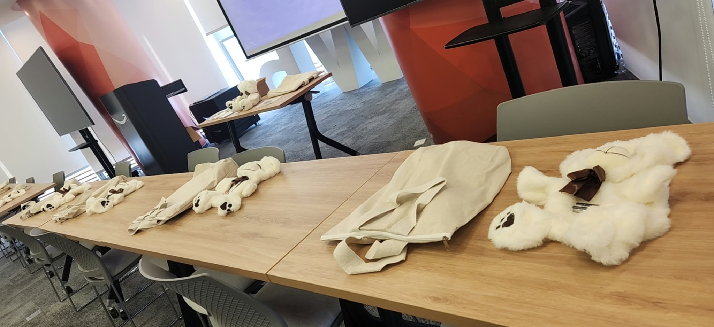

# **Sự kiện 5: Gấu bông thông minh cho trẻ em – Hoạt động vì cộng đồng phối hợp cùng Operation Smile Vietnam**

**Ngày:** Thứ Hai, ngày 26 tháng 10 năm 2026  
**Thời gian:** 01:30 PM – 03:30 PM (GMT+7)  
**Địa điểm:** Phòng EC2, Tầng 36, Văn phòng AWS Việt Nam, Bitexco Financial Tower, TP. Hồ Chí Minh.  
**Vai trò:** Người tham gia  

### **Mục tiêu sự kiện**

* Ứng dụng công nghệ và sự sáng tạo vào các hoạt động thiện nguyện mang lại giá trị nhân văn cho cộng đồng.  
* Lắp ráp và lập trình đồ chơi gấu bông tương tác thông minh hỗ trợ các bệnh nhi trong quá trình điều trị y tế.  
* Phối hợp chặt chẽ cùng tổ chức Operation Smile Vietnam mang lại niềm vui cho trẻ em.

### **Nội dung nổi bật**

#### **Công nghệ vì cộng đồng**
* Khẳng định vai trò của kỹ năng kỹ thuật khi được kết hợp với sự thấu cảm xã hội để tạo nên những sản phẩm giàu ý nghĩa.

#### **Thực hành lắp ráp & Làm việc nhóm**
* Tích hợp cảm biến tương tác, cài đặt module phản hồi âm thanh và cùng nhau hoàn thiện sản phẩm với các đồng nghiệp.

### **Trải nghiệm sự kiện**

Sự kiện là một trải nghiệm đặc biệt và đáng nhớ trong kỳ thực tập tại AWS. Bên cạnh những giờ làm việc với hạ tầng kỹ thuật phức tạp, hoạt động này giúp tôi nhận thức sâu sắc rằng mục tiêu cao đẹp nhất của công nghệ là phục vụ con người và mang lại nụ cười cho trẻ em.

### **Hình ảnh sự kiện**

  
