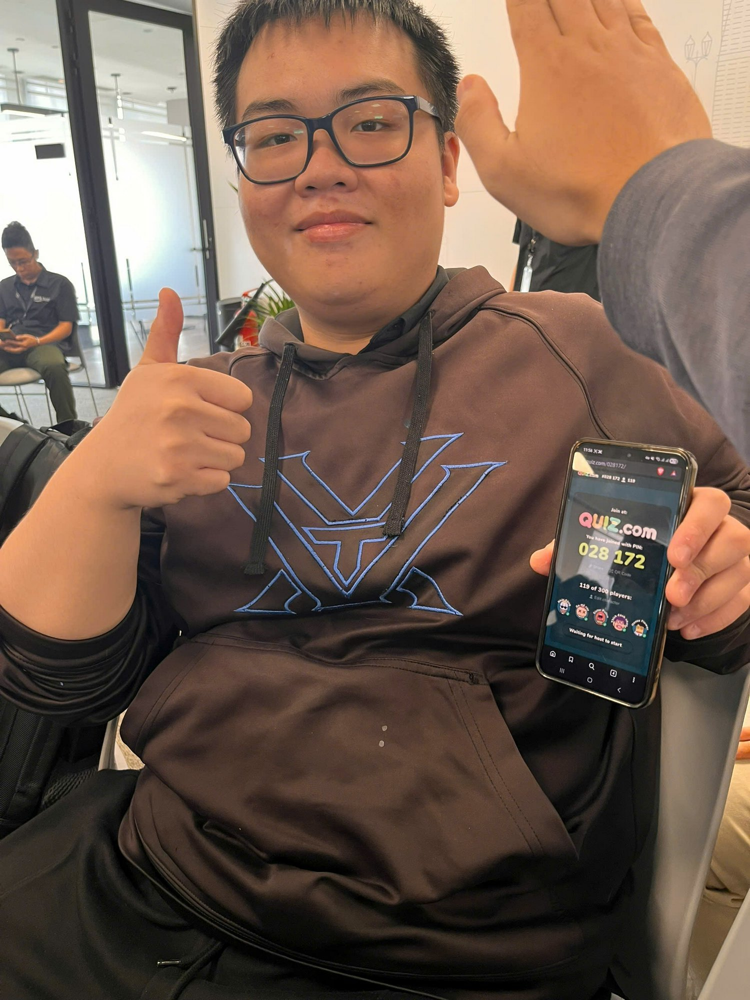

# **Event 6: Cloud Mastery – Cloud Sharing Session for Students**

**Date:** Saturday, November 14, 2026  
**Time:** Morning (GMT+7)  
**Location:** AWS Vietnam Office, Bitexco Financial Tower, Ho Chi Minh City, Vietnam.  
**Role:** Attendee  

### **Event Objectives**

* Share cloud knowledge and career guidance with young students from across Saigon.  
* Answer real questions from students, from career direction to hands-on cloud skills.  
* Review the content in a fun way with a live quiz game at the end.

### **Key Highlights**

#### **Open Q&A – "With No End"**
* The Q&A part ran much longer than planned. Students asked very practical questions about where to start in cloud, which skills matter, and how to grow a cloud career.

#### **Quiz Game at the End**
* A live Quiz.com game closed the session. Over 100 players joined (119 at the time of the photo) and the room was very lively.

#### **What's Next**
* The organizers mentioned another student-focused cloud event the following weekend: **AWS Student Community Day Vietnam 2026**.

### **Event Experience**

It was good to see so many students interested in cloud. The questions were real and practical, and hearing the answers helped me connect what I am building in ReLoop with how others plan their cloud learning and careers. The quiz was a fun way to check what stuck from the session.

### **Event Photos**

*Photo: ChauLe*
