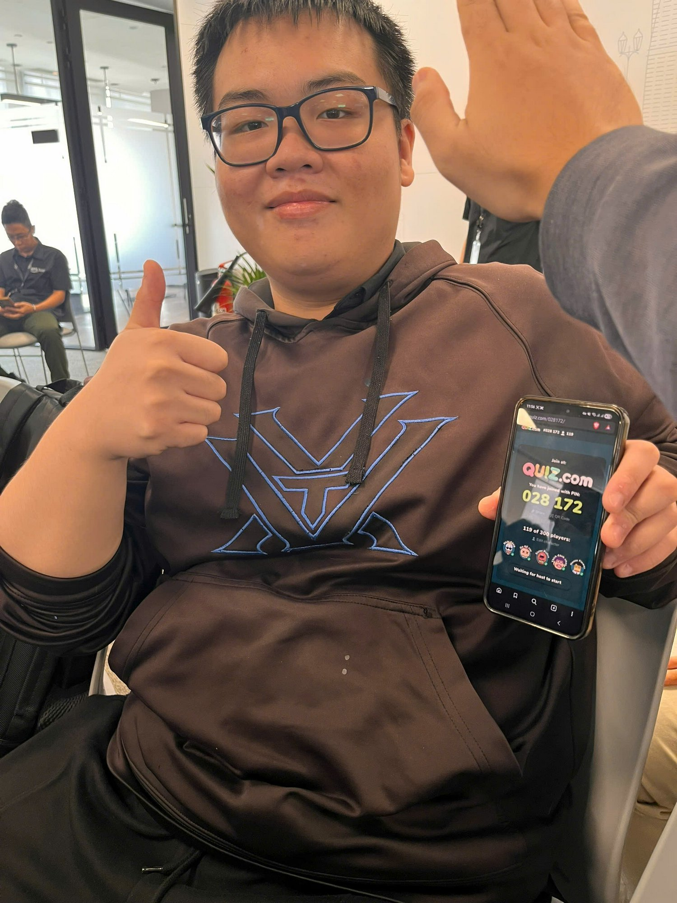

# **Sự kiện 6: Cloud Mastery – Buổi chia sẻ về Cloud cho sinh viên**

**Ngày:** Thứ Bảy, ngày 14 tháng 11 năm 2026  
**Thời gian:** Buổi sáng (GMT+7)  
**Địa điểm:** Văn phòng AWS Việt Nam, Tầng 26, Bitexco Financial Tower, TP. Hồ Chí Minh.  
**Vai trò:** Người tham dự  

### **Mục tiêu sự kiện**

* Chia sẻ kiến thức Cloud và định hướng nghề nghiệp cho các bạn sinh viên tại TP. Hồ Chí Minh.  
* Giải đáp các câu hỏi thực tế của sinh viên, từ định hướng đến chuyên môn về Cloud.  
* Ôn lại nội dung một cách vui vẻ qua trò chơi Quiz trực tiếp cuối buổi.

### **Nội dung nổi bật**

#### **Hỏi đáp mở kéo dài**
* Phần hỏi đáp kéo dài hơn dự kiến rất nhiều. Các bạn sinh viên đặt những câu hỏi rất thực tế và hay: nên bắt đầu học Cloud từ đâu, kỹ năng nào quan trọng, và phát triển sự nghiệp Cloud như thế nào.

#### **Game Quiz cuối buổi**
* Trò chơi Quiz.com trực tiếp khép lại buổi chia sẻ. Trò chơi thu hút hơn 100 người tham gia (119 người tại thời điểm chụp ảnh) và nhận được sự hưởng ứng rất nồng nhiệt.

#### **Sự kiện được giới thiệu tại buổi chia sẻ (21–22/11/2026)**
* Ban tổ chức giới thiệu thêm một sự kiện Cloud khác dành cho sinh viên diễn ra vào ngày 21–22/11/2026: **AWS Student Community Day Vietnam 2026**.

### **Trải nghiệm sự kiện**

Rất vui khi thấy nhiều bạn sinh viên quan tâm đến Cloud. Các câu hỏi đều thực tế, và nghe phần trả lời giúp tôi liên hệ những gì đang xây dựng trong ReLoop với cách người khác lên kế hoạch học tập và sự nghiệp Cloud. Game Quiz là cách vui để kiểm tra mình nhớ được gì sau buổi chia sẻ.

### **Hình ảnh sự kiện**

