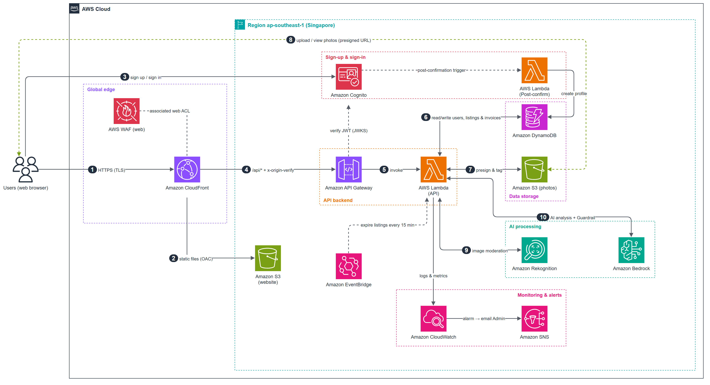

### What You Will Build

**ReLoop** connects device owners with verified repair and recycling partners while screening uploaded device photos with AI so listings stay clean, structured, and accurate. You deploy the entire `reloop2` stack using managed serverless AWS services in **Asia Pacific (Singapore) `ap-southeast-1`**, with global edge protection and delivery through **Amazon CloudFront** and **AWS WAF**.

### Architecture Walkthrough (Following Arrows 1 → 10)

Every section in this workshop maps directly to the numbered arrows and supporting links in the diagram above:

| Step | Arrow in Diagram | What Happens | Built In |
| --- | --- | --- | --- |
| **1** | **Users → CloudFront** (`HTTPS (TLS)`) | Browsers connect over HTTPS to CloudFront. **AWS WAF (`reloop2-web`)** sits attached as an `associated web ACL` to filter bad IPs, common web exploits, and abusive request rates. | [5.3](../5.3-global-edge/) |
| **2** | **CloudFront → S3 (website)** (`static files (OAC)`) | CloudFront fetches the private React SPA files from `reloop2-web-<suffix>` using Origin Access Control (OAC) while rewriting SPA routes inside CloudFront. | [5.3](../5.3-global-edge/) |
| **3** | **Users → Cognito** (`sign up / sign in`) | Users register and sign in against **Amazon Cognito** (`reloop2-user-pool`). On confirmation, Cognito fires the `post-confirmation trigger` to **AWS Lambda (Post-confirm)**, which writes the initial `Owner` profile to DynamoDB (`create profile`). | [5.4](../5.4-sign-up-and-sign-in/) |
| **4** | **CloudFront → API Gateway** (`/api/* + x-origin-verify`) | Requests to `/api/*` strip the `/api` prefix at CloudFront and forward to **Amazon API Gateway** with a shared secret header `x-origin-verify` so direct bypasses are blocked. | [5.5](../5.5-api-backend/) |
| **5** | **API Gateway → Lambda (API)** (`invoke`) | API Gateway checks protected routes against Cognito (`verify JWT (JWKS)`), then invokes **AWS Lambda (`reloop2-api`)** running Node.js 22 on ARM64. | [5.5](../5.5-api-backend/) |
| **6** | **Lambda (API) ↔ DynamoDB** (`read/write users, listings & invoices`) | Lambda reads and writes users, partner profiles, device listings, expiration timers, and monthly fee invoices in one on-demand table (`reloop2-core-table`). | [5.6](../5.6-dynamodb/) |
| **7** | **Lambda (API) ↔ S3 (photos)** (`presign & tag`) | When a seller attaches a device photo, Lambda generates a short-lived presigned upload URL and tags pending objects inside `reloop2-images-<suffix>`. | [5.7](../5.7-s3-photos/) |
| **8** | **Users ↔ S3 (photos)** (`upload / view photos (presigned URL)`) | The browser uploads the photo straight to private S3 and views listing images through short-lived presigned URLs — never proxying image bytes through Lambda. | [5.7](../5.7-s3-photos/) |
| **9** | **Lambda (API) ↔ Rekognition** (`image moderation`) | Lambda calls **Amazon Rekognition** to block unsafe images and extract text from device stickers/labels. | [5.8](../5.8-ai-processing/) |
| **10** | **Lambda (API) ↔ Bedrock** (`AI analysis + Guardrail`) | Lambda screens extracted text with **Amazon Bedrock Guardrail** (`apac.guardrail.v1:0`) and calls **Amazon Bedrock (`global.moonshotai.kimi-k3`)** in `ap-southeast-1` to auto-fill title, category, brand, condition, and visible defects. | [5.8](../5.8-ai-processing/) |

**Background & Operations Links (Unnumbered Dashed Arrows):**

- **EventBridge → Lambda (API)** (`expire listings every 15 min`): Rule `reloop2-sweep` invokes `reloop2-api` every 15 minutes to expire old open listings ([Module 5.9](../5.9-eventbridge/)).
- **Lambda (API) → CloudWatch** (`logs & metrics`) **→ SNS** (`alarm → email Admin`): Structured Lambda logs keep 7-day retention, and the `reloop2-lambda-errors` alarm publishes to SNS topic `reloop2-alerts` to email the admin ([Module 5.10](../5.10-monitoring/)).

### Service Selection Rationale

| Chosen AWS Services | Instead Of | Why Chosen (Cost · Scalability · Availability) |
| --- | --- | --- |
| **API Gateway (HTTP API) + Lambda (`arm64`)** | EC2 / ECS | `$0` when idle, auto-scales to 1,000 concurrency, Multi-AZ HA built in, Graviton `arm64` saves ~20% compute cost. |
| **DynamoDB On-Demand (Single-Table)** | Amazon RDS | Zero 24/7 server bill (~$0.10/month at workshop/dev scale), built-in Multi-AZ replication, native PITR & TTL. |
| **S3 + CloudFront (OAC) + Presigned URLs** | Proxying files through backend | 11 nines (`99.999999999%`) durability, keeps uploads off Lambda, CloudFront Free Tier (1 TB/month), private buckets only. |
| **Cognito + Rekognition + Bedrock (Kimi K3 & Guardrail)** | Self-built Auth / self-hosted GPU models | Fully managed serverless pay-per-use (10,000 free MAU; zero idle GPU cost) with built-in content moderation & Guardrail safety. |

### AWS Well-Architected Framework Alignment

| Pillar | How ReLoop Implements It |
| --- | --- |
| **Operational Excellence** | Modular Terraform IaC ([`madlyham/ReLoop/terraform/`](https://github.com/madlyham/ReLoop/tree/main/terraform)), single CI-verified deployment flow, structured JSON CloudWatch Logs (7-day retention), and Lambda Errors alarm → SNS Admin email alerts. |
| **Security** | CloudFront-attached AWS WAF (3 managed rule groups + 2 per-IP rate limits), private S3 buckets (Block Public Access + OAC + short-lived presigned URLs), `x-origin-verify` secret header blocking direct API Gateway calls, Cognito JWT (`JWKS`) on `ANY /{proxy+}`, separate least-privilege IAM roles, Rekognition + Bedrock Guardrail screening, and zero hardcoded secrets in Git. |
| **Reliability** | Multi-AZ managed serverless stack (CloudFront, API Gateway, Lambda concurrency 1,000, DynamoDB on-demand with 35-day PITR), S3 11-nines (`99.999999999%`) durability, conditional DynamoDB writes & `Idempotency-Key`, EventBridge 15-minute expiry sweeps, and graceful degradation when Bedrock is unavailable (manual form entry still works). |
| **Performance Efficiency** | CloudFront edge caching for SPA assets, ARM64 (Graviton) Node.js 22 Lambda (144 ms avg duration), single-table DynamoDB with `GSI1` & time-bucketed queries (zero table scans), direct browser-to-S3 presigned POST/GET keeping binary uploads off Lambda, and async self-invoke for ~35 s AI analysis. |
| **Cost Optimization** | Serverless pay-per-use staying mostly in Free Tier (`$11.70/month` total including `$10.00` CloudFront WAF; `$1.70/month` without WAF; `< $1.00` same-day workshop run), ARM64 Graviton ~20% compute savings, S3 1-day pending / 90-day retention lifecycle, 7-day CloudWatch retention, 20/user/day AI cap, and documented reverse-order cleanup. |
| **Sustainability** *(Checklist note)* | Serverless scale-to-zero compute eliminates idle 24/7 servers; ARM64 Graviton processors improve performance-per-watt; S3 lifecycle rules and 7-day log retention minimize unneeded storage. |

### Security Highlights

| Graph Area | Protection Built |
| --- | --- |
| **Global edge** | AWS WAF (`reloop2-web`, CloudFront scope) with 100 req/min public-API rate limit, 1,000 req/min global IP limit, IP Reputation, Known Bad Inputs, and Common Rule Set |
| **Origin isolation** | Both S3 buckets have Block Public Access ON (`reloop2-web` OAC-only, `reloop2-images` presigned-only); `reloop2-api` rejects any request missing the CloudFront `x-origin-verify` secret header |
| **Identity** | Cognito Essentials User Pool with password rules, email verification, deletion protection `ACTIVE`, Auth Code PKCE, and JWT verification (`JWKS`) on API Gateway `ANY /{proxy+}` |
| **AI safety** | Rekognition image moderation + Bedrock Guardrail (`STANDARD` tier, `HIGH` filters on Violence, Hate, Sexual, Insults, Misconduct, and Prompt Attack) |
| **Least-privilege IAM** | Two separate Lambda roles (`reloop2-post-confirmation-role` and `reloop2-api-lambda-role`) scoped strictly to `reloop2-core-table`, `listings/*`, and required AI/logging actions |

### Workshop Cost Estimate

Completing Modules **5.2–5.11** and tearing down in Module **5.12** the same day stays under **$1.00 USD**:

| Service | Workshop Usage | Estimated Same-Day Cost |
| --- | --- | --- |
| **Amazon CloudFront & S3** | Two private buckets (<20 MB), <1 GB transfer | $0.00 (Free Tier) |
| **AWS WAFv2** | **1 Web ACL (`reloop2-web`)** + 5 rules, prorated for ~1 day | ~$0.35 (or ~$10/mo if left running 30 days) |
| **Amazon Cognito** | Essentials tier, 1–5 test accounts | $0.00 (Free Tier: 10,000 MAU) |
| **API Gateway & Lambda** | ~100 invocations, 512 MB ARM64 | $0.00 (Free Tier) |
| **Amazon DynamoDB** | On-demand reads/writes (<5 MB, PITR) | ~$0.01 |
| **Rekognition & Bedrock** | Test moderation + Guardrail + Kimi K3 calls | ~$0.05–$0.25 |
| **EventBridge, CloudWatch & SNS** | 1 rule, 2 log groups, 1 metric alarm, 1 SNS topic | $0.00 (Free Tier) |
| **Total (built & cleaned up same day)** | Full E2E run + Module 5.12 cleanup | **< $1.00 USD** |

You can reproduce ongoing estimates in the **[AWS Pricing Calculator](https://calculator.aws/)** or inspect the full monthly line-by-line breakdown in **[reloop-cost-estimate.csv](/files/2-proposal/reloop-cost-estimate.csv)** (**11.70 USD/month** ongoing with CloudFront WAF / **1.70 USD/month** without WAF; **< 1.00 USD** for a same-day workshop run).

#### Operational Cost Optimization

- **Free Tier & Scale-to-Zero Serverless:** Core compute (Lambda), global delivery (CloudFront), authentication (Cognito up to 10,000 MAU), EventBridge, CloudWatch, and SNS stay within AWS Free Tier and bill `$0` when idle.
- **ARM64 (Graviton) Compute:** Running `reloop2-api` on `arm64` saves ~20% on Lambda compute cost compared with `x86_64`.
- **Automated Storage & Log Lifecycles:** S3 lifecycle rules delete unattached `pending` photos after 1 day and expire listing photos after 90 days, while CloudWatch Logs automatically expire after 7 days.
- **Per-User AI Quota Cap:** A hard backend quota limits Amazon Bedrock analyses to **20 calls/user/day**, capping variable generative-AI spend.
- **Immediate Module 5.12 Teardown for WAF:** Deleting the CloudFront AWS WAFv2 Web ACL in [Module 5.12](../5.12-cleanup-and-iac/) right after verification eliminates the fixed `$10.00/month` Web ACL + 5-rule charge.

{}
An AWS WAFv2 Web ACL bills **$5/month + $1/month per rule** continuously even with zero traffic. Complete [Module 5.12](../5.12-cleanup-and-iac/) right after finishing [Module 5.11](../5.11-end-to-end-verification/) so no ongoing charges remain.
{}
