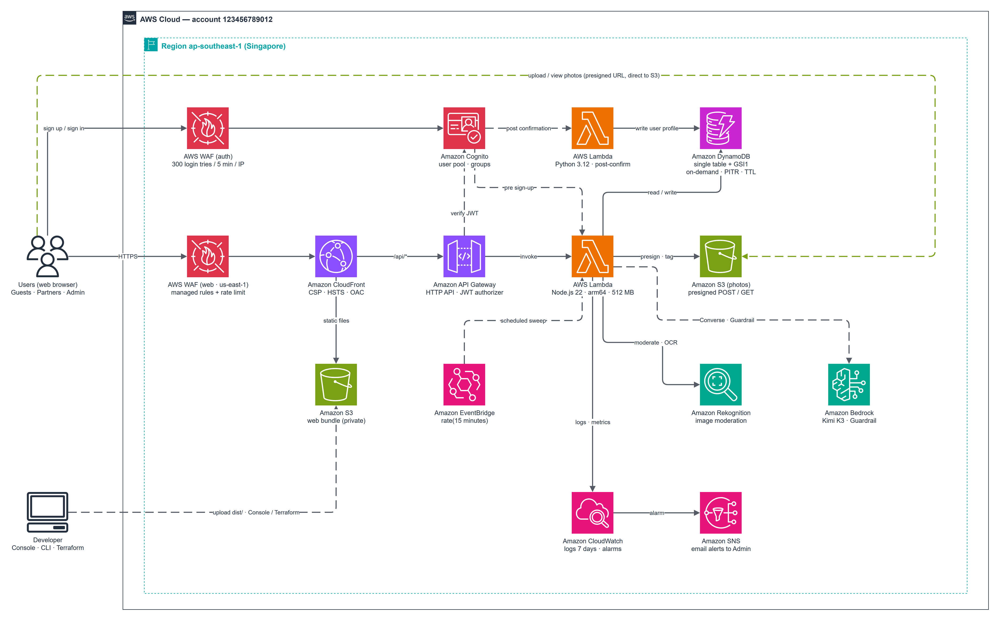

### What You Will Build

**ReLoop** connects device owners with verified repair and recycling partners while screening uploaded device photos with multimodal AI so listings stay clean, structured, and accurate. In this workshop you deploy the complete `reloop2` stack using strictly serverless AWS services—zero EC2 instances, zero NAT Gateways, and pay-per-request scaling down to near zero when idle.

### End-to-End Request Flows

1. **Static Web Delivery (`/`, all SPA routes):** Browser connects over HTTPS -> Edge WAF (`reloop2-web` in `us-east-1`) -> CloudFront Distribution (`PriceClass_200`) -> CloudFront Function `reloop2-spa-rewrite` rewrites extensionless routes to `/index.html` while keeping dotted chat URLs (`<partnerId>.<listingId>`) intact -> private S3 web bucket via Origin Access Control (OAC).
2. **API & Authentication Calls (`/api/*`):** Browser calls CloudFront `/api/*` -> CloudFront Function `reloop2-api-prefix` strips the `/api` prefix -> CloudFront forwards to HTTP API Gateway (`reloop2-api` in `ap-southeast-1`) injecting a shared secret header `x-origin-verify` -> API Gateway verifies JWT against Cognito (`ANY /{proxy+}`) or passes public routes -> Lambda (`reloop2-api`, Node.js 22 ARM64) validates `x-origin-verify` with `timingSafeEqual` and reads/writes DynamoDB.
3. **Direct Browser Image Upload & AI Analysis:** Authenticated user requests a presigned upload from Lambda -> Browser uploads photo straight to private S3 bucket (`reloop2-images-<suffix>`) tagged `state=pending` -> On listing inspection, Lambda invokes **Amazon Rekognition** (`DetectModerationLabels` + `DetectText` OCR) -> screens extracted text with **Amazon Bedrock Guardrail** (`ApplyGuardrailCommand`) -> invokes **Amazon Bedrock (`global.moonshotai.kimi-k3`)** `ConverseCommand` to return structured device fields (`title`, `category`, `brand`, `model`, `condition`, defect description).
4. **Scheduled Maintenance & Alerts:** Every 15 minutes, Amazon EventBridge rule `reloop2-sweep` invokes `reloop2-api` to expire 7-day open listings, issue 24-hour pickup reminders, and auto-complete 48-hour handoffs. CloudWatch Logs (7-day retention), a custom metric filter (`UnhandledErrors`), two CloudWatch metric alarms, SNS email alerts, and `ReLoop2-Backend-Health` provide live operational visibility.

### Security Highlights

| Layer | Protection Mechanism |
| --- | --- |
| **Edge Network** | `reloop2-web` WAFv2 (CloudFront, `us-east-1`): 100 req/min rate limit on public endpoints, 1,000 req/min global IP ceiling, AWS IP Reputation List, Known Bad Inputs, Common Rule Set |
| **Browser Headers** | CloudFront Response Headers Policy (`reloop2-security-headers`): HSTS (`max-age=31536000`), `X-Frame-Options: DENY`, `X-Content-Type-Options: nosniff`, `Referrer-Policy: strict-origin-when-cross-origin`, enforced `frame-ancestors 'none'` + CSP-Report-Only |
| **Origin Protection** | Both S3 buckets have Block Public Access ON (`s3-web` OAC-only, `s3-images` presigned-only); Lambda rejects any API request missing matching `x-origin-verify` header |
| **Identity** | Cognito User Pool protected by regional WAF `reloop2-auth` (`ap-southeast-1`, 300 auth calls / 5 min / IP), Pre-SignUp duplicate email guard, Deletion Protection `ACTIVE`, Auth Code PKCE |
| **Least Privilege IAM** | Separate Lambda execution roles (`reloop2-post-confirmation-role` and `reloop2-api-lambda-role`) scoped to explicit table ARNs, `listings/*` prefix, and required AI actions |

### Workshop Cost Estimate

Running the entire workshop from build through live E2E verification takes roughly **2–3 hours** and is followed by a clean teardown in Module **5.13**:

| Service | Usage During Workshop | Estimated Cost |
| --- | --- | --- |
| **DynamoDB** | On-demand reads/writes (<5 MB stored, PITR) | ~$0.01 (Free Tier covers most) |
| **S3** | Two private buckets, <20 MB assets & test photos | <$0.01 |
| **Lambda & HTTP API Gateway** | ~100–300 invocations, 512 MB ARM64 | $0.00 (Free Tier) |
| **Cognito** | Essentials tier, 1–5 test users | $0.00 (Free Tier: 10,000 MAU) |
| **CloudFront** | <1 GB transfer, 2 CloudFront Functions | $0.00 (Free Tier: 1 TB/mo) |
| **AWS WAFv2** | 2 Web ACLs x 7 rules prorated for ~1 day + 1K requests | ~$0.25–$0.50 (or ~$12/mo if left running 30 days!) |
| **Bedrock & Rekognition** | ~5–15 test image moderations + Kimi K3 calls | ~$0.05–$0.30 |
| **Total for Workshop** | Built, verified E2E, and deleted same day | **< $1.00 USD** |

{}
AWS WAFv2 Web ACLs charge **$5/month per ACL + $1/month per rule** continuously even with zero traffic. Complete Module **5.13** right after finishing Module **5.12** so your monthly bill remains minimal.
{}

### Repository & IaC Reference

All resources built manually in Modules **5.2–5.11** are also captured as tested, modular Terraform configurations in the repository's `terraform/` directory (`71/71` resources verified via import against the live stack with `0 to destroy`). See [Module 5.13](../5.13-cleanup-and-iac/) for usage details.
