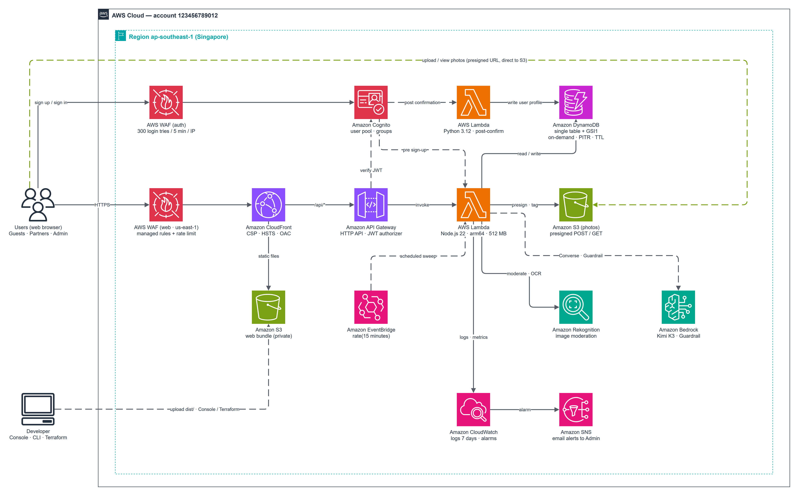

### Mục tiêu bài thực hành

**ReLoop** là nền tảng kết nối chủ sở hữu thiết bị điện tử cũ/hỏng với các đối tác thu mua và sửa chữa đã xác minh, sử dụng AI đa phương thức để sàng lọc ảnh và tự động điền thông tin tin đăng. Trong bài thực hành này, bạn tự tay triển khai toàn bộ hệ thống `reloop2` hoàn toàn bằng dịch vụ serverless của AWS—không máy chủ EC2, không NAT Gateway, chi phí bằng 0 khi không có lưu lượng sau khi dọn dẹp.

### Luồng xử lý chính (Request Flows)

1. **Phân phối Web SPA tĩnh (`/` và mọi route giao diện):** Trình duyệt gửi HTTPS -> Edge WAF (`reloop2-web` tại `us-east-1`) -> CloudFront Distribution (`PriceClass_200`) -> CloudFront Function `reloop2-spa-rewrite` viết lại các route không có đuôi file thành `/index.html` (đồng thời giữ nguyên các URL chat có dấu chấm dạng `<partnerId>.<listingId>`) -> bucket S3 web riêng tư qua Origin Access Control (OAC).
2. **Giao tiếp API & Xác thực (`/api/*`):** Trình duyệt gọi cùng domain CloudFront `/api/*` -> CloudFront Function `reloop2-api-prefix` cắt tiền tố `/api` -> chuyển tiếp tới HTTP API Gateway (`reloop2-api` tại `ap-southeast-1`) kèm header bí mật `x-origin-verify` -> API Gateway xác thực JWT từ Cognito (`ANY /{proxy+}`) hoặc cho qua các route công khai -> Lambda `reloop2-api` (Node.js 22 ARM64) kiểm tra `x-origin-verify` bằng `timingSafeEqual` và truy vấn DynamoDB.
3. **Upload ảnh trực tiếp & Phân tích AI:** Người dùng xin presigned URL từ Lambda -> tải ảnh thẳng lên bucket riêng tư `reloop2-images-<suffix>` với tag `state=pending` -> Khi bấm gợi ý AI, Lambda gọi **Amazon Rekognition** (`DetectModerationLabels` + `DetectText` OCR) -> kiểm duyệt chữ đọc được bằng **Amazon Bedrock Guardrail** (`ApplyGuardrailCommand`) -> gọi **Amazon Bedrock (`global.moonshotai.kimi-k3`)** `ConverseCommand` để trả về JSON gợi ý tiêu đề, loại thiết bị, hãng, model, tình trạng và mô tả lỗi.
4. **Tác vụ định kỳ & Giám sát:** Mỗi 15 phút, Amazon EventBridge rule `reloop2-sweep` kích hoạt `reloop2-api` để hết hạn tin sau 7 ngày, nhắc lịch nhận máy sau 24 giờ và tự hoàn tất sau 48 giờ. CloudWatch Logs (lưu 7 ngày), metric filter `UnhandledErrors`, 2 CloudWatch Alarms, SNS email và Dashboard `ReLoop2-Backend-Health` giúp theo dõi sức khỏe hệ thống theo thời gian thực.

### Các lớp bảo mật trọng tâm

| Tầng | Cơ chế bảo vệ đã áp dụng |
| --- | --- |
| **Biên mạng (Edge)** | `reloop2-web` WAFv2 (CloudFront, `us-east-1`): giới hạn 100 req/phút cho public API, 1.000 req/phút mỗi IP, bộ rule IP uy tín AWS, Known Bad Inputs, Common Rule Set |
| **Header trình duyệt** | CloudFront Response Headers Policy `reloop2-security-headers`: HSTS 1 năm, `X-Frame-Options: DENY`, `X-Content-Type-Options: nosniff`, `Referrer-Policy`, bật `frame-ancestors 'none'` + CSP-Report-Only |
| **Bảo vệ Origin** | Cả hai bucket S3 đều bật Block All Public Access (`s3-web` chỉ qua OAC, `s3-images` chỉ qua presigned URL); Lambda từ chối mọi yêu cầu thiếu `x-origin-verify` hợp lệ |
| **Danh tính (Identity)** | Cognito User Pool gắn Regional WAF `reloop2-auth` (`ap-southeast-1`, 300 lượt auth / 5 phút / IP), Pre-SignUp chặn trùng email, Deletion Protection `ACTIVE`, Auth Code PKCE |
| **IAM tối thiểu (Least Privilege)** | Tách riêng role cho `reloop2-post-confirmation` và `reloop2-api`, giới hạn đúng ARN bảng DynamoDB, tiền tố `listings/*` và quyền AI cần thiết |

### Ước tính chi phí thực hành

| Dịch vụ | Mức sử dụng khi chạy Workshop | Chi phí ước tính |
| --- | --- | --- |
| **DynamoDB** | On-demand (<5 MB dữ liệu, bật PITR) | ~$0.01 (nằm trong Free Tier) |
| **S3** | 2 bucket riêng tư, <20 MB web bundle & ảnh test | <$0.01 |
| **Lambda & HTTP API Gateway** | ~100–300 lượt gọi, 512 MB ARM64 | $0.00 (Free Tier) |
| **Cognito** | Essentials tier, 1–5 tài khoản thử nghiệm | $0.00 (Free Tier 10.000 MAU) |
| **CloudFront** | <1 GB băng thông, 2 CloudFront Functions | $0.00 (Free Tier 1 TB/tháng) |
| **AWS WAFv2** | 2 Web ACL x 7 rule chạy khoảng 1 ngày + ~1.000 request | ~$0.25–$0.50 (nếu để cả tháng ~ $12/tháng!) |
| **Bedrock & Rekognition** | ~5–15 ảnh test kiểm duyệt + gọi Kimi K3 | ~$0.05–$0.30 |
| **Tổng chi phí trọn bài** | Triển khai, test E2E và dọn dẹp trong ngày | **< $1.00 USD** |

{}
AWS WAFv2 tính phí cố định theo giờ (**$5/tháng mỗi Web ACL + $1/tháng mỗi rule**) ngay cả khi không có lưu lượng. Hãy thực hiện ngay Phần **5.13** sau khi test xong Phần **5.12** để tránh phát sinh chi phí tháng.
{}

### Tài nguyên Terraform tham chiếu

Toàn bộ tài nguyên bạn tạo thủ công ở Phần **5.2–5.11** đều đã được viết thành bộ Terraform sạch tại thư mục `terraform/` của kho mã (đã kiểm chứng import khớp `71/71` tài nguyên và `0 to destroy` với hệ thống chạy thực tế). Xem hướng dẫn chi tiết ở [Phần 5.13](../5.13-cleanup-and-iac/).
