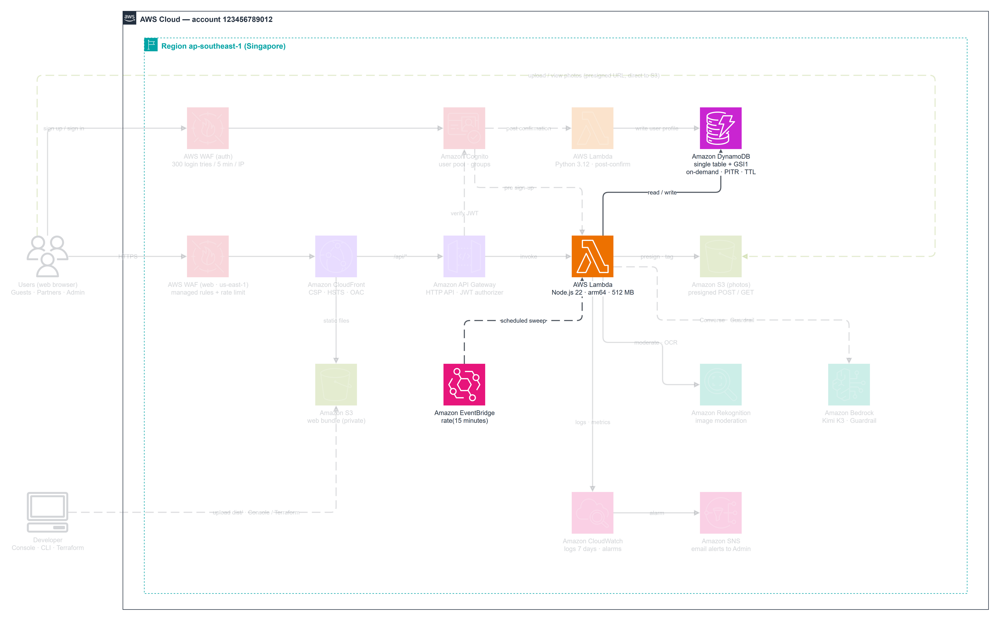
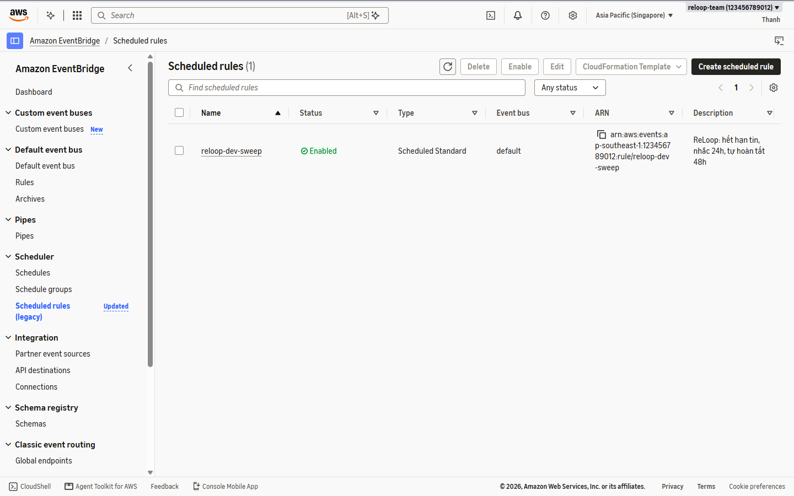
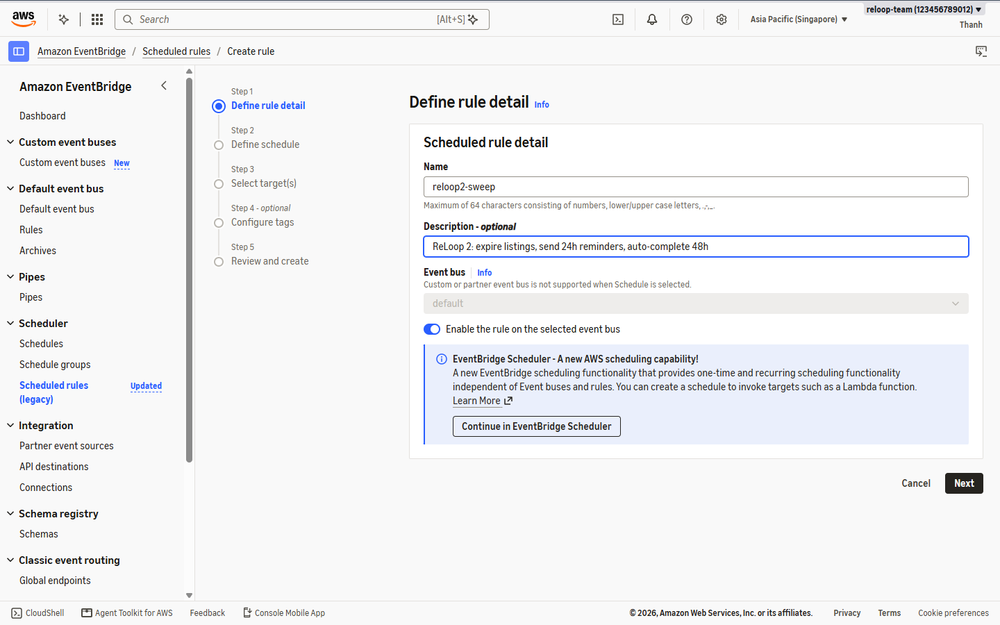
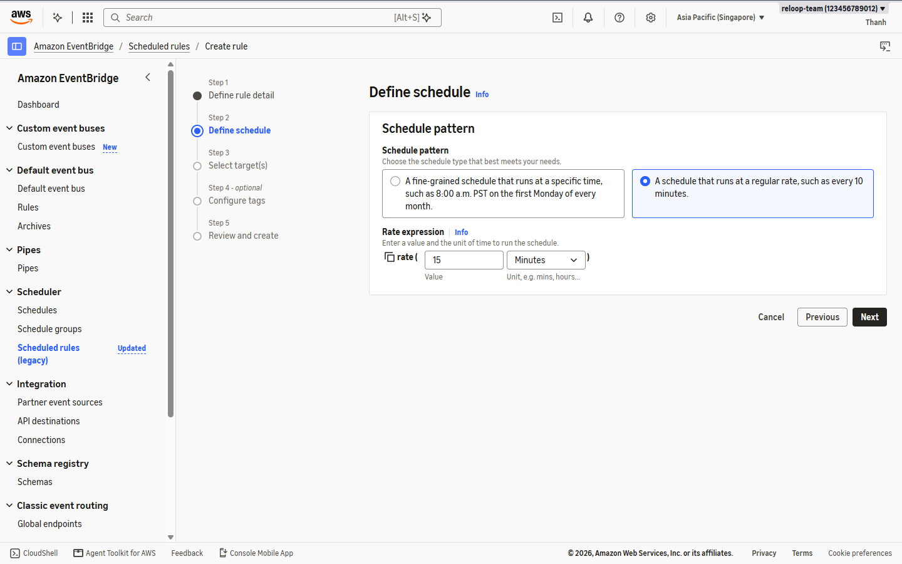
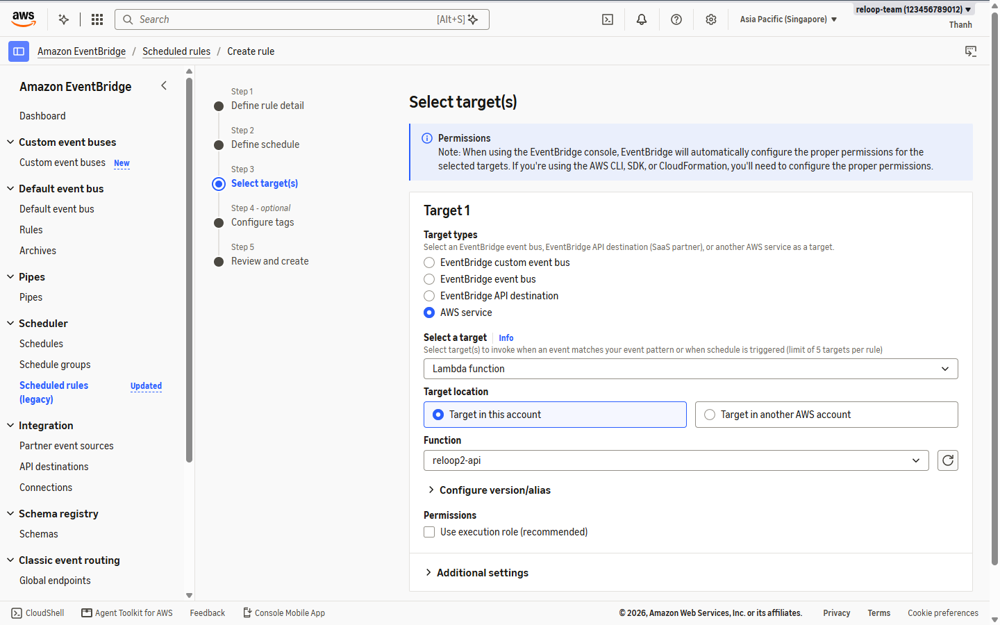
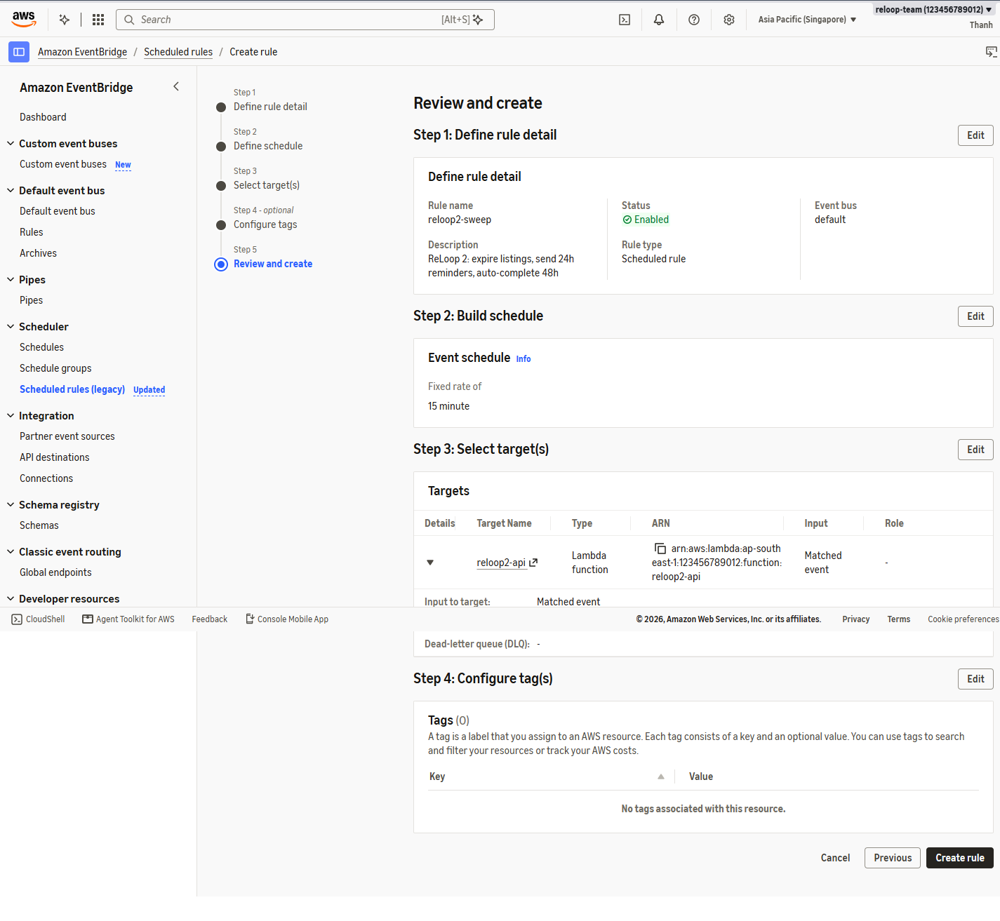
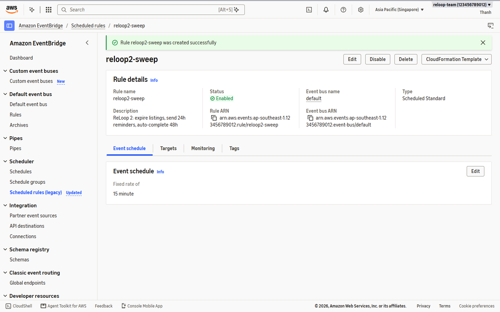
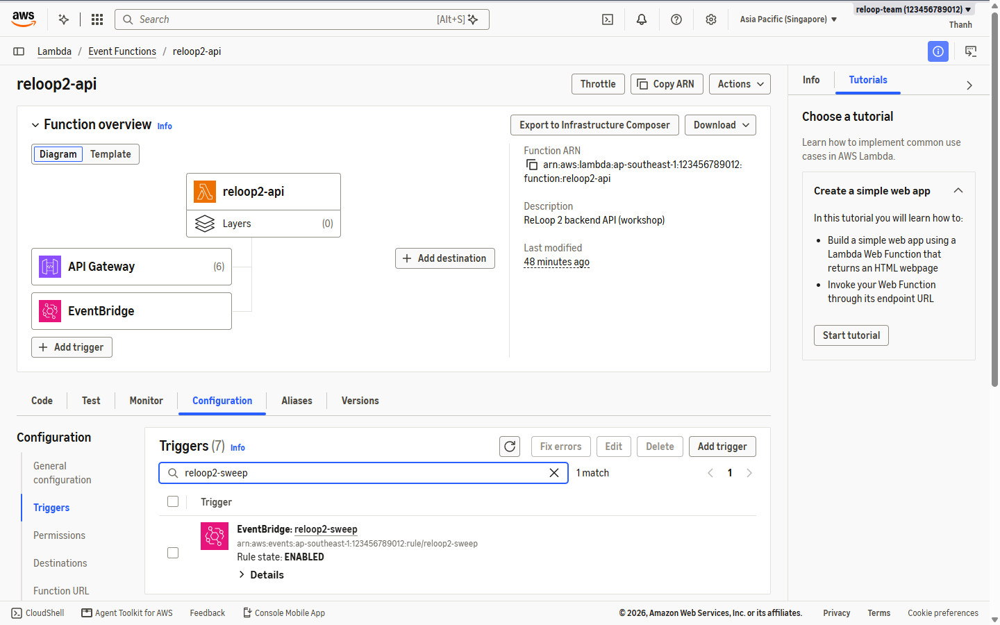

ReLoop runs scheduled maintenance inside the same `reloop2-api` Lambda every **15 minutes** without extra servers or SQS queues: closing expired 7-day listings, dispatching 24-hour pickup reminders, and auto-completing unconfirmed 48-hour handoffs using `TIMER#<timestamp>` items stored in `reloop2-core-table`.

---

### Step 1 — Create Scheduled Rule `reloop2-sweep`

1. In **`ap-southeast-1`**, open **Amazon EventBridge -> Rules** (`default` bus) and click **Create rule**.

2. Configure **Define rule detail**:
   - **Name:** `reloop2-sweep`
   - **Description:** `ReLoop 2: expire listings, send 24h reminders, auto-complete 48h`
   - **Event bus:** `default`
   - **Rule type:** **Schedule** -> continue in EventBridge Rule (`rate(15 minutes)` standard scheduled rule).

3. Set **Schedule pattern**:
   - **Schedule pattern:** Rate-based schedule -> **`15` Minutes** (`rate(15 minutes)`)

4. Under **Select target(s)**:
   - **Target type:** AWS service
   - **Select a target:** **Lambda function**
   - **Function:** `reloop2-api`

5. Review and click **Create rule**, then confirm `reloop2-sweep` shows **Enabled**.

6. Open **AWS Lambda -> `reloop2-api` -> Configuration -> Triggers** to verify EventBridge automatically appears as an active trigger backed by a resource policy from `events.amazonaws.com`.

