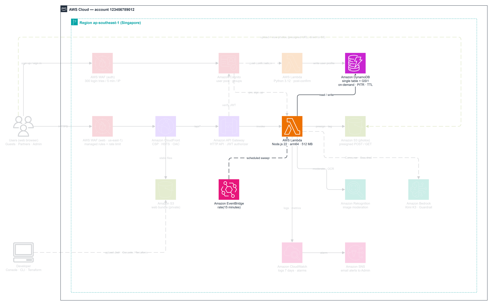
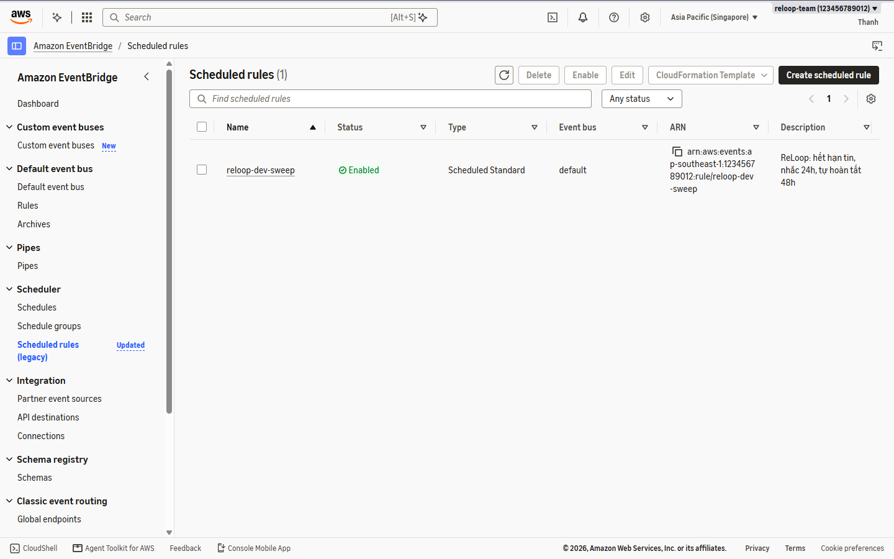
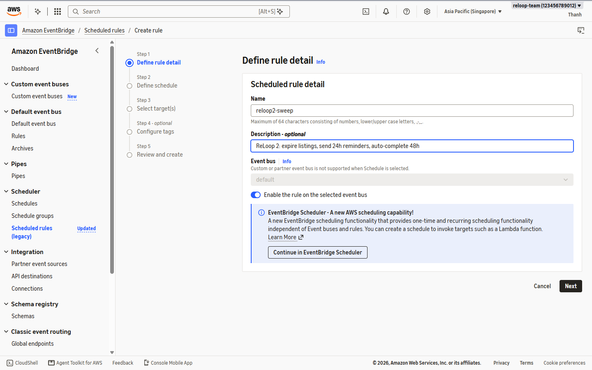
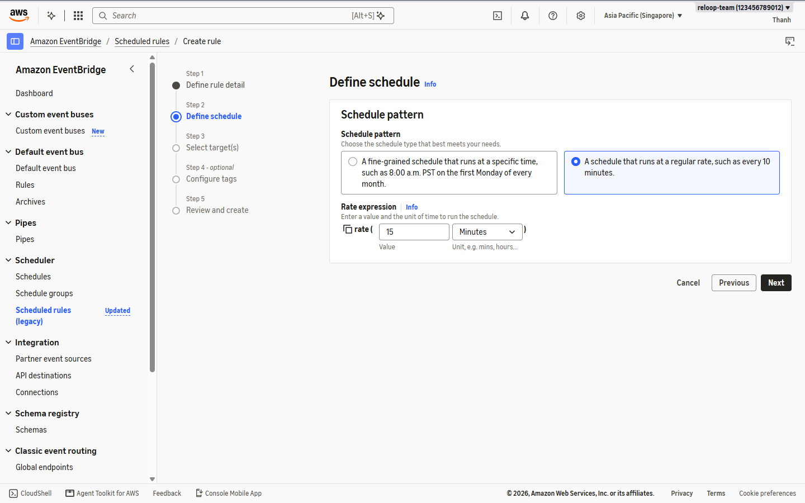
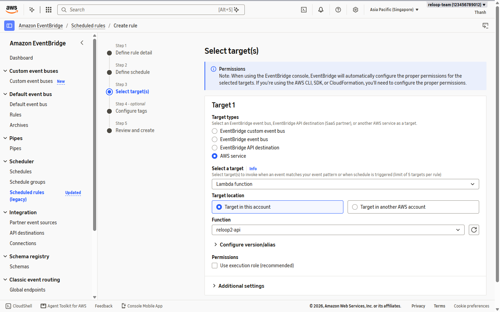
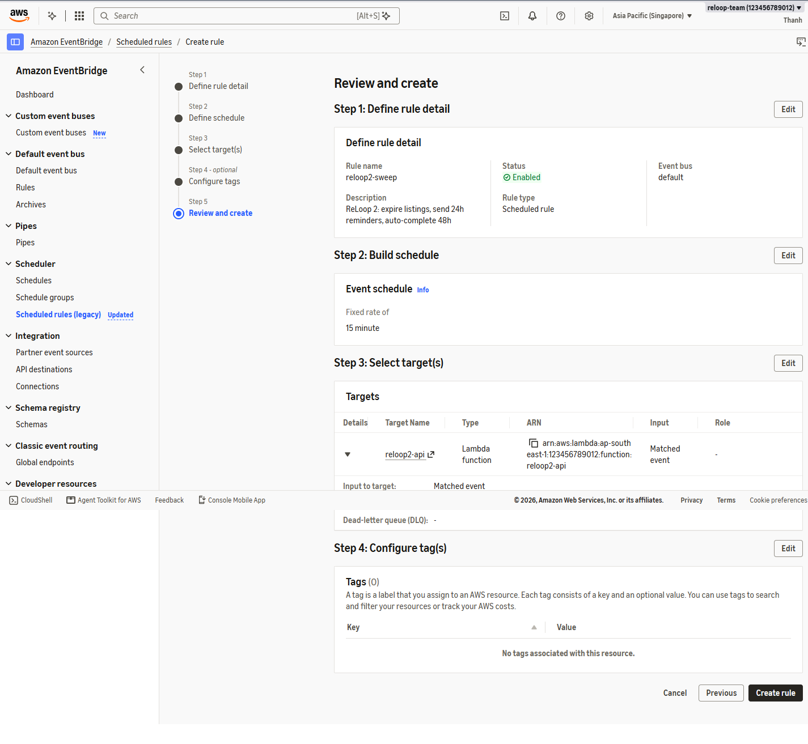
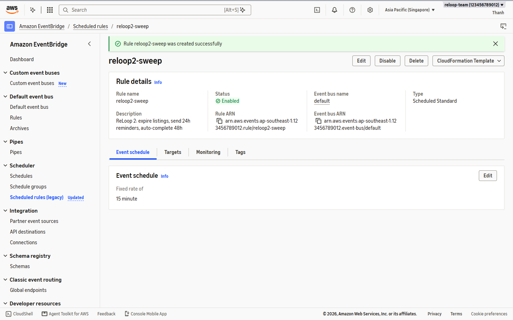
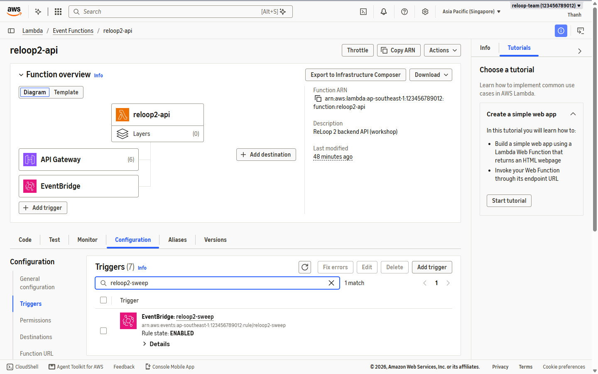

ReLoop thực thi bảo trì định kỳ **15 phút một lần** ngay trong hàm Lambda `reloop2-api`: đóng các tin đăng quá 7 ngày, gửi nhắc nhở lịch hẹn 24h và tự động hoàn tất giao dịch quá 48h dựa trên các bản ghi `TIMER#<timestamp>` lưu trong `reloop2-core-table`.

---

### Bước 1 — Tạo Scheduled Rule `reloop2-sweep`

1. Tại **`ap-southeast-1`**, mở **Amazon EventBridge -> Rules** (Event bus `default`), bấm **Create rule**.

2. Điền thông tin chi tiết:
   - **Name:** `reloop2-sweep`
   - **Description:** `ReLoop 2: expire listings, send 24h reminders, auto-complete 48h`
   - **Rule type:** **Schedule** -> chọn tiếp tục bằng standard scheduled rule.

3. Đặt lịch **Schedule pattern** chạy cố định mỗi **`15` phút** (`rate(15 minutes)`).

4. Ở bước **Select target(s)**, chọn **AWS service -> Lambda function -> `reloop2-api`**.

5. Kiểm tra lại thông số và bấm **Create rule**, xác nhận trạng thái **Enabled**.

6. Mở **Lambda -> `reloop2-api` -> Configuration -> Triggers** để kiểm tra trigger EventBridge đã tự gắn thành công (kèm quyền gọi từ `events.amazonaws.com`).

