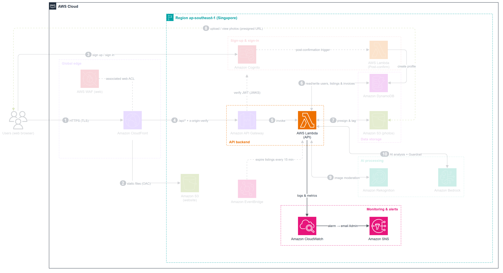
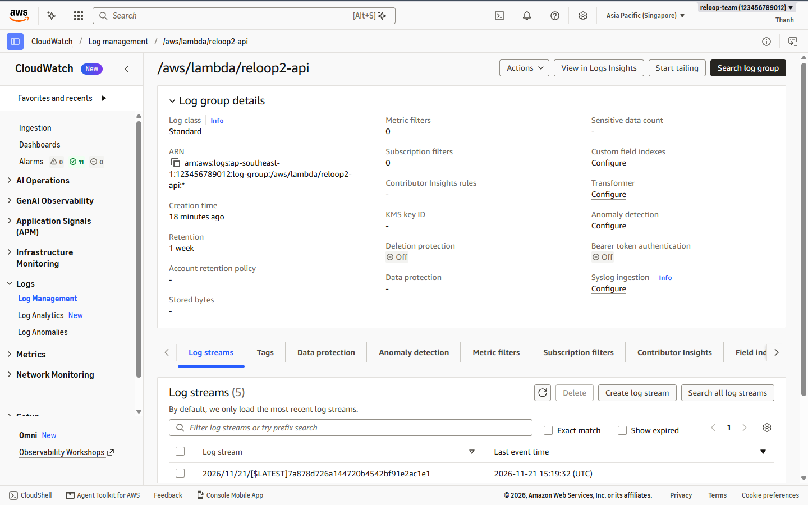
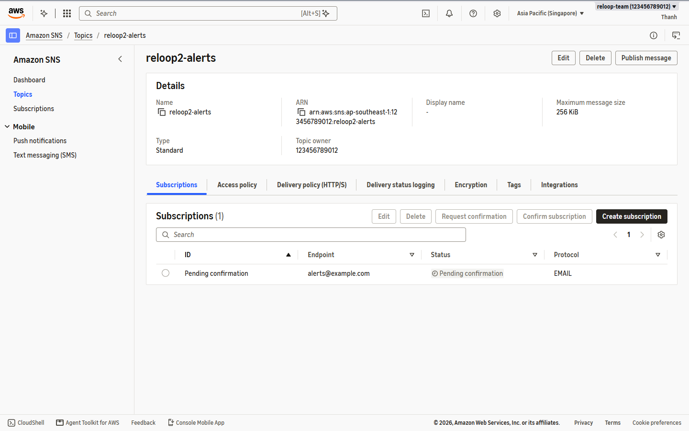
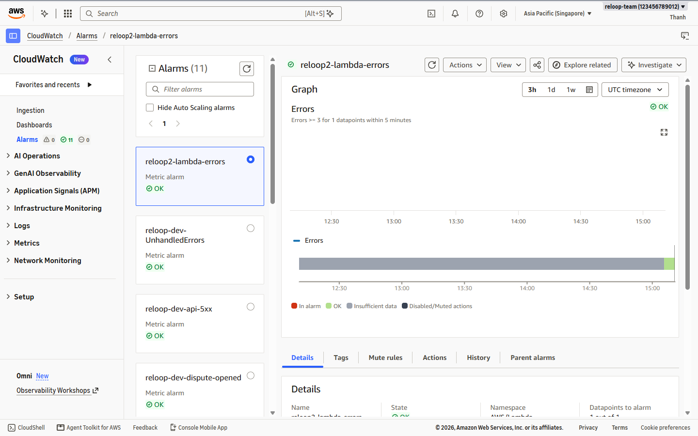

Complete the pink **Monitoring & alerts** box at the bottom of the diagram: configure 7-day log retention on `/aws/lambda/reloop2-api`, create an **Amazon SNS** email topic for admin alerts, and connect a **CloudWatch metric alarm** (`reloop2-lambda-errors`) that fires whenever `reloop2-api` encounters errors.

**Graph arrows covered in this step:**
- **Supporting link:** `AWS Lambda (API) → Amazon CloudWatch` (`logs & metrics`)
- **Supporting link:** `Amazon CloudWatch → Amazon SNS` (`alarm → email Admin`)

---

### Step 1 — Set 7-Day Retention on Lambda Log Group (`logs & metrics`)

1. Open **Amazon CloudWatch -> Logs -> Log Management** in **`ap-southeast-1`**.
2. Open **`/aws/lambda/reloop2-api`** (create it first if `reloop2-api` has not run yet) -> **Actions -> Edit retention setting** -> select **`1 week (7 days)`** -> **Save**. *(Optionally set the same 7-day retention on **`/aws/lambda/reloop2-post-confirmation`** to match the Terraform IaC.)*

---

### Step 2 — Create SNS Alert Topic & Admin Email Subscription (`email Admin`)

1. Open **Amazon SNS -> Topics -> Create topic** in **`ap-southeast-1`**:
   - **Type:** `Standard`
   - **Name:** `reloop2-alerts`
   - **Tag:** `Project = reloop2`
2. Open `reloop2-alerts` -> **Create subscription**:
   - **Protocol:** `Email`
   - **Endpoint:** Your admin email address (shown here as sanitized placeholder `alerts@example.com`).
3. Confirm the subscription link sent to your inbox so alarms deliver immediately.

---

### Step 3 — Create CloudWatch Alarm `reloop2-lambda-errors` (`alarm → email Admin`)

1. Open **Amazon CloudWatch -> Alarms -> All alarms -> Create alarm** in **`ap-southeast-1`**.
2. Select metric **`AWS/Lambda` -> `By Function Name` -> `reloop2-api` -> `Errors`**.
   *(If `reloop2-api` is not yet listed under `AWS/Lambda -> By Function Name`, trigger one quick request — e.g., open `https://<dist-domain>.cloudfront.net/feed` or run a Lambda test event — and refresh after ~1 minute.)*
3. Configure conditions:
   - **Statistic:** `Sum` · **Period:** `5 minutes` (`300s`)
   - **Threshold:** `Static` -> `Greater/Equal` -> **`3`**
   - **Datapoints to alarm:** `1 out of 1`
   - **Missing data treatment:** `Treat missing data as good (not breaching)`
4. Under **Notification**, trigger **In alarm** -> select existing SNS topic **`reloop2-alerts`**.
5. Set **Alarm name:** **`reloop2-lambda-errors`** -> click **Create alarm**.

{}
**Every single component and arrow on the architecture diagram is now deployed.** Proceed to [Module 5.11 — End-to-End Verification](../5.11-end-to-end-verification/) to prove Arrows **1 → 10**, EventBridge, and CloudWatch/SNS live.
{}
