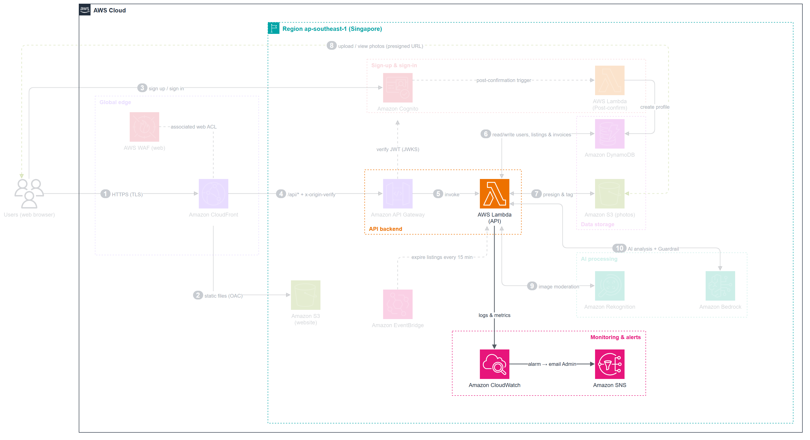
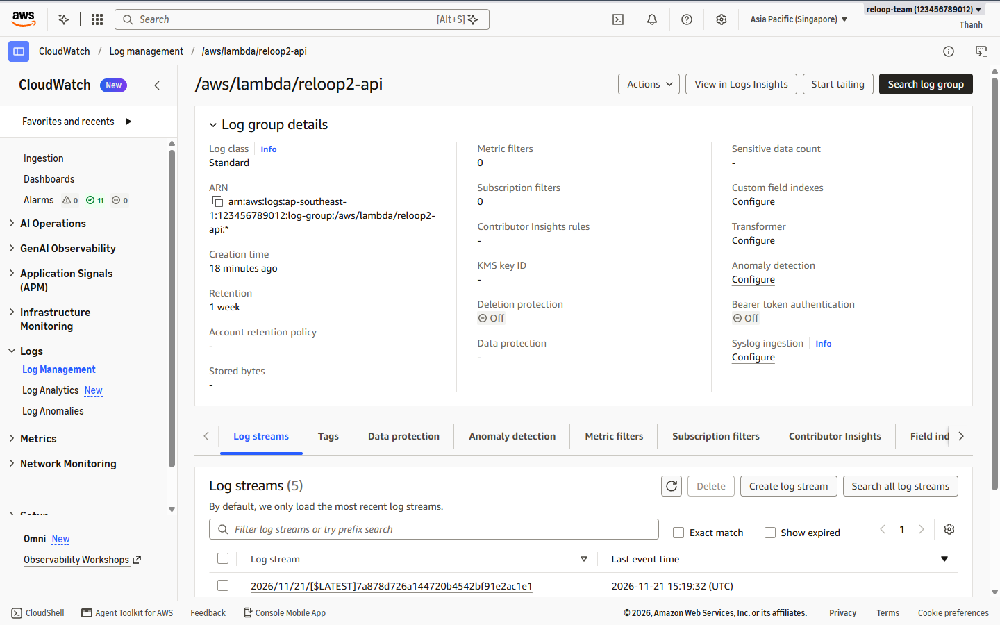
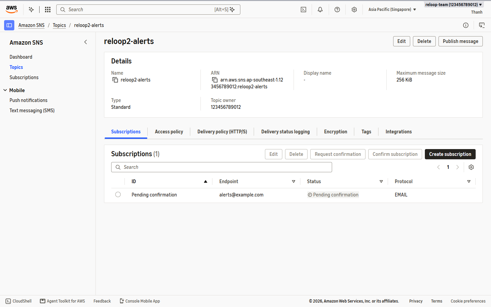
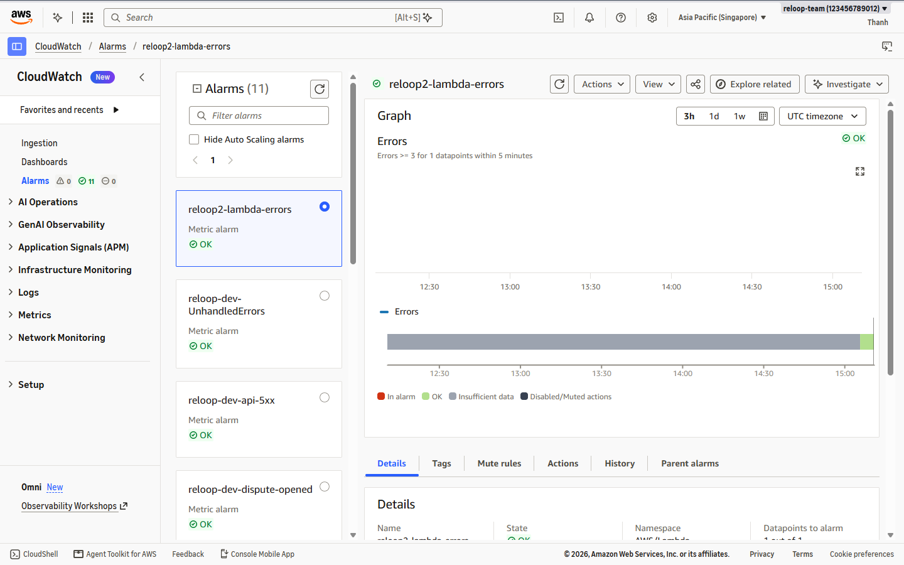

Hoàn thiện khối màu hồng **Monitoring & alerts** ở dưới cùng sơ đồ: đặt thời hạn lưu nhật ký 7 ngày cho `/aws/lambda/reloop2-api`, tạo chủ đề email **Amazon SNS** cho quản trị viên, và nối **CloudWatch metric alarm** (`reloop2-lambda-errors`) để gửi cảnh báo ngay khi `reloop2-api` phát sinh lỗi.

**Các mũi tên trên sơ đồ thuộc bước này:**
- **Liên kết phụ:** `AWS Lambda (API) → Amazon CloudWatch` (`logs & metrics`)
- **Liên kết phụ:** `Amazon CloudWatch → Amazon SNS` (`alarm → email Admin`)

---

### Bước 1 — Đặt lưu giữ 7 ngày cho Log Group của Lambda (`logs & metrics`)

1. Mở **Amazon CloudWatch -> Logs -> Log Management** tại **`ap-southeast-1`**.
2. Mở **`/aws/lambda/reloop2-api`** (tạo trước nếu `reloop2-api` chưa từng chạy) -> **Actions -> Edit retention setting** -> chọn **`1 week (7 days)`** -> **Save**. *(Tùy chọn đặt cùng mức lưu giữ 7 ngày cho **`/aws/lambda/reloop2-post-confirmation`** để khớp với Terraform IaC.)*

---

### Bước 2 — Tạo chủ đề SNS & Đăng ký email Admin (`email Admin`)

1. Mở **Amazon SNS -> Topics -> Create topic** tại **`ap-southeast-1`**:
   - **Type:** `Standard`
   - **Name:** `reloop2-alerts`
   - **Tag:** `Project = reloop2`
2. Mở `reloop2-alerts` -> **Create subscription**:
   - **Protocol:** `Email`
   - **Endpoint:** Địa chỉ email quản trị viên của bạn (hiển thị dạng mẫu ẩn danh `alerts@example.com`).
3. Mở email xác nhận từ AWS trong hộp thư và nhấn liên kết Confirm subscription để bắt đầu nhận cảnh báo.

---

### Bước 3 — Tạo cảnh báo CloudWatch `reloop2-lambda-errors` (`alarm → email Admin`)

1. Mở **Amazon CloudWatch -> Alarms -> All alarms -> Create alarm** tại **`ap-southeast-1`**.
2. Chọn chỉ số **`AWS/Lambda` -> `By Function Name` -> `reloop2-api` -> `Errors`**.
   *(Nếu chưa thấy `reloop2-api` trong `AWS/Lambda -> By Function Name`, hãy gửi nhanh một yêu cầu — ví dụ mở `https://<dist-domain>.cloudfront.net/feed` hoặc chạy một Lambda test event — rồi làm mới sau khoảng 1 phút.)*
3. Cấu hình điều kiện:
   - **Statistic:** `Sum` · **Period:** `5 minutes` (`300s`)
   - **Threshold:** `Static` -> `Greater/Equal` -> **`3`**
   - **Datapoints to alarm:** `1 out of 1`
   - **Missing data treatment:** `Treat missing data as good (not breaching)`
4. Ở mục **Notification**, chọn kích hoạt khi **In alarm** -> chọn chủ đề SNS **`reloop2-alerts`**.
5. Đặt **Alarm name:** **`reloop2-lambda-errors`** -> nhấn **Create alarm**.

{}
**Toàn bộ thành phần và mũi tên trên sơ đồ kiến trúc đã được triển khai.** Chuyển sang [Học phần 5.11 — Kiểm thử toàn luồng thực tế](../5.11-end-to-end-verification/) để xác minh trực tiếp **Mũi tên 1 → 10**, EventBridge và CloudWatch/SNS.
{}
