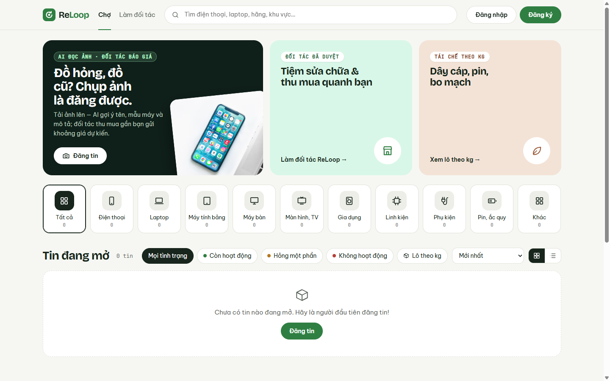
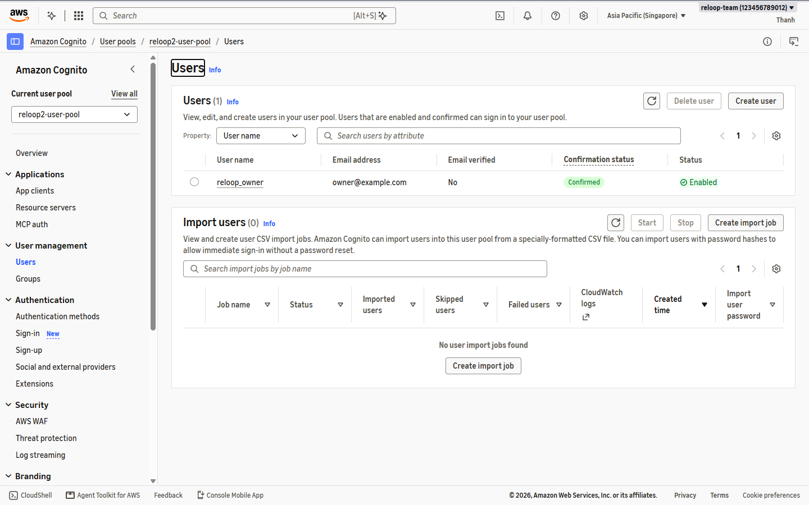
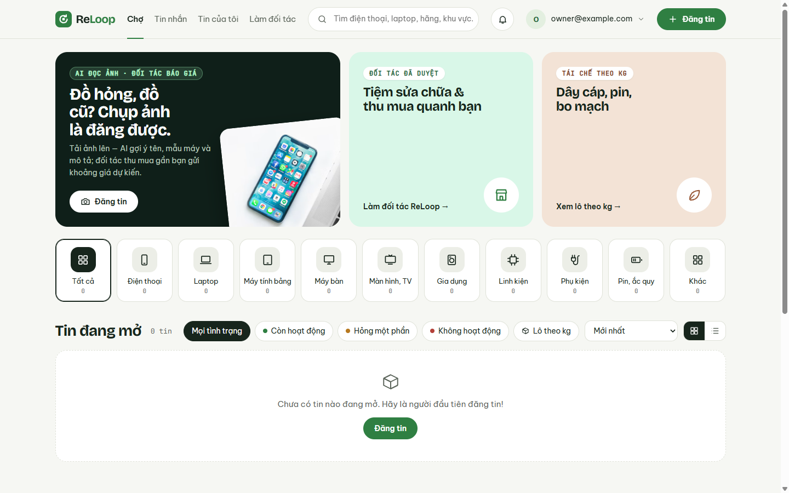
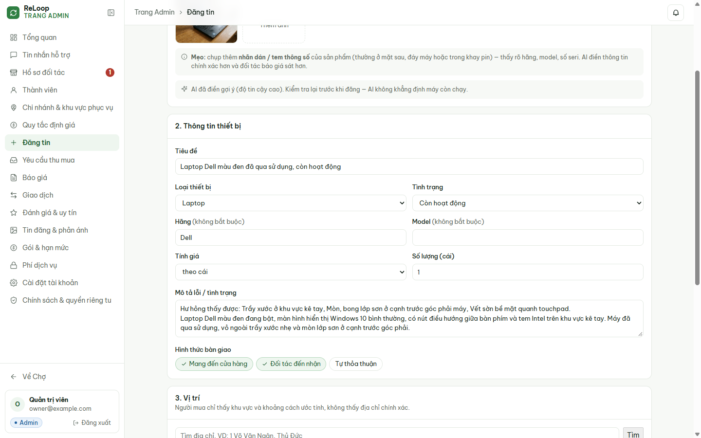
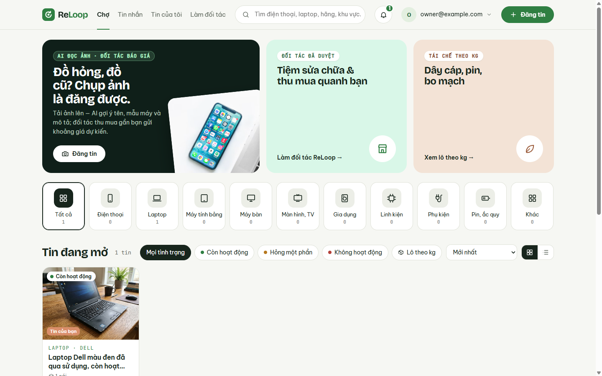
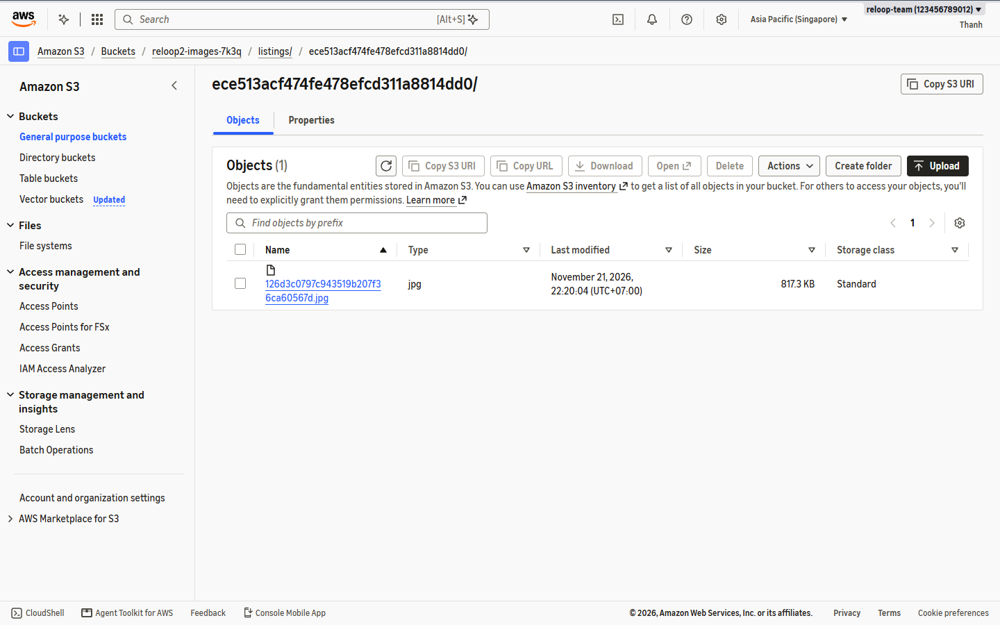
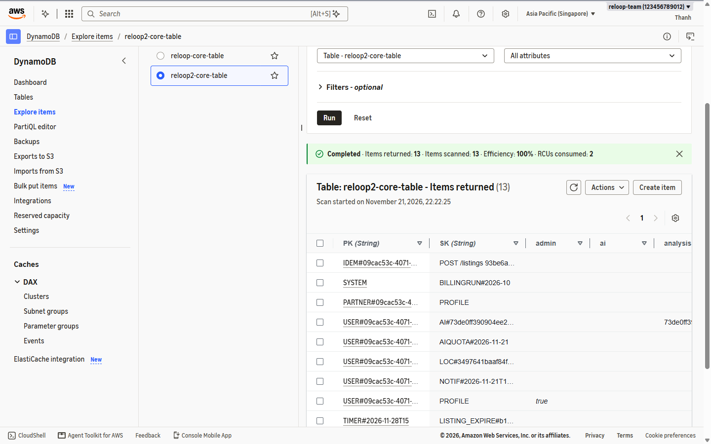
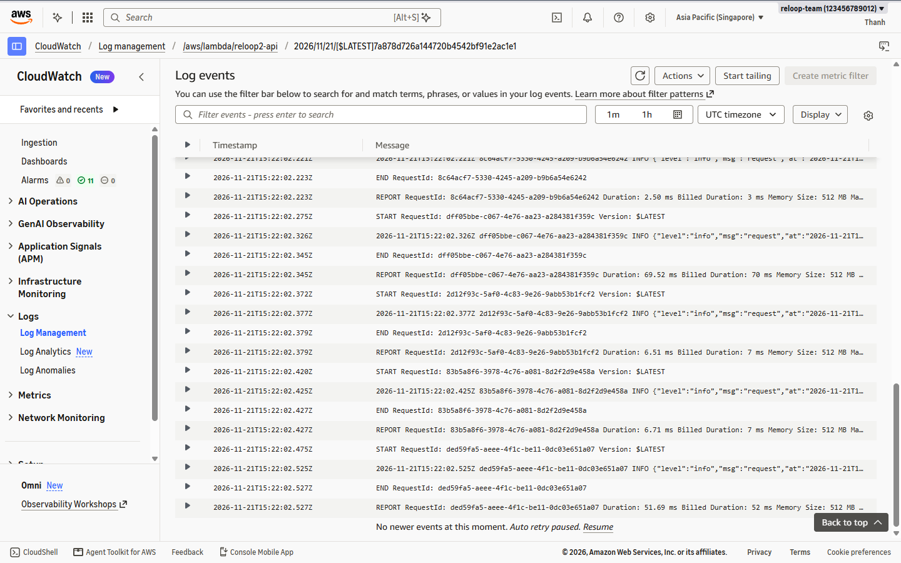
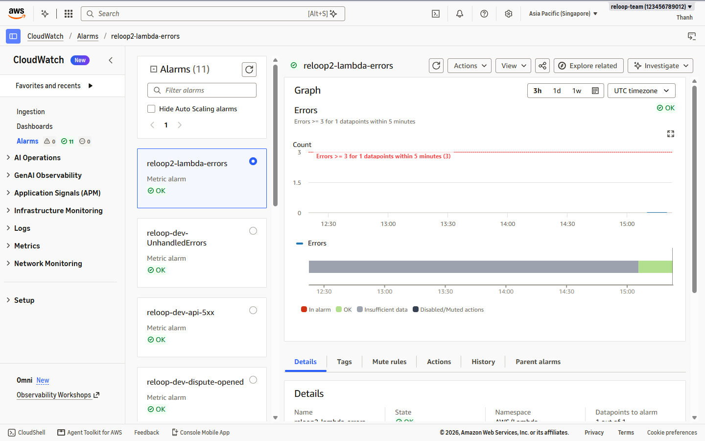

Walk the entire architecture diagram live from **Arrow 1 through Arrow 10**, plus **EventBridge** and **CloudWatch → SNS**, verifying real responses and backend evidence at every hop.

{}
**Live Demo:** [https://d1cjl1tvcp0r6q.cloudfront.net/](https://d1cjl1tvcp0r6q.cloudfront.net/) (verified live HTTPS CloudFront deployment of ReLoop)  
**Companion Code & Terraform Repo:** [https://github.com/madlyham/ReLoop](https://github.com/madlyham/ReLoop)
{}

**Graph arrows verified in this step:** All arrows **1 → 10** + **WAF**, **Post-confirm**, **verify JWT**, **EventBridge**, and **CloudWatch → SNS**.


---

### 1. Arrows 1, 2 & WAF — HTTPS Delivery, Static Files (OAC) & Origin Protection

1. Open your CloudFront URL (`https://<dist-domain>.cloudfront.net/`): confirm the React app loads over HTTPS via **CloudFront + WAF (`reloop2-web`)** from private S3 OAC (`reloop2-web-<suffix>`), and `/feed` fetches `/api/feed/public` cleanly (**Arrow 4**).



2. Verify **Arrow 4 (`x-origin-verify`)** blocks direct bypasses against API Gateway:
   ```bash
   curl -i https://<api-id>.execute-api.ap-southeast-1.amazonaws.com/feed/public
   # Expected: HTTP/2 403 -> {"code":"DIRECT_ACCESS_FORBIDDEN",...}
   ```

#### Error & Failure-Scenario Checks

Verify unauthorized requests, invalid calls, and burst traffic fail cleanly at the edge or authorizer layer:

- **Unauthenticated call to a protected route via CloudFront** (verifies the API Gateway Cognito JWT authorizer blocks missing tokens before Lambda runs):
  ```bash
  curl -i https://<dist-domain>.cloudfront.net/api/partners/me
  # Expected: HTTP/2 401 Unauthorized (rejected by API Gateway JWT authorizer)
  ```
- **Malformed/unknown routes & edge rate-limit protection:**
  - Unknown API paths return `HTTP/2 404` and malformed payloads return structured `HTTP/2 400` validation errors rather than unhandled `5xx` failures.
  - Sustaining bursts above **100 req/min** per IP on public API endpoints triggers AWS WAF (`reloop2-web`) at CloudFront, returning `HTTP/2 429` (`RATE_LIMITED`) with a `retry-after: 60` header before requests reach API Gateway or Lambda.

---

### 2. Arrow 3 + Post-Confirm — Sign-Up, Confirmation, Login & Profile Creation

3. Self-register and confirm a test user (for example, `reloop_owner` with your real email inbox, shown below as sanitized placeholder `owner@example.com`) through the **ReLoop web app** (`https://<dist-domain>.cloudfront.net/` -> **Sign up**) against **Amazon Cognito** (`reloop2-user-pool`). Confirming sign-up fires `reloop2-post-confirmation` automatically, inserting `USER#<sub> / PROFILE` into DynamoDB. *(Do not create the user via Cognito Console `AdminCreateUser`, as it does not fire `PostConfirmation_ConfirmSignUp`.)*



4. Sign in at `https://<dist-domain>.cloudfront.net/login` (`ALLOW_USER_SRP_AUTH`) and accept Terms. Verify the authenticated header displays your account (`owner@example.com`), proving **Arrow 3**, **Arrow 4**, **verify JWT (JWKS)**, and **Arrow 5**.



---

### 3. Arrows 4 → 10 — Presigned S3 Photo Upload, Rekognition, Bedrock & DynamoDB

5. Because `reloop2-api` restricts posting listings to approved **`Partners`** or **`Admins`**, add your test user to the **`Admins`** group in Cognito (or approve a partner application), then **sign out and sign back in** to the ReLoop web app so your JWT refreshes with the new group claim before opening **Create Listing** (`/listings/new`).
6. Upload a used laptop photo. Behind the scenes, every remaining numbered arrow executes in order:
   - **Arrow 7:** `reloop2-api` generates a presigned `POST` upload policy for `reloop2-images-<suffix>/listings/...` and tags it `state=pending`.
   - **Arrow 8:** The browser `POSTs` the photo directly to private S3 using that presigned `POST`.
   - **Arrow 9:** `reloop2-api` calls **Amazon Rekognition** (`DetectModerationLabels` + `DetectText`).
   - **Arrow 10:** `reloop2-api` screens extracted text via **Bedrock Guardrail** (`reloop2-ai-guardrail` v1) and invokes **Bedrock (`global.moonshotai.kimi-k3`)**, which auto-fills Title (`Laptop Dell màu đen đã qua sử dụng, còn hoạt động`), Category (`Laptop`), Brand (`Dell`), Condition, and visible defect notes with high confidence.



7. Complete location & handoff options and click **Đăng tin** (**Arrow 6** writes `LISTING#...` and `TIMER#... / LISTING_EXPIRE#...` to DynamoDB). Open `/feed` and confirm the live card renders with its photo loaded through a presigned GET URL (**Arrow 8** view).



---

### 4. Backend Evidence — S3 Photos, DynamoDB, EventBridge & CloudWatch/SNS

8. **S3 Photos (`reloop2-images-<suffix>/listings/<hash>/`):** Verify the uploaded `.jpg` object exists privately inside the bucket.



9. **DynamoDB (`reloop2-core-table` -> Explore items -> Run Scan):** Verify persisted application items — `USER#... / PROFILE` (from Post-confirm), `LISTING#... / META`, `USER#... / AI#...`, and `TIMER#... / LISTING_EXPIRE#...` *(plus `PARTNER#...` after partner onboarding and `SYSTEM / BILLINGRUN#...` after running the EventBridge sweep)*.



10. **EventBridge & CloudWatch Logs (`/aws/lambda/reloop2-api`):** Test the scheduled sweep payload directly (or wait 15 minutes for `reloop2-sweep`) and inspect the live CloudWatch log stream confirming structured `INFO` request logs and `REPORT` lines with 512 MB memory:
    ```bash
    aws lambda invoke --region ap-southeast-1 --function-name reloop2-api \
      --payload '{"source":"aws.events","detail-type":"Scheduled Event"}' \
      --cli-binary-format raw-in-base64-out sweep_out.json
    ```



11. **CloudWatch Alarm & SNS (`reloop2-lambda-errors`):** Verify the alarm stays in green **`OK`** state (`0` errors) and remains wired to `reloop2-alerts`.



{}
Verification is complete! Proceed immediately to [Module 5.12 — Cleanup & Terraform Reference](../5.12-cleanup-and-iac/) to delete all `reloop2` resources (especially AWS WAFv2) so ongoing billing stops today.
{}
