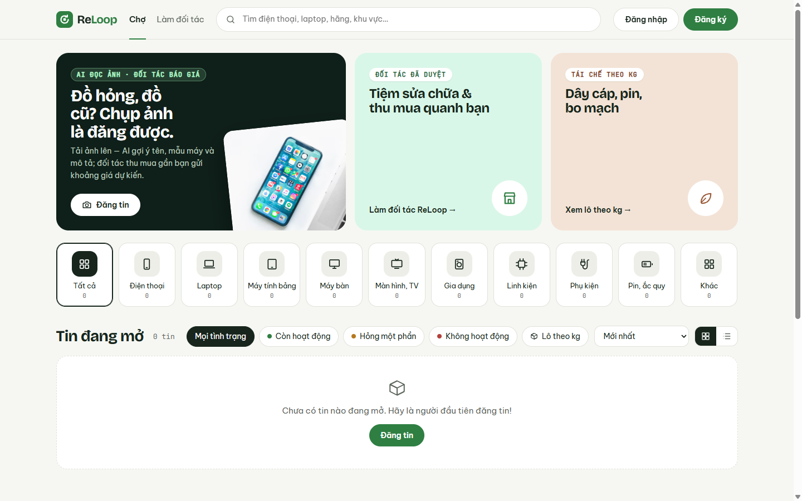
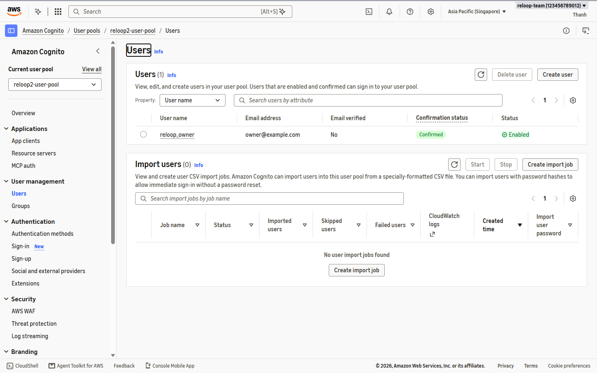
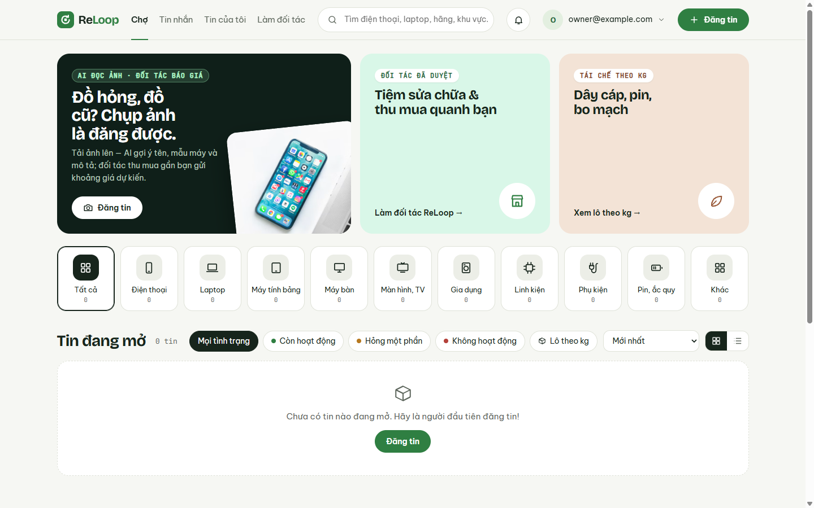
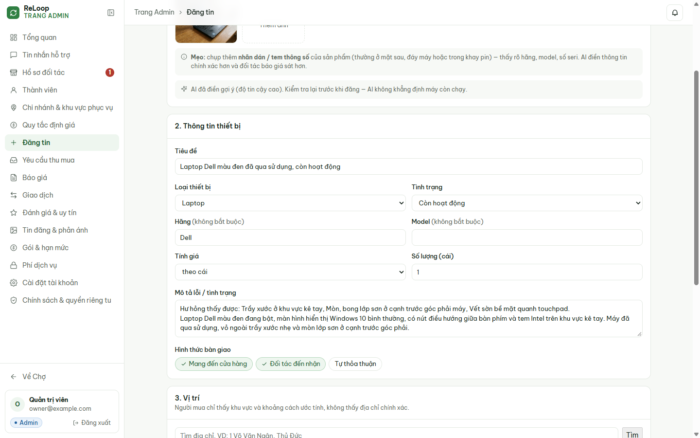
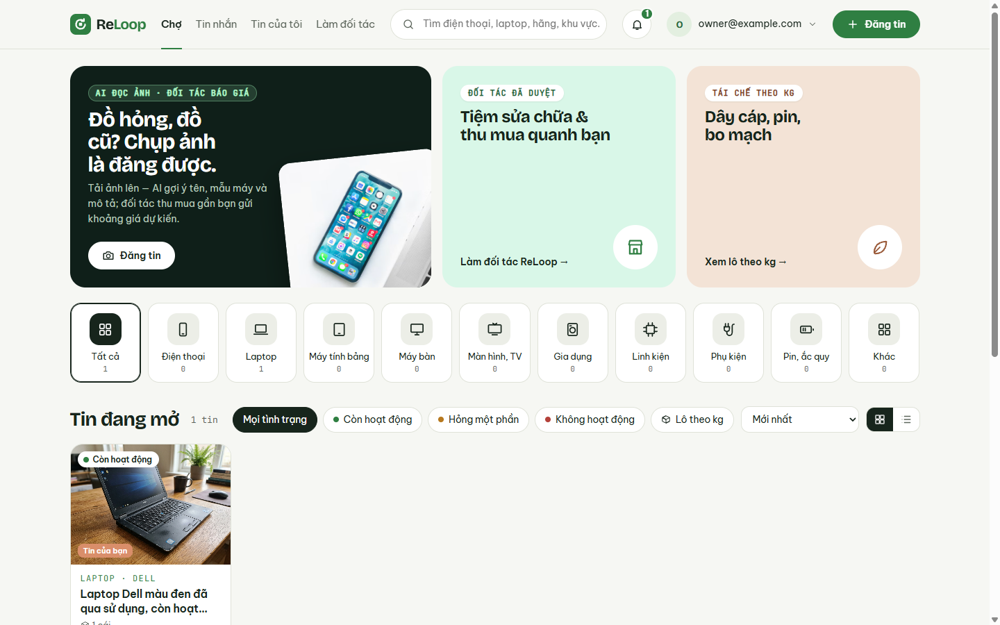
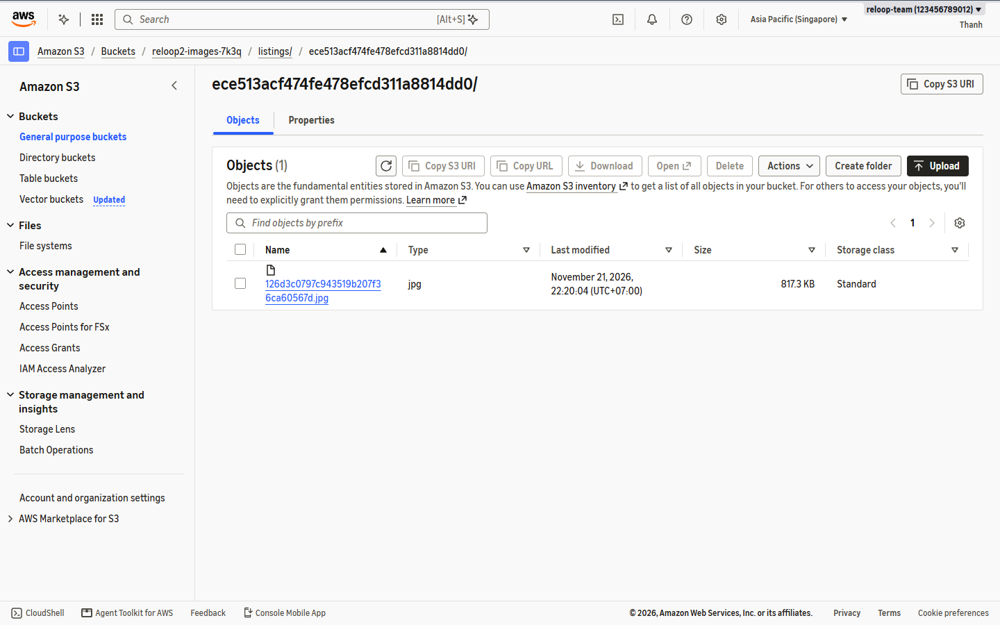
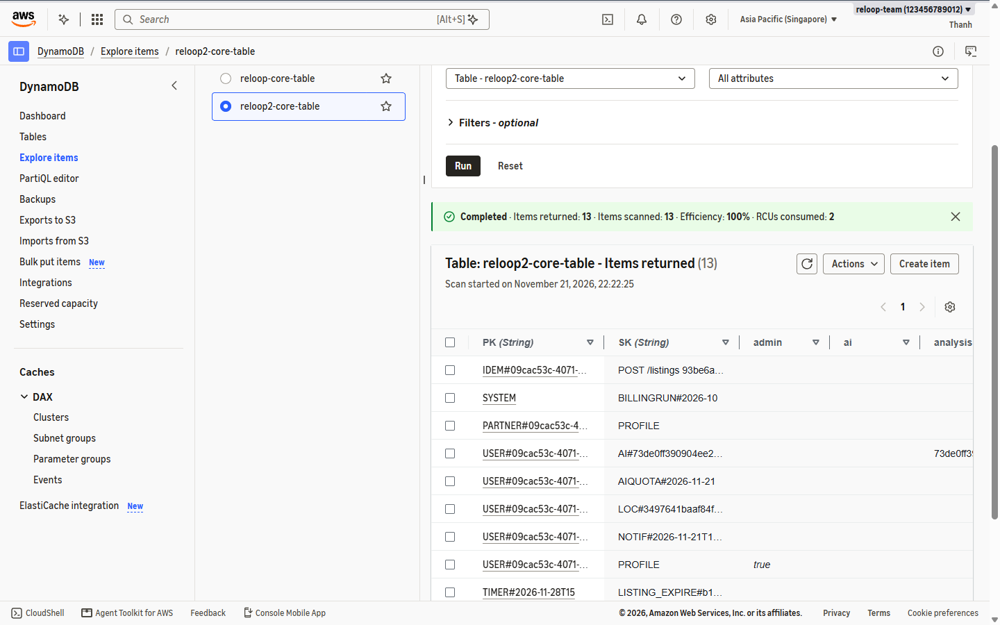
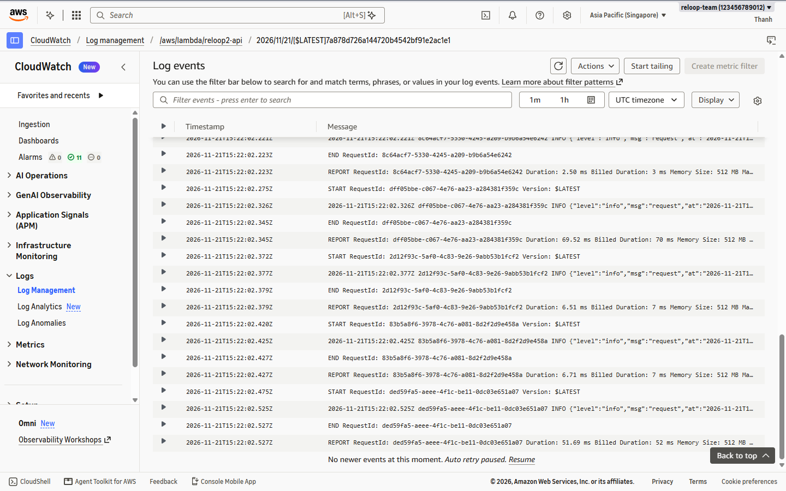
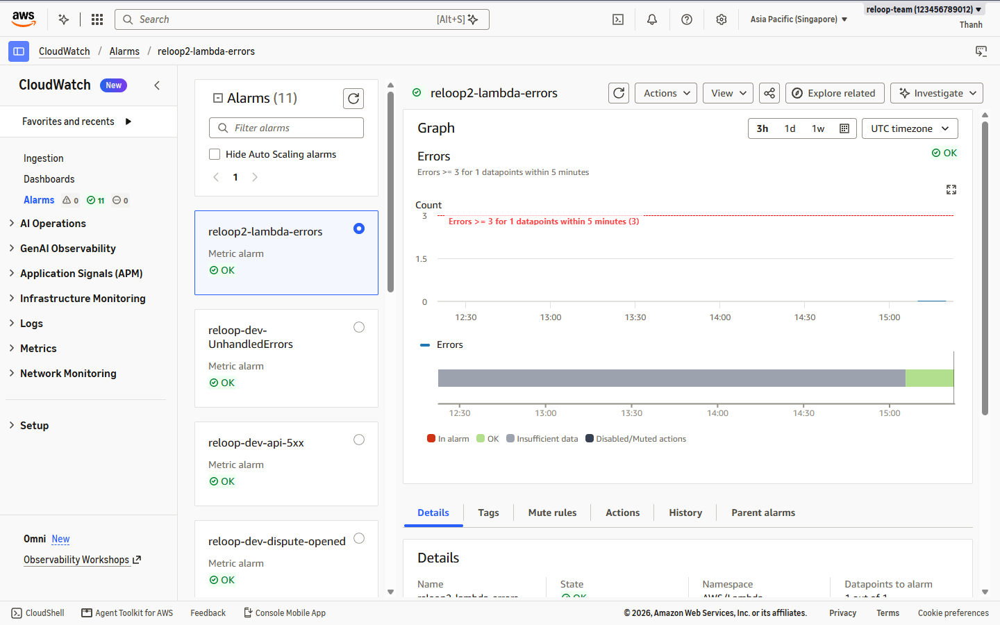

Kiểm chứng trực tiếp toàn bộ sơ đồ kiến trúc từ **Mũi tên 1 đến Mũi tên 10**, cộng thêm **EventBridge** và **CloudWatch → SNS**, đối chiếu phản hồi thực tế và bằng chứng dữ liệu ở từng chặng.

{}
**Bản Demo trực tuyến (Live Demo):** [https://d1cjl1tvcp0r6q.cloudfront.net/](https://d1cjl1tvcp0r6q.cloudfront.net/) (bản triển khai HTTPS trực tiếp của ReLoop trên CloudFront)  
**Mã nguồn đồng hành & Terraform Repo:** [https://github.com/madlyham/ReLoop](https://github.com/madlyham/ReLoop)
{}

**Các mũi tên được kiểm chứng ở bước này:** Toàn bộ **1 → 10** + **WAF**, **Post-confirm**, **verify JWT**, **EventBridge** và **CloudWatch → SNS**.


---

### 1. Mũi tên 1, 2 & WAF — Phục vụ HTTPS, Tệp tĩnh (OAC) & Bảo vệ Origin (chặn gọi trực tiếp)

1. Mở địa chỉ CloudFront (`https://<dist-domain>.cloudfront.net/`): xác nhận giao diện React tải bằng HTTPS thông qua **CloudFront + WAF (`reloop2-web`)** từ S3 OAC riêng tư (`reloop2-web-<suffix>`), và trang `/feed` gọi `/api/feed/public` thành công (**Mũi tên 4**).



2. Xác minh **Mũi tên 4 (`x-origin-verify`)** chặn truy cập thẳng vào API Gateway:
   ```bash
   curl -i https://<api-id>.execute-api.ap-southeast-1.amazonaws.com/feed/public
   # Kỳ vọng: HTTP/2 403 -> {"code":"DIRECT_ACCESS_FORBIDDEN",...}
   ```

#### Kiểm thử tình huống lỗi & bảo vệ hệ thống

Xác minh các yêu cầu chưa xác thực, truy vấn sai định dạng và lưu lượng đột biến đều bị chặn gọn gàng ngay tại lớp biên hoặc lớp xác thực:

- **Gọi tuyến bảo vệ qua CloudFront khi chưa đăng nhập** (kiểm chứng bộ xác thực JWT Cognito trên API Gateway chặn yêu cầu thiếu token trước khi Lambda chạy):
  ```bash
  curl -i https://<dist-domain>.cloudfront.net/api/partners/me
  # Kỳ vọng: HTTP/2 401 Unauthorized (bị từ chối bởi bộ xác thực JWT của API Gateway)
  ```
- **Đường dẫn không tồn tại/dữ liệu sai định dạng & bảo vệ giới hạn tốc độ ở biên:**
  - Đường dẫn API không tồn tại trả về `HTTP/2 404` và dữ liệu gửi lên sai định dạng trả về lỗi kiểm tra có cấu trúc `HTTP/2 400`, không phát sinh lỗi `5xx` chưa xử lý.
  - Lưu lượng đột biến vượt **100 request/phút** từ một IP tới các API công khai sẽ kích hoạt AWS WAF (`reloop2-web`) tại CloudFront, trả về `HTTP/2 429` (`RATE_LIMITED`) kèm header `retry-after: 60` trước khi yêu cầu chạm tới API Gateway hay Lambda.

---

### 2. Mũi tên 3 + Post-Confirm — Đăng ký, Xác nhận, Đăng nhập & Tự tạo hồ sơ

3. Tự đăng ký và xác nhận tài khoản thử (ví dụ `reloop_owner` bằng hộp thư email thật của bạn, minh họa bên dưới với giá trị ẩn danh `owner@example.com`) ngay trên **ứng dụng web ReLoop** (`https://<dist-domain>.cloudfront.net/` -> **Đăng ký**) kết nối tới **Amazon Cognito** (`reloop2-user-pool`). Ngay khi xác nhận mã email, Cognito tự kích hoạt `reloop2-post-confirmation` để ghi `USER#<sub> / PROFILE` vào DynamoDB. *(Không tạo người dùng bằng `AdminCreateUser` trên Cognito Console vì thao tác đó không kích hoạt sự kiện `PostConfirmation_ConfirmSignUp`.)*



4. Đăng nhập tại `https://<dist-domain>.cloudfront.net/login` (`ALLOW_USER_SRP_AUTH`) và đồng ý điều khoản. Xác nhận thanh tiêu đề hiển thị tài khoản đã đăng nhập (`owner@example.com`), chứng minh **Mũi tên 3**, **Mũi tên 4**, **verify JWT (JWKS)** và **Mũi tên 5**.



---

### 3. Mũi tên 4 → 10 — Tải ảnh Presigned S3, Rekognition, Bedrock & DynamoDB

5. Vì `reloop2-api` chỉ cho phép nhóm **`Partners`** đã duyệt hoặc **`Admins`** đăng tin, hãy thêm tài khoản thử vào nhóm **`Admins`** trong Cognito (hoặc duyệt hồ sơ đối tác), sau đó **đăng xuất và đăng nhập lại** trên ứng dụng web ReLoop để token JWT được làm mới với quyền nhóm mới rồi mới mở trang **Đăng tin** (`/listings/new`).
6. Tải lên một ảnh laptop cũ. Phía sau giao diện, toàn bộ các mũi tên còn lại chạy nối tiếp nhau:
   - **Mũi tên 7:** `reloop2-api` tạo chính sách tải lên presigned `POST` cho `reloop2-images-<suffix>/listings/...` và gắn thẻ `state=pending`.
   - **Mũi tên 8:** Trình duyệt tải ảnh (`POST`) trực tiếp lên S3 riêng tư bằng presigned `POST`.
   - **Mũi tên 9:** `reloop2-api` gọi **Amazon Rekognition** (`DetectModerationLabels` + `DetectText`).
   - **Mũi tên 10:** `reloop2-api` lọc chữ qua **Bedrock Guardrail** (`reloop2-ai-guardrail` v1) rồi gọi **Bedrock (`global.moonshotai.kimi-k3`)** để tự điền Tiêu đề (`Laptop Dell màu đen đã qua sử dụng, còn hoạt động`), Loại (`Laptop`), Hãng (`Dell`), Tình trạng và mô tả lỗi thấy được với độ tin cậy cao.



7. Điền địa chỉ, chọn hình thức bàn giao và nhấn **Đăng tin** (**Mũi tên 6** ghi `LISTING#...` cùng `TIMER#... / LISTING_EXPIRE#...` vào DynamoDB). Mở `/feed` xác nhận thẻ tin hiển thị kèm ảnh tải qua presigned GET URL (**Mũi tên 8**).



---

### 4. Bằng chứng tầng Backend — S3 Photos, DynamoDB, EventBridge & CloudWatch/SNS

8. **S3 Photos (`reloop2-images-<suffix>/listings/<hash>/`):** Xác nhận tệp ảnh `.jpg` đã lưu riêng tư trong bucket.



9. **DynamoDB (`reloop2-core-table` -> Explore items -> Run Scan):** Xác nhận các bản ghi ứng dụng đã lưu — `USER#... / PROFILE` (từ Post-confirm), `LISTING#... / META`, `USER#... / AI#...` và `TIMER#... / LISTING_EXPIRE#...` *(cùng `PARTNER#...` sau khi đăng ký đối tác và `SYSTEM / BILLINGRUN#...` sau khi chạy lệnh quét EventBridge)*.



10. **EventBridge & CloudWatch Logs (`/aws/lambda/reloop2-api`):** Gọi thử payload sự kiện định kỳ (hoặc chờ 15 phút để `reloop2-sweep` chạy) rồi mở log stream trên CloudWatch để xác nhận các dòng `INFO` và `REPORT` ở mức 512 MB:
    ```bash
    aws lambda invoke --region ap-southeast-1 --function-name reloop2-api \
      --payload '{"source":"aws.events","detail-type":"Scheduled Event"}' \
      --cli-binary-format raw-in-base64-out sweep_out.json
    ```



11. **CloudWatch Alarm & SNS (`reloop2-lambda-errors`):** Xác nhận cảnh báo giữ nguyên trạng thái xanh **`OK`** (`0` lỗi) và đang nối tới `reloop2-alerts`.



{}
Kiểm thử đã hoàn tất! Hãy thực hiện ngay [Học phần 5.12 — Dọn dẹp tài nguyên & Tham khảo Terraform](../5.12-cleanup-and-iac/) để xóa sạch toàn bộ tài nguyên `reloop2` (đặc biệt là AWS WAFv2) và chấm dứt chi phí phát sinh.
{}
