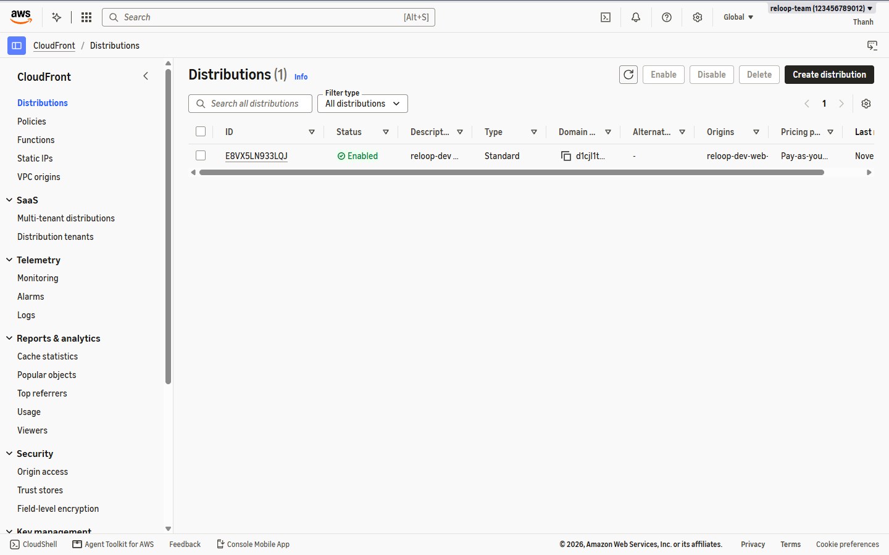
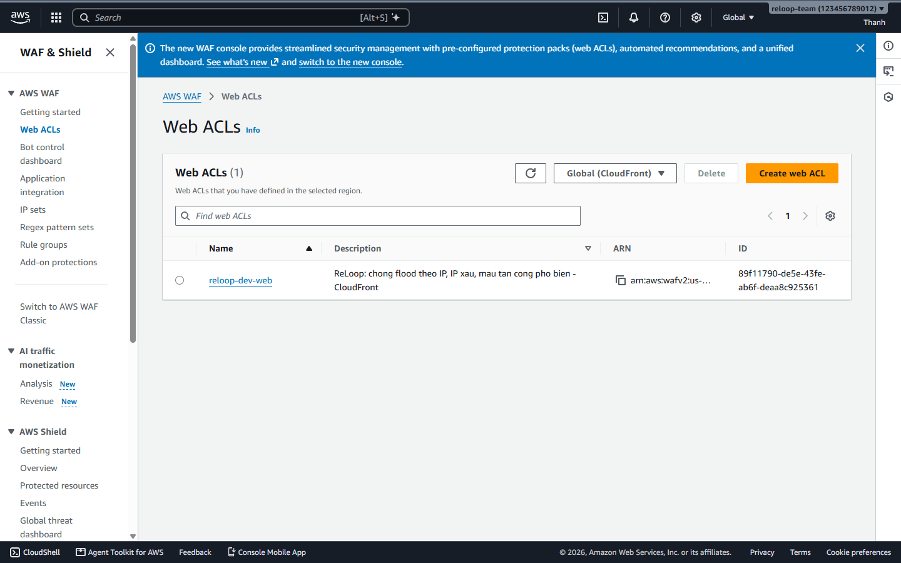

Delete every `reloop2` resource created in Modules **5.3–5.10** in safe reverse dependency order so zero ongoing charges remain (especially AWS WAFv2).

---

### Part A — Reverse-Order Teardown Checklist

1. **Start disabling CloudFront first (Global):** Open **CloudFront -> Distributions -> `<dist-id>`**:
   - Remove the associated WAF (`reloop2-web`) and detach `reloop2-spa-rewrite` / `reloop2-api-prefix` from the two behaviors.
   - Click **Disable** (takes ~2–4 minutes while you delete the regional services below).
2. **EventBridge (`ap-southeast-1`):** Open `reloop2-sweep` -> remove target `reloop2-api` -> delete rule `reloop2-sweep`.
3. **Monitoring & Alerts (`ap-southeast-1`):**
   - Delete CloudWatch alarm **`reloop2-lambda-errors`**.
   - Delete SNS topic **`reloop2-alerts`** (and any confirmed subscriptions).
   - Delete CloudWatch Log Groups **`/aws/lambda/reloop2-api`** and **`/aws/lambda/reloop2-post-confirmation`**.
4. **AI Processing (`ap-southeast-1`):** Open **Amazon Bedrock -> Guardrails** -> delete **`reloop2-ai-guardrail`** (deletes `DRAFT` and Version `1`).
5. **API Backend (`ap-southeast-1`):** Delete HTTP API Gateway **`reloop2-api`**.
6. **Sign-up & Sign-in (`ap-southeast-1`):** Open **Cognito -> `reloop2-user-pool`**:
   - Under **Branding -> Domain**, delete domain `reloop2-auth`.
   - Under **Overview -> Delete user pool**, uncheck/deactivate **Deletion protection** and delete `reloop2-user-pool`.
7. **Lambdas & IAM Roles:**
   - Delete Lambda functions **`reloop2-api`** and **`reloop2-post-confirmation`** (`ap-southeast-1`).
   - Open **IAM -> Roles** -> delete **`reloop2-api-lambda-role`** and **`reloop2-post-confirmation-role`** (inline policies are removed with the role).
8. **Data Storage (`ap-southeast-1`):**
   - Delete DynamoDB table **`reloop2-core-table`**.
   - Empty and delete both S3 buckets: **`reloop2-images-<suffix>`** and **`reloop2-web-<suffix>`**.
9. **Finish Global Edge (`Global / us-east-1`):**
   - Once CloudFront `<dist-id>` shows **Disabled + Deployed**, delete the distribution.
   - Delete CloudFront Origin Access Control **`reloop2-web-oac`** and Functions **`reloop2-spa-rewrite`** + **`reloop2-api-prefix`**.
   - Open **AWS WAF & Shield -> Global (CloudFront)** -> delete Web ACL **`reloop2-web`**.





---

### Part B — Verify Zero Leftover `reloop2` Resources via AWS CLI

Run this quick read-only check in your terminal and confirm every command returns `[]`:

```bash
aws cloudfront list-distributions --query "DistributionList.Items[?contains(Comment || '', 'reloop2')].Id"
aws wafv2 list-web-acls --scope CLOUDFRONT --region us-east-1 --query "WebACLs[?contains(Name,'reloop2')].Name"
aws s3api list-buckets --query "Buckets[?contains(Name,'reloop2')].Name"
aws dynamodb list-tables --region ap-southeast-1 --query "TableNames[?contains(@,'reloop2')]"
aws cognito-idp list-user-pools --max-results 60 --region ap-southeast-1 --query "UserPools[?contains(Name,'reloop2')].Name"
aws apigatewayv2 get-apis --region ap-southeast-1 --query "Items[?contains(Name,'reloop2')].Name"
aws lambda list-functions --region ap-southeast-1 --query "Functions[?contains(FunctionName,'reloop2')].FunctionName"
aws bedrock list-guardrails --region ap-southeast-1 --query "guardrails[?contains(name,'reloop2')].name"
aws events list-rules --region ap-southeast-1 --query "Rules[?contains(Name,'reloop2')].Name"
aws cloudwatch describe-alarms --region ap-southeast-1 --query "MetricAlarms[?contains(AlarmName,'reloop2')].AlarmName"
aws sns list-topics --region ap-southeast-1 --query "Topics[?contains(TopicArn,'reloop2')].TopicArn"
```

---

### Part C — Terraform Infrastructure-as-Code Reference

If you prefer reproducible Infrastructure as Code over manual Console clicks, the modular Terraform configuration in the repository's `terraform/` directory models this exact serverless architecture (`provider.tf`, `frontend.tf`, `security.tf`, `identity.tf`, `api.tf`, `data.tf`, `storage.tf`, `ai.tf`, `events.tf`, `monitoring.tf`). Copy `terraform.tfvars.example` to `terraform.tfvars`, set your unique prefix/suffix, and run `terraform init`, `terraform plan`, `terraform apply`, and `terraform destroy` when finished.
