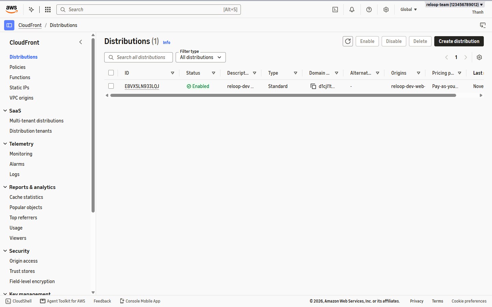
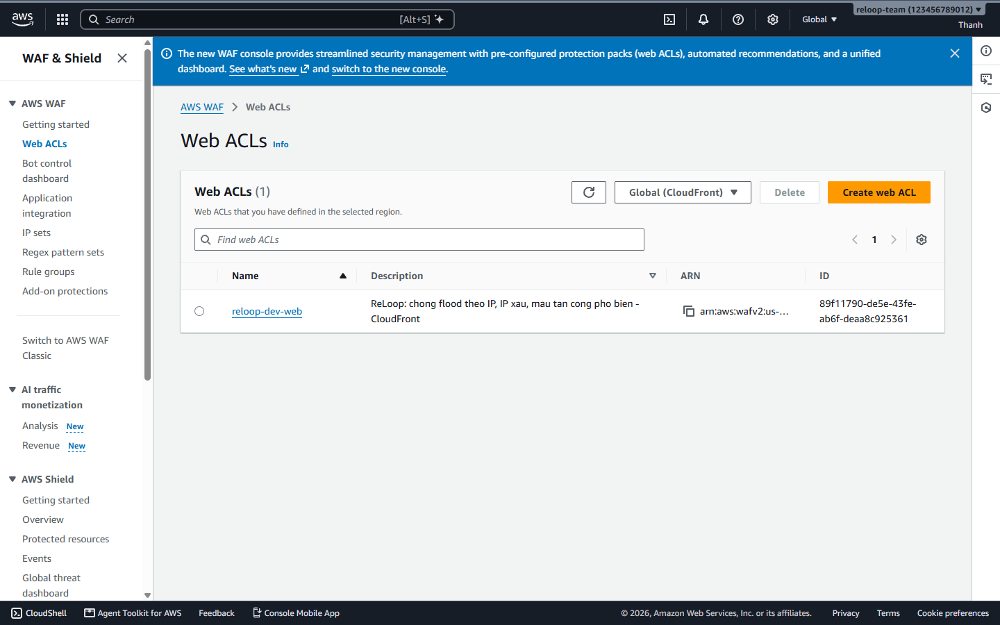

Xóa sạch mọi tài nguyên `reloop2` đã tạo ở các Học phần **5.3–5.10** theo đúng thứ tự ngược phụ thuộc để không còn bất kỳ chi phí duy trì nào (đặc biệt là AWS WAFv2).

---

### Phần A — Thứ tự dọn dẹp an toàn

1. **Tắt CloudFront trước (Global):** Mở **CloudFront -> Distributions -> `<dist-id>`**:
   - Gỡ WAF (`reloop2-web`) và gỡ `reloop2-spa-rewrite` / `reloop2-api-prefix` khỏi hai behavior.
   - Nhấn **Disable** (mất khoảng 2–4 phút trong lúc bạn xóa các dịch vụ tại vùng Singapore bên dưới).
2. **EventBridge (`ap-southeast-1`):** Mở `reloop2-sweep` -> gỡ đích `reloop2-api` -> xóa quy tắc `reloop2-sweep`.
3. **Giám sát & Cảnh báo (`ap-southeast-1`):**
   - Xóa cảnh báo CloudWatch **`reloop2-lambda-errors`**.
   - Xóa chủ đề SNS **`reloop2-alerts`** (cùng các đăng ký đã xác nhận nếu có).
   - Xóa các Log Group **`/aws/lambda/reloop2-api`** và **`/aws/lambda/reloop2-post-confirmation`**.
4. **Xử lý AI (`ap-southeast-1`):** Mở **Amazon Bedrock -> Guardrails** -> xóa **`reloop2-ai-guardrail`** (xóa cả `DRAFT` và Version `1`).
5. **API Backend (`ap-southeast-1`):** Xóa HTTP API Gateway **`reloop2-api`**.
6. **Đăng ký & Đăng nhập (`ap-southeast-1`):** Mở **Cognito -> `reloop2-user-pool`**:
   - Vào **Branding -> Domain**, xóa miền `reloop2-auth` (hoặc tiền tố kèm hậu tố của bạn).
   - Vào **Overview -> Delete user pool**, tắt **Deletion protection** rồi xóa `reloop2-user-pool`.
7. **Lambda & IAM Roles:**
   - Xóa hai hàm Lambda **`reloop2-api`** và **`reloop2-post-confirmation`** (`ap-southeast-1`).
   - Mở **IAM -> Roles** -> xóa **`reloop2-api-lambda-role`** và **`reloop2-post-confirmation-role`** (inline policy đi kèm sẽ tự xóa).
8. **Lưu trữ dữ liệu (`ap-southeast-1`):**
   - Xóa bảng DynamoDB **`reloop2-core-table`**.
   - Làm rỗng (Empty) rồi xóa cả hai bucket S3: **`reloop2-images-<suffix>`** và **`reloop2-web-<suffix>`**.
9. **Hoàn tất Lớp biên toàn cầu (`Global / us-east-1`):**
   - Khi CloudFront `<dist-id>` chuyển sang **Disabled + Deployed**, nhấn xóa distribution.
   - Xóa CloudFront Origin Access Control **`reloop2-web-oac`** cùng hai hàm **`reloop2-spa-rewrite`** và **`reloop2-api-prefix`**.
   - Mở **AWS WAF & Shield -> Global (CloudFront)** -> xóa Web ACL **`reloop2-web`**.





---

### Phần B — Xác minh sạch 100% tài nguyên `reloop2` bằng AWS CLI

Chạy loạt lệnh chỉ đọc sau trong terminal và xác nhận tất cả đều trả về `[]`:

```bash
aws cloudfront list-distributions --query "DistributionList.Items[?contains(Comment || '', 'reloop2')].Id"
aws wafv2 list-web-acls --scope CLOUDFRONT --region us-east-1 --query "WebACLs[?contains(Name,'reloop2')].Name"
aws s3api list-buckets --query "Buckets[?contains(Name,'reloop2')].Name"
aws dynamodb list-tables --region ap-southeast-1 --query "TableNames[?contains(@,'reloop2')]"
aws cognito-idp list-user-pools --max-results 60 --region ap-southeast-1 --query "UserPools[?contains(Name,'reloop2')].Name"
aws apigatewayv2 get-apis --region ap-southeast-1 --query "Items[?contains(Name,'reloop2')].Name"
aws lambda list-functions --region ap-southeast-1 --query "Functions[?contains(FunctionName,'reloop2')].FunctionName"
aws bedrock list-guardrails --region ap-southeast-1 --query "guardrails[?contains(name,'reloop2')].name"
aws events list-rules --region ap-southeast-1 --query "Rules[?contains(Name,'reloop2')].Name"
aws cloudwatch describe-alarms --region ap-southeast-1 --query "MetricAlarms[?contains(AlarmName,'reloop2')].AlarmName"
aws sns list-topics --region ap-southeast-1 --query "Topics[?contains(TopicArn,'reloop2')].TopicArn"
```

---

### Phần C — Tham khảo Hạ tầng dưới dạng Mã (Terraform)

Nếu bạn muốn tái dựng tự động thay vì thao tác tay trên Console, hãy clone kho đồng hành **[github.com/madlyham/ReLoop](https://github.com/madlyham/ReLoop)**. Thư mục [`terraform/`](https://github.com/madlyham/ReLoop/tree/main/terraform) mô tả trọn vẹn kiến trúc 12 dịch vụ này (`provider.tf`, `data.tf`, `variables.tf`, `frontend.tf`, `security.tf`, `identity.tf`, `api.tf`, `storage.tf`, `ai.tf`, `events.tf`, `monitoring.tf`, `outputs.tf`) và tham chiếu trực tiếp đến `zips/` cùng `cloudfront-functions/` trong cùng kho:

```bash
git clone https://github.com/madlyham/ReLoop.git
cd ReLoop/terraform
cp terraform.tfvars.example terraform.tfvars
# Chỉnh terraform.tfvars (bucket_suffix, alert_email, origin_verify_secret)
terraform init
terraform plan
terraform apply
```

Sau khi `terraform apply` xong, quay về thư mục gốc kho mã nguồn (`cd ..`), chạy `python frontend/configure.py` với các giá trị Cognito đầu ra rồi đồng bộ `frontend/build/` lên bucket S3 web (xem [README](https://github.com/madlyham/ReLoop#option-2--deploy-with-terraform-reproducible-iac)). Khi hoàn tất, làm rỗng cả hai bucket S3, đặt `cognito_deletion_protection = "INACTIVE"` trong `terraform.tfvars`, chạy `terraform apply` trước để tắt bảo vệ xóa trên User Pool, rồi mới chạy `terraform destroy`.
