With the full stack running live behind CloudFront (`https://<dist-domain>.cloudfront.net`), verify every major user, partner, admin, AI, storage, database, and telemetry path end-to-end!

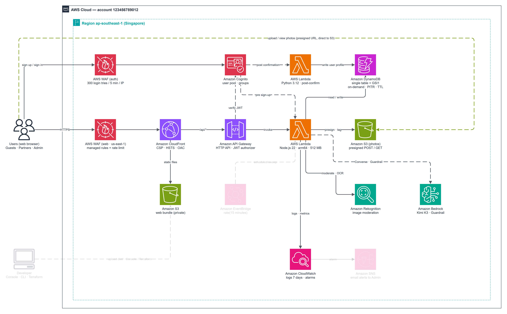

---

### 1. Public Web Delivery & Anonymous Marketplace Browsing

1. Open your CloudFront HTTPS URL (`https://<dist-domain>.cloudfront.net/`): confirm the landing UI renders cleanly over HTTP/2+3 with strict browser security headers enabled and zero mixed-content or CSP errors.

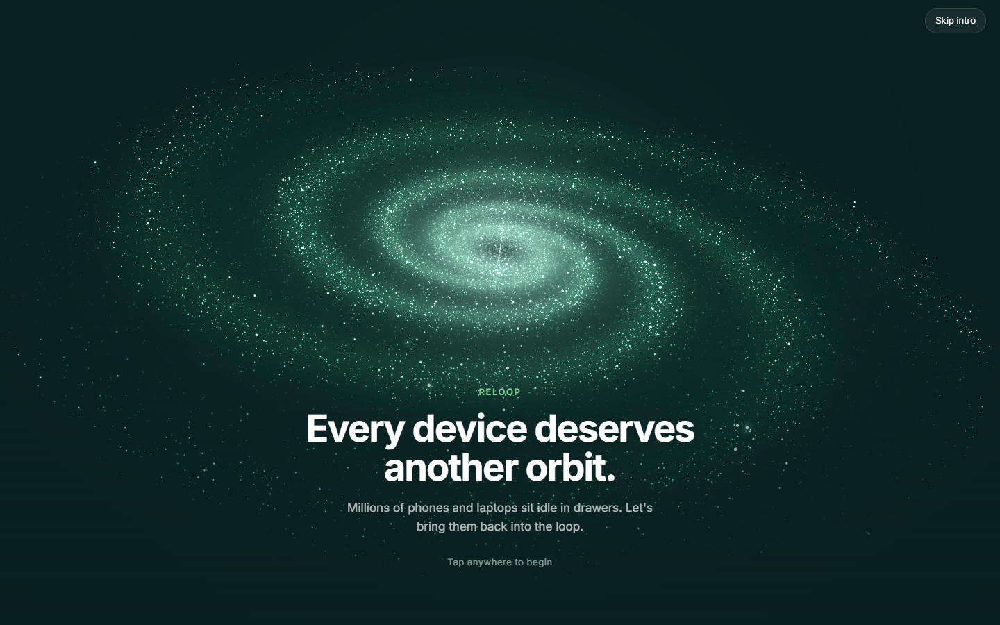

2. Open the public feed (`/feed` via `/api/feed/public`): confirm anonymous API calls pass through `rate-limit-public-api`, `/api` prefix stripping, and `x-origin-verify` validation.

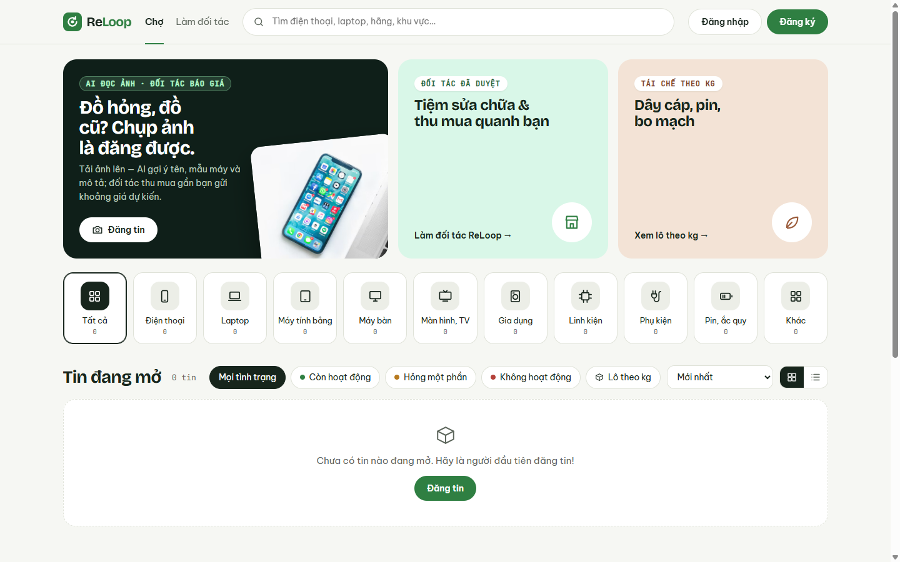

---

### 2. User Sign-Up, Confirmation, Login & Profile Auto-Creation

3. Register a test user (`success@simulator.amazonses.com` or your test inbox) via the Cognito Hosted UI — Cognito triggers `reloop2-api` (`PreSignUp`) to enforce email uniqueness.

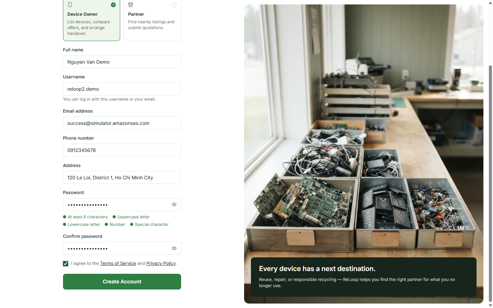

4. Verify confirmation (`Confirmed` status in `reloop2-user-pool` after code confirmation — triggering `reloop2-post-confirmation` to insert the `Owner` profile into DynamoDB).

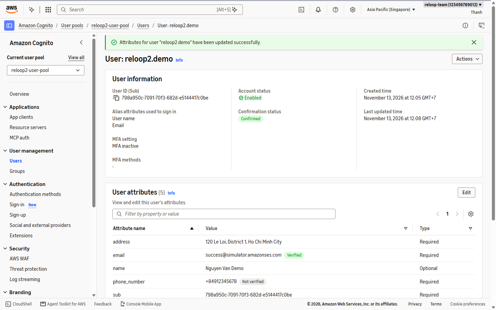

5. Sign in via Cognito Hosted UI (`ALLOW_USER_SRP_AUTH` + Auth Code PKCE) and verify CloudFront exchanges the token via `POST /api/auth/session` so the authenticated header appears.

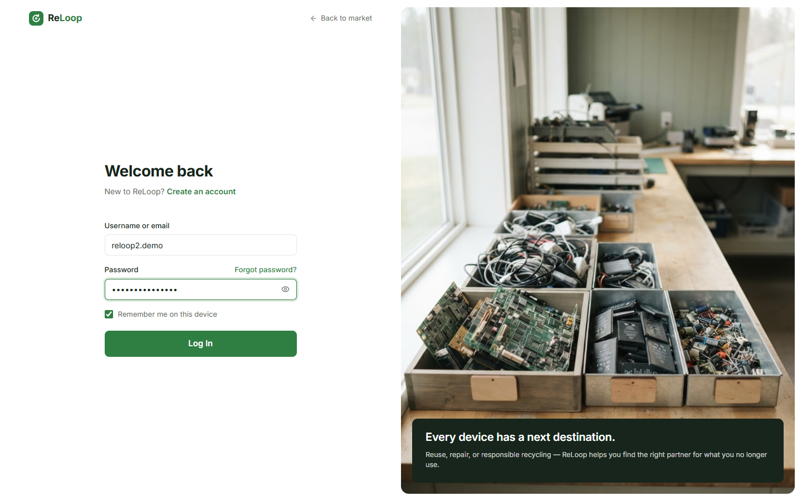

---

### 3. Partner Onboarding & Admin Approval

6. Submit a partner verification application from the test account, then switch/promote an Admin test session to verify and approve the partner profile.

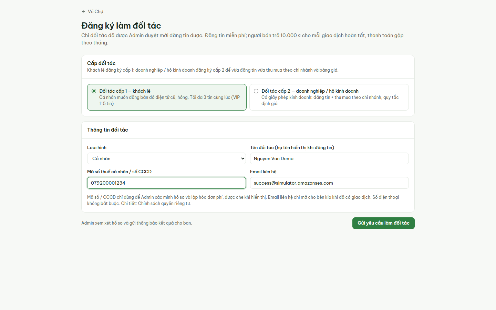

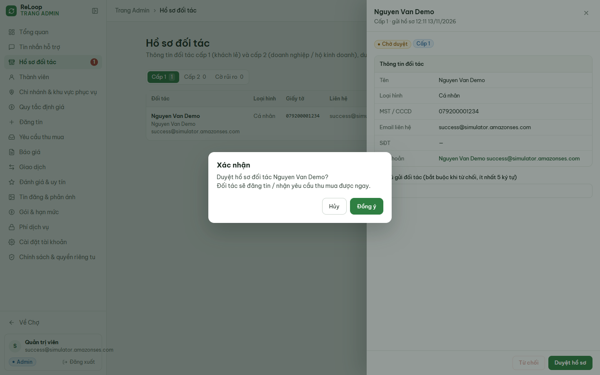

---

### 4. Multimodal AI Photo Screening & Listing Creation

Test three real scenarios on the **Create Listing** page (each photo uploads directly to S3 `reloop2-images-7k3q` via presigned URL first, then triggers Rekognition + Bedrock Guardrail + Bedrock Kimi K3):

7. **Scenario A — Laptop Photo:** Uploading a Dell laptop photo fills *"Laptop Dell màu đen đang bật máy, vỏ trầy xước đã qua sử dụng"* with category `Laptop`, brand `Dell`, and generated condition notes.

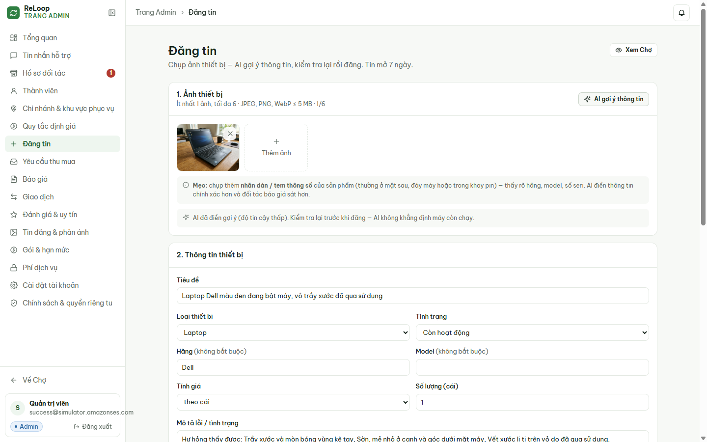

8. **Scenario B — Device + Label Sticker Photo:** Uploading two photos (an **Intel RealSense D435** depth camera + close-up spec label) lets OCR + Kimi K3 extract the exact model with **high confidence** (*"Camera độ sâu Intel RealSense D435 kèm chân máy mini"*, Brand `Intel`, Model `RealSense D435`).

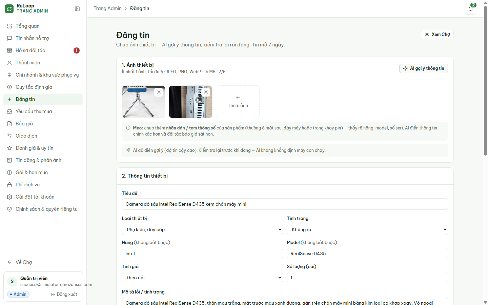

9. **Scenario C — Non-Electronic Photo Guard:** Uploading a **cat photo** confirms Kimi K3 refuses to fabricate device fields and displays *"AI không nhận ra thiết bị điện tử trong ảnh — kiểm tra lại ảnh hoặc nhập tay."*

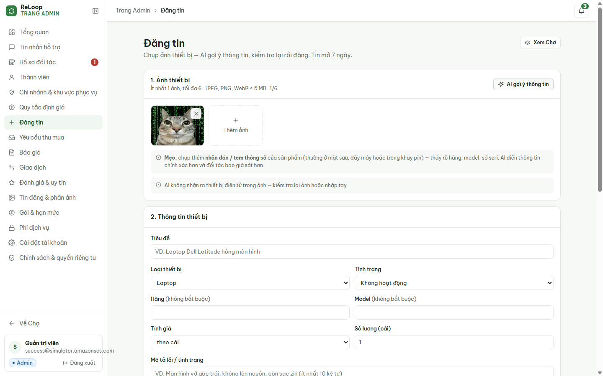

10. Publish your test listings (including an **XUNFOX K820** wired gaming mouse with label) and confirm all **3 live items** appear on the public ReLoop marketplace feed immediately!

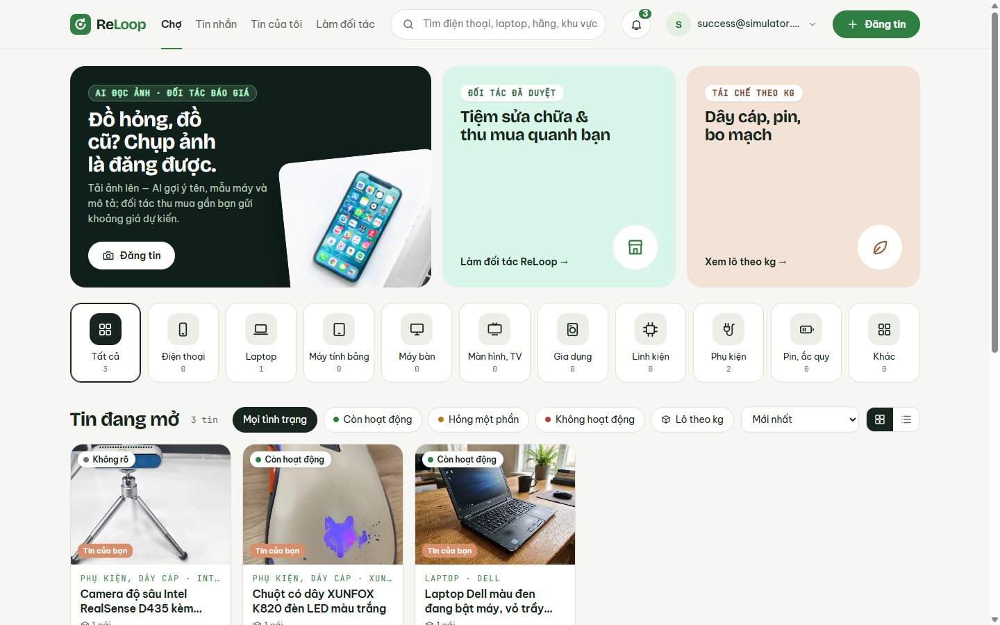

---

### 5. Verify Backend Evidence in S3, DynamoDB & CloudWatch

11. Open **S3 -> `reloop2-images-7k3q -> listings/<userId>/`**: confirm **6 uploaded `.jpg` objects** stored privately via presigned POST/PUT.

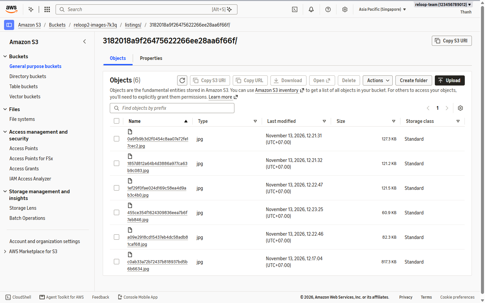

12. Open **DynamoDB -> Explore items -> `reloop2-core-table`** and click **Run (Scan)**: confirm **29 items** persisted (including `USER#...`, listing metadata, and `TIMER#.../LISTING_EXPIRE#...` items).

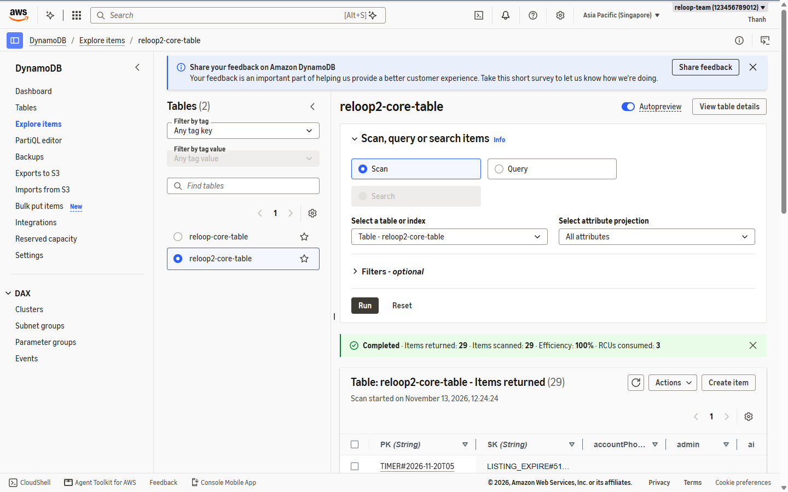

13. Open **CloudWatch -> Dashboards -> `ReLoop2-Backend-Health`**: observe live telemetry (**55** Lambda invocations with **0** errors/throttles, **52** HTTP API requests with **0** 4xx/5xx, **170** DynamoDB RCUs and **26** WCUs consumed).

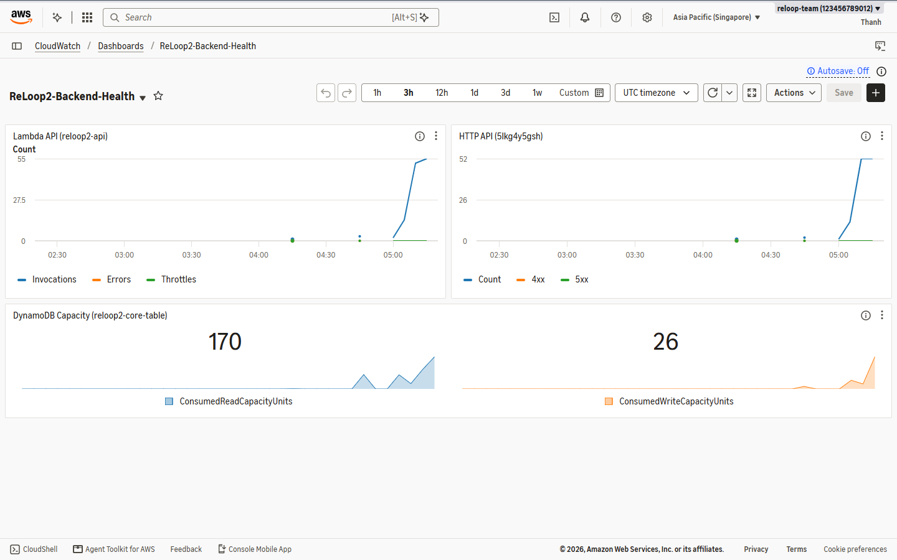
