Khi toàn bộ kiến trúc đã chạy qua domain HTTPS của CloudFront, hãy kiểm chứng toàn bộ luồng từ trình duyệt đến S3, DynamoDB, Cognito, AI và CloudWatch!

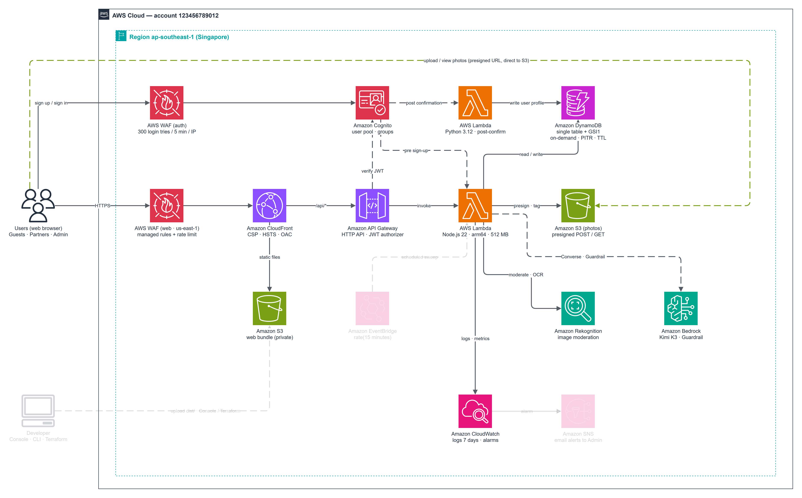

---

### 1. Kiểm tra Web công khai & Feed ẩn danh

1. Truy cập `https://<dist-domain>.cloudfront.net/`: giao diện ReLoop hiển thị tức thì qua HTTP/2+3 với đầy đủ header bảo mật và không có lỗi CSP.

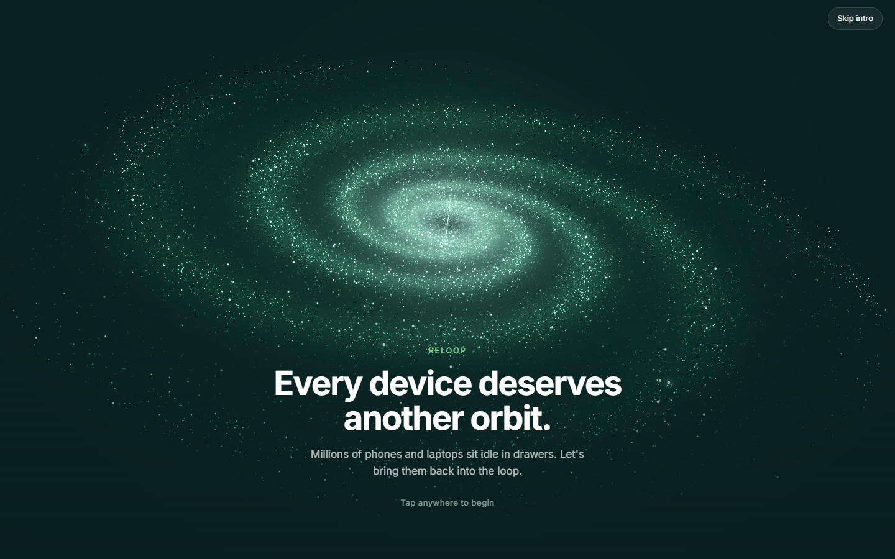

2. Mở trang Chợ (`/feed`) khi chưa đăng nhập để kiểm chứng request `/api/feed/public` đi qua WAF `rate-limit-public-api`, CloudFront strip `/api` và kiểm tra `x-origin-verify`.

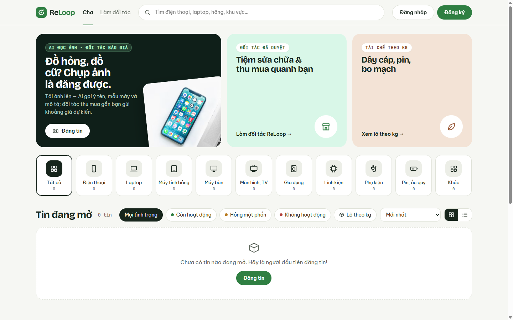

---

### 2. Đăng ký, Xác nhận, Đăng nhập & Tự tạo Hồ sơ

3. Đăng ký tài khoản kiểm thử (`success@simulator.amazonses.com` hoặc email thử nghiệm) trên Managed Login v2 (kích hoạt `PreSignUp`).

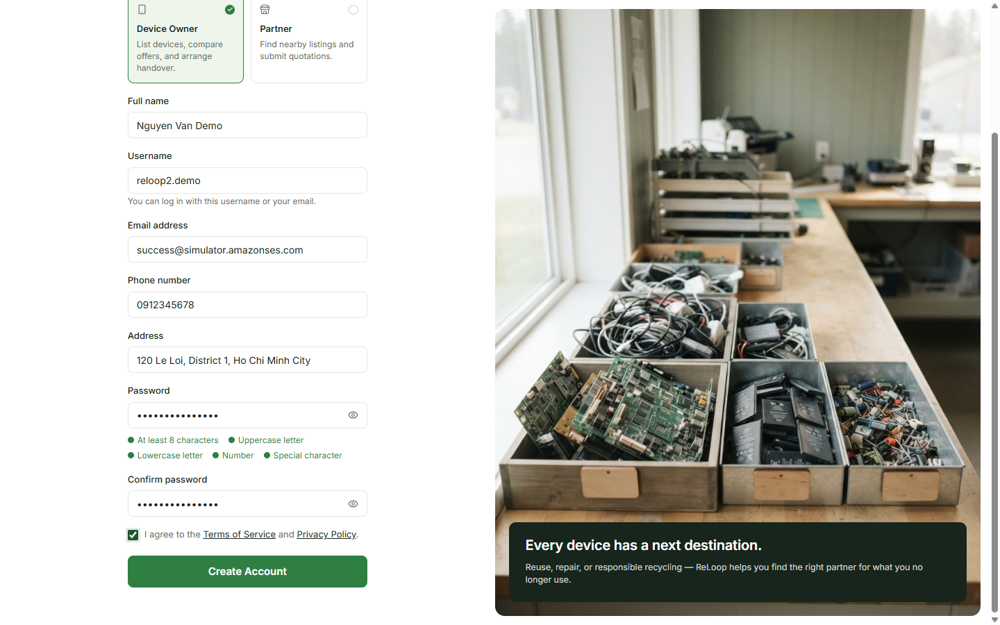

4. Kiểm tra người dùng đạt trạng thái **`Confirmed`** trong `reloop2-user-pool` (lúc này `reloop2-post-confirmation` đã tự động ghi bản ghi `Owner` vào DynamoDB).

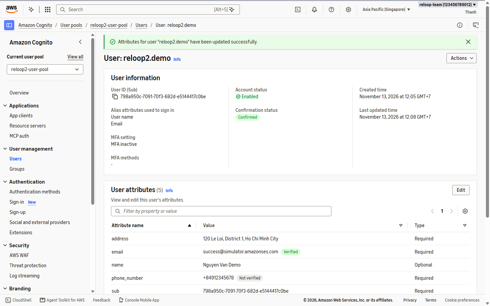

5. Đăng nhập hoàn tất quá trình trao đổi phiên `POST /api/auth/session` qua CloudFront.

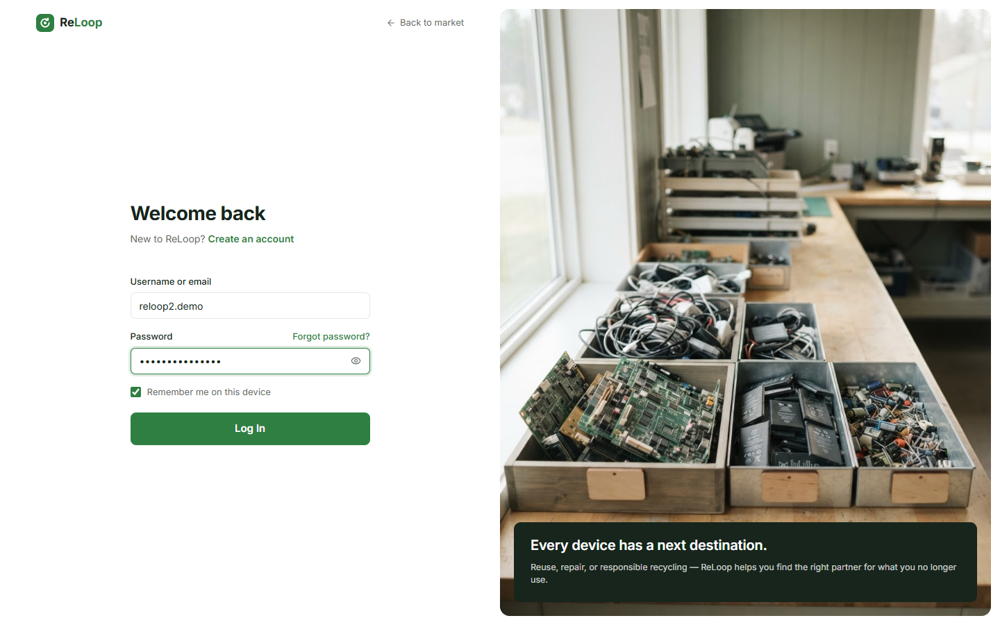

---

### 3. Quy trình Đối tác & Duyệt Admin

6. Nộp hồ sơ đăng ký đối tác từ tài khoản test và dùng giao diện Admin duyệt hồ sơ đối tác trực tiếp qua API được bảo vệ JWT.

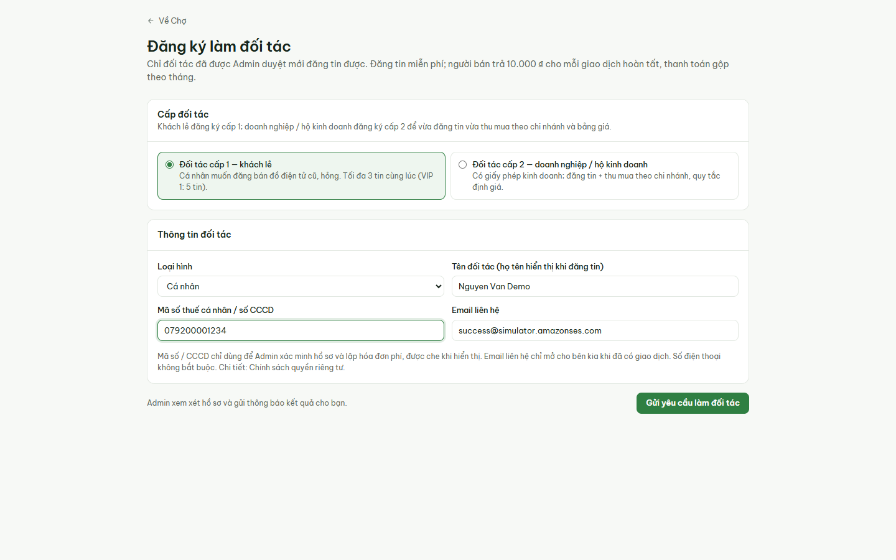

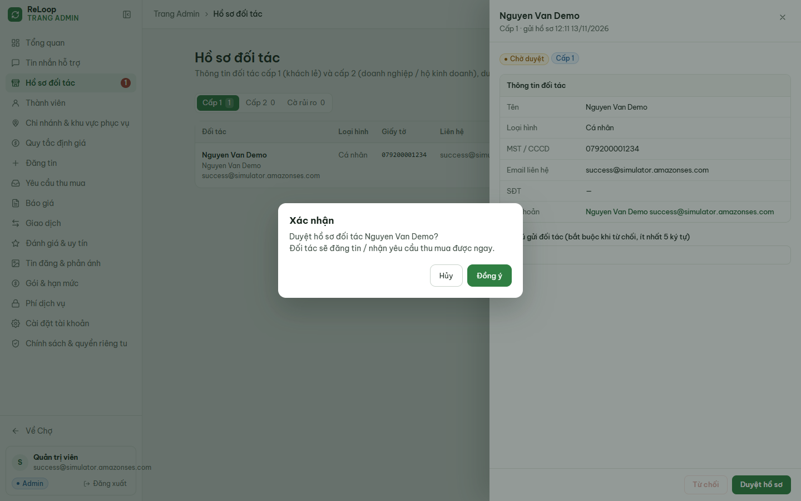

---

### 4. Kiểm thử AI Phân tích Ảnh đa kịch bản

Trên trang **Đăng tin**, kiểm thử 3 kịch bản ảnh thực tế (ảnh được upload thẳng lên S3 bằng presigned URL rồi đi qua Rekognition + Bedrock Guardrail + Kimi K3):

7. **Kịch bản A — Ảnh Laptop:** AI nhận diện chính xác *"Laptop Dell màu đen đang bật máy, vỏ trầy xước đã qua sử dụng"* (`Laptop`, hãng `Dell`, tự mô tả tình trạng).

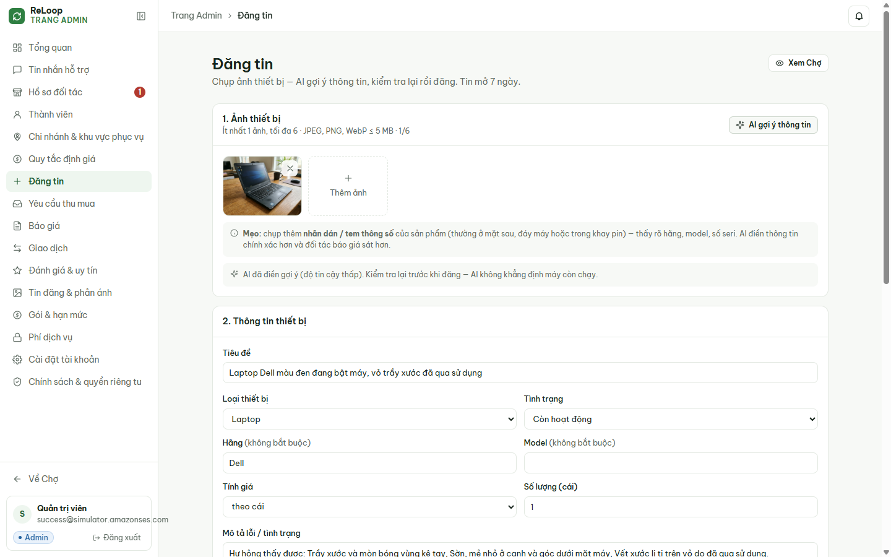

8. **Kịch bản B — Thiết bị kèm tem thông số:** Tải 2 ảnh **Intel RealSense D435** (kèm ảnh cận cảnh nhãn thông số) -> AI điền ở **độ tin cậy cao** (`Intel`, `RealSense D435`, tiêu đề *"Camera độ sâu Intel RealSense D435 kèm chân máy mini"*).

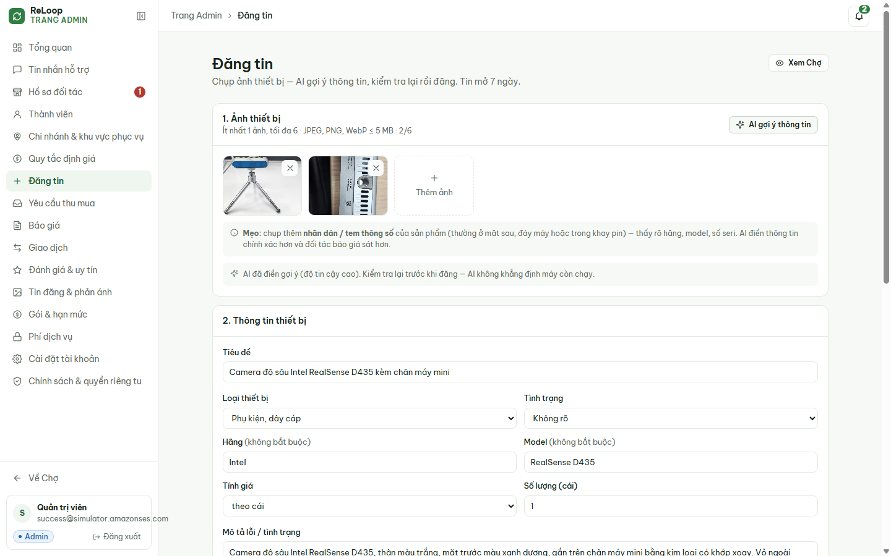

9. **Kịch bản C — Ảnh không phải đồ điện tử (ảnh mèo):** AI nhận biết không phải thiết bị và báo *"AI không nhận ra thiết bị điện tử trong ảnh — kiểm tra lại ảnh hoặc nhập tay."*

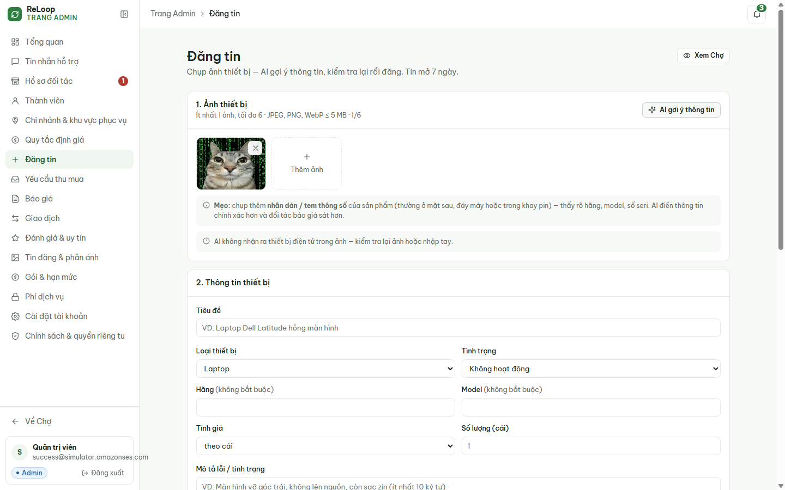

10. Hoàn tất đăng 3 tin thử nghiệm (gồm RealSense D435, chuột XUNFOX K820 có đèn LED và Laptop Dell) — cả **3 tin đăng mới** hiển thị ngay trên trang Chợ công khai.

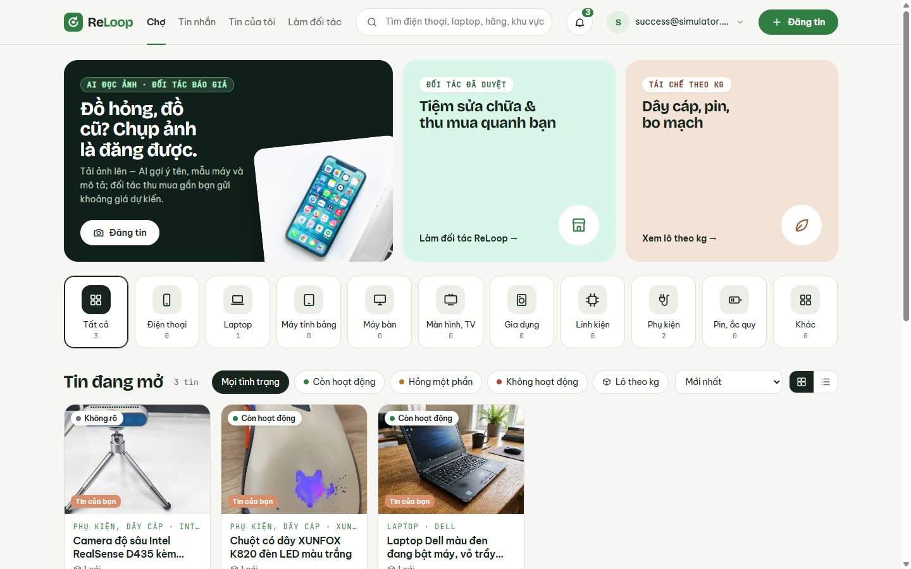

---

### 5. Đối chiếu Dữ liệu thực tế trên AWS

11. Mở **S3 -> `reloop2-images-7k3q -> listings/<userId>/`**: xác nhận **6 tệp `.jpg`** đã được trình duyệt upload trực tiếp qua presigned URL.

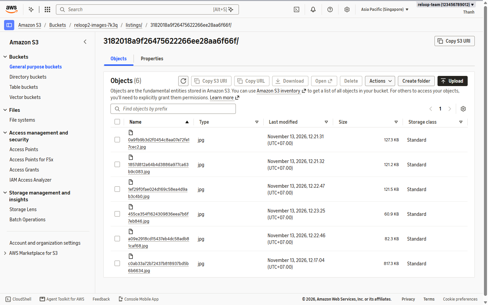

12. Mở **DynamoDB -> `reloop2-core-table` -> Scan**: xác nhận **29 bản ghi** (`USER#...`, tin đăng, `TIMER#.../LISTING_EXPIRE#...`).

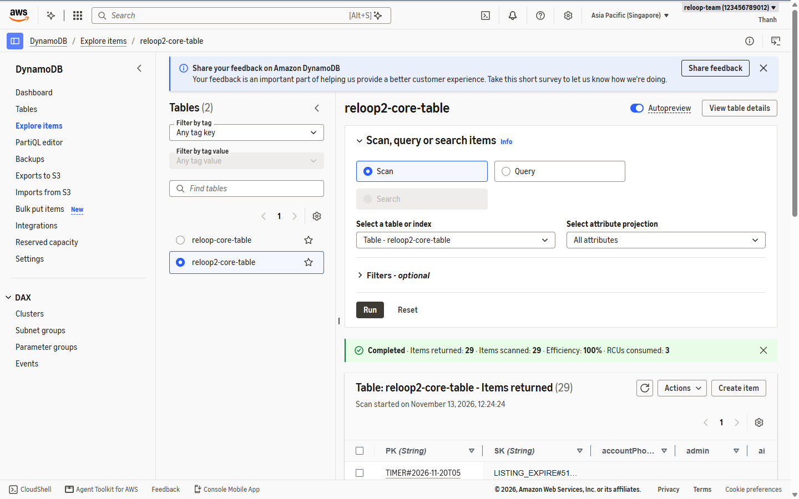

13. Mở **CloudWatch -> `ReLoop2-Backend-Health`**: quan sát trực tiếp **55** lượt gọi Lambda (`0` lỗi), **52** request HTTP API (`0` 4xx/5xx), và **170 RCU / 26 WCU** trên DynamoDB.

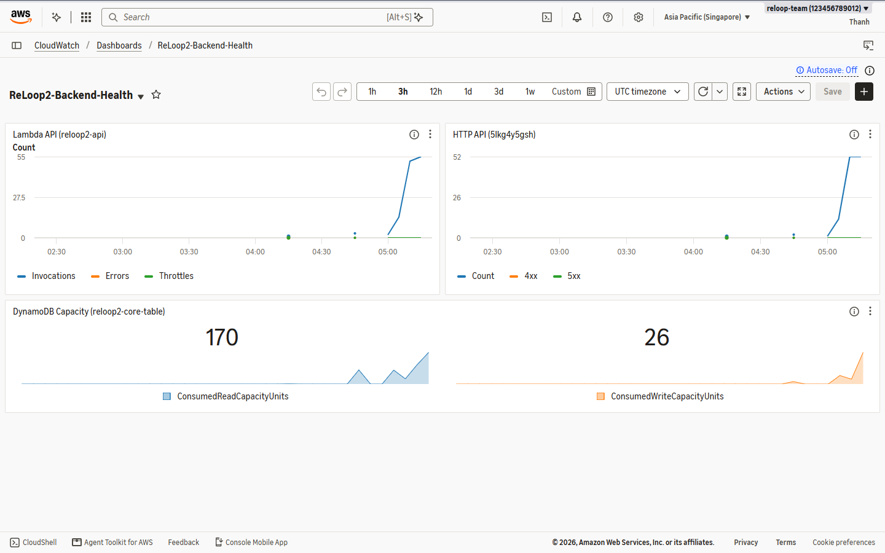
