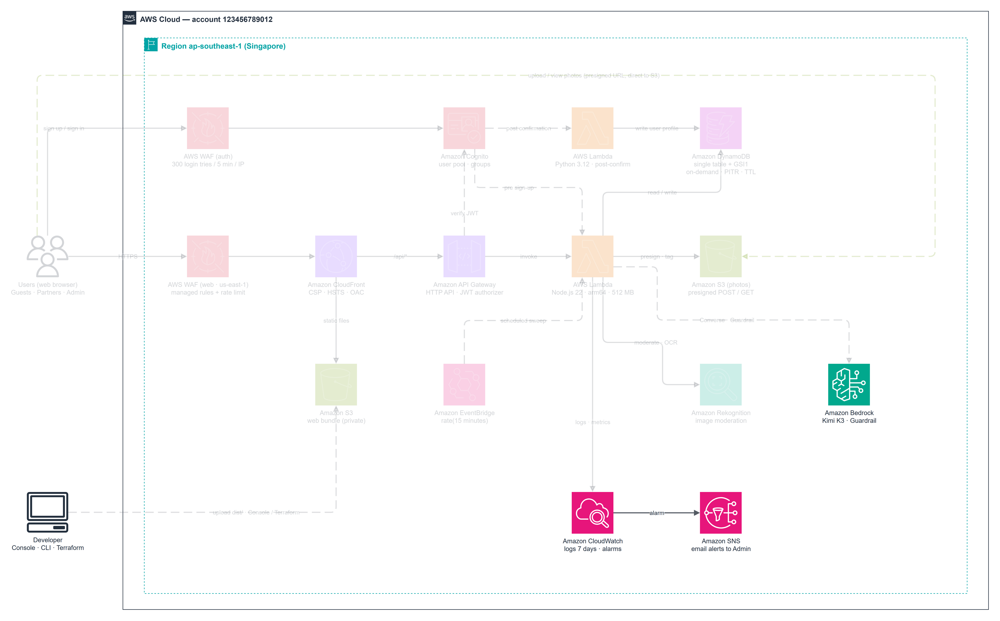
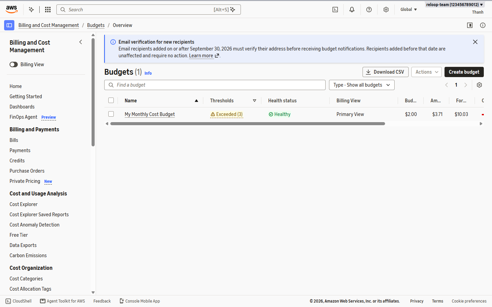
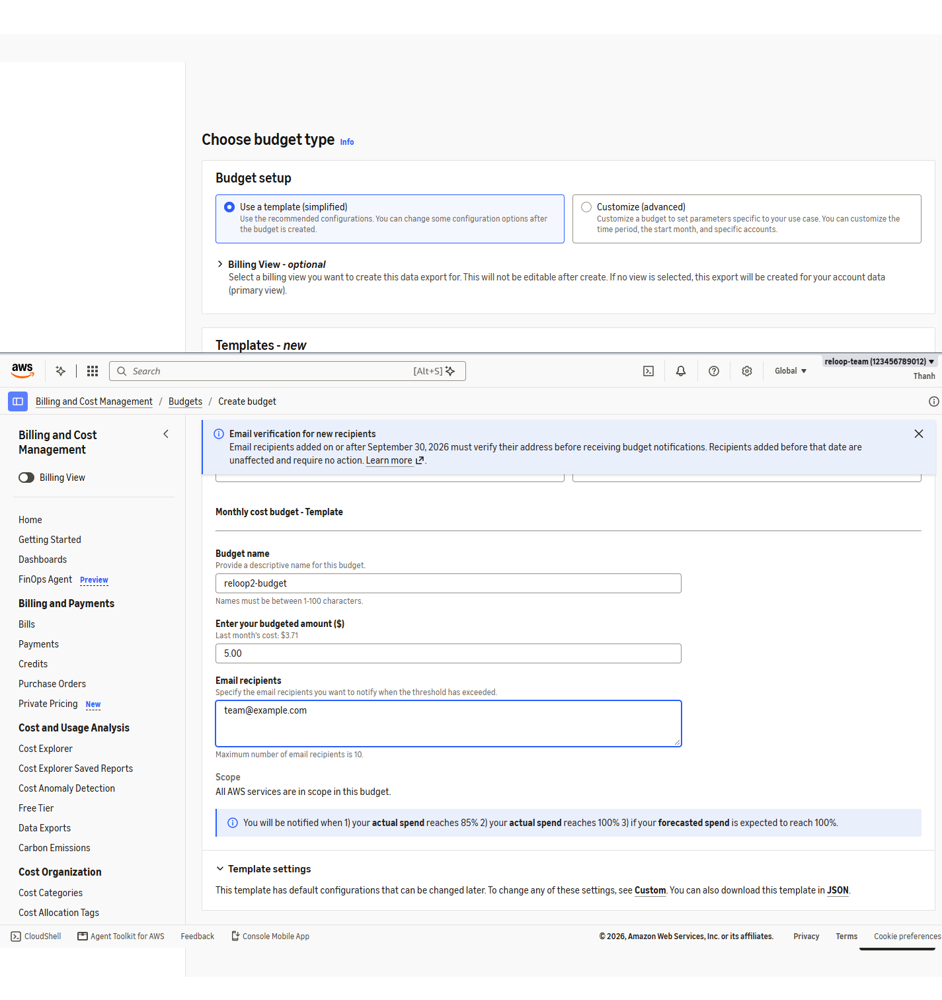
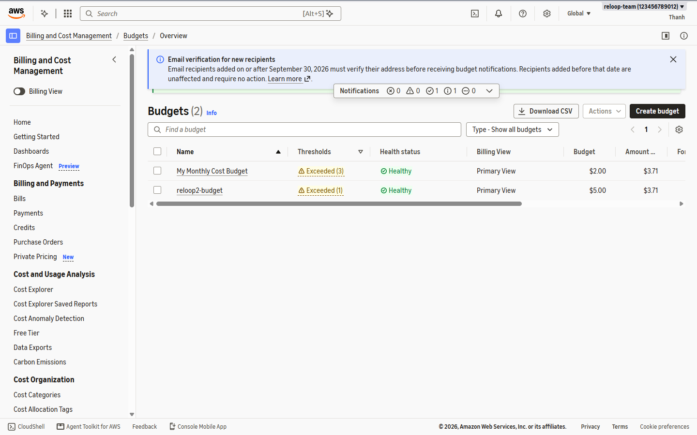
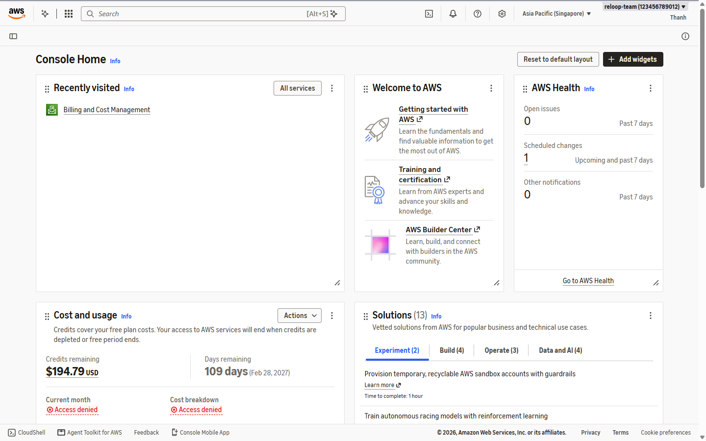
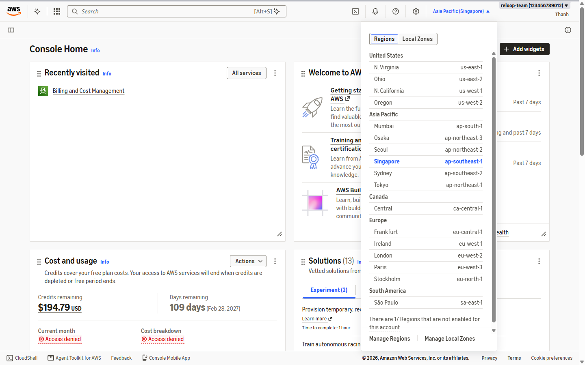
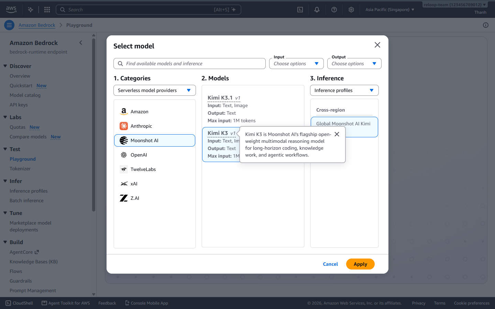
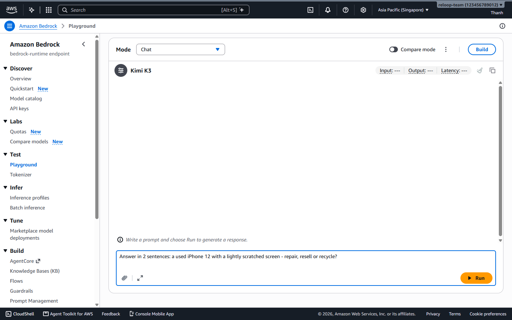
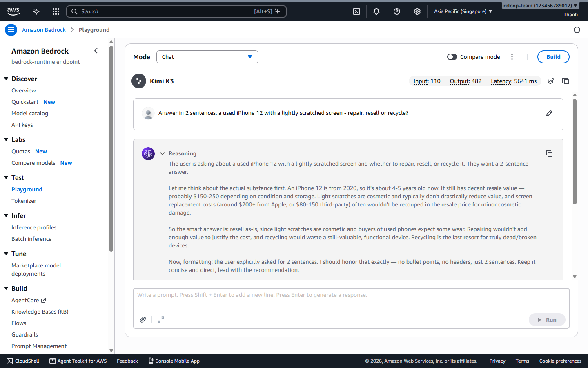

Before provisioning any application resource, set up a **$5.00 monthly cost budget**, verify your primary working region (`ap-southeast-1`), and test model invocation in **Amazon Bedrock** so you catch quota or model availability issues up front.



### Part A — Create a $5.00 Monthly AWS Budget Alert

1. Sign in to the AWS Management Console as an IAM user with permissions for Billing, Budgets, DynamoDB, Cognito, S3, Lambda, API Gateway, CloudFront, WAFv2, EventBridge, CloudWatch, SNS, and Bedrock.
2. Open **Billing and Cost Management -> Budgets**, then review existing budgets or choose **Create budget**.



3. Choose **Use a template (simplified)** -> **Monthly cost budget**:
   - **Budget name:** `reloop2-budget`
   - **Enter your budgeted amount ($):** `5.00`
   - **Email recipients:** `alerts@example.com` (enter your real notification email)



4. Click **Create budget** and confirm `reloop2-budget` appears in the Budgets table (by default the template alerts at **85% actual**, **100% actual**, and **100% forecasted** spend).



---

### Part B — Verify Regions (`ap-southeast-1` Primary & `us-east-1` Global)

ReLoop stores user data, S3 buckets, Cognito, API Gateway, Lambdas, EventBridge, and CloudWatch in **Asia Pacific (Singapore) `ap-southeast-1`** for low latency across Southeast Asia, while two services require **US East (N. Virginia) `us-east-1`**:
- **CloudFront Edge WAFv2 (`reloop2-web`)** (AWS requires CloudFront scope Web ACLs to live in `us-east-1`).
- **Amazon Bedrock Guardrails & Kimi K3 cross-region inference** used in the workshop verification steps.

5. Confirm your Console top-right region selector is set to **Asia Pacific (Singapore) `ap-southeast-1`**.



6. Remember how to switch to **US East (N. Virginia) `us-east-1`** from the region dropdown whenever a later step explicitly targets global CloudFront WAF or Bedrock Guardrails.



---

### Part C — Verify Amazon Bedrock Model Access (`Kimi K3`)

7. Switch region to **`us-east-1`** (or open **Amazon Bedrock -> Playgrounds -> Chat / Text**).
8. Click **Select model** and choose **Moonshot AI -> Kimi K3** (`global.moonshotai.kimi-k3` cross-region inference profile).



9. Send a quick structured JSON verification prompt to confirm model access is enabled without errors:

```text
Return strictly valid JSON with keys "device" and "ok": {"device":"laptop","ok":true}
```



10. Confirm the model responds cleanly with JSON and token/latency metrics displayed. You are now ready to build the storage layer in Module **5.3**.


