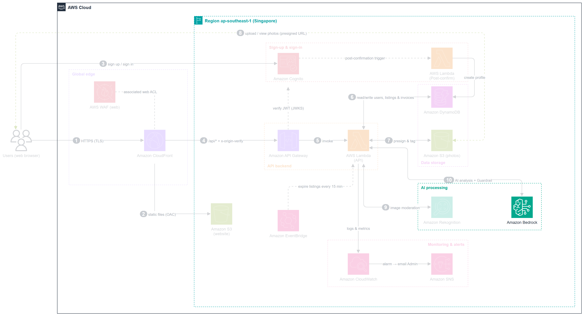
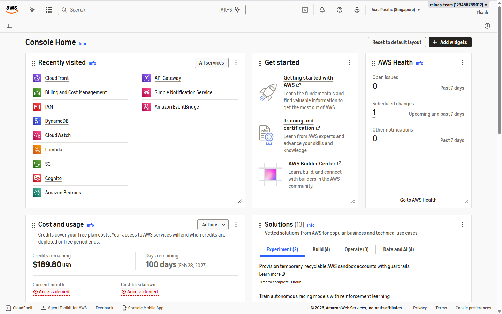
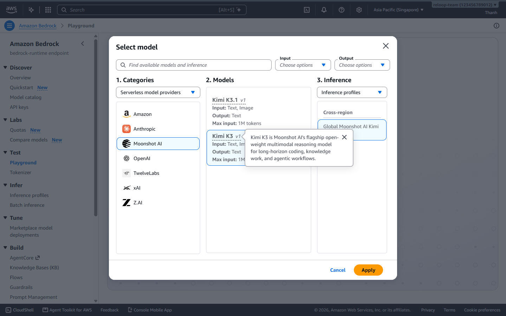
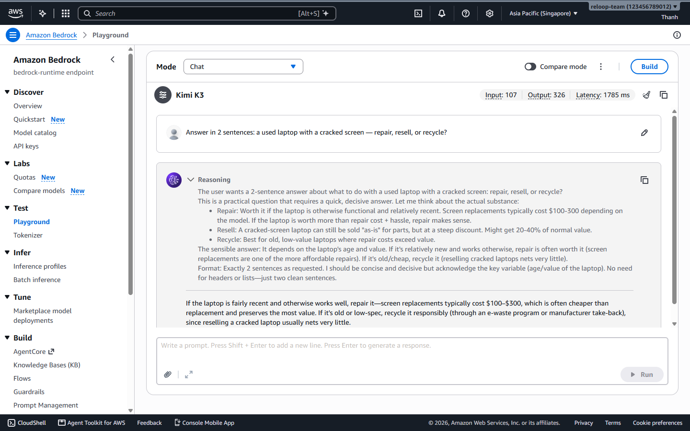

Before building Arrow 1, confirm your AWS account is set to **Asia Pacific (Singapore) `ap-southeast-1`** and can invoke **Amazon Bedrock (`global.moonshotai.kimi-k3`)** directly from Singapore.

**Graph nodes checked in this step:** `Amazon Bedrock` (inside **Region `ap-southeast-1`**).



### Required Tools & Permissions

- An AWS account with Console and AWS CLI v2 access (`aws sts get-caller-identity` succeeds).
- Permissions to create CloudFront, WAFv2, S3, Cognito, API Gateway, Lambda, DynamoDB, Bedrock Guardrails, EventBridge, CloudWatch, SNS, and scoped IAM execution roles.
- Git and Python 3 to clone the companion repository **[github.com/madlyham/ReLoop](https://github.com/madlyham/ReLoop)** (contains prebuilt Lambda `.zip` packages, sanitized frontend bundle + `configure.py`, CloudFront Functions, and modular Terraform IaC):
  ```bash
  git clone https://github.com/madlyham/ReLoop.git
  cd ReLoop
  ```

---

### Step 1 — Confirm Primary Region (`ap-southeast-1`)

Every regional service in the diagram — S3, Cognito, API Gateway, Lambda, DynamoDB, Rekognition, **Amazon Bedrock**, **Bedrock Guardrail**, EventBridge, CloudWatch, and SNS — runs inside **Asia Pacific (Singapore) `ap-southeast-1`**.

Only **AWS WAF (`reloop2-web`)** for Amazon CloudFront uses the **Global (`us-east-1`)** endpoint in Module 5.3.

1. Open the AWS Management Console and verify the top-right region selector is set to **Asia Pacific (Singapore) `ap-southeast-1`**.



---

### Step 2 — Verify Amazon Bedrock Access (`Kimi K3`) in Singapore

ReLoop invokes **`global.moonshotai.kimi-k3`** using Amazon Bedrock's **Global cross-region inference profile** directly from **`ap-southeast-1`**. Stay in **Asia Pacific (Singapore) `ap-southeast-1`** — do not switch to `us-east-1`.

1. Open **Amazon Bedrock -> Test -> Playground** (confirm the top-right region still reads **Asia Pacific (Singapore)**).
2. Click **Select model** -> **Moonshot AI** -> **Kimi K3** -> select the **Cross-region** profile **`Global Moonshot AI Kimi K3`** -> click **Apply**.



3. Enter a short test prompt and press **Enter** (or click **Run**):
   ```text
   Answer in 2 sentences: a used laptop with a cracked screen — repair, resell, or recycle?
   ```
4. Confirm Kimi K3 returns a response with input/output token metrics and latency.



{}
Your Singapore region and Bedrock model access are verified. Move on to [Module 5.3 — Global Edge & Static Website](../5.3-global-edge/) to build **Arrows 1 and 2 + WAF**.
{}
