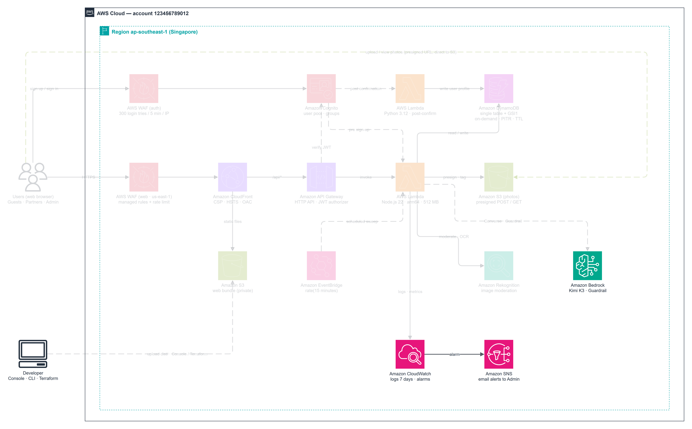
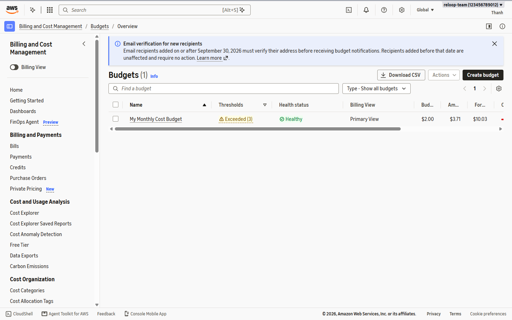
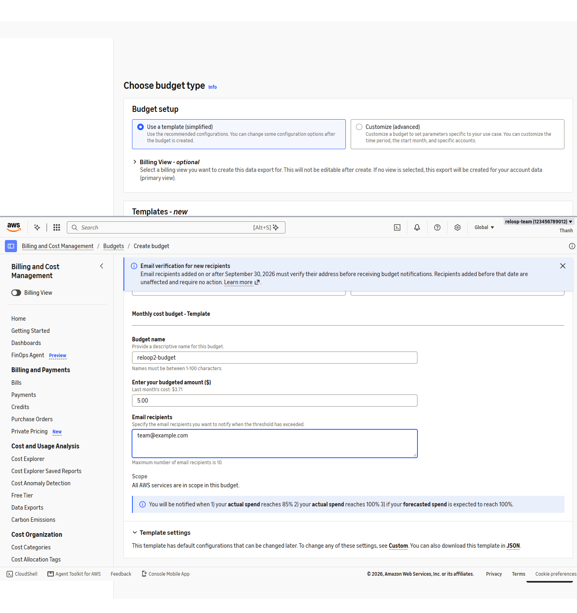
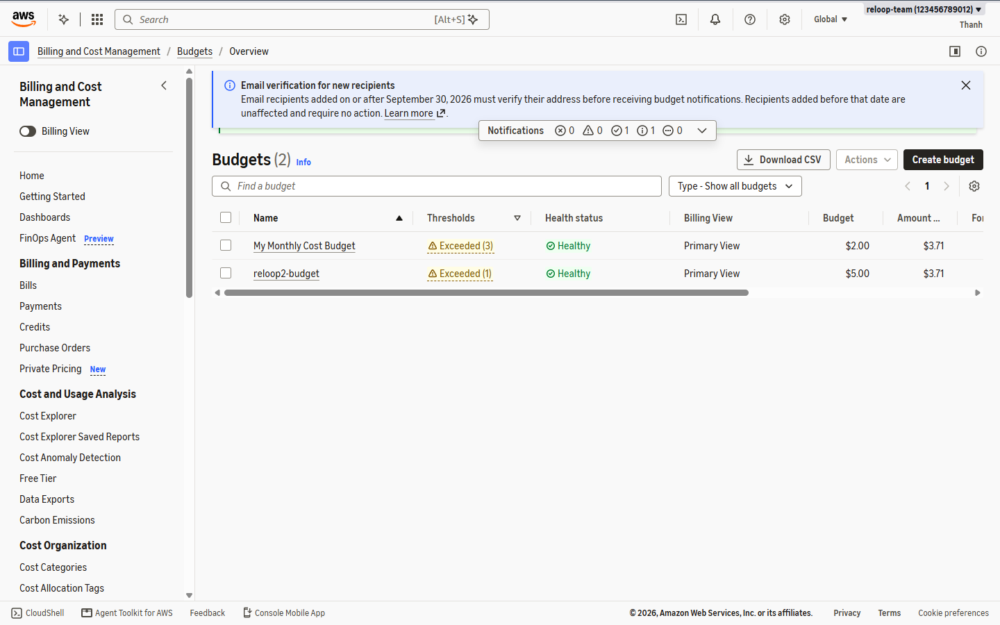
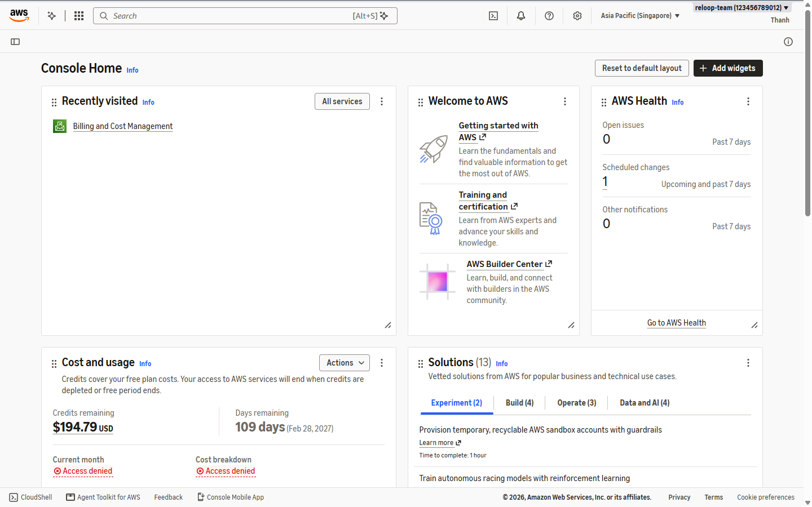
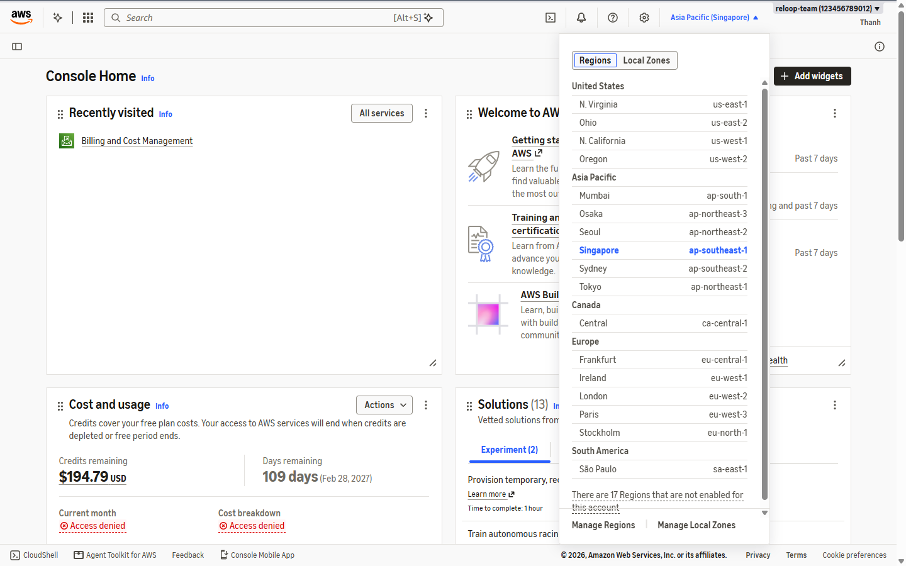
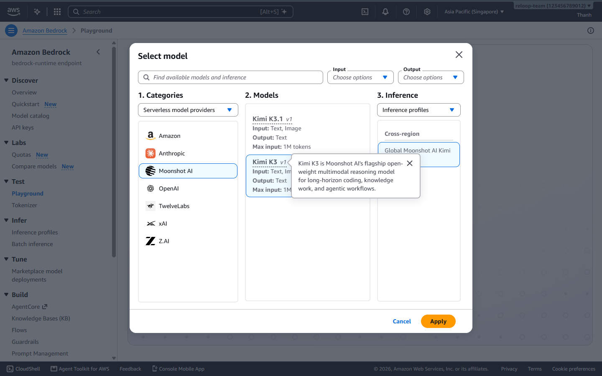
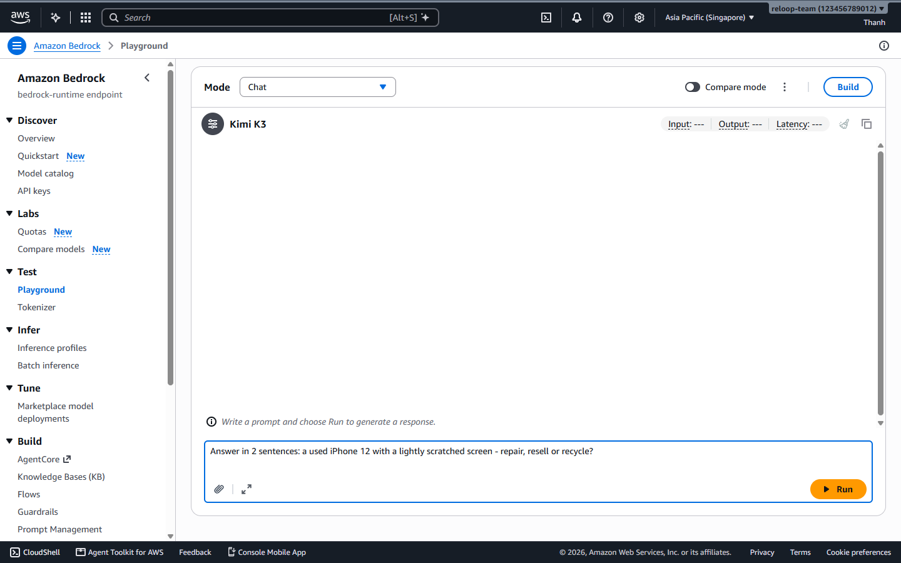
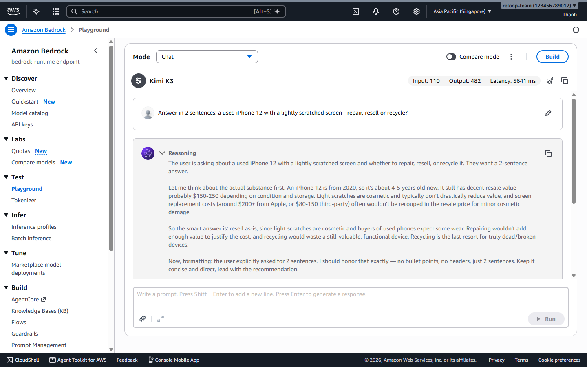

Trước khi tạo tài nguyên ứng dụng, hãy thiết lập cảnh báo chi phí **$5.00/tháng**, xác nhận Region chính (`ap-southeast-1`) và gọi thử mô hình **Amazon Bedrock** để chắc chắn tài khoản đã sẵn sàng quyền truy cập AI.



### Phần A — Tạo cảnh báo ngân sách $5.00/tháng trên AWS Budgets

1. Đăng nhập AWS Management Console bằng IAM User có đủ quyền cho Budgets, DynamoDB, Cognito, S3, Lambda, API Gateway, CloudFront, WAFv2, EventBridge, CloudWatch, SNS và Bedrock.
2. Vào **Billing and Cost Management -> Budgets**, kiểm tra danh sách hiện có và bấm **Create budget**.



3. Chọn **Use a template (simplified)** -> **Monthly cost budget**:
   - **Budget name:** `reloop2-budget`
   - **Enter your budgeted amount ($):** `5.00`
   - **Email recipients:** `alerts@example.com` (nhập email thật của bạn để nhận cảnh báo)



4. Bấm **Create budget** và kiểm tra `reloop2-budget` xuất hiện trong bảng (mẫu tự động cảnh báo ở ngưỡng **85% thực tế**, **100% thực tế**, và **100% dự báo**).



---

### Phần B — Xác nhận Region (`ap-southeast-1` chính & `us-east-1` Global)

ReLoop đặt cơ sở dữ liệu, S3, Cognito, API Gateway, Lambda, EventBridge và CloudWatch tại **Asia Pacific (Singapore) `ap-southeast-1`** để tối ưu độ trễ cho người dùng Đông Nam Á, riêng hai thành phần cần thao tác tại **US East (N. Virginia) `us-east-1`**:
- **AWS WAFv2 cho CloudFront (`reloop2-web`)** (AWS bắt buộc scope CloudFront nằm ở `us-east-1`).
- **Amazon Bedrock Guardrails** và kiểm thử model trong Playground.

5. Kiểm tra thanh góc trên bên phải Console đang chọn **Asia Pacific (Singapore) `ap-southeast-1`**.



6. Khi cần chuyển sang **`us-east-1`** ở các bước CloudFront WAF hoặc Bedrock, dùng menu chọn Region ở góc trên phải.



---

### Phần C — Kiểm tra quyền gọi Amazon Bedrock (`Kimi K3`)

7. Chuyển Region sang **`us-east-1`** và mở **Amazon Bedrock -> Playgrounds -> Chat / Text**.
8. Bấm **Select model**, chọn **Moonshot AI -> Kimi K3** (sử dụng inference profile `global.moonshotai.kimi-k3`).



9. Nhập thử prompt yêu cầu trả JSON để kiểm tra model hoạt động bình thường:

```text
Return strictly valid JSON with keys "device" and "ok": {"device":"laptop","ok":true}
```



10. Khi model trả về JSON hợp lệ kèm thông số latency/token là tài khoản đã sẵn sàng AI. Chuyển sang **Phần 5.3** để tạo bảng DynamoDB.


