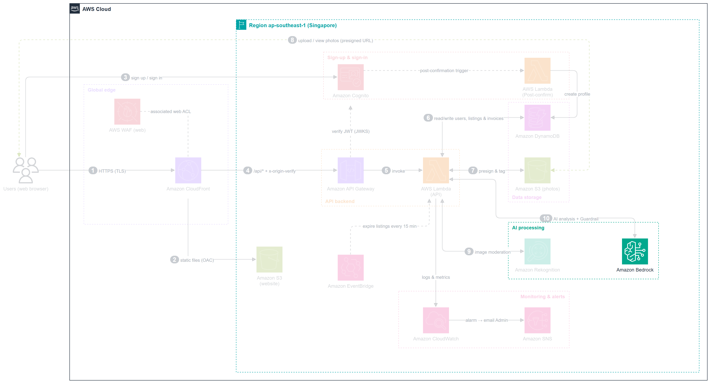
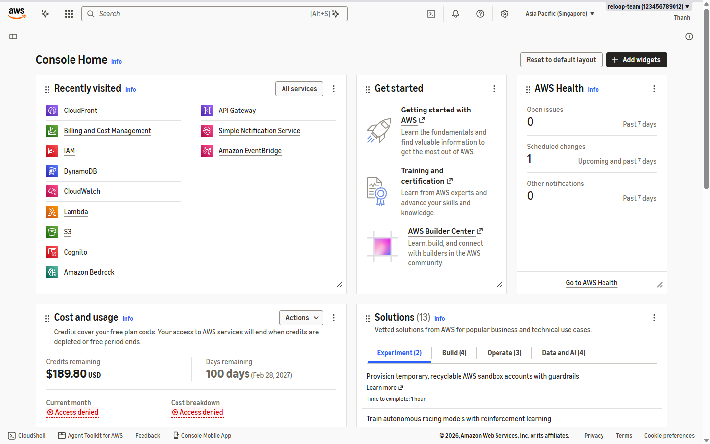
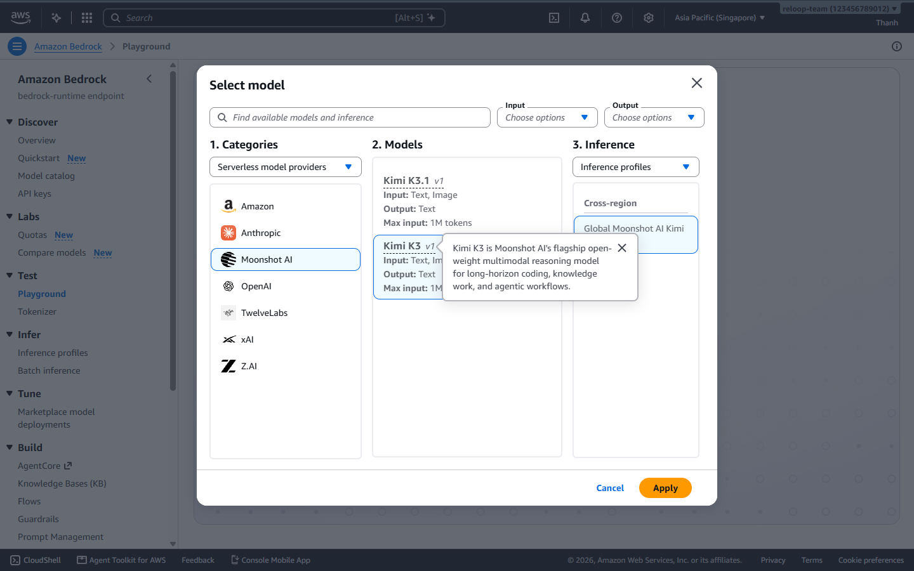
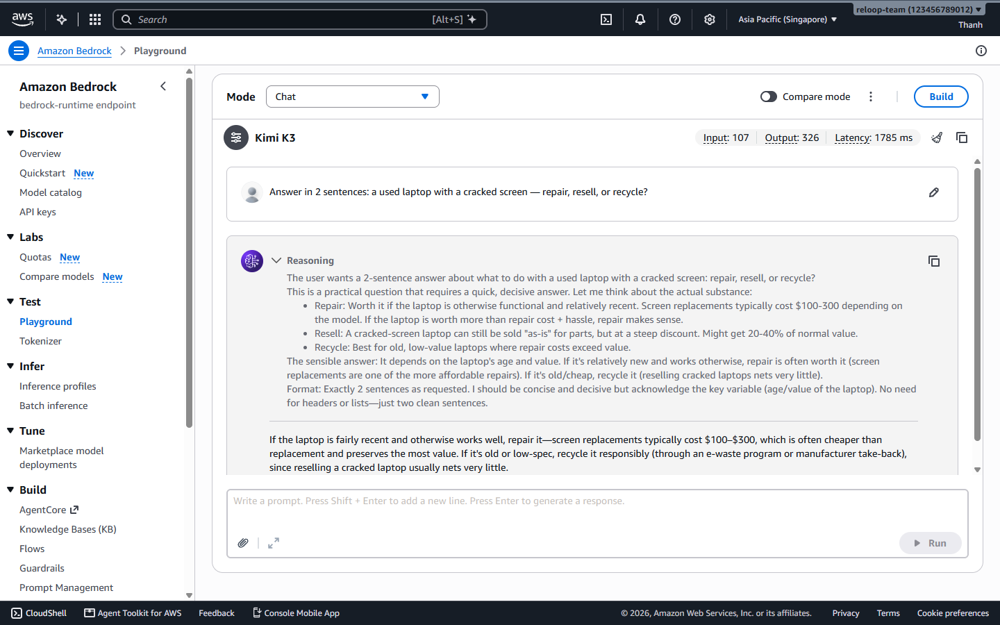

Trước khi dựng Mũi tên 1, hãy xác nhận tài khoản AWS đang chọn đúng vùng **Asia Pacific (Singapore) `ap-southeast-1`** và có thể gọi **Amazon Bedrock (`global.moonshotai.kimi-k3`)** ngay từ Singapore.

**Thành phần sơ đồ kiểm tra ở bước này:** `Amazon Bedrock` (trong **Vùng `ap-southeast-1`**).



### Công cụ & Quyền cần có

- Tài khoản AWS có quyền truy cập AWS Management Console và AWS CLI v2 (`aws sts get-caller-identity` chạy thành công).
- Quyền tạo CloudFront, WAFv2, S3, Cognito, API Gateway, Lambda, DynamoDB, Bedrock Guardrails, EventBridge, CloudWatch, SNS và vai trò thực thi IAM giới hạn quyền.
- Git và Python 3 để tải kho mã nguồn đồng hành **[github.com/madlyham/ReLoop](https://github.com/madlyham/ReLoop)** (chứa sẵn các gói `.zip` Lambda, bản dựng giao diện tĩnh kèm `configure.py`, CloudFront Functions và mã Terraform dạng mô-đun):
  ```bash
  git clone https://github.com/madlyham/ReLoop.git
  cd ReLoop
  ```

---

### Bước 1 — Xác nhận vùng chính (`ap-southeast-1`)

Mọi dịch vụ theo vùng trên sơ đồ — S3, Cognito, API Gateway, Lambda, DynamoDB, Rekognition, **Amazon Bedrock**, **Bedrock Guardrail**, EventBridge, CloudWatch và SNS — đều chạy tại **Asia Pacific (Singapore) `ap-southeast-1`**.

Chỉ riêng **AWS WAF (`reloop2-web`)** gắn với Amazon CloudFront sử dụng phạm vi **Global (`us-east-1`)** ở Học phần 5.3.

1. Mở AWS Management Console và kiểm tra bộ chọn vùng ở góc trên bên phải đang là **Asia Pacific (Singapore) `ap-southeast-1`**.



---

### Bước 2 — Kiểm tra quyền gọi Amazon Bedrock (`Kimi K3`) tại Singapore

ReLoop gọi **`global.moonshotai.kimi-k3`** thông qua **Global cross-region inference profile** của Amazon Bedrock ngay từ **`ap-southeast-1`**. Hãy giữ nguyên vùng **Asia Pacific (Singapore) `ap-southeast-1`** — không cần chuyển sang `us-east-1`.

1. Mở **Amazon Bedrock -> Test -> Playground** (xác nhận góc trên bên phải vẫn là **Asia Pacific (Singapore)**).
2. Nhấn **Select model** -> **Moonshot AI** -> **Kimi K3** -> chọn inference profile **Cross-region** **`Global Moonshot AI Kimi K3`** -> nhấn **Apply**.



3. Nhập câu thử ngắn rồi nhấn **Enter** (hoặc **Run**):
   ```text
   Answer in 2 sentences: a used laptop with a cracked screen — repair, resell, or recycle?
   ```
4. Xác nhận Kimi K3 trả lời kèm số token đầu vào/đầu ra và độ trễ.



{}
Vùng Singapore và quyền gọi Bedrock đã sẵn sàng. Chuyển sang [Học phần 5.3 — Lớp biên toàn cầu & Website tĩnh](../5.3-global-edge/) để dựng **Mũi tên 1, 2 và WAF**.
{}
