ReLoop uses an **Amazon DynamoDB** single-table schema (`reloop2-core-table`) in **`ap-southeast-1`** with On-Demand capacity, one Global Secondary Index (`GSI1`) for role/status queries, 35-day Point-in-Time Recovery (PITR), and Time to Live (TTL) for automatic cleanup of temporary records and timers.

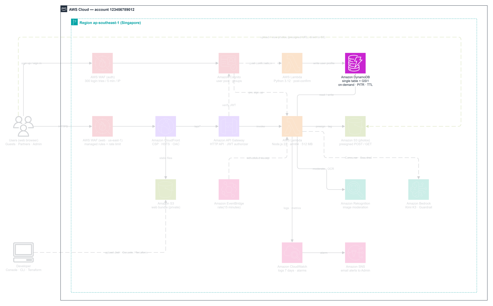

### Single-Table Key Design Overview

| Attribute | Type | Role |
| --- | --- | --- |
| `PK` | String (`S`) | Partition Key — entity prefix (`USER#<id>`, `LISTING#<id>`, `TIMER#<isoTime>`, `SESSION#<id>`) |
| `SK` | String (`S`) | Sort Key — record subtype (`PROFILE`, `META`, `QUOTE#<id>`, `LISTING_EXPIRE#<id>`) |
| `GSI1PK` | String (`S`) | Secondary partition key (`ROLE#Owner`, `STATUS#OPEN`, `PARTNER#<id>`) |
| `GSI1SK` | String (`S`) | Secondary sort key (`USER#<id>`, `<createdAt>`) |
| `ttl` | Number (`N`) | Unix epoch timestamp (seconds) monitored by DynamoDB TTL |

---

### Step 1 — Create `reloop2-core-table`

1. Switch back to **Asia Pacific (Singapore) `ap-southeast-1`**, open **DynamoDB -> Tables**, and click **Create table**.

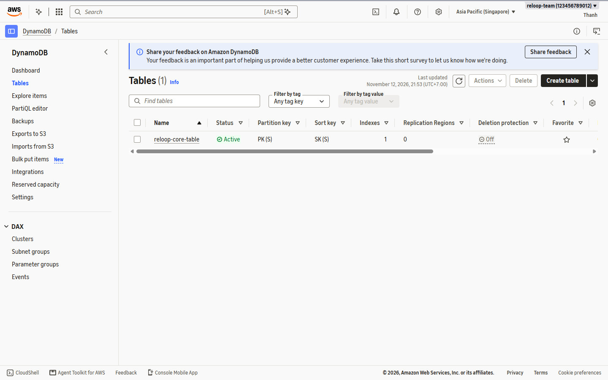

2. Under **Table details**:
   - **Table name:** `reloop2-core-table`
   - **Partition key:** `PK` (`String`)
   - **Sort key:** `SK` (`String`)

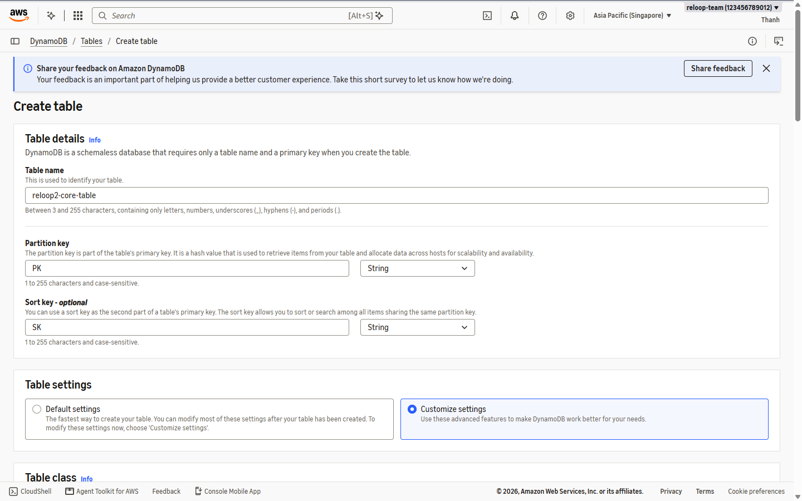

3. Select **Customize settings**, set **Capacity mode** to **On-demand**, then scroll to **Secondary indexes** -> click **Create global index**:
   - **Partition key:** `GSI1PK` (`String`)
   - **Sort key:** `GSI1SK` (`String`)
   - **Index name:** `GSI1`
   - **Attribute projections:** `All`

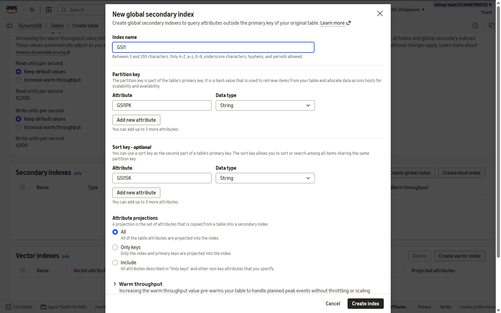

4. Review the complete configuration summary (On-demand throughput + Standard table class + `GSI1`).

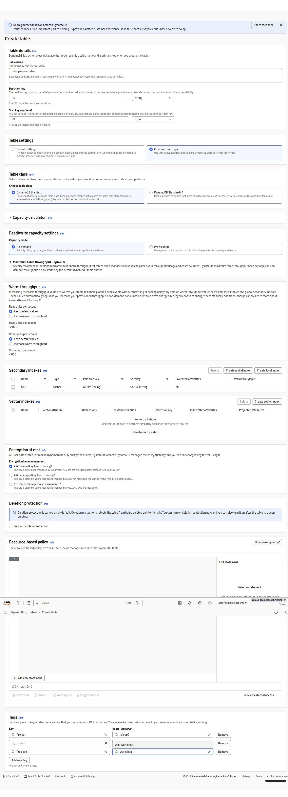

5. Confirm **Secondary indexes** shows `GSI1` queued with `ALL` projection.

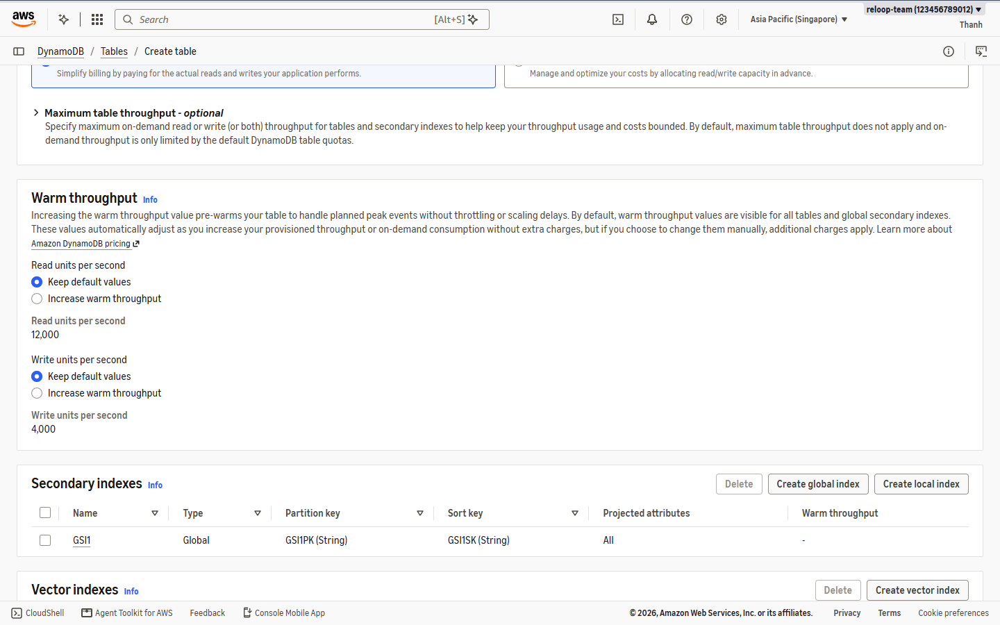

6. Under **Tags**, add standard workshop tags:
   - `Owner = team`
   - `Project = reloop2`
   - `Purpose = workshop`
   Then click **Create table**.

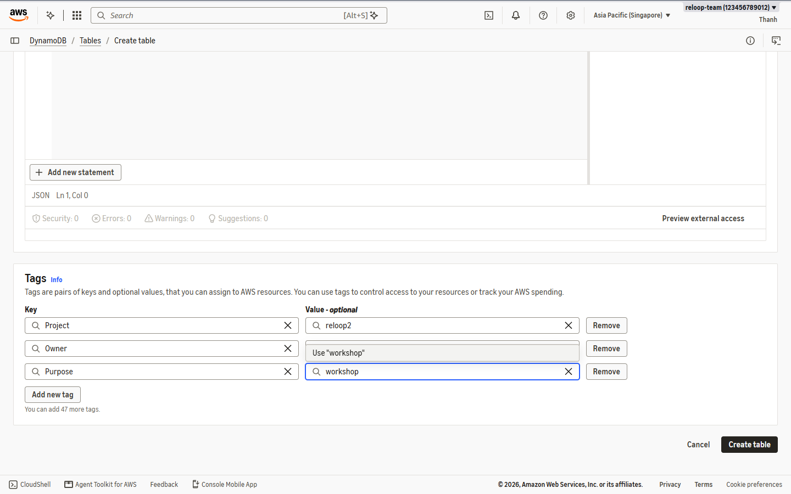

7. Wait ~15 seconds while the table status transitions from **Creating** to **Active**.

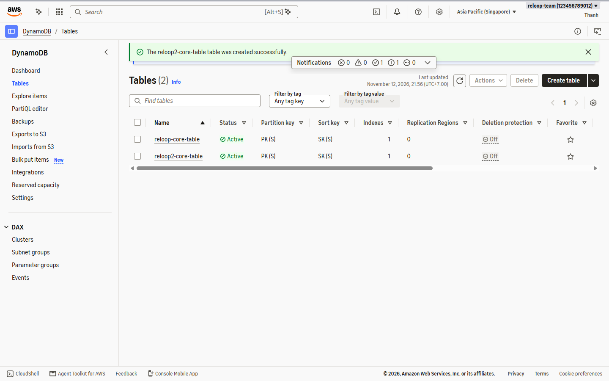

---

### Step 2 — Enable Point-in-Time Recovery (PITR) & TTL

8. Open `reloop2-core-table` -> **Backups** tab -> under **Point-in-time recovery (PITR)** click **Edit**.
9. Check **Turn on point-in-time recovery** and set **Recovery window (days)** to `35`, then click **Save changes**.

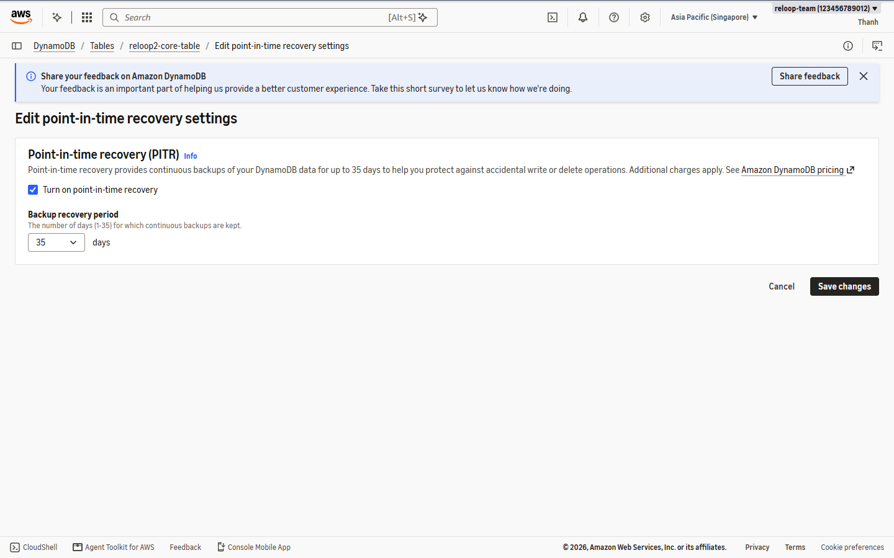

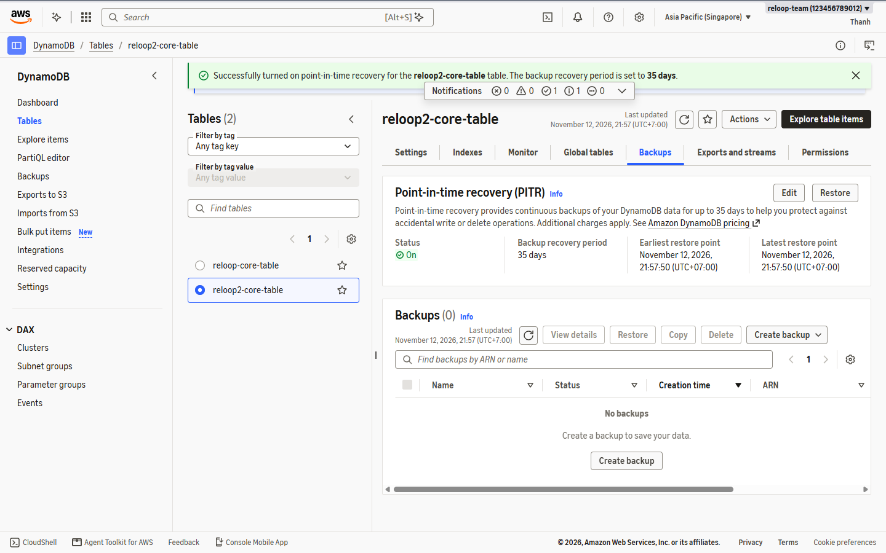

10. Scroll to **Additional settings -> Time to Live (TTL)** -> click **Turn on** -> enter **TTL attribute name:** `ttl` -> **Turn on TTL**.

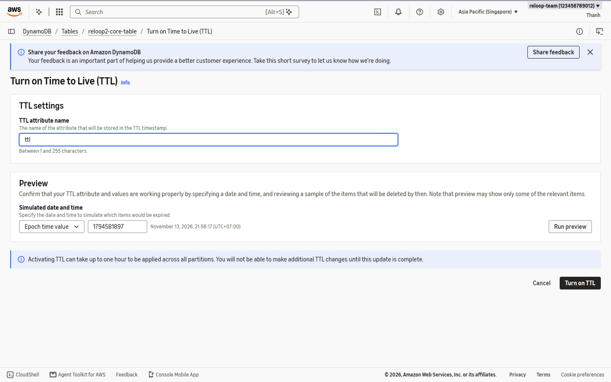

---

### Step 3 — Verify Table & Index Status

11. Open the **Overview** tab and **Indexes** tab of `reloop2-core-table` to confirm:
   - Status is `Active`
   - Billing mode is `On-demand`
   - `GSI1` is `Active` with `PK/SK` + `GSI1PK/GSI1SK` (`ALL`)

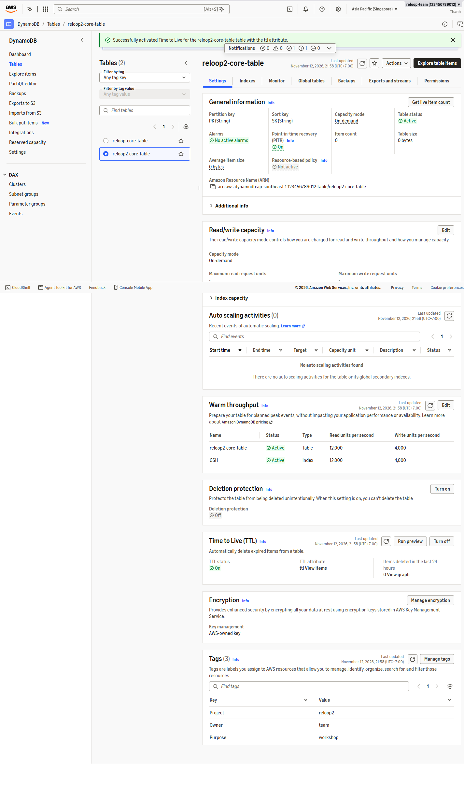

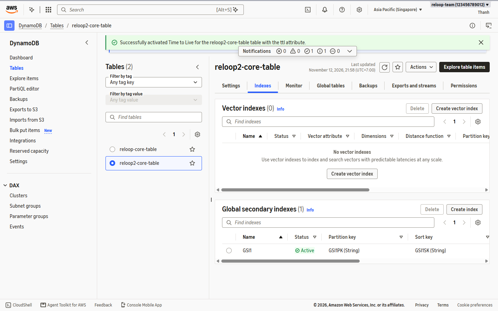
