ReLoop lưu toàn bộ dữ liệu nghiệp vụ trong một bảng **Amazon DynamoDB** duy nhất (`reloop2-core-table`) tại Region **`ap-southeast-1`**, chạy chế độ **On-demand**, có một **Global Secondary Index (`GSI1`)** phục vụ truy vấn theo vai trò/trạng thái, bật sao lưu liên tục **PITR 35 ngày** và **TTL** tự động dọn dữ liệu tạm.

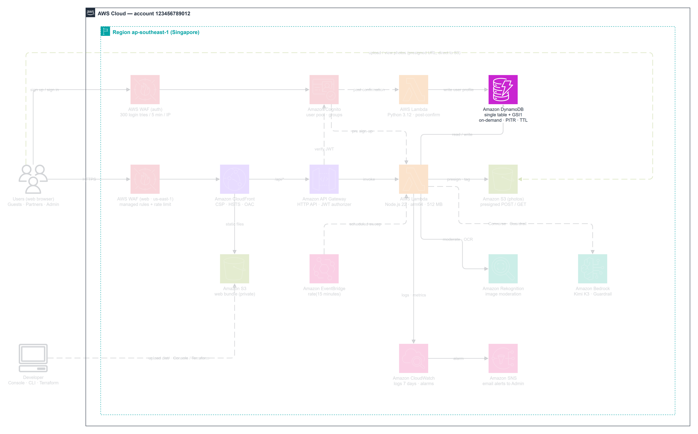

### Thiết kế khóa Single-Table

| Thuộc tính | Kiểu | Vai trò |
| --- | --- | --- |
| `PK` | String (`S`) | Partition Key — định danh đối tượng (`USER#<id>`, `LISTING#<id>`, `TIMER#<isoTime>`, `SESSION#<id>`) |
| `SK` | String (`S`) | Sort Key — loại bản ghi con (`PROFILE`, `META`, `QUOTE#<id>`, `LISTING_EXPIRE#<id>`) |
| `GSI1PK` | String (`S`) | Khóa phân vùng chỉ mục phụ (`ROLE#Owner`, `STATUS#OPEN`, `PARTNER#<id>`) |
| `GSI1SK` | String (`S`) | Khóa sắp xếp chỉ mục phụ (`USER#<id>`, `<createdAt>`) |
| `ttl` | Number (`N`) | Unix epoch (giây) để DynamoDB TTL tự động xóa |

---

### Bước 1 — Tạo bảng `reloop2-core-table`

1. Chuyển về **Asia Pacific (Singapore) `ap-southeast-1`**, mở **DynamoDB -> Tables**, bấm **Create table**.

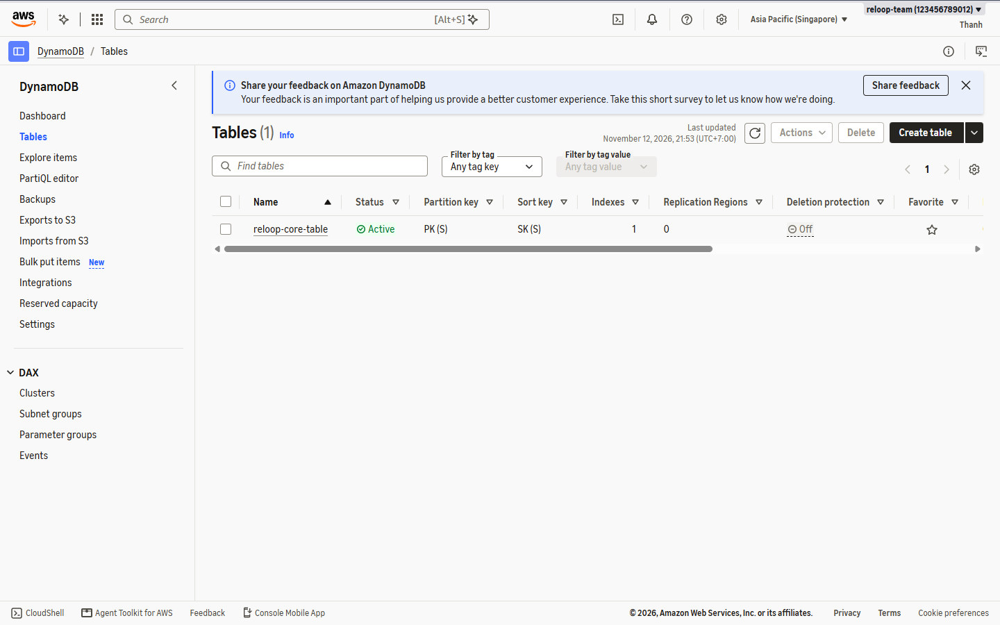

2. Ở mục **Table details**:
   - **Table name:** `reloop2-core-table`
   - **Partition key:** `PK` (`String`)
   - **Sort key:** `SK` (`String`)

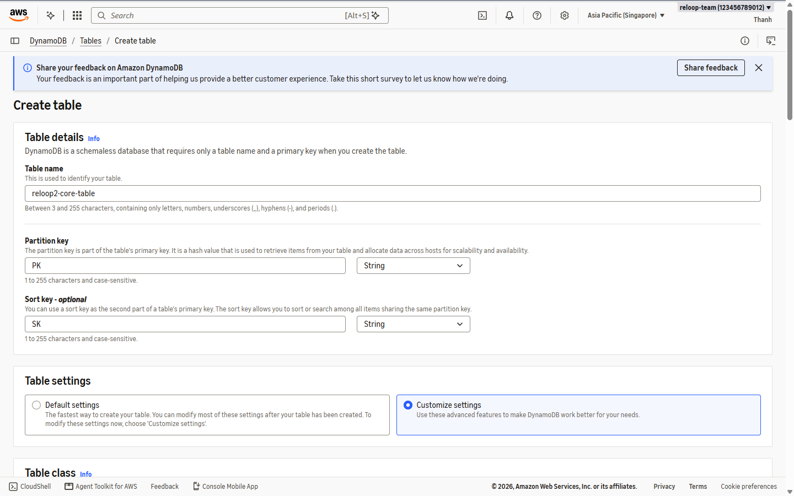

3. Chọn **Customize settings**, đặt **Capacity mode** là **On-demand**, kéo xuống **Secondary indexes** -> bấm **Create global index**:
   - **Partition key:** `GSI1PK` (`String`)
   - **Sort key:** `GSI1SK` (`String`)
   - **Index name:** `GSI1`
   - **Attribute projections:** `All`

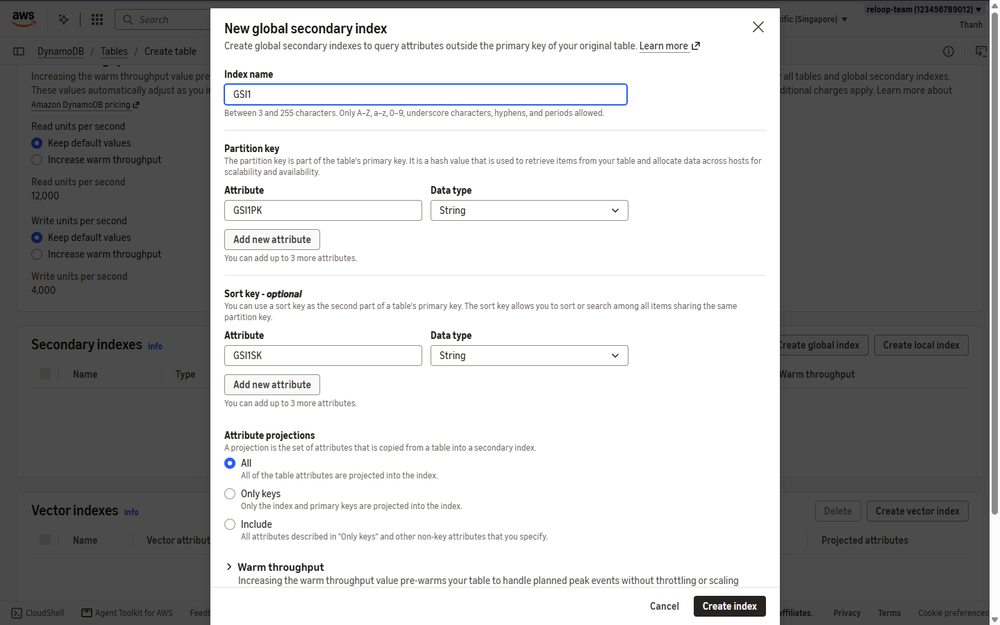

4. Kiểm tra lại cấu hình tổng quan (On-demand, Standard class, đã có `GSI1`).

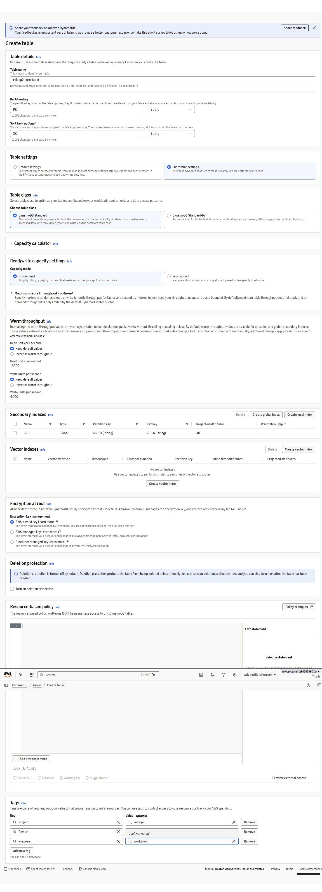

5. Xác nhận mục **Secondary indexes** đã hiển thị `GSI1` (`ALL`).

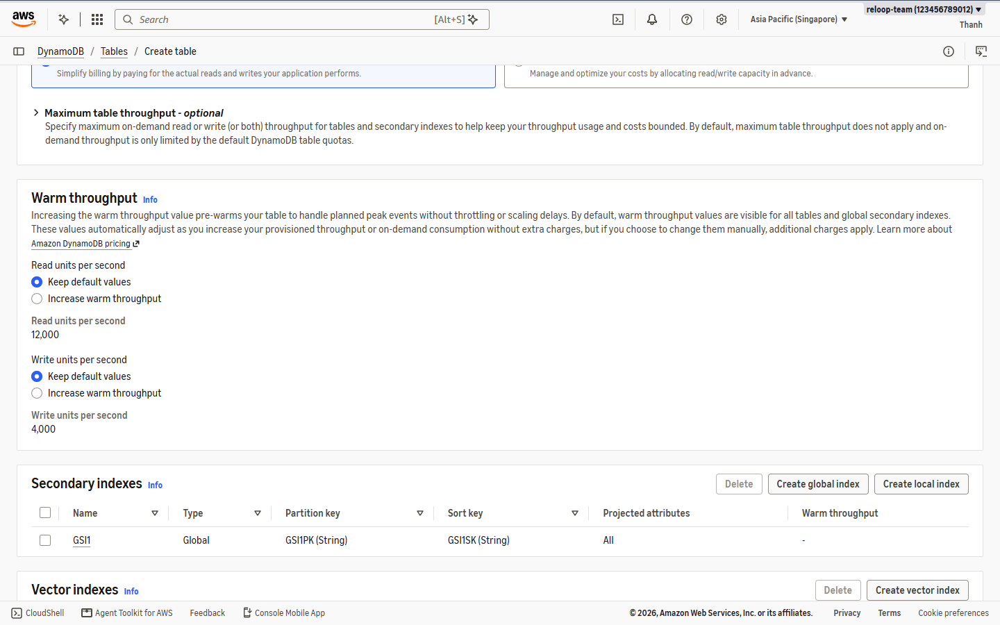

6. Ở mục **Tags**, gắn bộ tag thực hành:
   - `Owner = team`
   - `Project = reloop2`
   - `Purpose = workshop`
   Rồi bấm **Create table**.

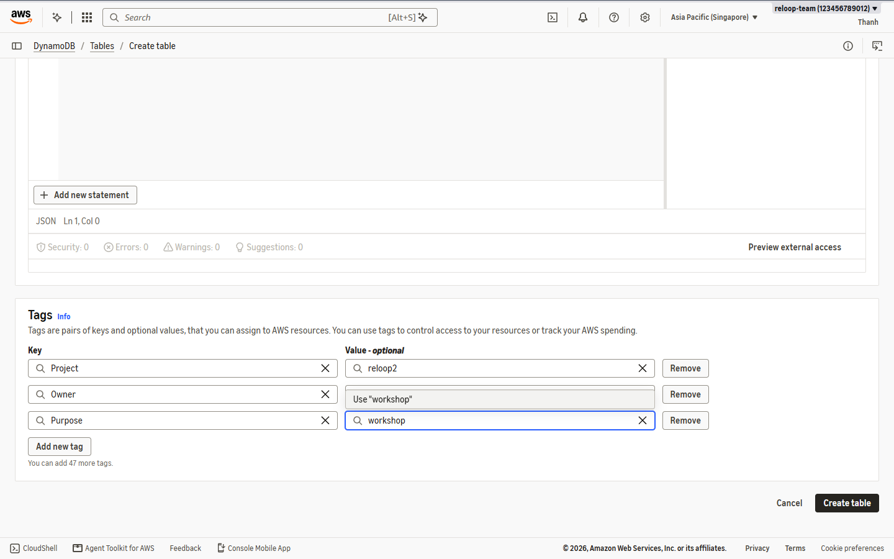

7. Đợi khoảng 15 giây để trạng thái bảng chuyển từ **Creating** sang **Active**.

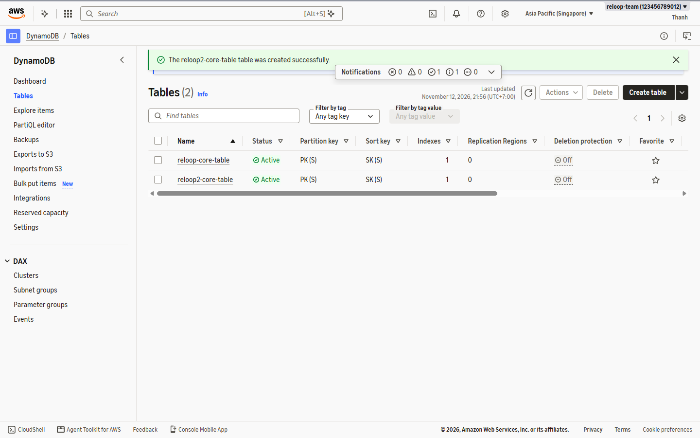

---

### Bước 2 — Bật Point-in-Time Recovery (PITR) và TTL

8. Mở bảng `reloop2-core-table` -> tab **Backups** -> ở mục **Point-in-time recovery (PITR)** bấm **Edit**.
9. Tích **Turn on point-in-time recovery**, đặt **Recovery window (days)** là `35`, bấm **Save changes**.

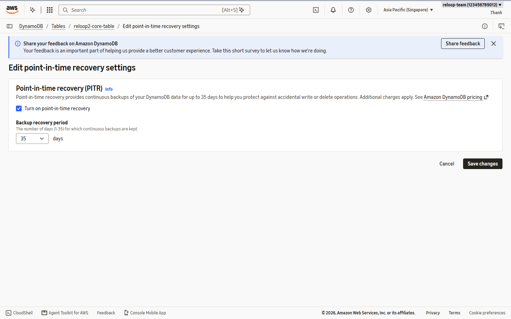

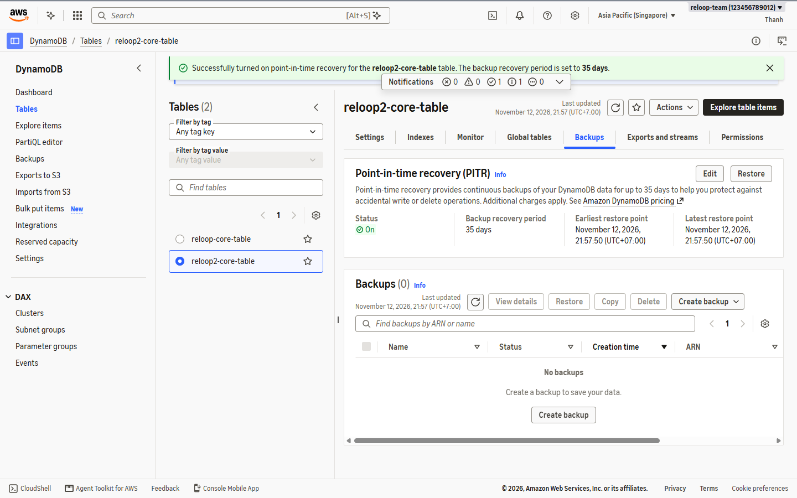

10. Chuyển sang **Additional settings -> Time to Live (TTL)** -> bấm **Turn on** -> nhập **TTL attribute name:** `ttl` -> **Turn on TTL**.

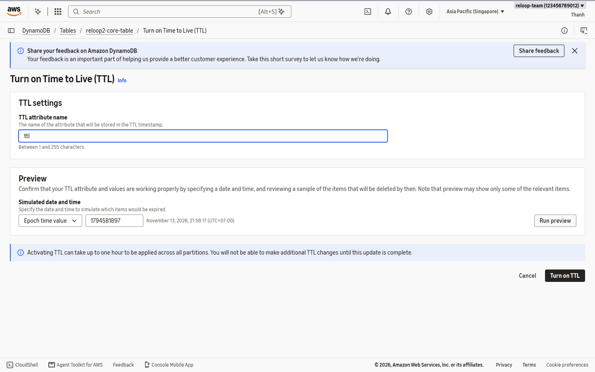

---

### Bước 3 — Xác nhận bảng và chỉ mục phụ sẵn sàng

11. Kiểm tra lại tab **Overview** và tab **Indexes** của `reloop2-core-table`:
   - Trạng thái `Active`, On-demand
   - `GSI1` ở trạng thái `Active`, đầy đủ thuộc tính `ALL`

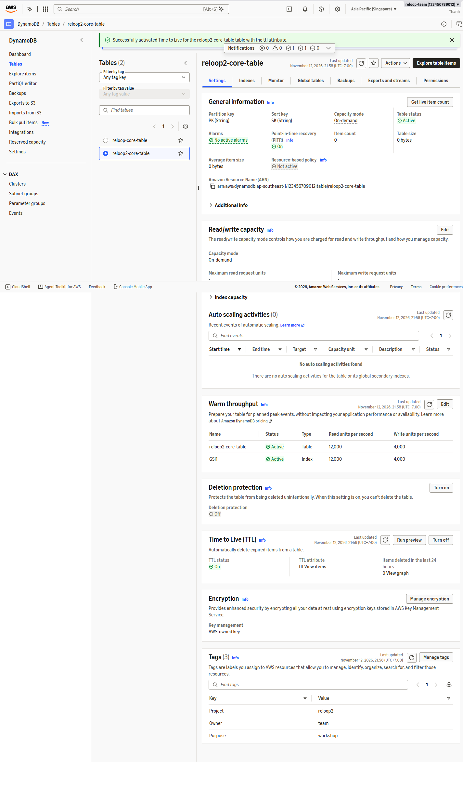

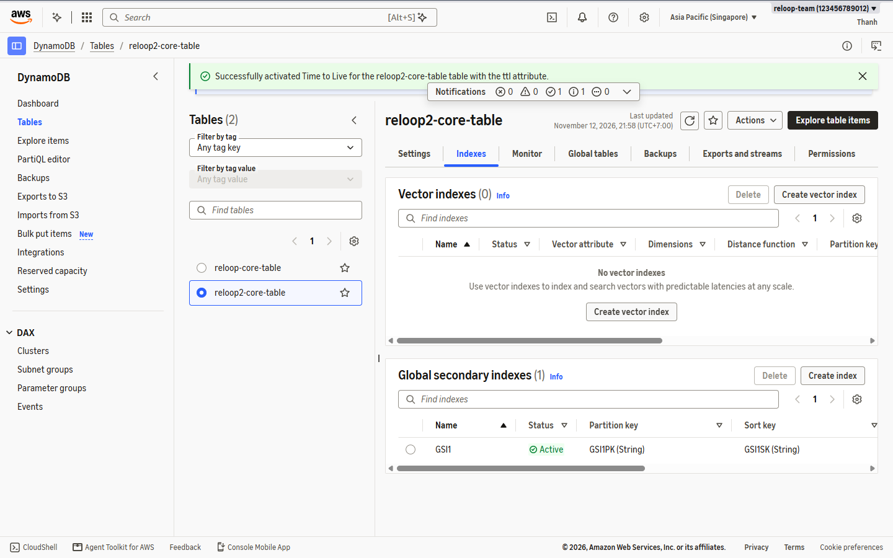
