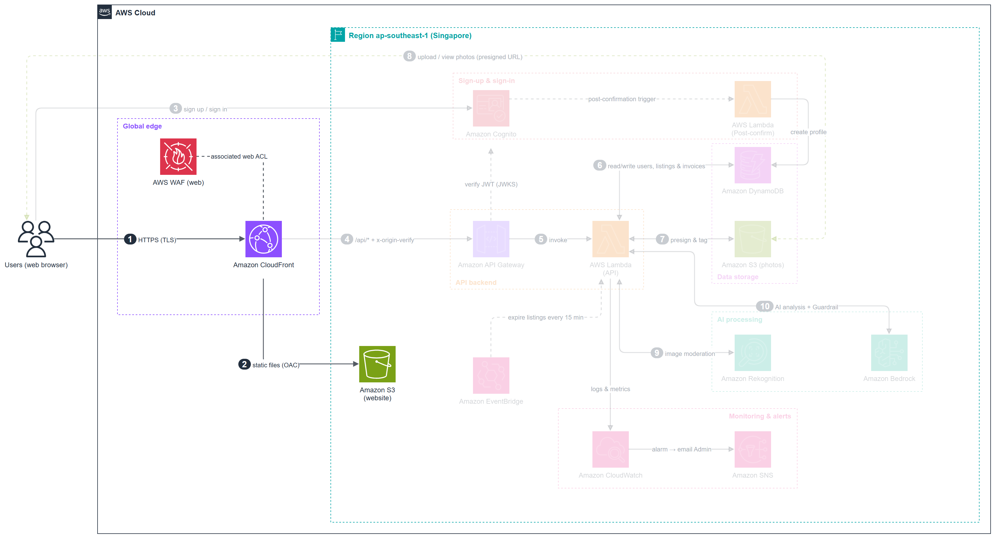
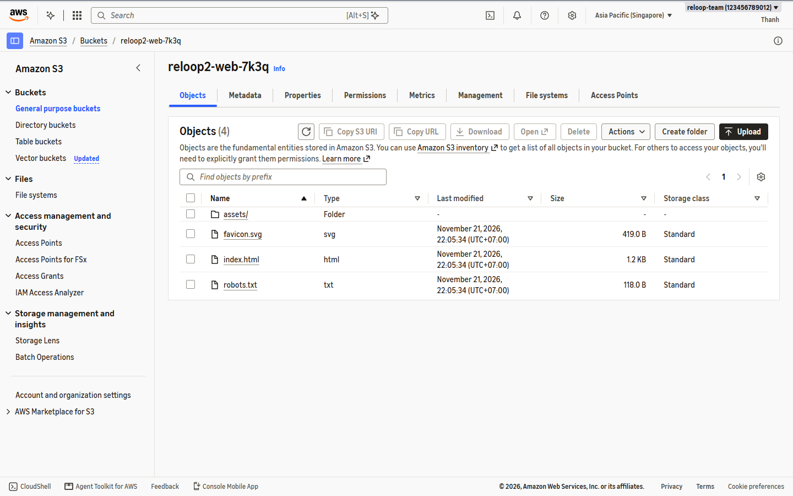
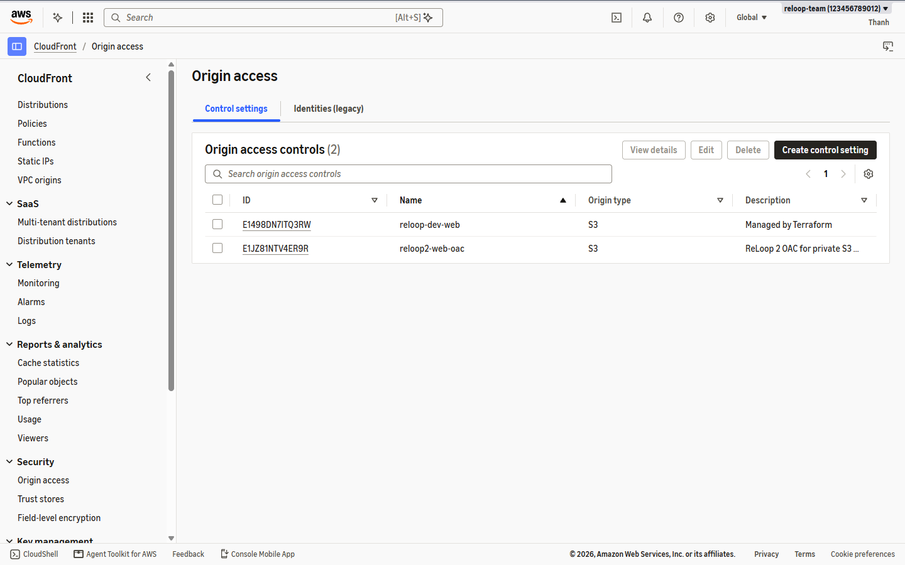
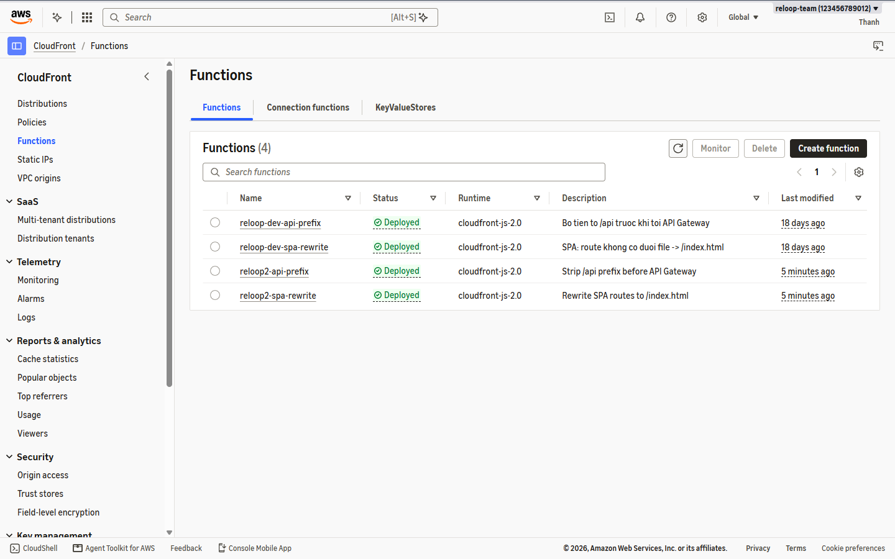
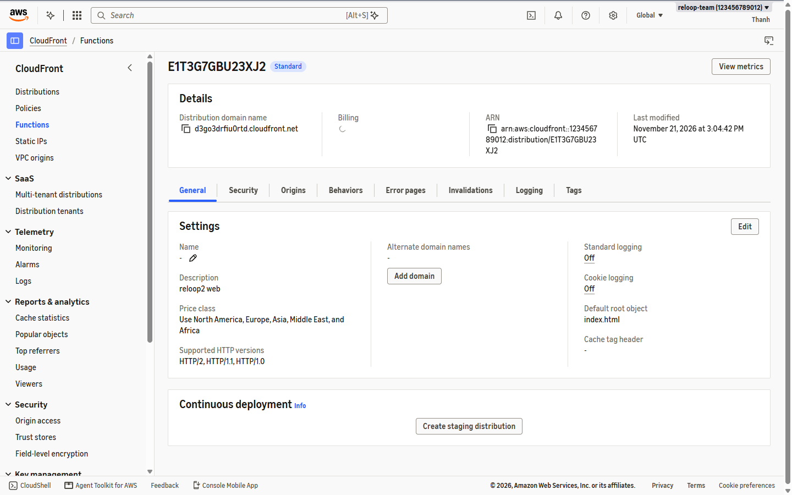
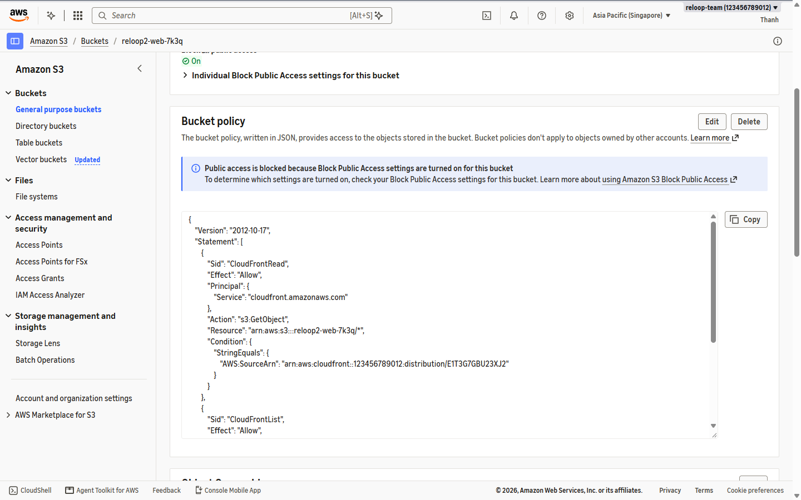
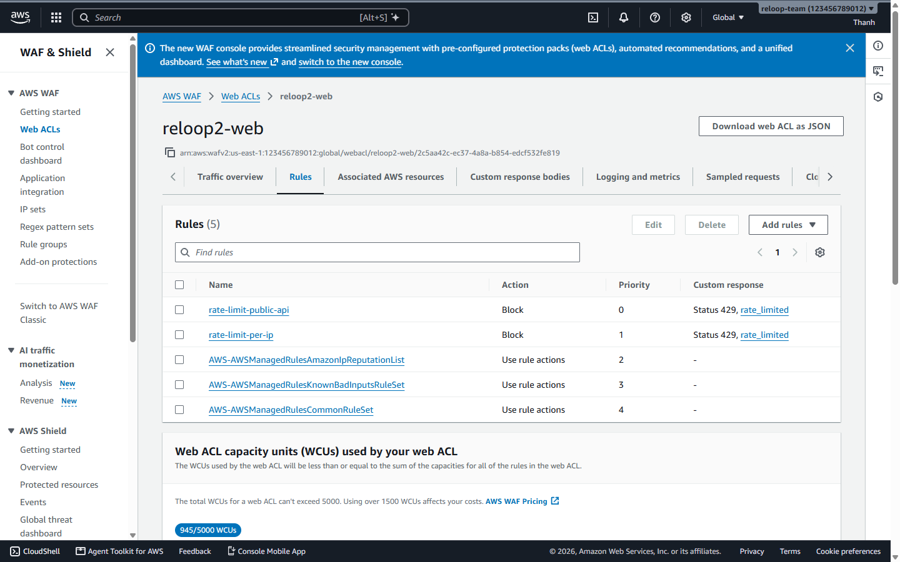
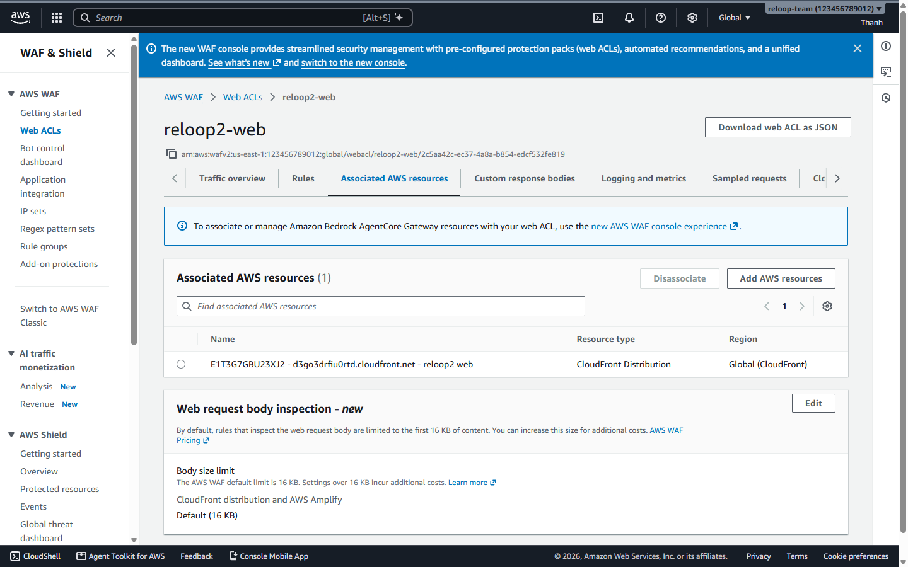

Start at the entry point of the architecture diagram. In this module you create the private S3 website bucket, put **Amazon CloudFront** in front of it with Origin Access Control (OAC), and attach **AWS WAF (`reloop2-web`)** to protect every incoming HTTPS request. Building CloudFront first also gives you your live `https://<dist-domain>.cloudfront.net` URL right away, so later modules wire Cognito, API Gateway, and S3 CORS cleanly in one pass with no backfill.

**Graph arrows covered in this step:**
- **Arrow 1:** `Users (web browser) → Amazon CloudFront` (`HTTPS (TLS)`)
- **Supporting link:** `AWS WAF (web) — Amazon CloudFront` (`associated web ACL`)
- **Arrow 2:** `Amazon CloudFront → Amazon S3 (website)` (`static files (OAC)`)



---

### Part A — Create Private S3 Website Bucket (`Arrow 2` Target)

Although the diagram labels this bucket **Amazon S3 (website)** because it holds the built React site, **S3 static website hosting stays OFF**. All public access is blocked so only CloudFront can read objects through OAC.

1. Open **Amazon S3** in **`ap-southeast-1`** -> click **Create bucket**.
2. Configure:
   - **Bucket name:** `reloop2-web-<suffix>` (for example, `reloop2-web-7k3q`)
   - **Block all public access:** **Enabled** (all 4 boxes checked)
   - **Default encryption:** Server-side encryption with Amazon S3 managed keys (**SSE-S3**), Bucket Key **Enable**
   - **Tag:** `Project = reloop2`
3. Click **Create bucket**. (You will upload the final frontend bundle once Cognito IDs are created in Module 5.4.)



---

### Part B — Create CloudFront OAC & Routing Functions

Inside **Amazon CloudFront**, create two small helper features needed for Arrows 2 and 4:

1. **Origin Access Control (OAC):** Open **CloudFront -> Security -> Origin access -> Create control setting**:
   - **Name:** `reloop2-web-oac`
   - **Signing behavior:** `Sign requests (recommended)` (`sigv4`)
   - **Origin type:** `S3`



2. **CloudFront Functions (`cloudfront-js-2.0`):** Open **CloudFront -> Functions** and create + publish two lightweight viewer-request functions (also saved in [`cloudfront-functions/`](https://github.com/madlyham/ReLoop/tree/main/cloudfront-functions) in the companion repo):
   - **`reloop2-spa-rewrite`** (supports **Arrow 2** so SPA routes like `/feed` or `/listings/new` resolve to `/index.html` while keeping real asset extensions untouched):
     ```javascript
     function handler(event) {
       var req = event.request;
       if (!/\.(js|mjs|css|map|html|png|jpe?g|gif|svg|ico|webp|avif|txt|json|xml|webmanifest|woff2?|ttf)$/i.test(req.uri)) req.uri = '/index.html';
       return req;
     }
     ```
   - **`reloop2-api-prefix`** (prepares **Arrow 4** for Module 5.5 by stripping `/api` before forwarding to HTTP API Gateway):
     ```javascript
     function handler(event) {
       var req = event.request;
       req.uri = req.uri.replace(/^\/api(?=\/)/, '');
       return req;
     }
     ```



---

### Part C — Create CloudFront Distribution & S3 OAC Bucket Policy (`Arrows 1 & 2`)

1. Open **CloudFront -> Distributions -> Create distribution**:
   - **Origin domain:** `reloop2-web-<suffix>.s3.ap-southeast-1.amazonaws.com`
   - **Origin access:** **Origin access control settings (recommended)** -> choose **`reloop2-web-oac`**
   - **Viewer protocol policy:** `Redirect HTTP to HTTPS`
   - **Allowed HTTP methods:** `GET, HEAD`
   - **Cache policy:** `CachingOptimized`
   - **Function associations -> Viewer request:** `CloudFront Functions` -> **`reloop2-spa-rewrite`**
   - **Price class:** `Use North America, Europe, Asia, Middle East, and Africa` (`PriceClass_200`)
   - **Default root object:** `index.html`
   - **Description:** `reloop2 web`
   - **Web Application Firewall (WAF):** Choose **Do not enable security protections** here — you attach your custom `reloop2-web` Web ACL cleanly in Part D.
2. Click **Create distribution** and note your **Distribution ID** (`<dist-id>`) and **Distribution domain name** (`https://<dist-domain>.cloudfront.net`).



3. Return to **S3 -> `reloop2-web-<suffix>` -> Permissions -> Bucket policy** and paste the least-privilege policy granting read access strictly to your distribution ARN:
   *(Replace placeholder `123456789012` with your 12-digit AWS Account ID, plus `<suffix>` and `<dist-id>`.)*
   ```json
   {
     "Version": "2012-10-17",
     "Statement": [
       {
         "Sid": "CloudFrontRead",
         "Effect": "Allow",
         "Principal": { "Service": "cloudfront.amazonaws.com" },
         "Action": "s3:GetObject",
         "Resource": "arn:aws:s3:::reloop2-web-<suffix>/*",
         "Condition": {
           "StringEquals": {
             "AWS:SourceArn": "arn:aws:cloudfront::123456789012:distribution/<dist-id>"
           }
         }
       },
       {
         "Sid": "CloudFrontList",
         "Effect": "Allow",
         "Principal": { "Service": "cloudfront.amazonaws.com" },
         "Action": "s3:ListBucket",
         "Resource": "arn:aws:s3:::reloop2-web-<suffix>",
         "Condition": {
           "StringEquals": {
             "AWS:SourceArn": "arn:aws:cloudfront::123456789012:distribution/<dist-id>"
           }
         }
       }
     ]
   }
   ```



---

### Part D — Create & Associate AWS WAF (`reloop2-web`)

In the diagram, **AWS WAF (web)** connects directly to **Amazon CloudFront** via `associated web ACL`. CloudFront WAF ACLs must be created in **Global (CloudFront) / `us-east-1`**.

1. Open **AWS WAF & Shield -> Web ACLs**, select **Global (CloudFront)**, and click **Create web ACL**.
2. Set **Name:** `reloop2-web`, **Description:** `ReLoop: IP rate limits, bad IPs, common attack patterns - CloudFront`, and associate your CloudFront distribution (`reloop2 web`).
3. Add a **Custom response body** named **`rate_limited`** (Content type: `JSON`):
   ```json
   {"code":"RATE_LIMITED","message":"Too many requests - wait about 1 minute and try again"}
   ```
4. Add these **5 rules** in priority order (`0` → `4`):

| Priority | Rule Name | Type & Action |
| --- | --- | --- |
| `0` | `rate-limit-public-api` | Rate-based: **100 req / 60s / IP** scoped to URI paths starting with `/api/auth/`, `/api/feed/public`, or `/api/fees` -> **Block** (`429`, body `rate_limited`, header `retry-after: 60`) |
| `1` | `rate-limit-per-ip` | Rate-based: **1,000 req / 60s / IP** across all paths -> **Block** (`429`, body `rate_limited`, header `retry-after: 60`) |
| `2` | `AWS-AWSManagedRulesAmazonIpReputationList` | AWS Managed Rule Group (default actions) |
| `3` | `AWS-AWSManagedRulesKnownBadInputsRuleSet` | AWS Managed Rule Group (default actions) |
| `4` | `AWS-AWSManagedRulesCommonRuleSet` | AWS Managed Rule Group — override **`SizeRestrictions_BODY`** and **`GenericRFI_BODY`** to **Count** so legitimate JSON payloads are never false-blocked |

5. Set **Default action:** **Allow** -> click **Create web ACL**.
6. Verify the **Rules (5)** tab shows `945/5000 WCUs` and the **Associated AWS resources** tab lists your CloudFront distribution.





{}
**Arrows 1, 2, and WAF are now built.** Next, move to [Module 5.4 — Sign-up & Sign-in](../5.4-sign-up-and-sign-in/) to build **Arrow 3** and the **Post-confirmation** profile trigger.
{}
