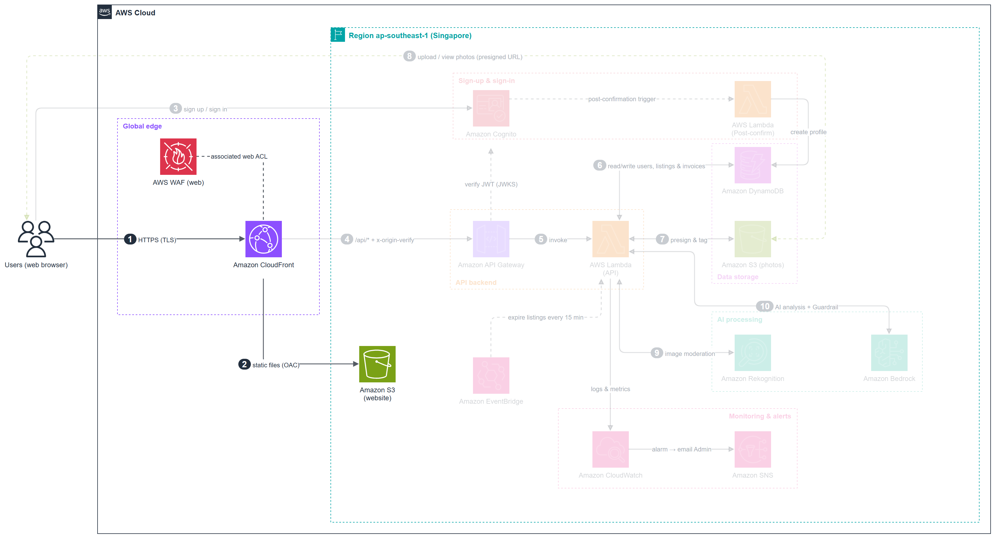
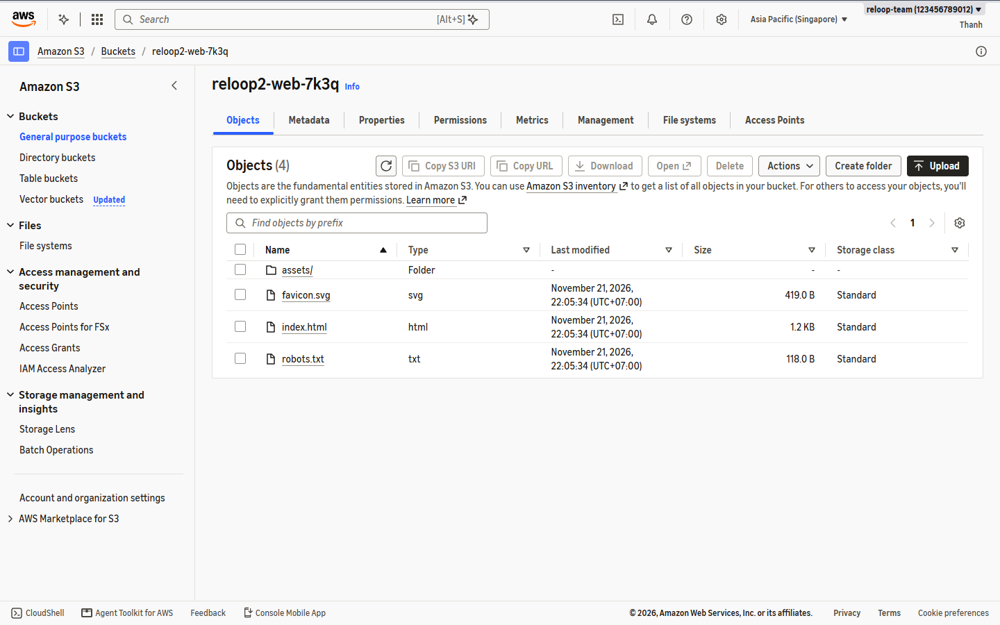
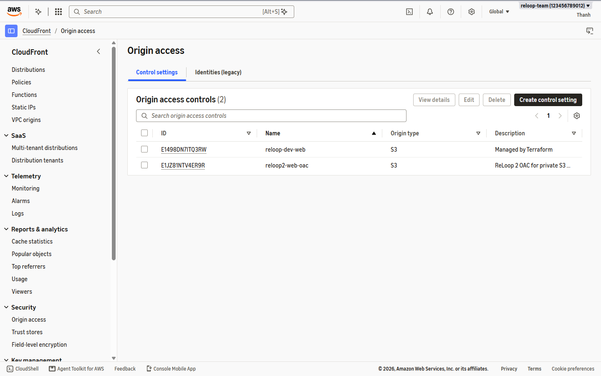
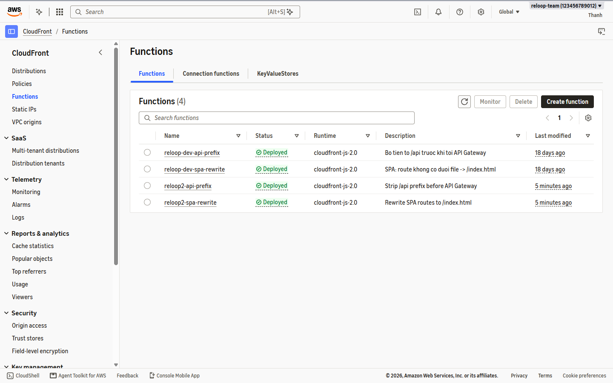
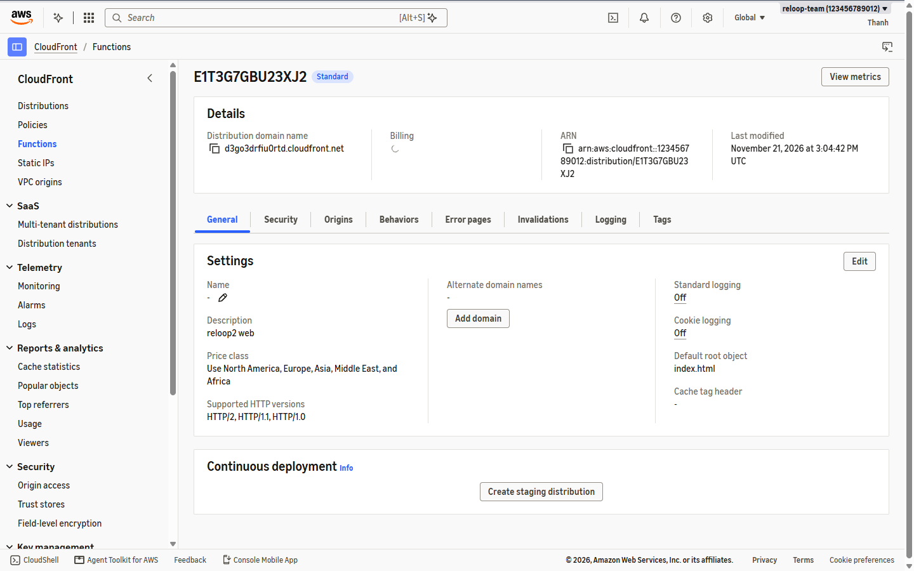
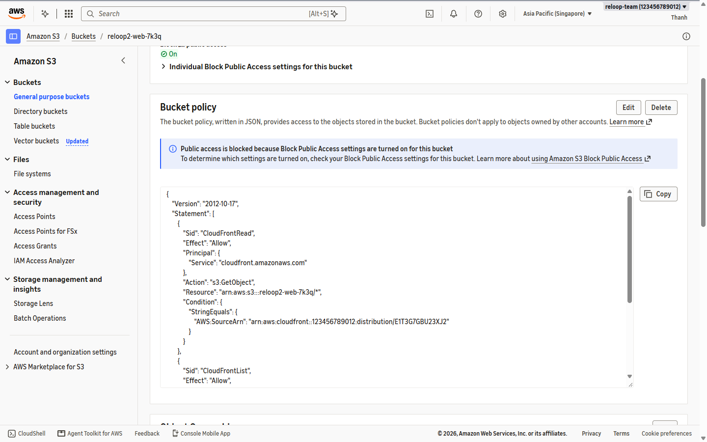
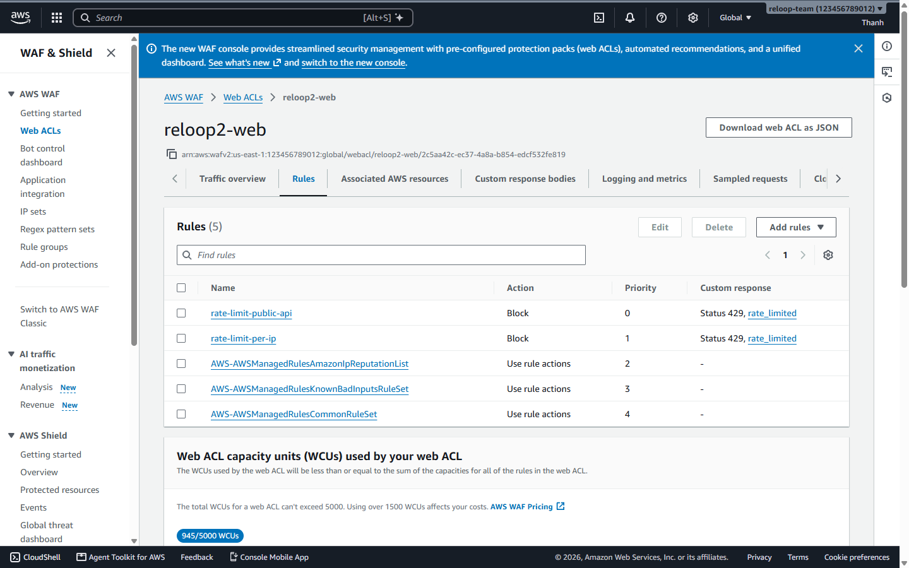
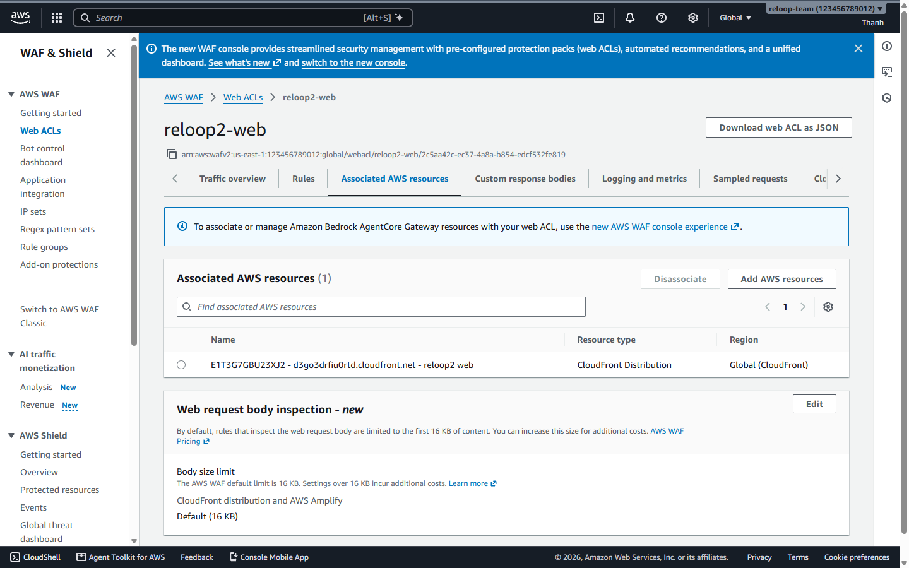

Bắt đầu từ đúng điểm vào đầu tiên trên sơ đồ kiến trúc. Trong học phần này, bạn tạo bucket S3 riêng tư chứa website tĩnh, đặt **Amazon CloudFront** phía trước cùng Origin Access Control (OAC) và gắn **AWS WAF (`reloop2-web`)** để bảo vệ mọi yêu cầu HTTPS. Việc dựng CloudFront trước giúp bạn có ngay tên miền `https://<dist-domain>.cloudfront.net`, nhờ đó các học phần sau cấu hình Cognito, API Gateway và S3 CORS một lần là xong mà không cần quay lại cập nhật.

**Các mũi tên trên sơ đồ thuộc bước này:**
- **Mũi tên 1:** `Users (web browser) → Amazon CloudFront` (`HTTPS (TLS)`)
- **Liên kết phụ:** `AWS WAF (web) — Amazon CloudFront` (`associated web ACL`)
- **Mũi tên 2:** `Amazon CloudFront → Amazon S3 (website)` (`static files (OAC)`)



---

### Phần A — Tạo bucket S3 website riêng tư (Đích của `Mũi tên 2`)

Dù sơ đồ ghi nhãn **Amazon S3 (website)** vì đây là nơi chứa bản dựng React, **tính năng S3 static website hosting vẫn TẮT**. Toàn bộ truy cập công khai được chặn để chỉ CloudFront đọc được tệp qua OAC.

1. Mở **Amazon S3** tại **`ap-southeast-1`** -> nhấn **Create bucket**.
2. Cấu hình:
   - **Bucket name:** `reloop2-web-<suffix>` (ví dụ `reloop2-web-7k3q`)
   - **Block all public access:** **Bật** (tích cả 4 ô)
   - **Default encryption:** Mã hóa phía máy chủ **SSE-S3**, bật **Bucket Key**
   - **Tag:** `Project = reloop2`
3. Nhấn **Create bucket**. (Bạn sẽ tải gói giao diện lên sau khi có mã Cognito ở Học phần 5.4.)



---

### Phần B — Tạo CloudFront OAC & Hàm định tuyến (CloudFront Functions)

Ngay trong **Amazon CloudFront**, bạn tạo hai thành phần nhỏ cần thiết cho Mũi tên 2 và Mũi tên 4:

1. **Origin Access Control (OAC):** Mở **CloudFront -> Security -> Origin access -> Create control setting**:
   - **Name:** `reloop2-web-oac`
   - **Signing behavior:** `Sign requests (recommended)` (`sigv4`)
   - **Origin type:** `S3`



2. **CloudFront Functions (`cloudfront-js-2.0`):** Mở **CloudFront -> Functions**, tạo và xuất bản (Publish) hai hàm `viewer-request` (cũng có sẵn trong thư mục [`cloudfront-functions/`](https://github.com/madlyham/ReLoop/tree/main/cloudfront-functions) của kho đồng hành):
   - **`reloop2-spa-rewrite`** (hỗ trợ **Mũi tên 2** để các đường dẫn SPA như `/feed` hay `/listings/new` trỏ về `/index.html`, còn các tệp tài nguyên tĩnh (như .js, .css, ảnh...) vẫn được phục vụ trực tiếp):
     ```javascript
     function handler(event) {
       var req = event.request;
       if (!/\.(js|mjs|css|map|html|png|jpe?g|gif|svg|ico|webp|avif|txt|json|xml|webmanifest|woff2?|ttf)$/i.test(req.uri)) req.uri = '/index.html';
       return req;
     }
     ```
   - **`reloop2-api-prefix`** (chuẩn bị cho **Mũi tên 4** ở Học phần 5.5 bằng cách cắt tiền tố `/api` trước khi chuyển sang HTTP API Gateway):
     ```javascript
     function handler(event) {
       var req = event.request;
       req.uri = req.uri.replace(/^\/api(?=\/)/, '');
       return req;
     }
     ```



---

### Phần C — Tạo CloudFront Distribution & Chính sách bucket OAC (`Mũi tên 1 & 2`)

1. Mở **CloudFront -> Distributions -> Create distribution**:
   - **Origin domain:** `reloop2-web-<suffix>.s3.ap-southeast-1.amazonaws.com`
   - **Origin access:** **Origin access control settings (recommended)** -> chọn **`reloop2-web-oac`**
   - **Viewer protocol policy:** `Redirect HTTP to HTTPS`
   - **Allowed HTTP methods:** `GET, HEAD`
   - **Cache policy:** `CachingOptimized`
   - **Function associations -> Viewer request:** `CloudFront Functions` -> **`reloop2-spa-rewrite`**
   - **Price class:** `Use North America, Europe, Asia, Middle East, and Africa` (`PriceClass_200`)
   - **Default root object:** `index.html`
   - **Description:** `reloop2 web`
   - **Web Application Firewall (WAF):** Chọn **Do not enable security protections** — bạn sẽ gắn Web ACL tùy chỉnh `reloop2-web` ở Phần D.
2. Nhấn **Create distribution** và ghi lại **Distribution ID** (`<dist-id>`) cùng **Distribution domain name** (`https://<dist-domain>.cloudfront.net`).



3. Quay lại **S3 -> `reloop2-web-<suffix>` -> Permissions -> Bucket policy** và dán chính sách giới hạn quyền đọc chỉ cho ARN distribution của bạn:
   *(Thay giá trị mẫu `123456789012` bằng mã tài khoản AWS 12 chữ số của bạn, cùng với `<suffix>` và `<dist-id>`.)*
   ```json
   {
     "Version": "2012-10-17",
     "Statement": [
       {
         "Sid": "CloudFrontRead",
         "Effect": "Allow",
         "Principal": { "Service": "cloudfront.amazonaws.com" },
         "Action": "s3:GetObject",
         "Resource": "arn:aws:s3:::reloop2-web-<suffix>/*",
         "Condition": {
           "StringEquals": {
             "AWS:SourceArn": "arn:aws:cloudfront::123456789012:distribution/<dist-id>"
           }
         }
       },
       {
         "Sid": "CloudFrontList",
         "Effect": "Allow",
         "Principal": { "Service": "cloudfront.amazonaws.com" },
         "Action": "s3:ListBucket",
         "Resource": "arn:aws:s3:::reloop2-web-<suffix>",
         "Condition": {
           "StringEquals": {
             "AWS:SourceArn": "arn:aws:cloudfront::123456789012:distribution/<dist-id>"
           }
         }
       }
     ]
   }
   ```



---

### Phần D — Tạo & Gắn AWS WAF (`reloop2-web`)

Trên sơ đồ, **AWS WAF (web)** nối trực tiếp với **Amazon CloudFront** qua `associated web ACL`. Web ACL cho CloudFront bắt buộc tạo ở phạm vi **Global (CloudFront) / `us-east-1`**.

1. Mở **AWS WAF & Shield -> Web ACLs**, chọn **Global (CloudFront)** rồi nhấn **Create web ACL**.
2. Đặt **Name:** `reloop2-web`, **Description:** `ReLoop: IP rate limits, bad IPs, common attack patterns - CloudFront`, và liên kết với CloudFront distribution (`reloop2 web`).
3. Thêm **Custom response body** tên **`rate_limited`** (kiểu `JSON`):
   ```json
   {"code":"RATE_LIMITED","message":"Too many requests - wait about 1 minute and try again"}
   ```
4. Thêm đủ **5 quy tắc** theo thứ tự ưu tiên (`0` → `4`):

| Ưu tiên | Tên quy tắc | Cấu hình & Hành động |
| --- | --- | --- |
| `0` | `rate-limit-public-api` | Giới hạn tần suất: **100 req / 60s / IP** áp dụng cho đường dẫn bắt đầu bằng `/api/auth/`, `/api/feed/public` hoặc `/api/fees` -> **Block** (`429`, nội dung `rate_limited`, tiêu đề `retry-after: 60`) |
| `1` | `rate-limit-per-ip` | Giới hạn tần suất: **1.000 req / 60s / IP** cho mọi đường dẫn -> **Block** (`429`, nội dung `rate_limited`, tiêu đề `retry-after: 60`) |
| `2` | `AWS-AWSManagedRulesAmazonIpReputationList` | Bộ quy tắc quản lý AWS (giữ hành động mặc định) |
| `3` | `AWS-AWSManagedRulesKnownBadInputsRuleSet` | Bộ quy tắc quản lý AWS (giữ hành động mặc định) |
| `4` | `AWS-AWSManagedRulesCommonRuleSet` | Bộ quy tắc quản lý AWS — chuyển **`SizeRestrictions_BODY`** và **`GenericRFI_BODY`** sang **Count** để không chặn nhầm dữ liệu JSON hợp lệ |

5. Đặt **Default action:** **Allow** -> nhấn **Create web ACL**.
6. Kiểm tra thẻ **Rules (5)** hiển thị `945/5000 WCUs` và thẻ **Associated AWS resources** đã liệt kê CloudFront distribution của bạn.





{}
**Mũi tên 1, 2 và WAF đã hoàn tất.** Tiếp theo, chuyển sang [Học phần 5.4 — Đăng ký & Đăng nhập](../5.4-sign-up-and-sign-in/) để xây dựng **Mũi tên 3** và hàm **Post-confirmation**.
{}
