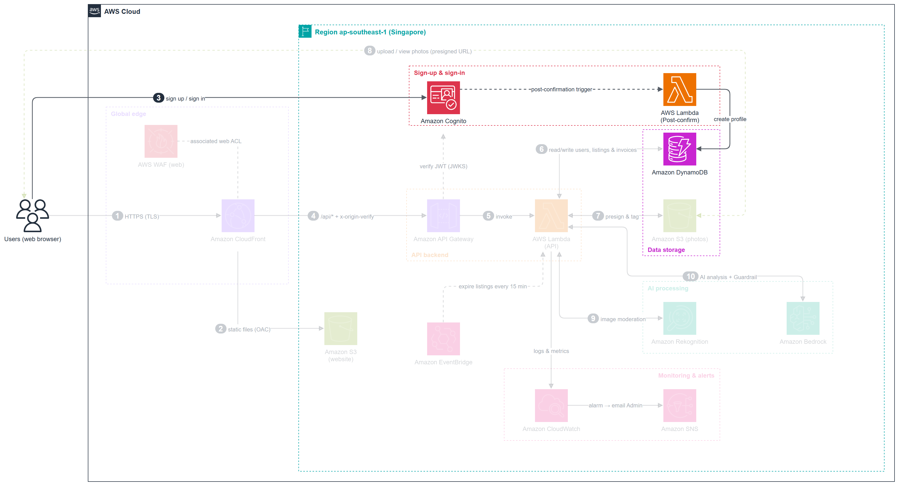
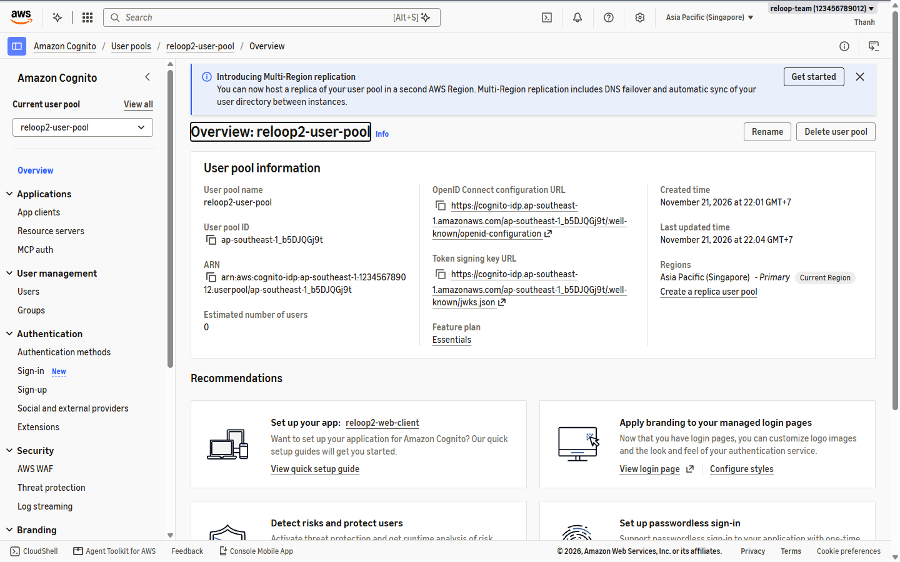
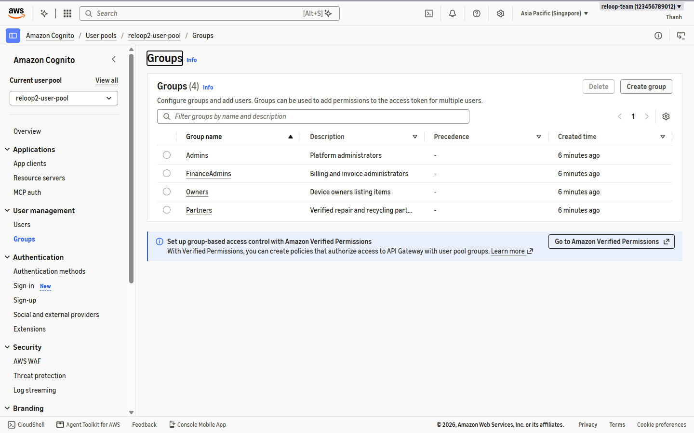
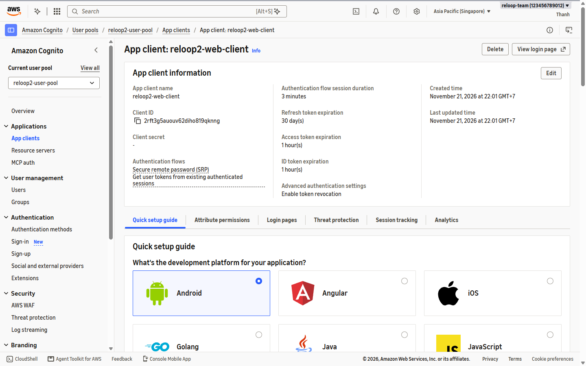
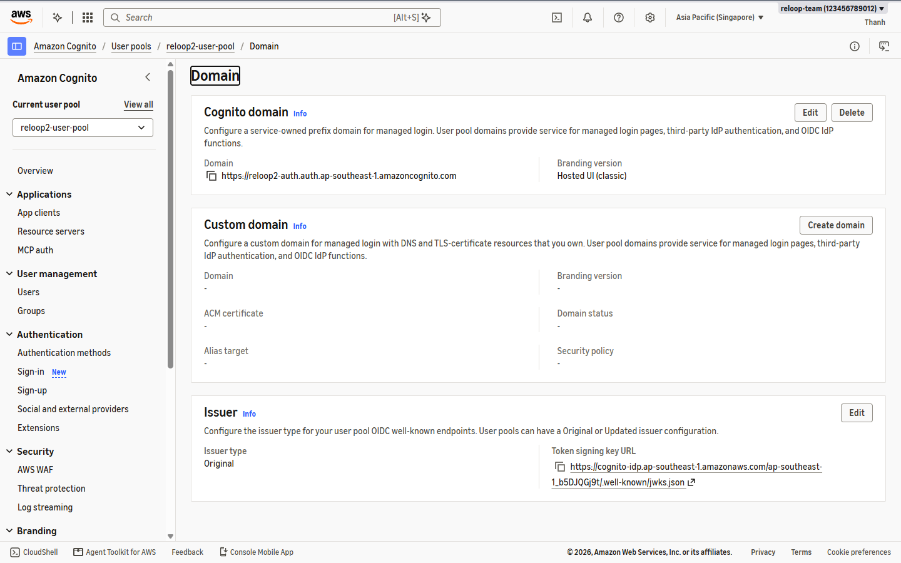
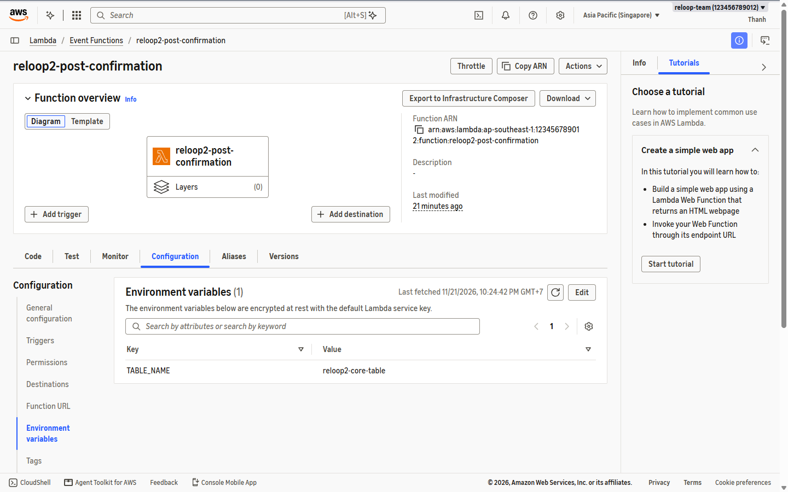
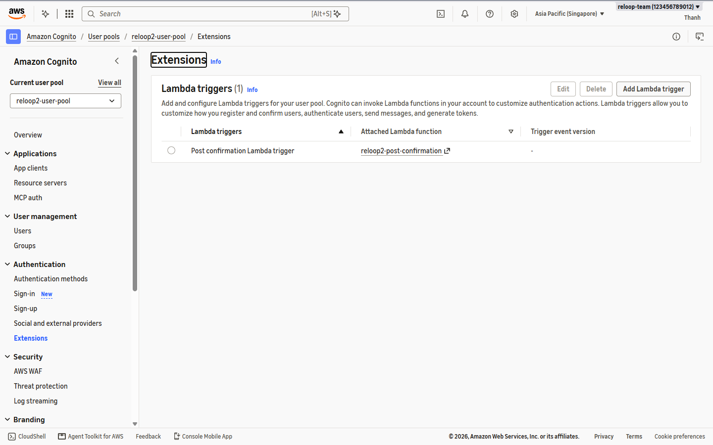

Next on the architecture path is **Arrow 3**: users register and sign in directly against **Amazon Cognito**, and when a new account is confirmed, Cognito automatically triggers **AWS Lambda (Post-confirm)** to create the user's initial `Owner` profile in **Amazon DynamoDB**. Because CloudFront is already deployed from Module 5.3, you enter your live `https://<dist-domain>.cloudfront.net` callback and sign-out URLs once here.

**Graph arrows covered in this step:**
- **Arrow 3:** `Users (web browser) → Amazon Cognito` (`sign up / sign in`)
- **Supporting link:** `Amazon Cognito → AWS Lambda (Post-confirm)` (`post-confirmation trigger`)
- **Supporting link:** `AWS Lambda (Post-confirm) → Amazon DynamoDB` (`create profile`)



---

### Part A — Create Cognito User Pool & Groups (`Arrow 3`)

1. Open **Amazon Cognito -> User pools -> Create user pool** in **`ap-southeast-1`**.
2. Configure:
   - **Pool name:** `reloop2-user-pool`
   - **Tier:** `Essentials`
   - **Sign-in & attributes:** Username + required `email` (auto-verified by email) and optional `name`
   - **Password policy:** Minimum 8 characters with uppercase, lowercase, number, and symbol
   - **Account recovery:** Verified email only
   - **Deletion protection:** `ACTIVE`
   - **Tag:** `Project = reloop2`
3. Note the **User Pool ID** (`ap-southeast-1_<id>`) and **User Pool ARN**.



4. Under **User management -> Groups**, create four role groups used for access control:
   - `Owners` — Device owners listing items
   - `Partners` — Verified repair and recycling partners
   - `Admins` — Platform administrators
   - `FinanceAdmins` — Billing and invoice administrators



---

### Part B — Configure App Client & Managed Login Domain

1. Under **Applications -> App clients**, create a public SPA app client (no client secret):
   - **Client name:** `reloop2-web-client`
   - **Authentication flows:** `ALLOW_USER_SRP_AUTH`, `ALLOW_REFRESH_TOKEN_AUTH`
   - **OAuth 2.0 grant type:** `Authorization code grant` (PKCE)
   - **OpenID Connect scopes:** `email`, `openid`, `phone`
   - **Allowed callback URLs:** `https://<dist-domain>.cloudfront.net/auth/callback` and `http://localhost:5173/auth/callback`
   - **Allowed sign-out URLs:** `https://<dist-domain>.cloudfront.net/` and `http://localhost:5173/`
2. Note the **Client ID** (`<client-id>`).



3. Under **Branding -> Domain**, create a Cognito domain prefix:
   - **Domain prefix:** `reloop2-auth` (yielding `https://reloop2-auth.auth.ap-southeast-1.amazoncognito.com`; append your suffix if already taken globally).



---

### Part C — Create Post-Confirmation Lambda (`create profile`)

When a user confirms sign-up, Cognito calls `reloop2-post-confirmation`, which writes `PK = USER#<sub>`, `SK = PROFILE` into `reloop2-core-table` (you create the table itself in [Module 5.6](../5.6-dynamodb/); IAM policies and Lambda environment variables accept the table name and ARN ahead of time).

1. **IAM Role:** Open **IAM -> Roles -> Create role** for **AWS service -> Lambda**:
   - **Role name:** `reloop2-post-confirmation-role`
   - Attach AWS managed policy `AWSLambdaBasicExecutionRole` (for CloudWatch Logs).
   - Add inline policy **`DynamoDBWriteAccess`**:
     ```json
     {
       "Version": "2012-10-17",
       "Statement": [
         {
           "Sid": "PutUserProfile",
           "Effect": "Allow",
           "Action": "dynamodb:PutItem",
           "Resource": "arn:aws:dynamodb:ap-southeast-1:123456789012:table/reloop2-core-table"
         }
       ]
     }
     ```
2. **Lambda Function:** Open **AWS Lambda -> Create function** in **`ap-southeast-1`**:
   - **Function name:** `reloop2-post-confirmation`
   - **Runtime:** `Python 3.12` (`x86_64`), **Memory:** `128 MB`, **Timeout:** `3s`
   - **Execution role:** `reloop2-post-confirmation-role`
   - **Environment variable:** `TABLE_NAME = reloop2-core-table`
   - **Code (`lambda_function.py`):** Upload [`reloop2-post-confirmation.zip`](https://github.com/madlyham/ReLoop/releases/download/v1.0.0/reloop2-post-confirmation.zip) (also in `ReLoop/zips/` after cloning), or copy-paste [`backend/post-confirmation/lambda_function.py`](https://github.com/madlyham/ReLoop/blob/main/backend/post-confirmation/lambda_function.py) directly into the Lambda inline editor:
     ```python
     import os
     import boto3
     import datetime

     dynamodb = boto3.client('dynamodb')
     TABLE_NAME = os.environ['TABLE_NAME']

     def lambda_handler(event, context):
         if event.get('triggerSource') != 'PostConfirmation_ConfirmSignUp':
             return event

         user_attributes = event['request']['userAttributes']
         user_id = user_attributes['sub']
         email = user_attributes.get('email', '')
         name = user_attributes.get('name', 'Unknown')
         role = 'Owner'
         timestamp = datetime.datetime.utcnow().isoformat() + 'Z'

         try:
             dynamodb.put_item(
                 TableName=TABLE_NAME,
                 Item={
                     'PK': {'S': f"USER#{user_id}"},
                     'SK': {'S': "PROFILE"},
                     'GSI1PK': {'S': f"ROLE#{role}"},
                     'GSI1SK': {'S': f"USER#{user_id}"},
                     'email': {'S': email},
                     'fullName': {'S': name},
                     'role': {'S': role},
                     'status': {'S': 'ACTIVE'},
                     'createdAt': {'S': timestamp}
                 },
                 ConditionExpression='attribute_not_exists(PK)'
             )
         except Exception as e:
             print(f"Failed to write user to DynamoDB: {str(e)}")

         return event
     ```



3. **Attach Trigger in Cognito:** Open **Cognito -> `reloop2-user-pool` -> Authentication -> Extensions -> Add Lambda trigger**:
   - **Trigger type:** `Sign-up` -> **`Post confirmation Lambda trigger`**
   - **Lambda function:** `reloop2-post-confirmation`
   - Verify only this single Post-confirmation trigger is listed.



---

### Part D — Upload Frontend Bundle to S3 Website (`Arrow 2` Live Assets)

Now that your Cognito User Pool ID, App Client ID, and domain exist, stamp those values into the prebuilt React bundle from **[github.com/madlyham/ReLoop](https://github.com/madlyham/ReLoop/tree/main/frontend)** using `frontend/configure.py` and sync to `reloop2-web-<suffix>` (created in Module 5.3):

```bash
# Inside your cloned ReLoop repository (no Node.js build required):
python frontend/configure.py \
  --pool-id "ap-southeast-1_<id>" \
  --client-id "<client-id>" \
  --domain "https://reloop2-auth.auth.ap-southeast-1.amazoncognito.com"

# Upload configured static files to the private S3 website bucket and refresh CloudFront cache:
aws s3 sync frontend/build/ s3://reloop2-web-<suffix>/ --region ap-southeast-1 --delete
aws cloudfront create-invalidation --distribution-id <dist-id> --paths "/*"
```

{}
**Arrow 3 and the Post-confirmation flow are ready.** Next, move to [Module 5.5 — API Backend](../5.5-api-backend/) to build **Arrows 4, 5, and JWT verification**.
{}
