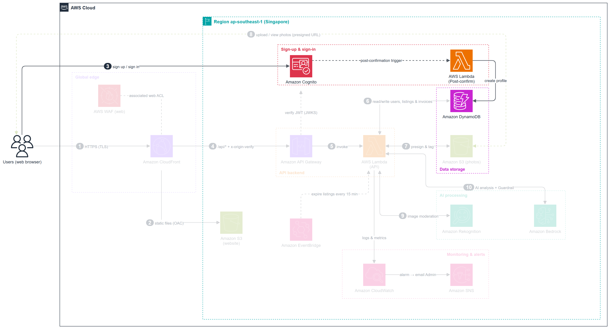
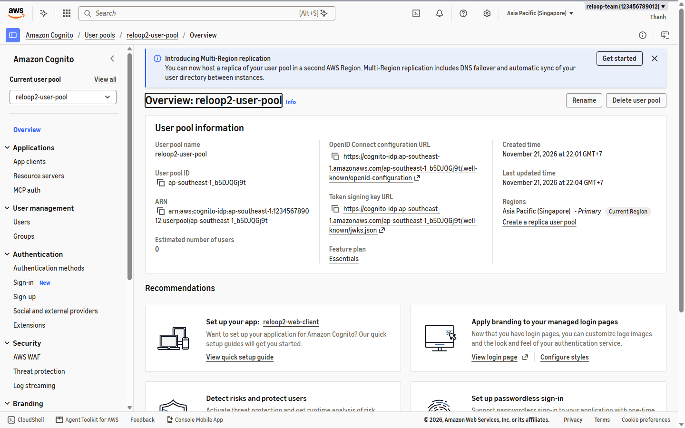
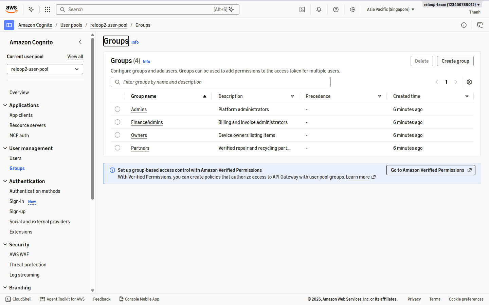
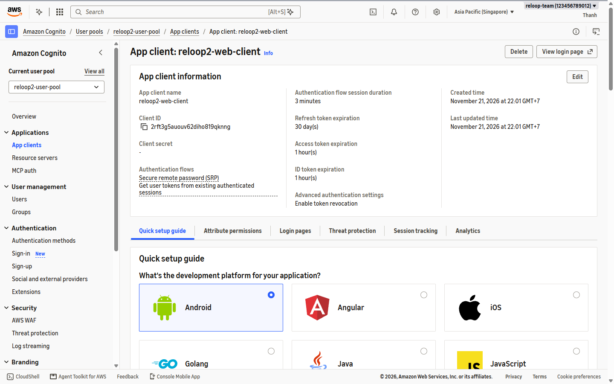
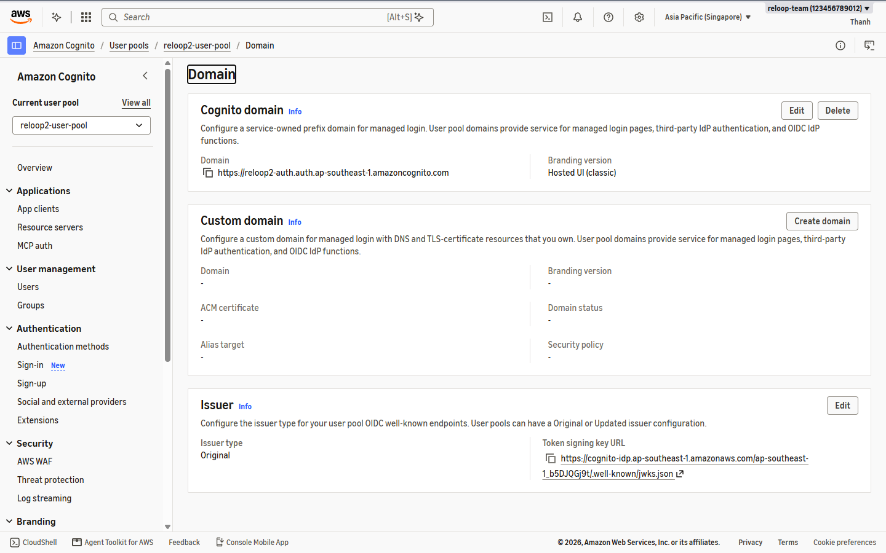
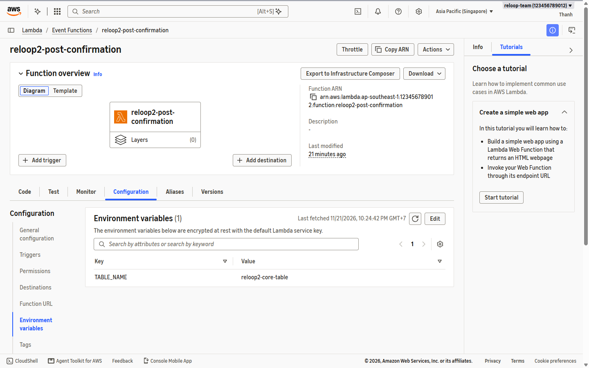
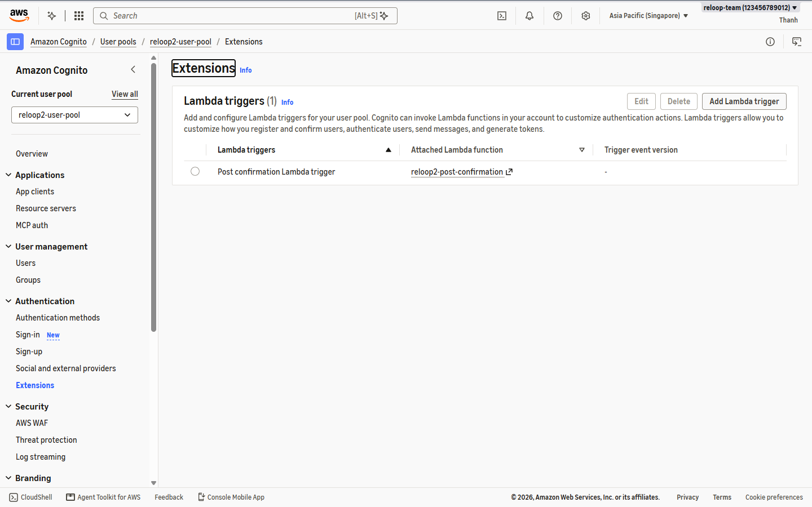

Bước tiếp theo trên sơ đồ kiến trúc là **Mũi tên 3**: người dùng đăng ký và đăng nhập trực tiếp với **Amazon Cognito**, và khi tài khoản mới được xác nhận, Cognito tự động gọi **AWS Lambda (Post-confirm)** để tạo hồ sơ `Owner` ban đầu trong **Amazon DynamoDB**. Vì CloudFront đã được dựng ở Học phần 5.3, bạn nhập luôn địa chỉ `https://<dist-domain>.cloudfront.net` cho callback và sign-out một lần duy nhất.

**Các mũi tên trên sơ đồ thuộc bước này:**
- **Mũi tên 3:** `Users (web browser) → Amazon Cognito` (`sign up / sign in`)
- **Liên kết phụ:** `Amazon Cognito → AWS Lambda (Post-confirm)` (`post-confirmation trigger`)
- **Liên kết phụ:** `AWS Lambda (Post-confirm) → Amazon DynamoDB` (`create profile`)



---

### Phần A — Tạo Cognito User Pool & Nhóm quyền (`Mũi tên 3`)

1. Mở **Amazon Cognito -> User pools -> Create user pool** tại **`ap-southeast-1`**.
2. Cấu hình:
   - **Pool name:** `reloop2-user-pool`
   - **Tier:** `Essentials`
   - **Đăng nhập & thuộc tính:** Tên đăng nhập + `email` bắt buộc (tự động xác minh qua email) và `name` tùy chọn
   - **Chính sách mật khẩu:** Tối thiểu 8 ký tự gồm chữ hoa, chữ thường, số và ký tự đặc biệt
   - **Khôi phục tài khoản:** Chỉ qua email đã xác minh
   - **Deletion protection:** `ACTIVE`
   - **Tag:** `Project = reloop2`
3. Ghi lại **User Pool ID** (`ap-southeast-1_<id>`) và **User Pool ARN**.



4. Vào **User management -> Groups**, tạo 4 nhóm phân quyền:
   - `Owners` — Người có thiết bị đăng bán
   - `Partners` — Đối tác sửa chữa và tái chế đã duyệt
   - `Admins` — Quản trị viên nền tảng
   - `FinanceAdmins` — Quản trị phí và hóa đơn



---

### Phần B — Cấu hình App Client & Tên miền đăng nhập

1. Vào **Applications -> App clients**, tạo một public SPA client (không dùng client secret):
   - **Client name:** `reloop2-web-client`
   - **Luồng xác thực:** `ALLOW_USER_SRP_AUTH`, `ALLOW_REFRESH_TOKEN_AUTH`
   - **Kiểu cấp quyền OAuth 2.0:** `Authorization code grant` (PKCE)
   - **Phạm vi OpenID Connect:** `email`, `openid`, `phone`
   - **Allowed callback URLs:** `https://<dist-domain>.cloudfront.net/auth/callback` và `http://localhost:5173/auth/callback`
   - **Allowed sign-out URLs:** `https://<dist-domain>.cloudfront.net/` và `http://localhost:5173/`
2. Ghi lại **Client ID** (`<client-id>`).



3. Vào **Branding -> Domain**, tạo tiền tố miền Cognito:
   - **Domain prefix:** `reloop2-auth` (tạo ra `https://reloop2-auth.auth.ap-southeast-1.amazoncognito.com`; thêm hậu tố của bạn nếu đã có người dùng).



---

### Phần C — Tạo Lambda Post-Confirmation (`create profile`)

Khi người dùng xác nhận đăng ký, Cognito gọi `reloop2-post-confirmation` để ghi bản ghi `PK = USER#<sub>`, `SK = PROFILE` vào `reloop2-core-table` (bảng sẽ được tạo ở [Học phần 5.6](../5.6-dynamodb/); IAM policy và biến môi trường Lambda cho phép khai báo tên và ARN bảng từ trước).

1. **IAM Role:** Mở **IAM -> Roles -> Create role** cho **AWS service -> Lambda**:
   - **Role name:** `reloop2-post-confirmation-role`
   - Gắn chính sách quản lý `AWSLambdaBasicExecutionRole` (cho CloudWatch Logs).
   - Thêm inline policy **`DynamoDBWriteAccess`**:
     ```json
     {
       "Version": "2012-10-17",
       "Statement": [
         {
           "Sid": "PutUserProfile",
           "Effect": "Allow",
           "Action": "dynamodb:PutItem",
           "Resource": "arn:aws:dynamodb:ap-southeast-1:123456789012:table/reloop2-core-table"
         }
       ]
     }
     ```
2. **Hàm Lambda:** Mở **AWS Lambda -> Create function** tại **`ap-southeast-1`**:
   - **Function name:** `reloop2-post-confirmation`
   - **Runtime:** `Python 3.12` (`x86_64`), **Memory:** `128 MB`, **Timeout:** `3s`
   - **Execution role:** `reloop2-post-confirmation-role`
   - **Biến môi trường:** `TABLE_NAME = reloop2-core-table`
   - **Mã nguồn (`lambda_function.py`):** Tải lên [`reloop2-post-confirmation.zip`](https://github.com/madlyham/ReLoop/releases/download/v1.0.0/reloop2-post-confirmation.zip) (cũng có sẵn trong `ReLoop/zips/` sau khi clone, hoặc chép từ [`backend/post-confirmation/lambda_function.py`](https://github.com/madlyham/ReLoop/blob/main/backend/post-confirmation/lambda_function.py)). Hàm ghi `USER#<sub> / PROFILE` với `role = Owner`, `status = ACTIVE`, `GSI1PK = ROLE#Owner`, kèm `ConditionExpression='attribute_not_exists(PK)'`, rồi trả về `event` nguyên vẹn để Cognito hoàn tất đăng nhập.



3. **Gắn Trigger trong Cognito:** Mở **Cognito -> `reloop2-user-pool` -> Authentication -> Extensions -> Add Lambda trigger**:
   - **Loại trigger:** `Sign-up` -> **`Post confirmation Lambda trigger`**
   - **Hàm Lambda:** `reloop2-post-confirmation`
   - Xác nhận chỉ có duy nhất một trigger Post-confirmation này trong danh sách.



---

### Phần D — Tải gói giao diện lên S3 Website (Tệp tĩnh cho `Mũi tên 2`)

Sau khi có Cognito User Pool ID, App Client ID và domain, hãy gắn các giá trị này vào bản dựng React có sẵn trong **[github.com/madlyham/ReLoop](https://github.com/madlyham/ReLoop/tree/main/frontend)** bằng `frontend/configure.py` rồi đồng bộ lên bucket `reloop2-web-<suffix>` (đã tạo ở Học phần 5.3):

```bash
# Chạy trong thư mục ReLoop đã clone (không cần build bằng Node.js):
python frontend/configure.py \
  --pool-id "ap-southeast-1_<id>" \
  --client-id "<client-id>" \
  --domain "https://reloop2-auth.auth.ap-southeast-1.amazoncognito.com"

# Đồng bộ tệp tĩnh đã cấu hình lên S3 website riêng tư và xóa bộ nhớ đệm CloudFront:
aws s3 sync frontend/build/ s3://reloop2-web-<suffix>/ --region ap-southeast-1 --delete
aws cloudfront create-invalidation --distribution-id <dist-id> --paths "/*"
```

{}
**Mũi tên 3 và luồng Post-confirmation đã sẵn sàng.** Tiếp theo, chuyển sang [Học phần 5.5 — Hệ thống API Backend](../5.5-api-backend/) để dựng **Mũi tên 4, 5 và xác thực JWT**.
{}
