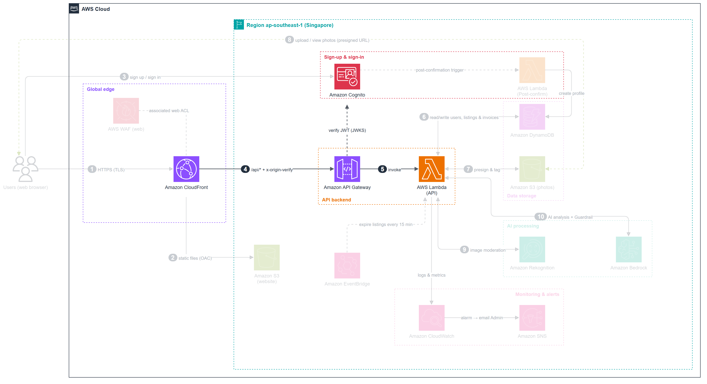
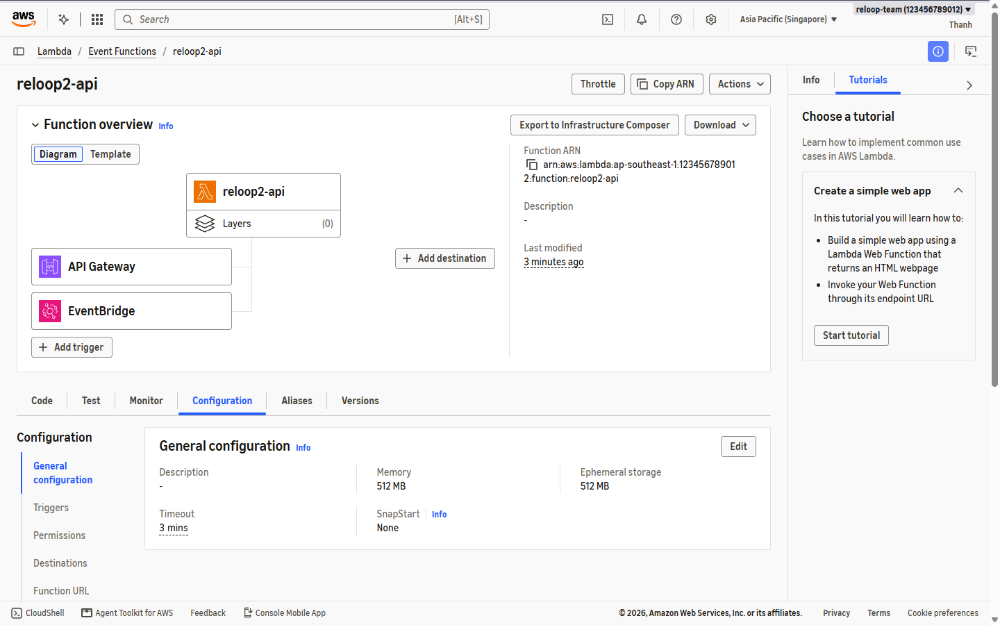
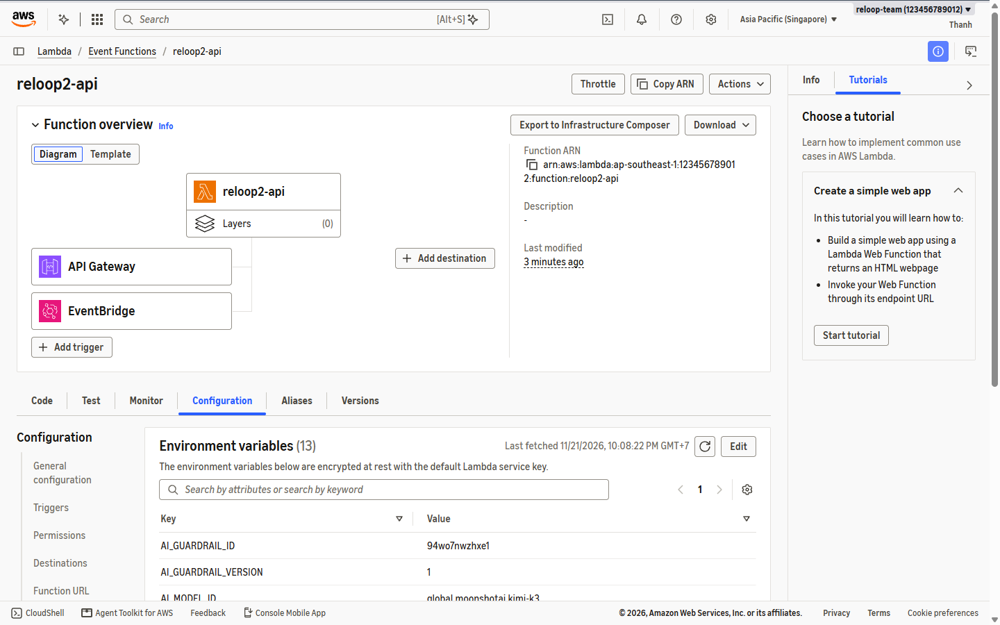
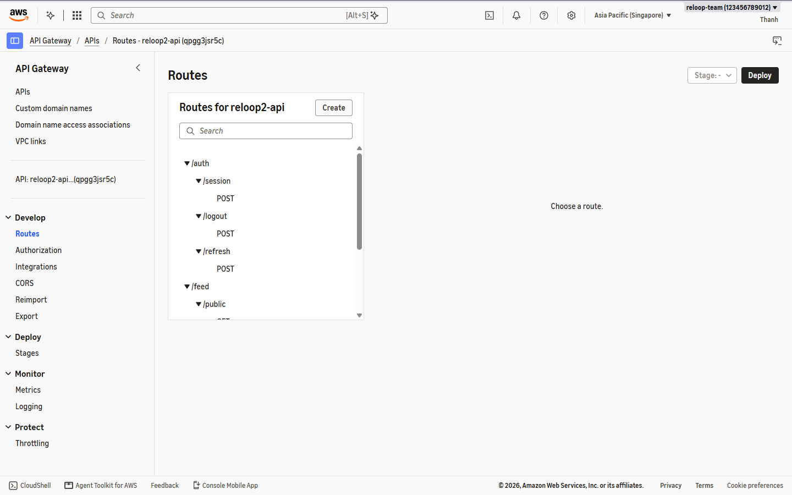
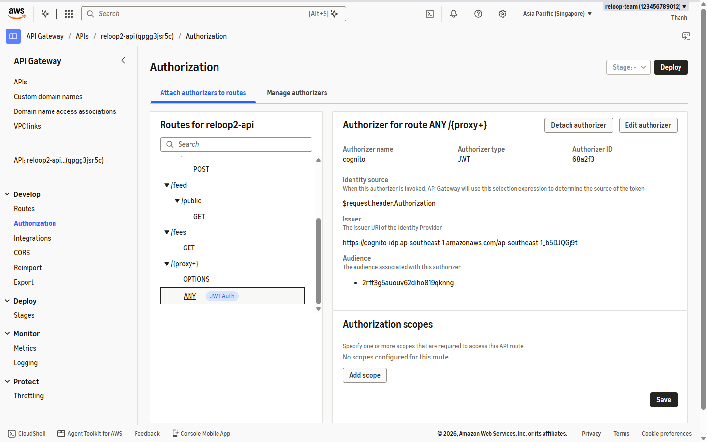
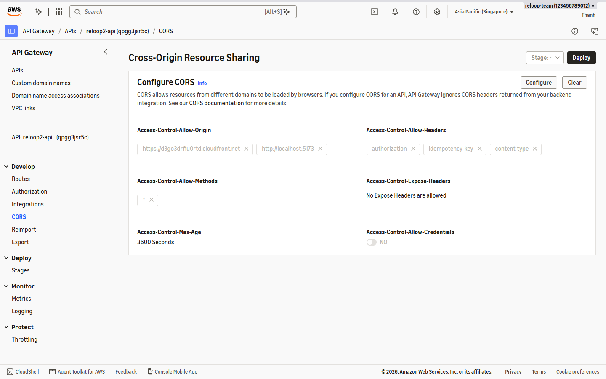
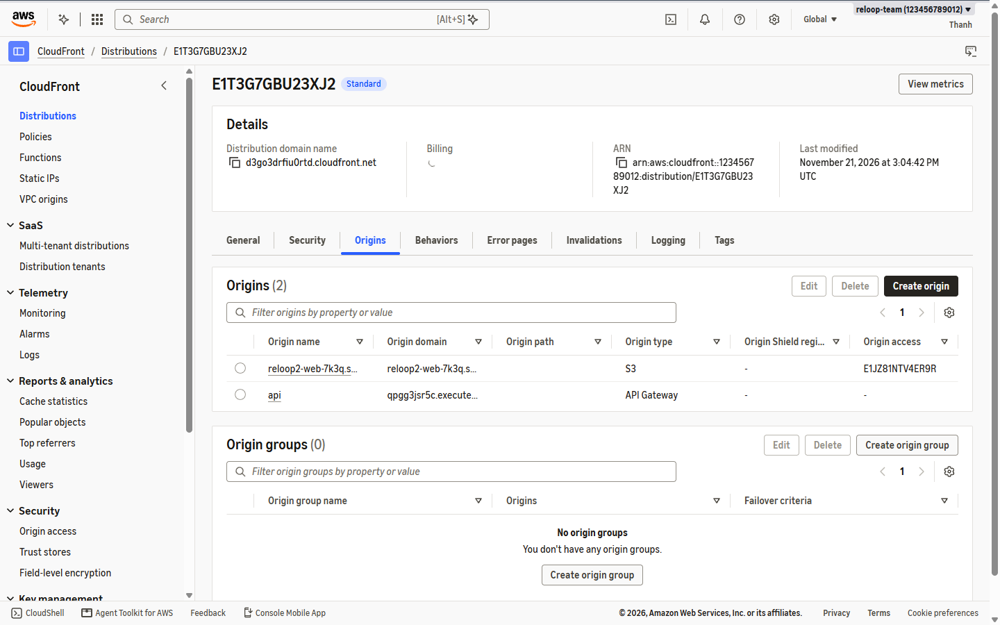
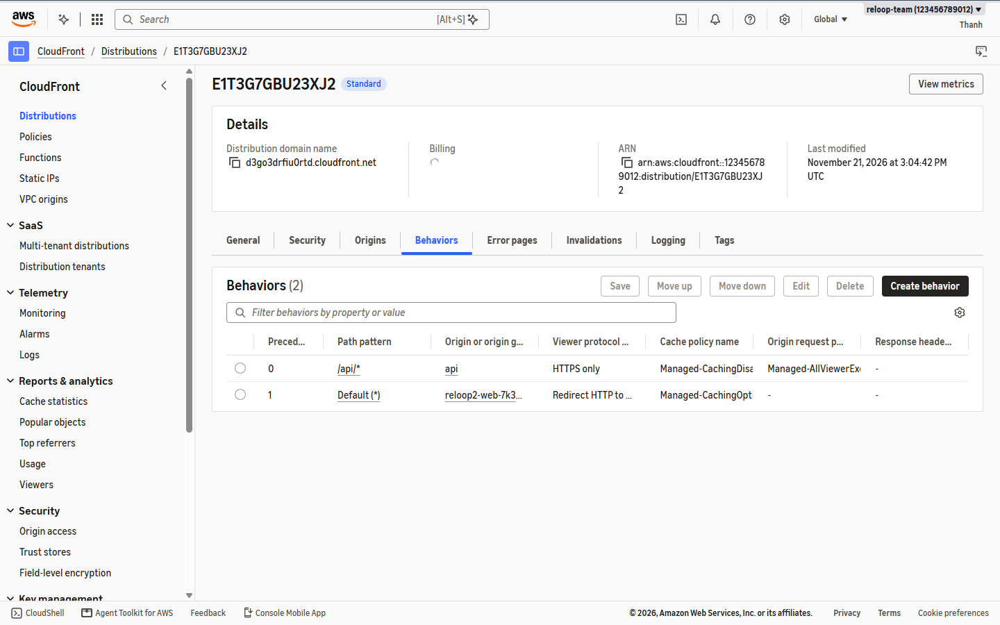

Now build the orange **API backend** box on the diagram: **AWS Lambda (`reloop2-api`)**, **Amazon API Gateway** with a Cognito JWT authorizer (`verify JWT (JWKS)`), and the `/api/*` routing link from **Amazon CloudFront** carrying the shared secret header `x-origin-verify`.

**Graph arrows covered in this step:**
- **Arrow 4:** `Amazon CloudFront → Amazon API Gateway` (`/api/* + x-origin-verify`)
- **Supporting link:** `Amazon API Gateway → Amazon Cognito` (`verify JWT (JWKS)`)
- **Arrow 5:** `Amazon API Gateway → AWS Lambda (API)` (`invoke`)



---

### Part A — Create Least-Privilege IAM Role & Backend Lambda (`Arrow 5` Target)

1. **Generate a 64-character random origin secret** locally (store it only in your terminal session — never commit it to Git):
   ```bash
   python -c "import secrets; print(secrets.token_hex(32))"
   ```
2. **IAM Role:** Create **`reloop2-api-lambda-role`** (trust entity: `lambda.amazonaws.com`) with inline policy **`reloop2-api-access`** covering the exact downstream arrows from `AWS Lambda (API)` (DynamoDB in 5.6, S3 photos in 5.7, Rekognition & Bedrock in 5.8, and CloudWatch Logs in 5.10):
   ```json
   {
     "Version": "2012-10-17",
     "Statement": [
       {
         "Sid": "CoreTable",
         "Effect": "Allow",
         "Action": ["dynamodb:GetItem", "dynamodb:Query", "dynamodb:PutItem", "dynamodb:DeleteItem", "dynamodb:ConditionCheckItem"],
         "Resource": [
           "arn:aws:dynamodb:ap-southeast-1:123456789012:table/reloop2-core-table",
           "arn:aws:dynamodb:ap-southeast-1:123456789012:table/reloop2-core-table/index/*"
         ]
       },
       {
         "Sid": "ListingImages",
         "Effect": "Allow",
         "Action": ["s3:PutObject", "s3:GetObject", "s3:PutObjectTagging", "s3:GetObjectTagging", "s3:DeleteObject"],
         "Resource": "arn:aws:s3:::reloop2-images-<suffix>/listings/*"
       },
       {
         "Sid": "Bedrock",
         "Effect": "Allow",
         "Action": ["bedrock:InvokeModel"],
         "Resource": [
           "arn:aws:bedrock:*:123456789012:inference-profile/global.moonshotai.kimi-k3",
           "arn:aws:bedrock:*::foundation-model/*"
         ]
       },
       {
         "Sid": "Guardrail",
         "Effect": "Allow",
         "Action": ["bedrock:ApplyGuardrail"],
         "Resource": [
           "arn:aws:bedrock:ap-southeast-1:123456789012:guardrail/*",
           "arn:aws:bedrock:*:123456789012:guardrail-profile/*"
         ]
       },
       {
         "Sid": "Moderation",
         "Effect": "Allow",
         "Action": ["rekognition:DetectModerationLabels", "rekognition:DetectText"],
         "Resource": "*"
       },
       {
         "Sid": "SelfInvoke",
         "Effect": "Allow",
         "Action": ["lambda:InvokeFunction"],
         "Resource": "arn:aws:lambda:ap-southeast-1:123456789012:function:reloop2-api"
       },
       {
         "Sid": "Logs",
         "Effect": "Allow",
         "Action": ["logs:CreateLogStream", "logs:PutLogEvents"],
         "Resource": "arn:aws:logs:ap-southeast-1:123456789012:log-group:/aws/lambda/reloop2-api:*"
       }
     ]
   }
   ```
3. **Create Lambda Function:** Open **AWS Lambda -> Create function** in **`ap-southeast-1`**:
   - **Function name:** `reloop2-api`
   - **Runtime:** `Node.js 22.x` · **Architecture:** `arm64`
   - **Execution role:** `reloop2-api-lambda-role`
   - Upload `reloop2-api.zip` (handler `index.handler`).
   - Under **Configuration -> General configuration**, set **Memory:** `512 MB`, **Timeout:** `3 min` (`180s`).



4. Under **Configuration -> Environment variables**, add:

| Key | Value |
| --- | --- |
| `STAGE` | `aws` |
| `AUTH_MODE` | `cognito` |
| `TABLE_NAME` | `reloop2-core-table` |
| `IMAGE_BUCKET` | `reloop2-images-<suffix>` |
| `COGNITO_CLIENT_ID` | `<client-id>` (from Module 5.4) |
| `AI_MODEL_ID` | `global.moonshotai.kimi-k3` |
| `ORIGIN_VERIFY_SECRET` | `<your-64-char-hex-secret>` |
| `NODE_OPTIONS` | `--enable-source-maps` |

*(You will add `AI_GUARDRAIL_ID` and `AI_GUARDRAIL_VERSION` right after creating the Guardrail in Module 5.8.)*



---

### Part B — Build HTTP API Gateway & JWT Authorizer (`Arrow 5` + `verify JWT`)

1. Open **Amazon API Gateway -> Create API -> HTTP API -> Build** in **`ap-southeast-1`**:
   - **API name:** `reloop2-api`
   - **Integration:** Lambda -> `reloop2-api` (Payload format `2.0`)
   - **Routes:**
     - `ANY /{proxy+}` (protected by Cognito JWT)
     - Public routes (`Authorization = None`): `GET /feed/public`, `GET /fees`, `POST /auth/session`, `POST /auth/refresh`, `POST /auth/logout`, `OPTIONS /{proxy+}`
   - **Stage:** `$default` with **Auto-deploy** enabled.



2. Under **Develop -> Authorization -> Manage authorizers -> Create**:
   - **Authorizer type:** `JWT` · **Name:** `cognito`
   - **Identity source:** `$request.header.Authorization`
   - **Issuer URL:** `https://cognito-idp.ap-southeast-1.amazonaws.com/ap-southeast-1_<id>`
   - **Audience:** `<client-id>`
   - Attach **`cognito`** strictly to **`ANY /{proxy+}`** (leaving the 6 public routes open).



3. Under **Develop -> CORS**, enter your CloudFront origin from Module 5.3 directly (no backfill required):
   - **Access-Control-Allow-Origin:** `https://<dist-domain>.cloudfront.net`, `http://localhost:5173`
   - **Access-Control-Allow-Headers:** `authorization`, `idempotency-key`, `content-type`
   - **Access-Control-Allow-Methods:** `*` · **Max age:** `3600`
4. Under **Protect -> Throttling**, edit the `$default` stage to **Rate limit:** `20` req/s, **Burst limit:** `50`.



---

### Part C — Wire CloudFront `/api/*` Origin & `x-origin-verify` (`Arrow 4`)

Now connect **Amazon CloudFront** (Module 5.3) to your new **API Gateway** endpoint:

1. Open **CloudFront -> Distributions -> `<dist-id>` -> Origins -> Create origin**:
   - **Origin domain:** `<api-id>.execute-api.ap-southeast-1.amazonaws.com`
   - **Protocol:** `HTTPS only` (`TLSv1.2`) · **Origin read timeout:** `30s`
   - **Name:** `api`
   - **Add custom header:** Header name **`x-origin-verify`**, Value **`<your-64-char-hex-secret>`** (must match `ORIGIN_VERIFY_SECRET` on Lambda; `reloop2-api` checks this header using `timingSafeEqual` and returns `403 DIRECT_ACCESS_FORBIDDEN` to any caller bypassing CloudFront).



2. Open the **Behaviors** tab -> **Create behavior**:
   - **Path pattern:** `/api/*`
   - **Origin:** `api`
   - **Viewer protocol policy:** `HTTPS only`
   - **Allowed HTTP methods:** `GET, HEAD, OPTIONS, PUT, POST, PATCH, DELETE`
   - **Cache policy:** `CachingDisabled`
   - **Origin request policy:** `AllViewerExceptHostHeader`
   - **Function associations -> Viewer request:** `CloudFront Functions` -> **`reloop2-api-prefix`** (created in Module 5.3 to strip `/api` before API Gateway receives the route)
3. Confirm `/api/*` sits at **Precedence `0`** above `Default (*)` at **Precedence `1`**.



{}
**Arrows 4, 5, and JWT verification are wired.** Next, move to [Module 5.6 — Data Storage: Amazon DynamoDB](../5.6-dynamodb/) to build **Arrow 6**.
{}
