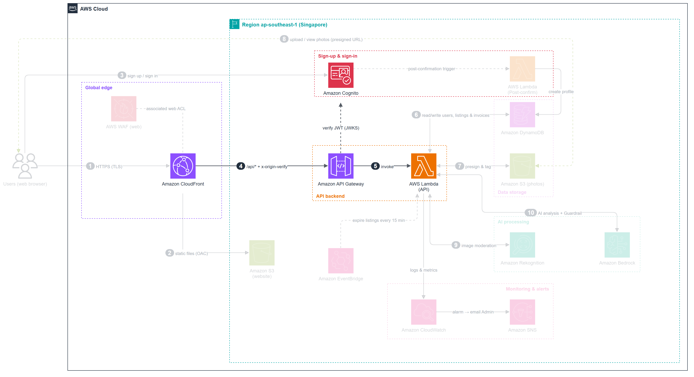
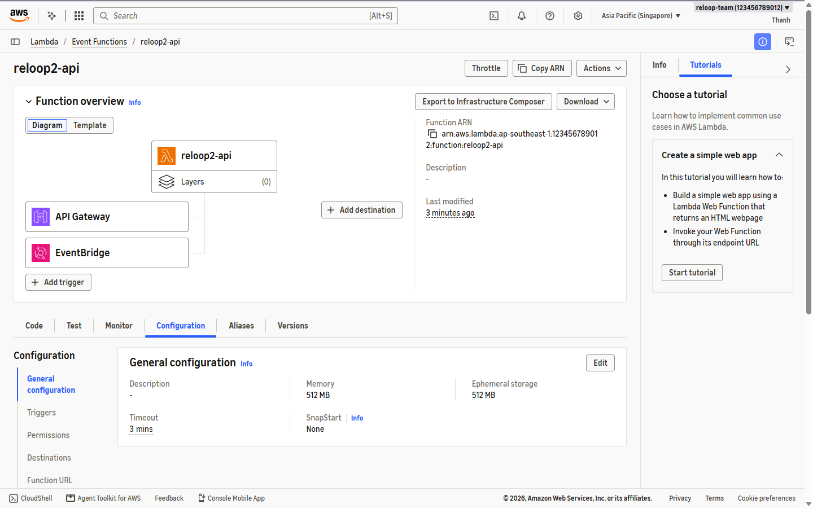
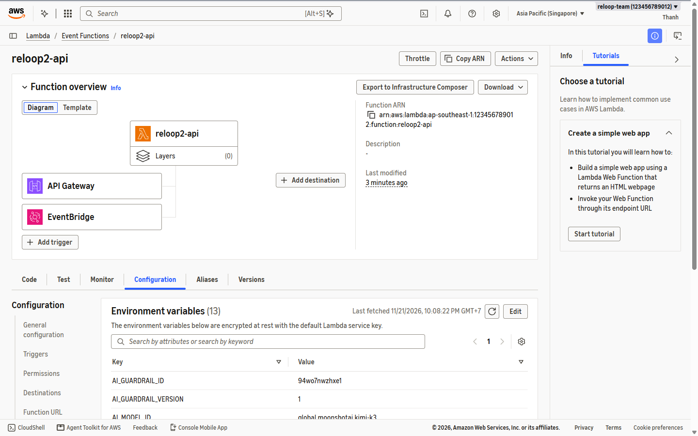
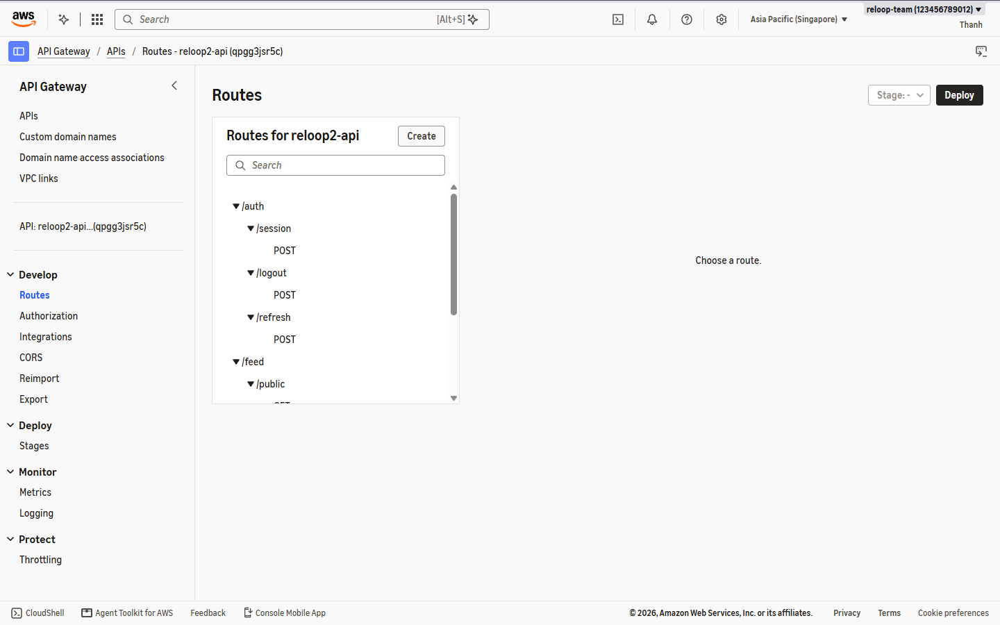
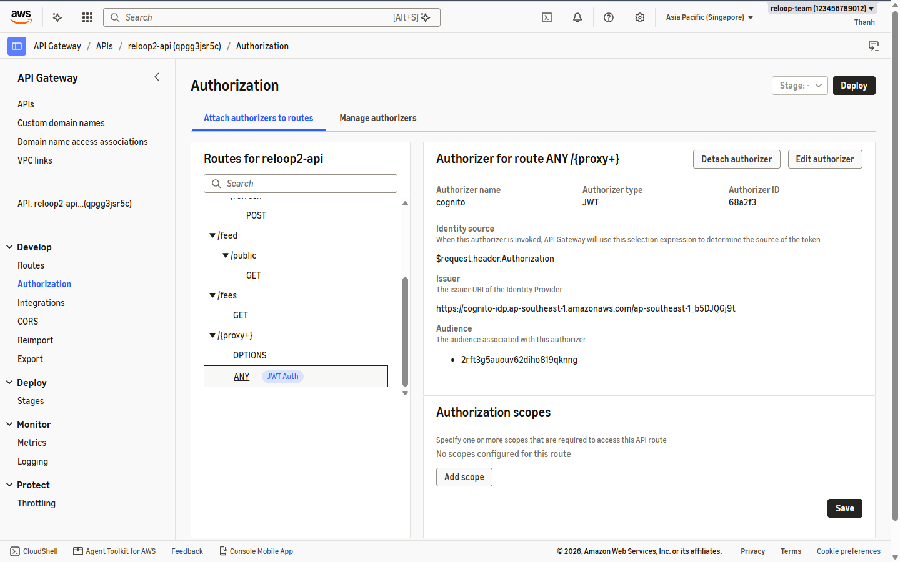
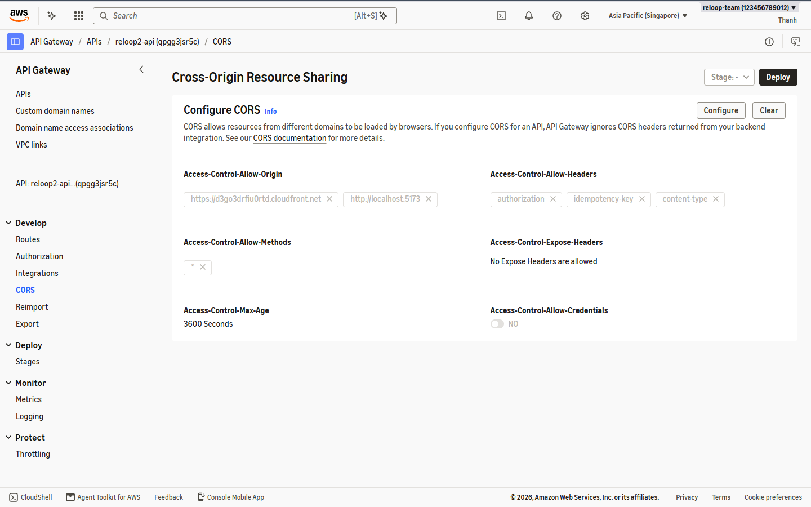
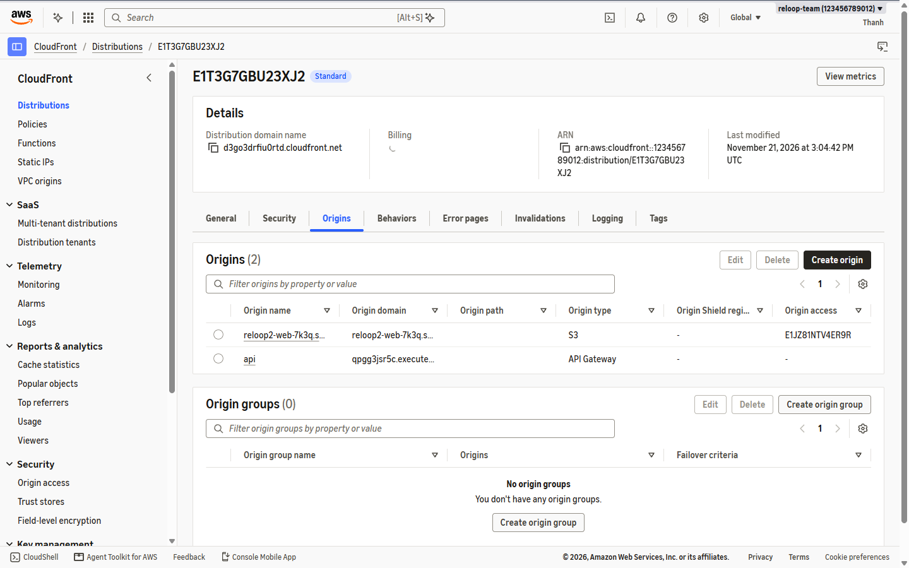
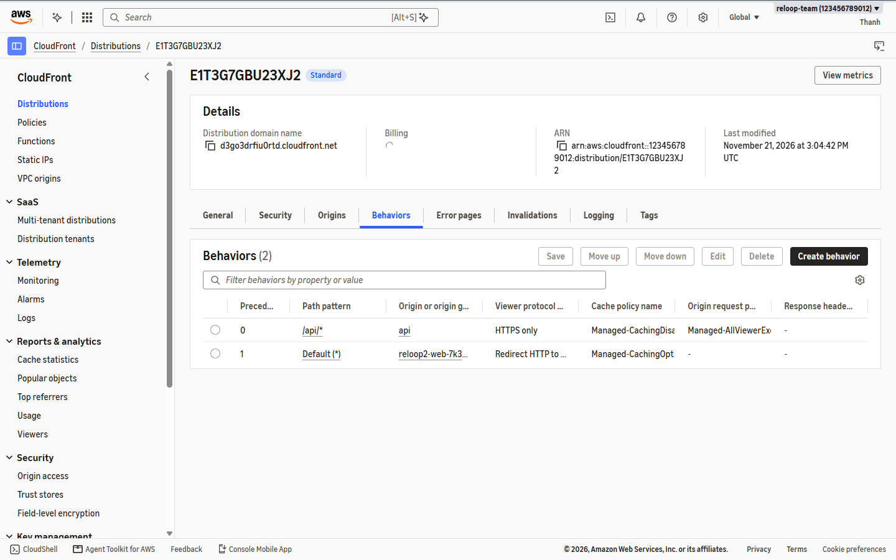

Bây giờ bạn xây dựng khối màu cam **API backend** trên sơ đồ: **AWS Lambda (`reloop2-api`)**, **Amazon API Gateway** kèm bộ xác thực JWT của Cognito (`verify JWT (JWKS)`), và tuyến `/api/*` từ **Amazon CloudFront** mang tiêu đề bí mật `x-origin-verify`.

**Các mũi tên trên sơ đồ thuộc bước này:**
- **Mũi tên 4:** `Amazon CloudFront → Amazon API Gateway` (`/api/* + x-origin-verify`)
- **Liên kết phụ:** `Amazon API Gateway → Amazon Cognito` (`verify JWT (JWKS)`)
- **Mũi tên 5:** `Amazon API Gateway → AWS Lambda (API)` (`invoke`)



---

### Phần A — Tạo IAM Role tối thiểu quyền & Backend Lambda (Đích của `Mũi tên 5`)

1. **Sinh chuỗi bí mật ngẫu nhiên 64 ký tự hex** trên máy (chỉ giữ trong phiên terminal — không bao giờ commit lên Git):
   ```bash
   python -c "import secrets; print(secrets.token_hex(32))"
   ```
2. **IAM Role:** Tạo **`reloop2-api-lambda-role`** (chọn trusted entity / dịch vụ tin cậy là **AWS service -> Lambda**), gắn chính sách quản lý của AWS **`AWSLambdaBasicExecutionRole`**, rồi thêm inline policy **`reloop2-api-access`** cấp đúng quyền cho các mũi tên đi ra từ `AWS Lambda (API)` (DynamoDB ở 5.6, S3 photos ở 5.7, Rekognition & Bedrock ở 5.8 và CloudWatch Logs ở 5.10):
   *(Thay giá trị mẫu `123456789012` bằng mã tài khoản AWS 12 chữ số của bạn và `<suffix>` bằng hậu tố bucket của bạn.)*
   ```json
   {
     "Version": "2012-10-17",
     "Statement": [
       {
         "Sid": "CoreTable",
         "Effect": "Allow",
         "Action": ["dynamodb:GetItem", "dynamodb:Query", "dynamodb:PutItem", "dynamodb:DeleteItem", "dynamodb:ConditionCheckItem"],
         "Resource": [
           "arn:aws:dynamodb:ap-southeast-1:123456789012:table/reloop2-core-table",
           "arn:aws:dynamodb:ap-southeast-1:123456789012:table/reloop2-core-table/index/*"
         ]
       },
       {
         "Sid": "ListingImages",
         "Effect": "Allow",
         "Action": ["s3:PutObject", "s3:GetObject", "s3:PutObjectTagging", "s3:GetObjectTagging", "s3:DeleteObject"],
         "Resource": "arn:aws:s3:::reloop2-images-<suffix>/listings/*"
       },
       {
         "Sid": "Bedrock",
         "Effect": "Allow",
         "Action": ["bedrock:InvokeModel"],
         "Resource": [
           "arn:aws:bedrock:*:123456789012:inference-profile/global.moonshotai.kimi-k3",
           "arn:aws:bedrock:*::foundation-model/*"
         ]
       },
       {
         "Sid": "Guardrail",
         "Effect": "Allow",
         "Action": ["bedrock:ApplyGuardrail"],
         "Resource": [
           "arn:aws:bedrock:ap-southeast-1:123456789012:guardrail/*",
           "arn:aws:bedrock:*:123456789012:guardrail-profile/*"
         ]
       },
       {
         "Sid": "Moderation",
         "Effect": "Allow",
         "Action": ["rekognition:DetectModerationLabels", "rekognition:DetectText"],
         "Resource": "*"
       },
       {
         "Sid": "SelfInvoke",
         "Effect": "Allow",
         "Action": ["lambda:InvokeFunction"],
         "Resource": "arn:aws:lambda:ap-southeast-1:123456789012:function:reloop2-api"
       },
       {
         "Sid": "Logs",
         "Effect": "Allow",
         "Action": ["logs:CreateLogStream", "logs:PutLogEvents"],
         "Resource": "arn:aws:logs:ap-southeast-1:123456789012:log-group:/aws/lambda/reloop2-api:*"
       }
     ]
   }
   ```
3. **Tạo hàm Lambda:** Mở **AWS Lambda -> Create function** tại **`ap-southeast-1`**:
   - **Function name:** `reloop2-api`
   - **Runtime:** `Node.js 22.x` · **Architecture:** `arm64`
   - **Execution role:** `reloop2-api-lambda-role`
   - Tải lên tệp [`reloop2-api.zip`](https://github.com/madlyham/ReLoop/releases/download/v1.0.0/reloop2-api.zip) (cũng có sẵn tại `ReLoop/zips/reloop2-api.zip` trong [github.com/madlyham/ReLoop](https://github.com/madlyham/ReLoop); handler `index.handler`).
   - Vào **Configuration -> General configuration**, đặt **Memory:** `512 MB`, **Timeout:** `3 min` (`180s`).



4. Vào **Configuration -> Environment variables**, thêm các biến sau:

| Khóa | Giá trị |
| --- | --- |
| `STAGE` | `aws` |
| `AUTH_MODE` | `cognito` |
| `TABLE_NAME` | `reloop2-core-table` |
| `IMAGE_BUCKET` | `reloop2-images-<suffix>` |
| `COGNITO_CLIENT_ID` | `<client-id>` (từ Học phần 5.4) |
| `AI_MODEL_ID` | `global.moonshotai.kimi-k3` |
| `ORIGIN_VERIFY_SECRET` | `<chuỗi-bí-mật-64-hex>` |
| `NODE_OPTIONS` | `--enable-source-maps` |

*(Bạn sẽ bổ sung `AI_GUARDRAIL_ID` và `AI_GUARDRAIL_VERSION` ngay sau khi tạo Guardrail ở Học phần 5.8.)*



---

### Phần B — Tạo HTTP API Gateway & Bộ xác thực JWT (`Mũi tên 5` + `verify JWT`)

1. Mở **Amazon API Gateway -> Create API -> HTTP API -> Build** tại **`ap-southeast-1`**:
   - **API name:** `reloop2-api`
   - **Integration:** Lambda -> `reloop2-api` (Payload format `2.0`)
   - **Routes:**
     - `ANY /{proxy+}` (bảo vệ bằng Cognito JWT)
     - Các tuyến công khai (`Authorization = None`): `GET /feed/public`, `GET /fees`, `POST /auth/session`, `POST /auth/refresh`, `POST /auth/logout`, `OPTIONS /{proxy+}`
   - **Stage:** `$default` có bật **Auto-deploy**.



2. Vào **Develop -> Authorization -> Manage authorizers -> Create**:
   - **Authorizer type:** `JWT` · **Name:** `cognito`
   - **Identity source:** `$request.header.Authorization`
   - **Issuer URL:** `https://cognito-idp.ap-southeast-1.amazonaws.com/ap-southeast-1_<id>`
   - **Audience:** `<client-id>`
   - Chỉ gắn **`cognito`** cho tuyến **`ANY /{proxy+}`** (giữ không xác thực cho 6 tuyến công khai).



3. Vào **Develop -> CORS**, nhập trực tiếp tên miền CloudFront từ Học phần 5.3 (không cần quay lại sửa sau):
   - **Access-Control-Allow-Origin:** `https://<dist-domain>.cloudfront.net`, `http://localhost:5173`
   - **Access-Control-Allow-Headers:** `authorization`, `idempotency-key`, `content-type`
   - **Access-Control-Allow-Methods:** `*` · **Max age:** `3600`
4. Vào **Protect -> Throttling**, chỉnh stage `$default` với **Rate limit:** `20` req/s, **Burst limit:** `50`.



---

### Phần C — Nối CloudFront `/api/*` & Tiêu đề `x-origin-verify` (`Mũi tên 4`)

Bây giờ hãy nối **Amazon CloudFront** (Học phần 5.3) tới **API Gateway** vừa tạo:

1. Mở **CloudFront -> Distributions -> `<dist-id>` -> Origins -> Create origin**:
   - **Origin domain:** `<api-id>.execute-api.ap-southeast-1.amazonaws.com`
   - **Protocol:** `HTTPS only` (`TLSv1.2`) · **Origin read timeout:** `30s`
   - **Name:** `api`
   - **Add custom header:** Tên tiêu đề **`x-origin-verify`**, Giá trị **`<chuỗi-bí-mật-64-hex>`** (phải khớp `ORIGIN_VERIFY_SECRET` trên Lambda; `reloop2-api` so sánh bằng `timingSafeEqual` và trả về `403 DIRECT_ACCESS_FORBIDDEN` nếu gọi thẳng API Gateway bỏ qua CloudFront).



2. Mở thẻ **Behaviors** -> **Create behavior**:
   - **Path pattern:** `/api/*`
   - **Origin:** `api`
   - **Viewer protocol policy:** `HTTPS only`
   - **Allowed HTTP methods:** `GET, HEAD, OPTIONS, PUT, POST, PATCH, DELETE`
   - **Cache policy:** `CachingDisabled`
   - **Origin request policy:** `AllViewerExceptHostHeader`
   - **Function associations -> Viewer request:** `CloudFront Functions` -> **`reloop2-api-prefix`** (đã tạo ở Học phần 5.3 để cắt tiền tố `/api` trước khi chuyển sang API Gateway)
3. Xác nhận `/api/*` nằm ở **Precedence `0`** phía trên `Default (*)` ở **Precedence `1`**.



{}
**Mũi tên 4, 5 và xác thực JWT đã hoàn tất.** Tiếp theo, chuyển sang [Học phần 5.6 — Lưu trữ dữ liệu: Amazon DynamoDB](../5.6-dynamodb/) để xây dựng **Mũi tên 6**.
{}
