Uploaded device photos go directly from the user's browser to a private **Amazon S3** bucket (`reloop2-images-<suffix>`, e.g. `reloop2-images-7k3q`) via short-lived presigned URLs issued by Lambda. **Block All Public Access** stays enabled so photos cannot be listed or hotlinked outside controlled presigned URLs, while CORS allows browser uploads and S3 Lifecycle rules automatically purge abandoned `pending` uploads and incomplete multipart uploads.

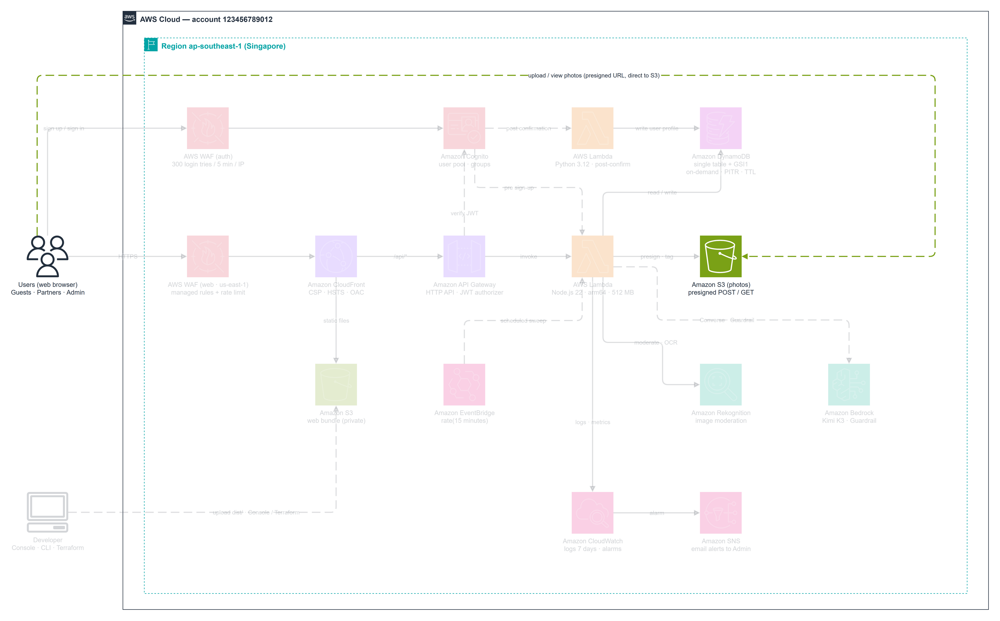

---

### Step 1 — Create Private Bucket `reloop2-images-<suffix>`

1. Open **Amazon S3 -> Buckets** in **`ap-southeast-1`** and click **Create bucket**.

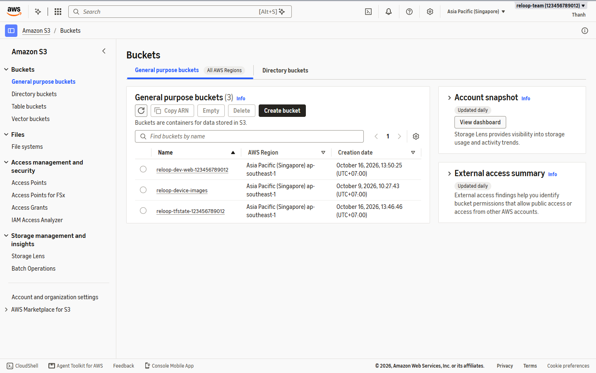

2. Configure **General configuration**:
   - **AWS Region:** `ap-southeast-1`
   - **Bucket type:** General purpose
   - **Bucket name:** `reloop2-images-7k3q` (replace `7k3q` with your own globally unique 4-character suffix)

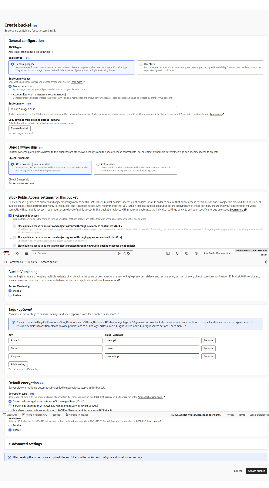

3. Leave **Block all public access** checked (`ON`) — never expose raw user photos via public bucket policies.

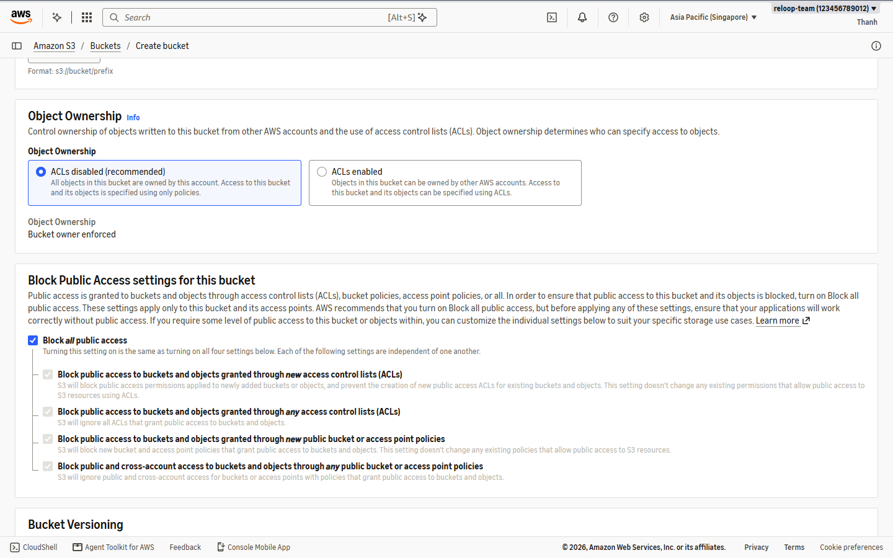

4. Add workshop tags (`Owner=team`, `Project=reloop2`, `Purpose=workshop`), keep **SSE-S3 (`AES256`)** with **Bucket Key Enabled**, and click **Create bucket**.

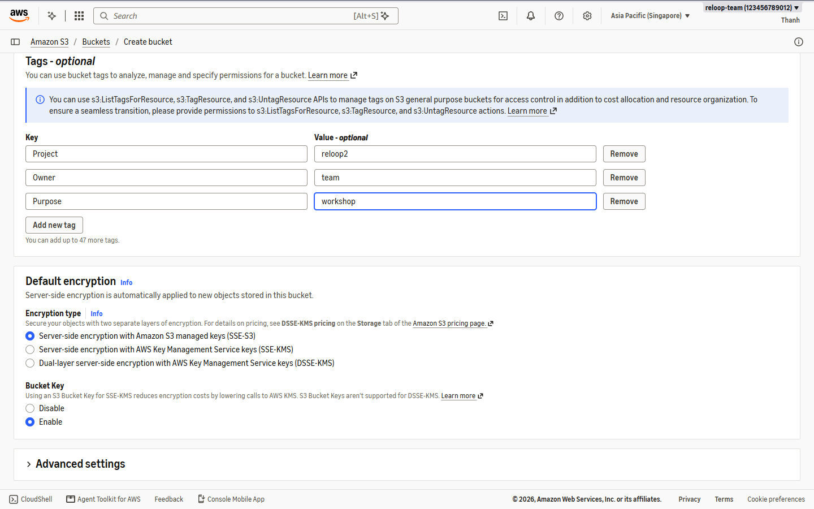

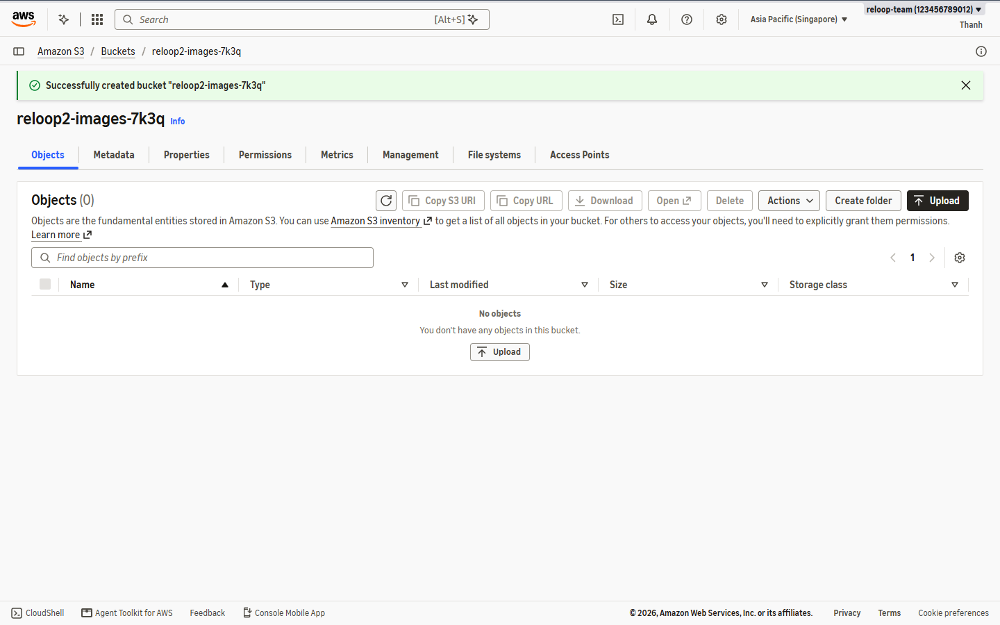

---

### Step 2 — Configure CORS for Direct Browser Uploads

5. Open `reloop2-images-7k3q` -> **Permissions** -> scroll to **Cross-origin resource sharing (CORS)** -> click **Edit** and paste (we start with `http://localhost:5173`, then append our CloudFront origin in Module **5.8**):

```json
[
  {
    "AllowedHeaders": ["*"],
    "AllowedMethods": ["PUT", "POST", "GET"],
    "AllowedOrigins": ["http://localhost:5173"],
    "ExposeHeaders": ["ETag"]
  }
]
```

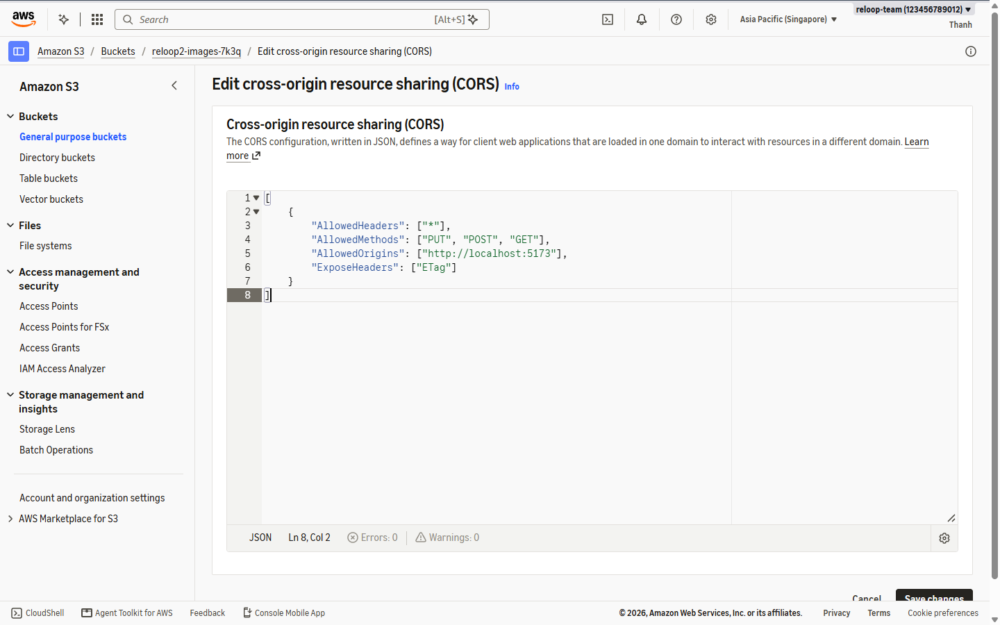

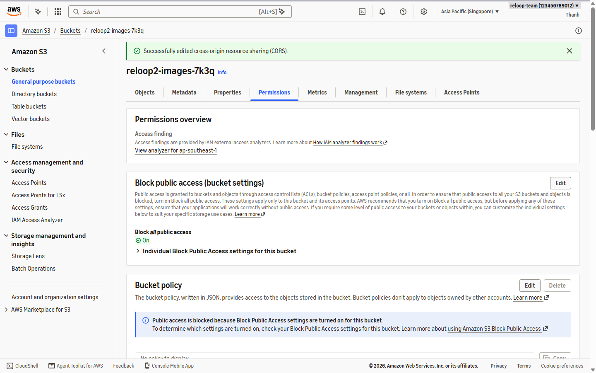

---

### Step 3 — Add 3 Cost-Control Lifecycle Rules

6. Open **Management -> Lifecycle rules** -> click **Create lifecycle rule** for each rule below:

| Rule Name | Scope / Filter | Action |
| --- | --- | --- |
| `reloop2-listing-images-unattached` | Prefix `listings/` AND object tag `state = pending` | Expire current versions after **1 day** |
| `reloop2-listing-images-retention` | Prefix `listings/` (all attached photos) | Expire current versions after **90 days** |
| `reloop2-abort-incomplete-uploads` | Prefix `listings/` | Abort incomplete multipart uploads after **1 day** |

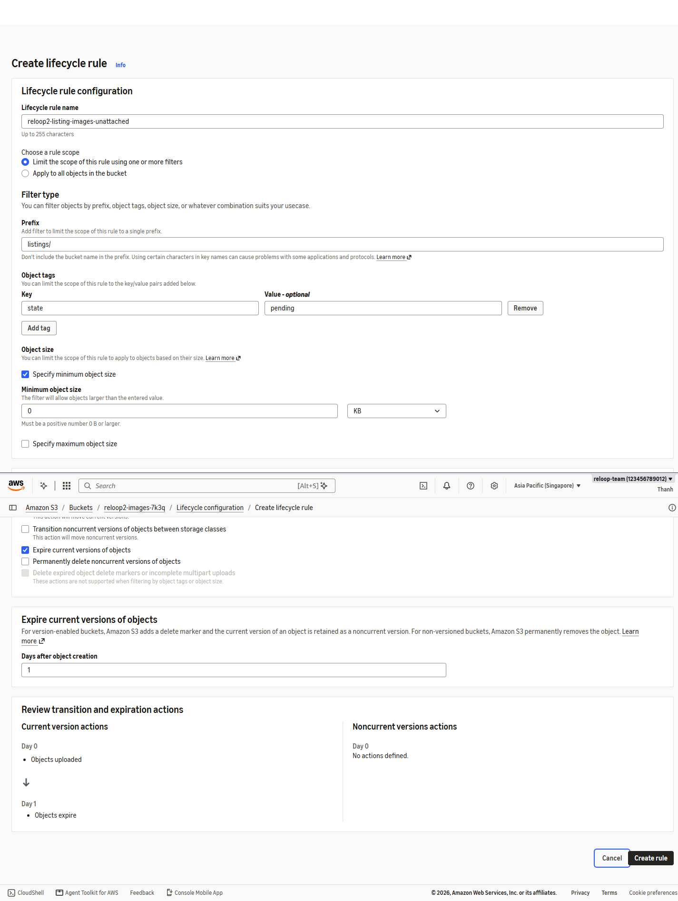

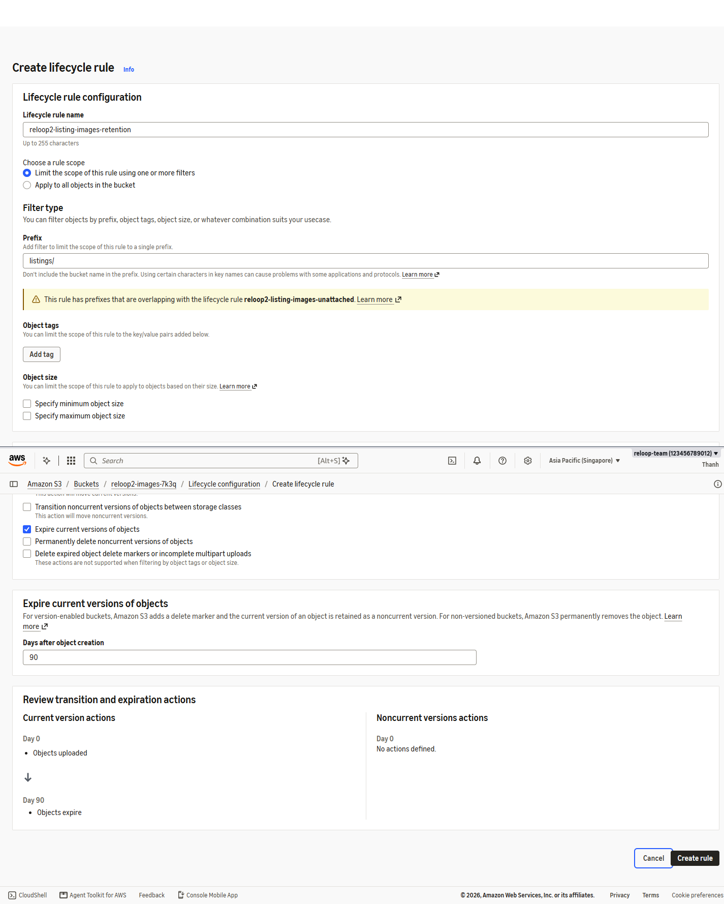

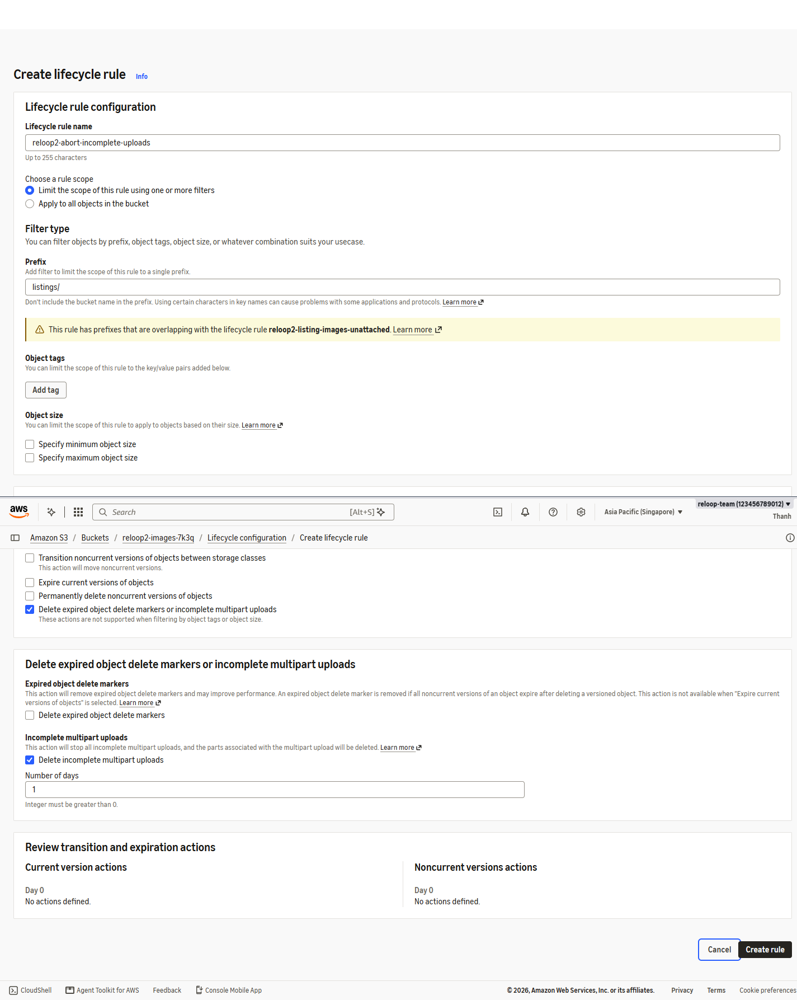

7. Confirm all **3 lifecycle rules** show status **Enabled** under **Management -> Lifecycle rules**.

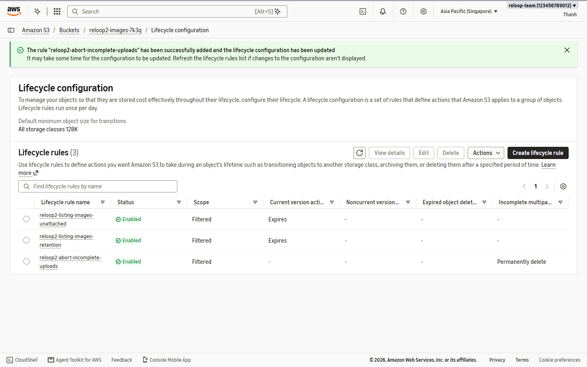
