Ảnh thiết bị do người dùng tải lên được đẩy trực tiếp từ trình duyệt vào bucket **Amazon S3** riêng tư (`reloop2-images-<suffix>`, ví dụ `reloop2-images-7k3q`) thông qua **presigned URL** ngắn hạn do Lambda cấp. **Block All Public Access** luôn bật, CORS cho phép trình duyệt upload an toàn, và 3 **Lifecycle rules** tự động dọn ảnh rác chưa gắn tin sau 1 ngày và thu hồi dung lượng sau 90 ngày.

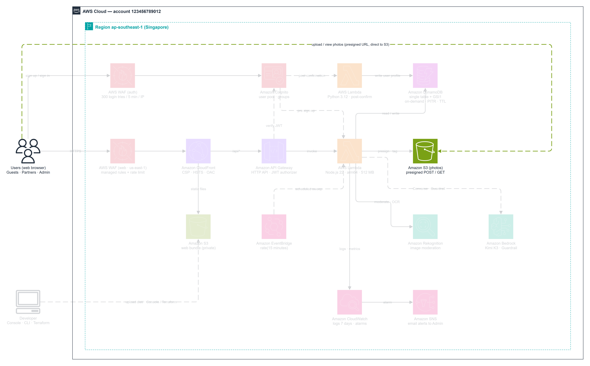

---

### Bước 1 — Tạo bucket riêng tư `reloop2-images-<suffix>`

1. Vào **Amazon S3 -> Buckets** tại **`ap-southeast-1`**, bấm **Create bucket**.

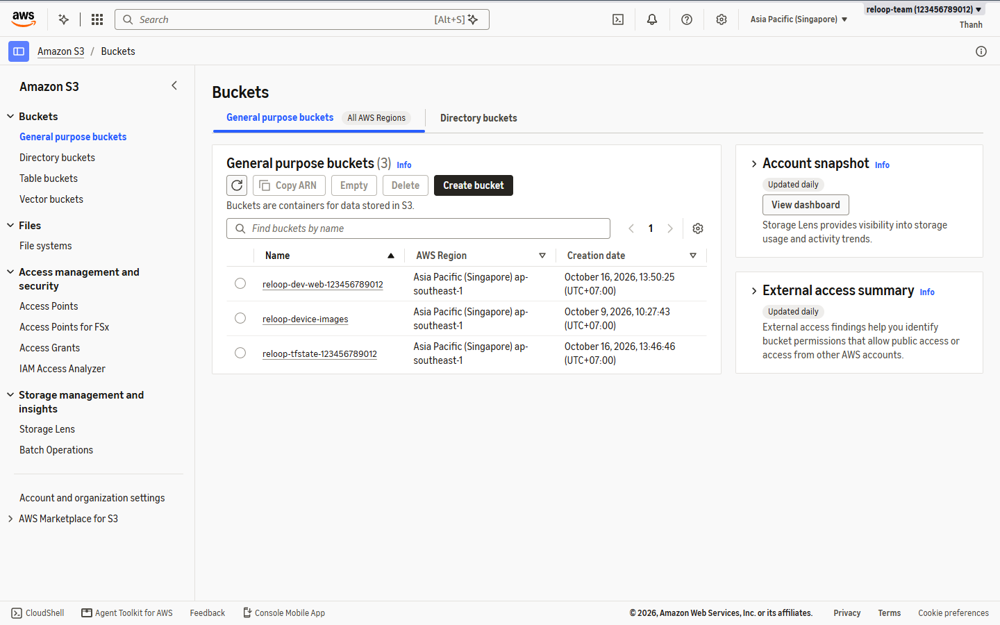

2. Ở mục **General configuration**:
   - **AWS Region:** `ap-southeast-1`
   - **Bucket name:** `reloop2-images-7k3q` (thay `7k3q` bằng hậu tố duy nhất toàn cầu của bạn)

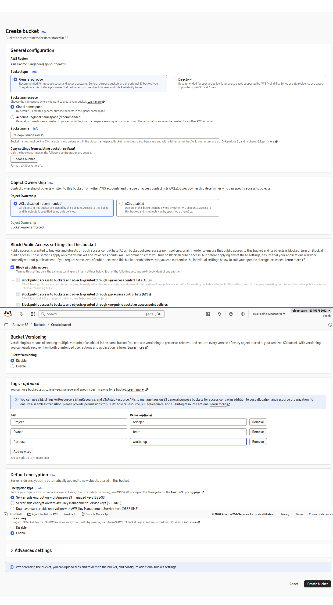

3. Giữ nguyên tích chọn **Block all public access** để ảnh không bị truy cập công khai trái phép.

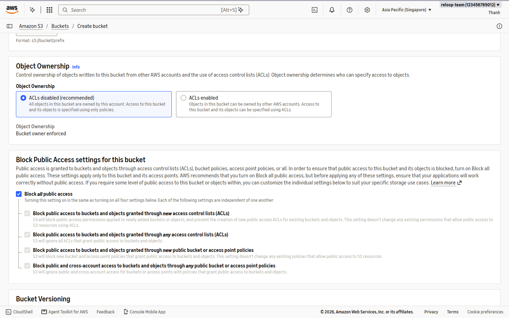

4. Gắn tags (`Owner=team`, `Project=reloop2`, `Purpose=workshop`), bật mã hóa mặc định **SSE-S3 (`AES256`) + Bucket Key**, rồi bấm **Create bucket**.

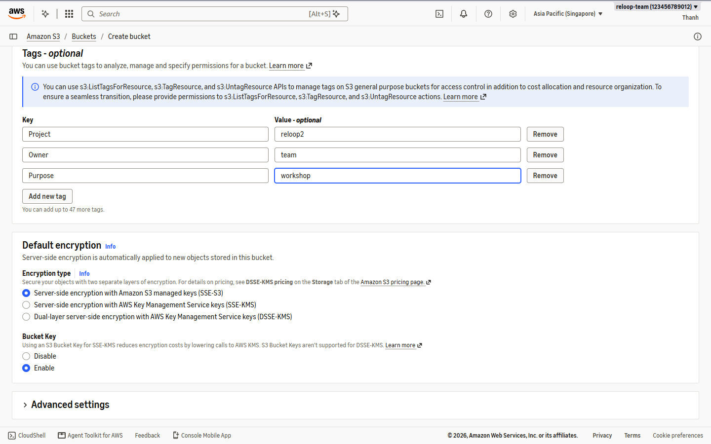

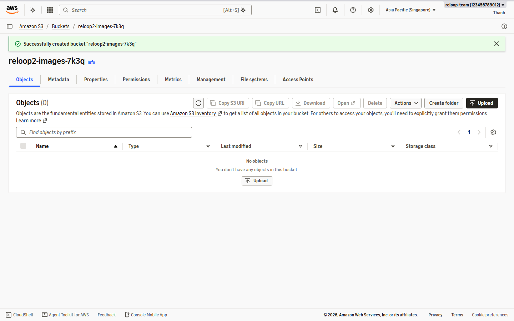

---

### Bước 2 — Cấu hình CORS cho phép upload trực tiếp từ trình duyệt

5. Mở bucket `reloop2-images-7k3q` -> tab **Permissions** -> mục **Cross-origin resource sharing (CORS)** -> bấm **Edit** và dán cấu hình JSON sau (ở Phần **5.8** ta sẽ thêm domain CloudFront):

```json
[
  {
    "AllowedHeaders": ["*"],
    "AllowedMethods": ["PUT", "POST", "GET"],
    "AllowedOrigins": ["http://localhost:5173"],
    "ExposeHeaders": ["ETag"]
  }
]
```

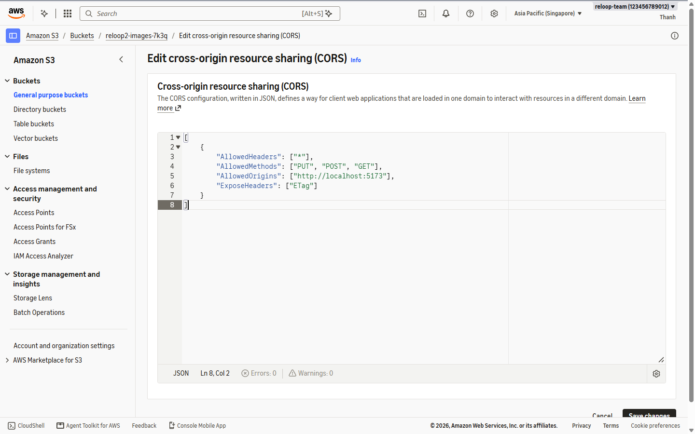

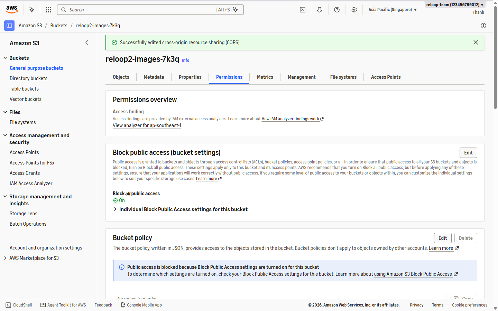

---

### Bước 3 — Tạo 3 Lifecycle Rules tối ưu chi phí

6. Vào tab **Management -> Lifecycle rules** -> **Create lifecycle rule** cho cả 3 quy tắc:

| Tên Rule | Phạm vi lọc | Hành động |
| --- | --- | --- |
| `reloop2-listing-images-unattached` | Tiền tố `listings/` VÀ object tag `state = pending` | Hết hạn sau **1 ngày** |
| `reloop2-listing-images-retention` | Tiền tố `listings/` | Hết hạn sau **90 ngày** |
| `reloop2-abort-incomplete-uploads` | Tiền tố `listings/` | Hủy multipart upload lỗi sau **1 ngày** |

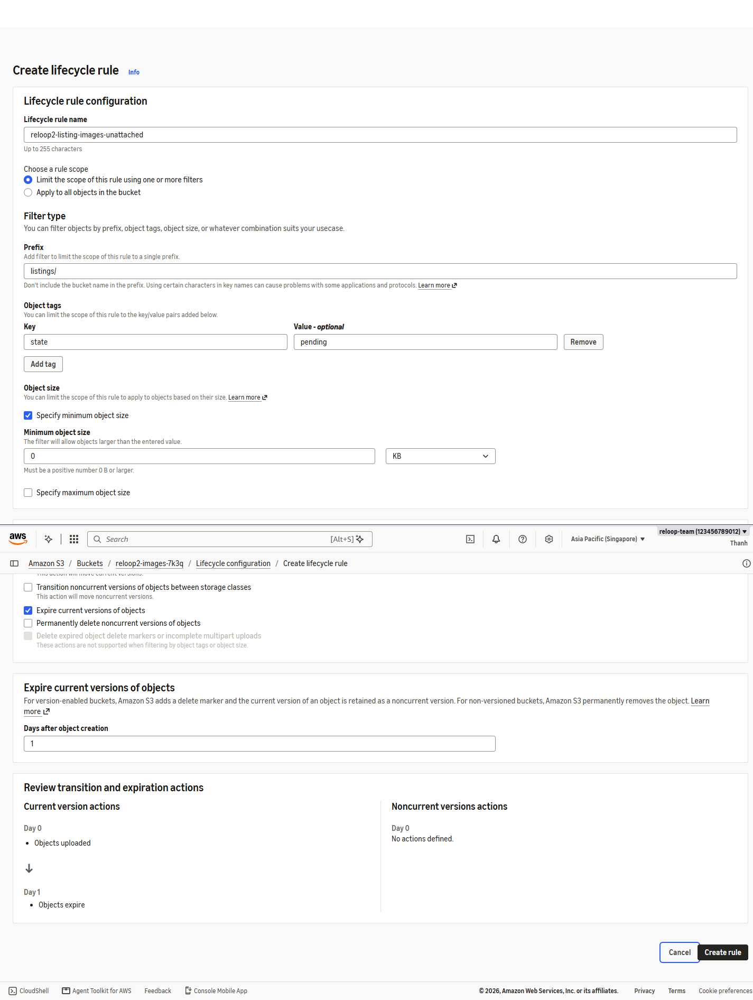

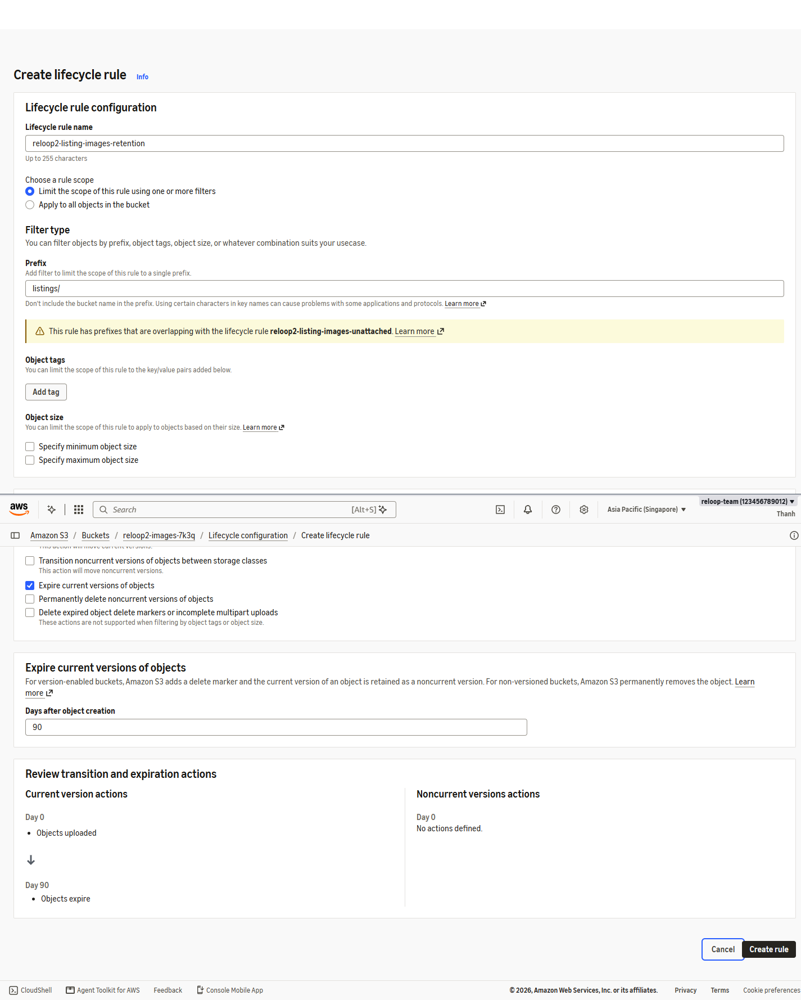

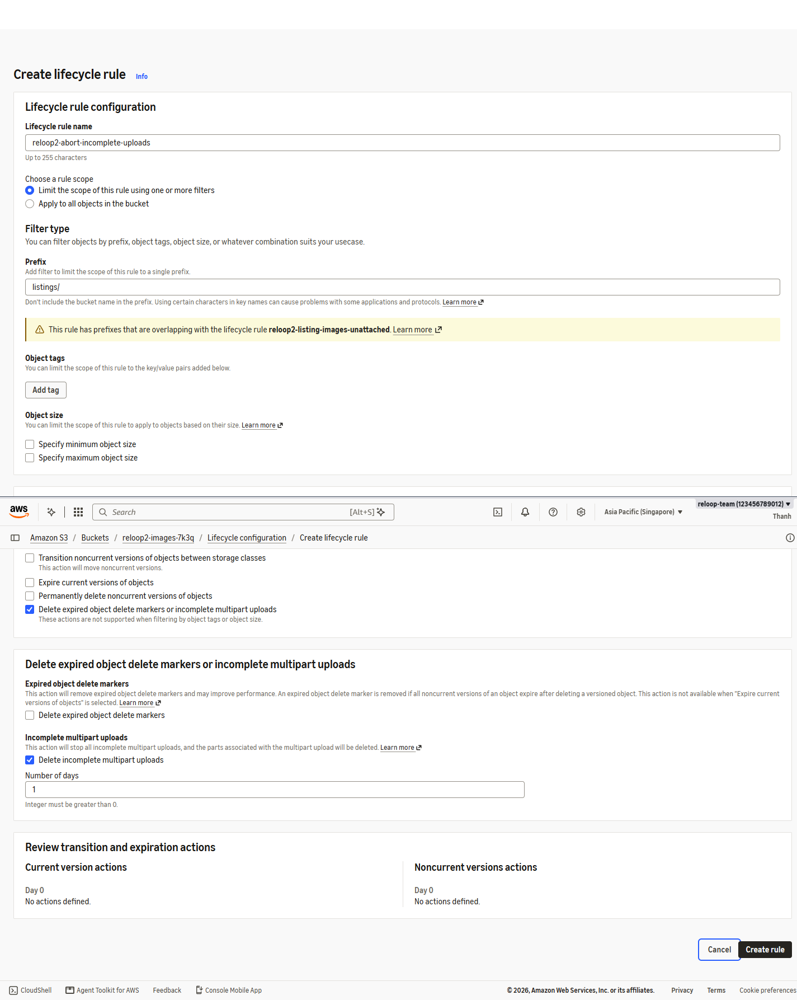

7. Xác nhận cả **3 Lifecycle rules** đều ở trạng thái **Enabled**.

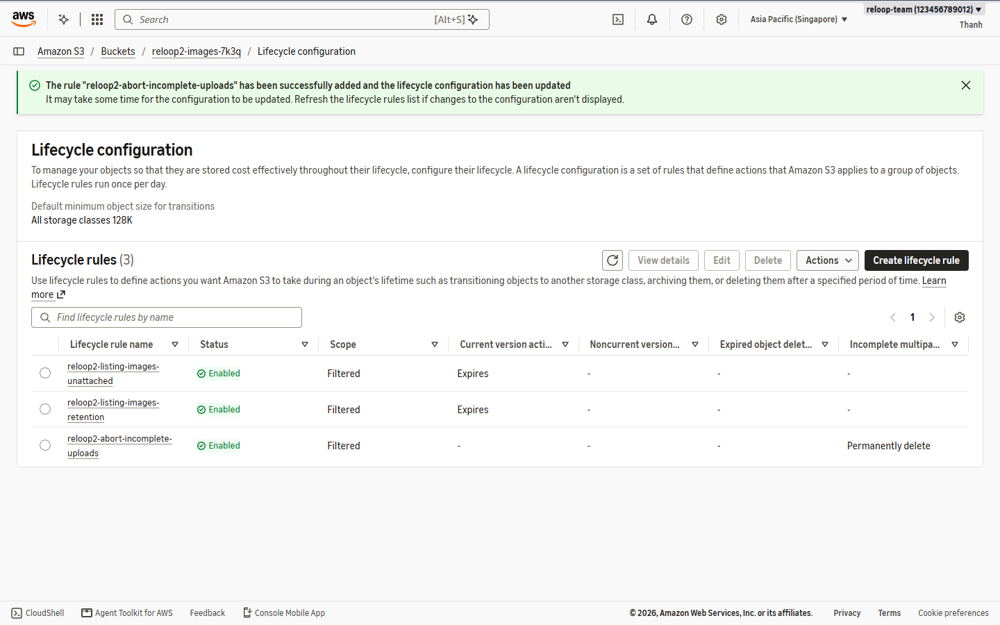
