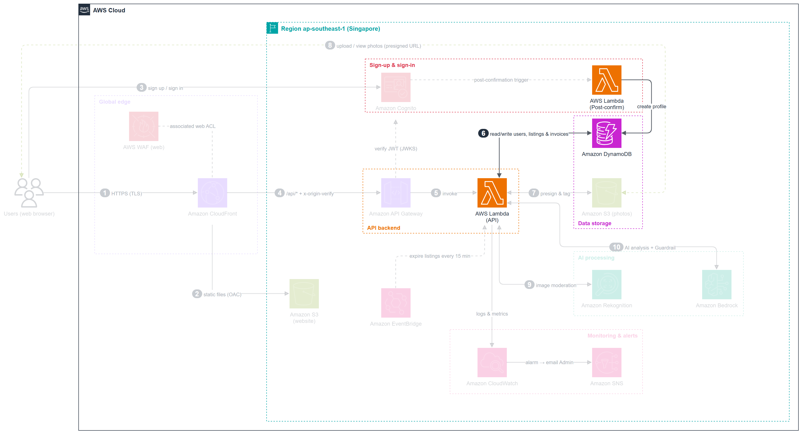
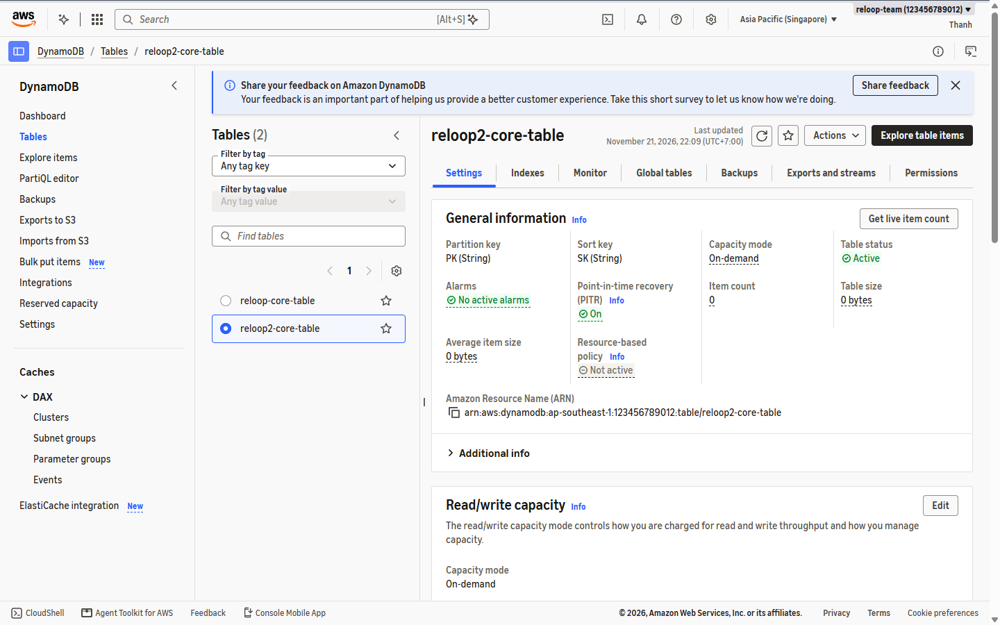
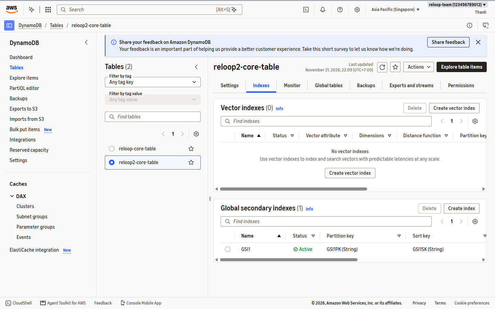
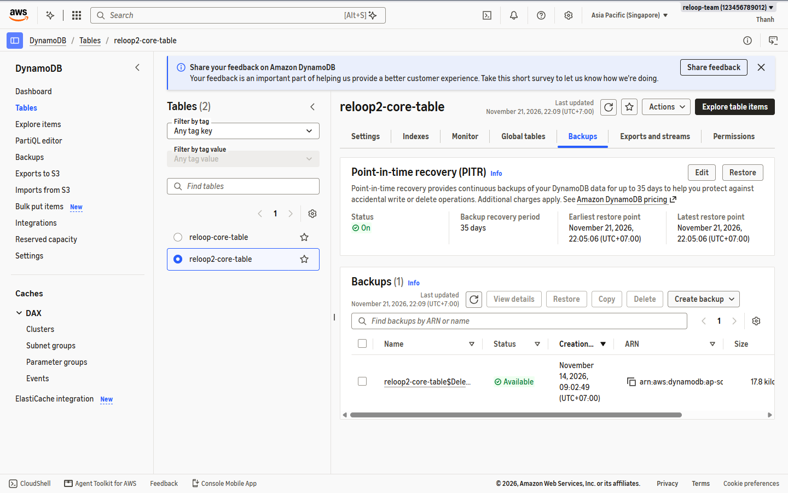

Follow **Arrow 6** into the **Data storage** box: one serverless **Amazon DynamoDB** table (`reloop2-core-table`) stores every application record — user profiles created by `reloop2-post-confirmation`, partner profiles, device listings, expiration timers, and monthly fee invoices written and queried by `reloop2-api`.

**Graph arrows covered in this step:**
- **Arrow 6:** `AWS Lambda (API) ↔ Amazon DynamoDB` (`read/write users, listings & invoices`)
- **Supporting link:** `AWS Lambda (Post-confirm) → Amazon DynamoDB` (`create profile`)

---

### Single-Table Key Design (`users, listings & invoices`)

ReLoop packs all entities into one on-demand table (`PK` / `SK`) plus one overloaded Global Secondary Index (`GSI1` on `GSI1PK` / `GSI1SK`):

| Entity | `PK` | `SK` | Purpose |
| --- | --- | --- | --- |
| **User Profile** | `USER#<userId>` | `PROFILE` | Created automatically by `reloop2-post-confirmation` (`GSI1PK = ROLE#Owner`) |
| **Partner Profile** | `PARTNER#<userId>` | `PROFILE` | Partner onboarding & approval (`GSI1PK = PARTNER#STATUS#PENDING\|APPROVED`) |
| **Device Listing** | `LISTING#<listingId>` | `META` | Owner's listings (`GSI1PK = OWNER#<userId>`, expires after 7 days; public feed records use `PK = FEED#<YYYY-MM>`) |
| **Monthly Invoice** | `USER#<userId>` | `INVOICE#<invoiceId>` | Monthly transaction fee invoices & VIP billing (`SYSTEM / BILLINGRUN#<YYYY-MM>`) |
| **Expiry Timer** | `TIMER#<YYYY-MM-DDTHH>` | `LISTING_EXPIRE#<id>` | Queried every 15 minutes by the EventBridge sweep (Module 5.9) |
| **Notifications** | `USER#<userId>` | `NOTIF#<ts>#<id>` | Auto-deleted after 90 days via DynamoDB TTL (`ttl` attribute) |

---

### Step 1 — Create Table `reloop2-core-table` & `GSI1`

1. Open **Amazon DynamoDB -> Tables -> Create table** in **`ap-southeast-1`**.
2. Configure:
   - **Table name:** `reloop2-core-table`
   - **Partition key:** `PK` (`String`)
   - **Sort key:** `SK` (`String`)
   - **Table settings:** **Customize settings** -> **Capacity mode:** **`On-demand`** (`PAY_PER_REQUEST`)
3. Under **Secondary indexes -> Create global index**:
   - **Partition key:** `GSI1PK` (`String`)
   - **Sort key:** `GSI1SK` (`String`)
   - **Index name:** `GSI1`
   - **Attribute projections:** `All`
4. Add tag `Project = reloop2` and click **Create table**. Wait until status reads **Active**.

---

### Step 2 — Enable Point-in-Time Recovery (PITR) & TTL

1. Open the **Backups** tab -> **Point-in-time recovery (PITR)** -> **Edit** -> check **Turn on point-in-time recovery** -> **Save changes**.
2. Open **Additional settings -> Time to Live (TTL)** -> **Turn on**:
   - **TTL attribute name:** `ttl`
   - Click **Turn on TTL** so expired notifications clean themselves up automatically at zero compute cost.

{}
**Arrow 6 (`DynamoDB`) is live.** Both `reloop2-post-confirmation` and `reloop2-api` can now read and write users, listings, and invoices. Next, move to [Module 5.7 — Data Storage: Amazon S3 Photos](../5.7-s3-photos/) for **Arrows 7 and 8**.
{}
