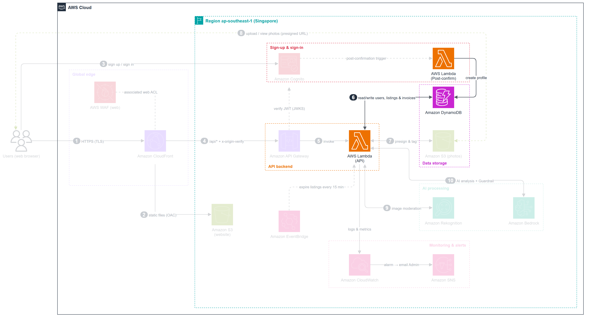
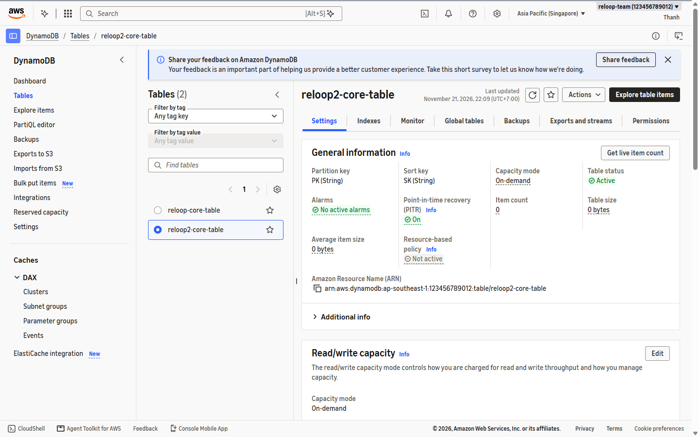
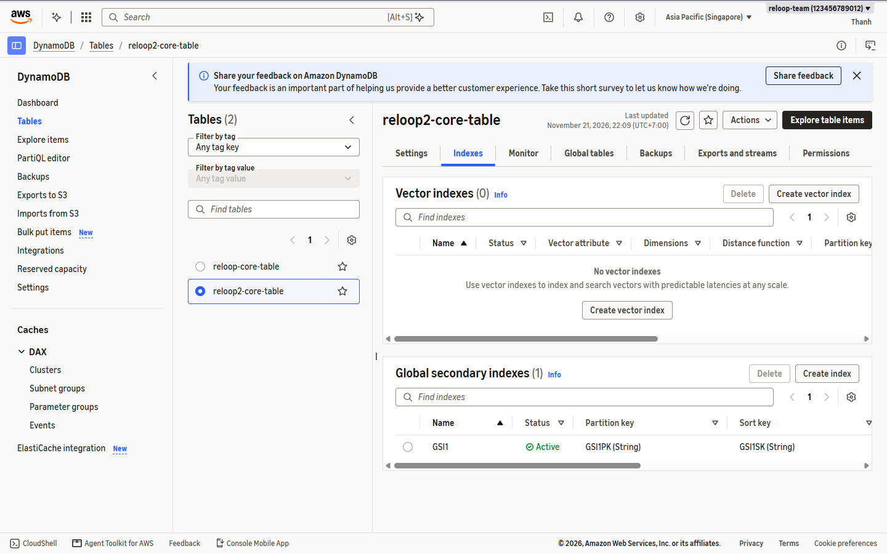
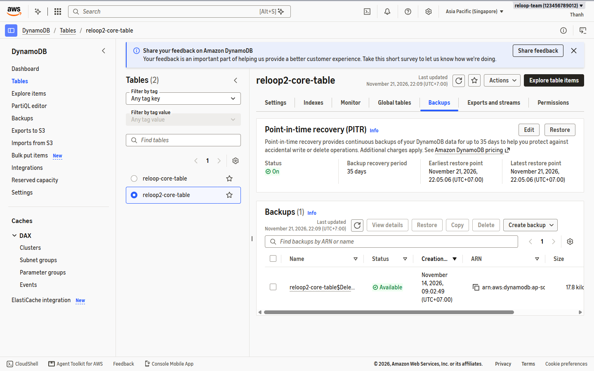

Đi theo **Mũi tên 6** vào khối **Data storage**: một bảng **Amazon DynamoDB** duy nhất (`reloop2-core-table`) lưu toàn bộ dữ liệu ứng dụng — hồ sơ người dùng do `reloop2-post-confirmation` tạo ra, hồ sơ đối tác, tin đăng thiết bị, bộ hẹn giờ hết hạn và hóa đơn phí theo tháng do `reloop2-api` đọc/ghi.

**Các mũi tên trên sơ đồ thuộc bước này:**
- **Mũi tên 6:** `AWS Lambda (API) ↔ Amazon DynamoDB` (`read/write users, listings & invoices`)
- **Liên kết phụ:** `AWS Lambda (Post-confirm) → Amazon DynamoDB` (`create profile`)

---

### Thiết kế bảng đơn (`users, listings & invoices`)

ReLoop gom mọi thực thể vào một bảng on-demand (`PK` / `SK`) kèm một Global Secondary Index dùng chung (overloaded GSI, `GSI1` trên `GSI1PK` / `GSI1SK`):

| Thực thể | `PK` | `SK` | Mục đích |
| --- | --- | --- | --- |
| **Hồ sơ người dùng** | `USER#<userId>` | `PROFILE` | Do `reloop2-post-confirmation` tự tạo (`GSI1PK = ROLE#Owner`) |
| **Hồ sơ đối tác** | `PARTNER#<userId>` | `PROFILE` | Đăng ký và duyệt đối tác (`GSI1PK = PARTNER#STATUS#PENDING\|APPROVED`) |
| **Tin đăng thiết bị** | `LISTING#<listingId>` | `META` | Tin đăng của chủ thiết bị (`GSI1PK = OWNER#<userId>`, tự hết hạn sau 7 ngày; bản ghi bảng tin công khai dùng `PK = FEED#<YYYY-MM>`) |
| **Hóa đơn theo tháng** | `USER#<userId>` | `INVOICE#<invoiceId>` | Hóa đơn phí giao dịch hàng tháng & gói VIP (`SYSTEM / BILLINGRUN#<YYYY-MM>`) |
| **Bộ hẹn giờ hết hạn** | `TIMER#<YYYY-MM-DDTHH>` | `LISTING_EXPIRE#<id>` | Được lịch quét EventBridge truy vấn mỗi 15 phút (Học phần 5.9) |
| **Thông báo** | `USER#<userId>` | `NOTIF#<ts>#<id>` | Tự xóa sau 90 ngày nhờ DynamoDB TTL (thuộc tính `ttl`) |

---

### Bước 1 — Tạo bảng `reloop2-core-table` & `GSI1`

1. Mở **Amazon DynamoDB -> Tables -> Create table** tại **`ap-southeast-1`**.
2. Cấu hình:
   - **Table name:** `reloop2-core-table`
   - **Partition key:** `PK` (`String`)
   - **Sort key:** `SK` (`String`)
   - **Table settings:** **Customize settings** -> **Capacity mode:** **`On-demand`** (`PAY_PER_REQUEST`)
3. Ở mục **Secondary indexes -> Create global index**:
   - **Partition key:** `GSI1PK` (`String`)
   - **Sort key:** `GSI1SK` (`String`)
   - **Index name:** `GSI1`
   - **Attribute projections:** `All`
4. Gắn thẻ `Project = reloop2` và nhấn **Create table**. Chờ đến khi trạng thái chuyển sang **Active**.

---

### Bước 2 — Bật Point-in-Time Recovery (PITR) & TTL

1. Mở thẻ **Backups** -> **Point-in-time recovery (PITR)** -> **Edit** -> tích **Turn on point-in-time recovery** -> **Save changes**.
2. Mở **Additional settings -> Time to Live (TTL)** -> **Turn on**:
   - **TTL attribute name:** `ttl`
   - Nhấn **Turn on TTL** để các thông báo cũ tự động xóa mà không tốn chi phí tính toán.

{}
**Mũi tên 6 (`DynamoDB`) đã sẵn sàng.** Cả `reloop2-post-confirmation` lẫn `reloop2-api` giờ đã có thể đọc/ghi người dùng, tin đăng và hóa đơn. Tiếp theo, chuyển sang [Học phần 5.7 — Lưu trữ ảnh: Amazon S3 Photos](../5.7-s3-photos/) cho **Mũi tên 7 và 8**.
{}
