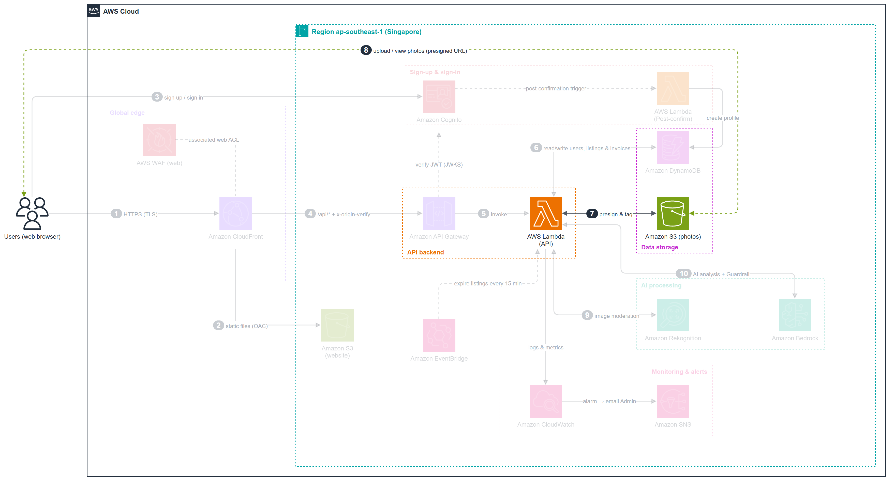
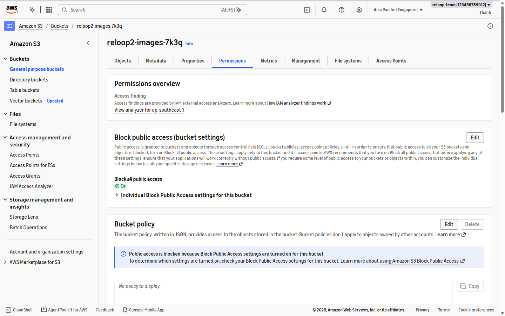
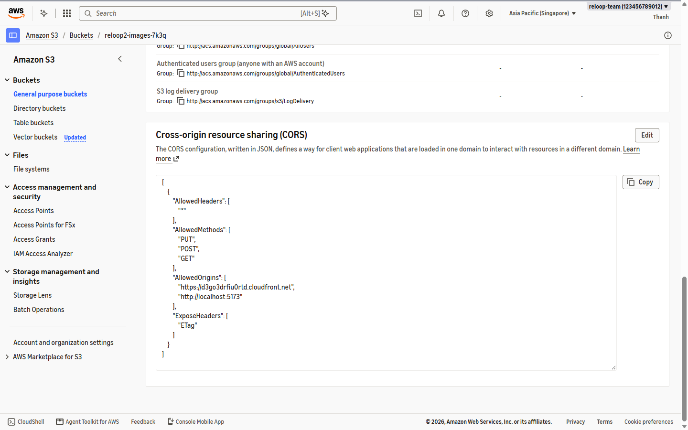
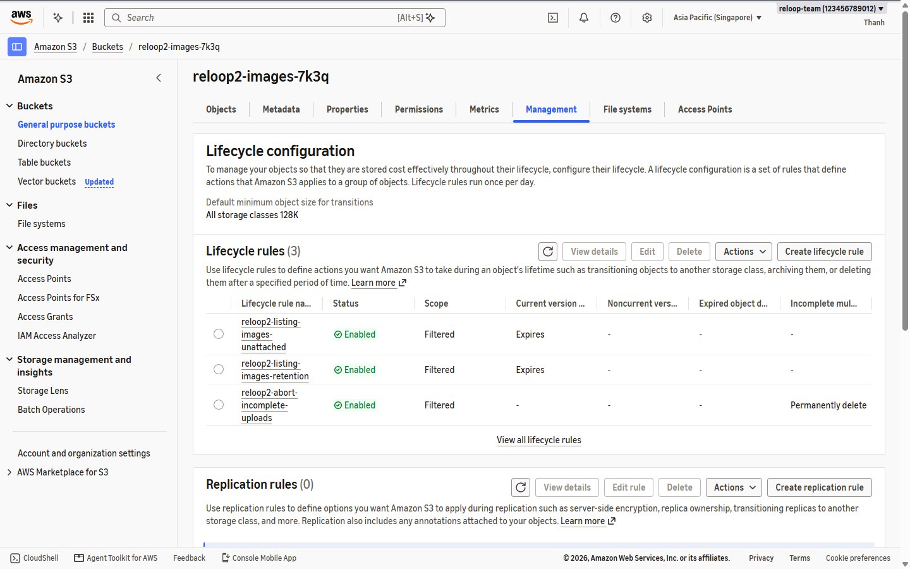

Complete the **Data storage** box by creating the private photo bucket `reloop2-images-<suffix>`. In the diagram, photo handling uses a two-step presigned URL pattern so large image uploads never pass through API Gateway or Lambda:

1. **Arrow 7 (`presign & tag`):** `AWS Lambda (API)` generates a short-lived presigned `POST` upload policy for `listings/<hash>/<uuid>.<ext>` with the `state=pending` object tag (via `createPresignedPost`).
2. **Arrow 8 (`upload / view photos`):** `Users (web browser)` upload (`POST`) the image straight into private S3 using that presigned `POST` and later view photos via short-lived presigned `GET` URLs.

**Graph arrows covered in this step:**
- **Arrow 7:** `AWS Lambda (API) ↔ Amazon S3 (photos)` (`presign & tag`)
- **Arrow 8:** `Users (web browser) ↔ Amazon S3 (photos)` (`upload / view photos (presigned URL)`)



---

### Step 1 — Create Private Bucket `reloop2-images-<suffix>`

1. Open **Amazon S3 -> Create bucket** in **`ap-southeast-1`**.
2. Configure:
   - **Bucket name:** `reloop2-images-<suffix>` (matching `IMAGE_BUCKET` on `reloop2-api`, e.g., `reloop2-images-7k3q`)
   - **Block all public access:** **Enabled** (all 4 boxes checked)
   - **Default encryption:** **SSE-S3** with Bucket Key **Enable**
   - **Tag:** `Project = reloop2`
3. Click **Create bucket**.



---

### Step 2 — Configure CORS Once for Direct Browser Uploads (`Arrow 8`)

Because CloudFront is already deployed from Module 5.3, you enter your live `https://<dist-domain>.cloudfront.net` origin once with no later backfill:

1. Open **`reloop2-images-<suffix>` -> Permissions -> Cross-origin resource sharing (CORS) -> Edit** and paste:
   ```json
   [
     {
       "AllowedHeaders": ["*"],
       "AllowedMethods": ["PUT", "POST", "GET"],
       "AllowedOrigins": [
         "https://<dist-domain>.cloudfront.net",
         "http://localhost:5173"
       ],
       "ExposeHeaders": ["ETag"]
     }
   ]
   ```
2. Click **Save changes**.



---

### Step 3 — Add 3 Cost-Control Lifecycle Rules (Cleanup of Tagged Arrow 7 Uploads)

Open the **Management** tab -> **Create lifecycle rule** three times so abandoned or expired photos never accumulate storage charges:

| Rule Name | Scope (`listings/`) | Action |
| --- | --- | --- |
| `reloop2-listing-images-unattached` | Prefix `listings/` + tag **`state=pending`** | Expire current versions after **1 day** (cleans photos uploaded before a user cancels the form) |
| `reloop2-listing-images-retention` | Prefix `listings/` | Expire current versions after **90 days** |
| `reloop2-abort-incomplete-uploads` | Prefix `listings/` | Delete incomplete multipart uploads after **1 day** |



{}
**Arrows 7 and 8 (`S3 photos`) are ready.** Next, move to [Module 5.8 — AI Processing: Rekognition & Bedrock](../5.8-ai-processing/) to complete **Arrows 9 and 10**.
{}
