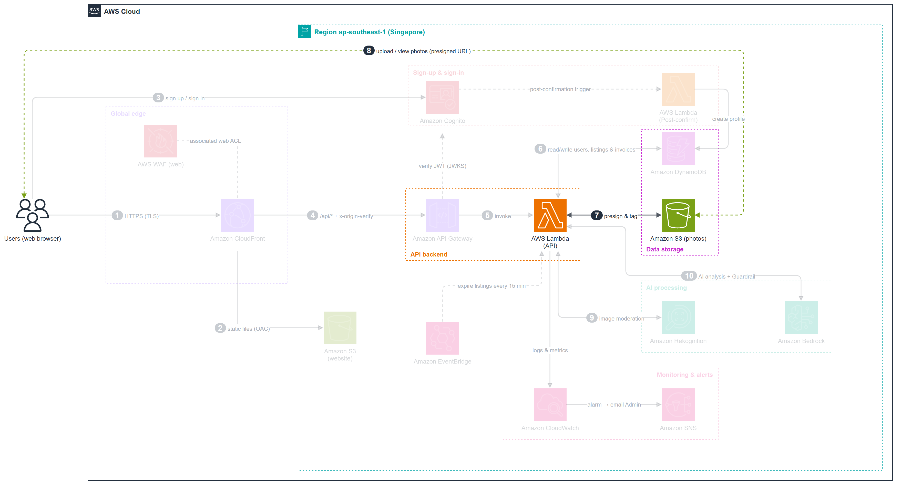
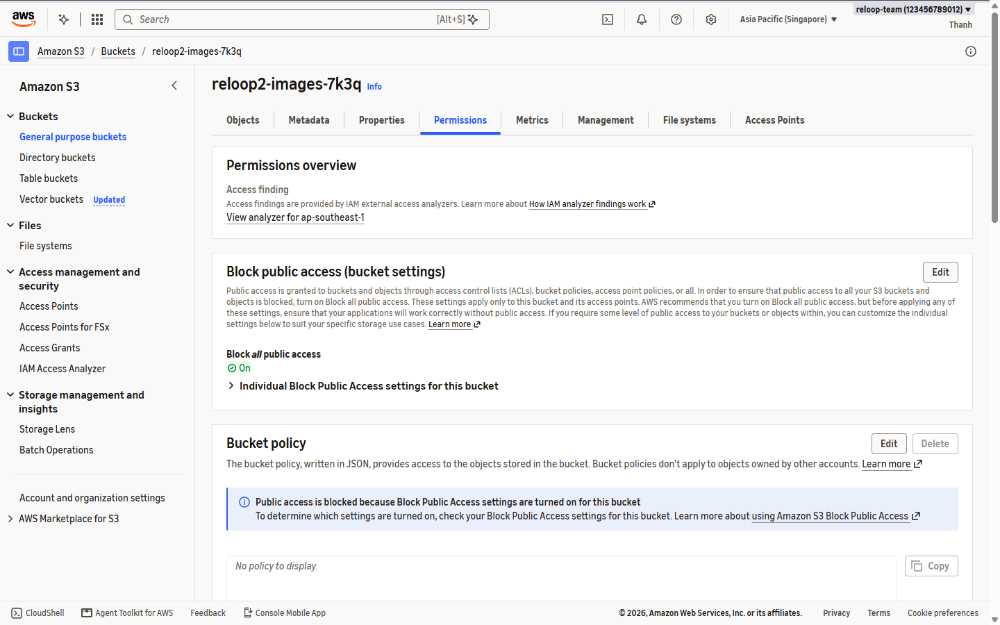
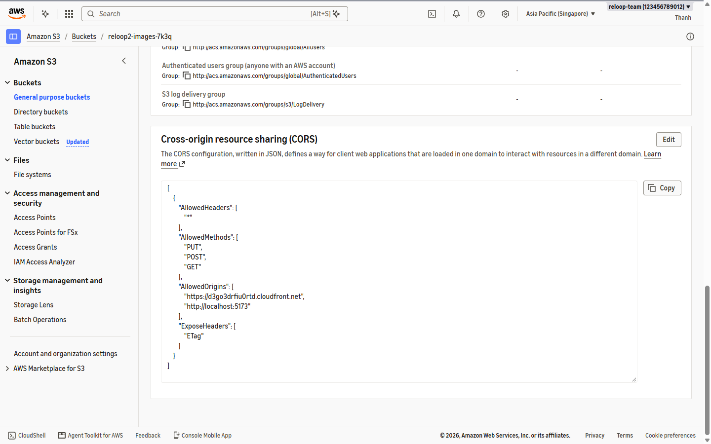
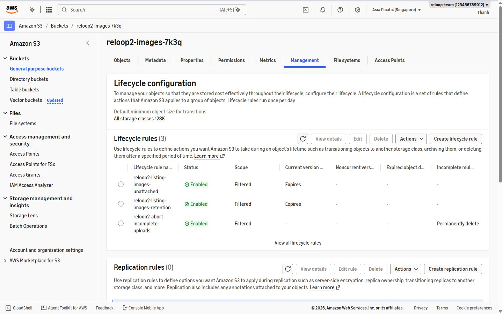

Hoàn thiện khối **Data storage** bằng cách tạo bucket chứa ảnh riêng tư `reloop2-images-<suffix>`. Trên sơ đồ, luồng ảnh dùng mô hình presigned URL gồm 2 bước để ảnh dung lượng lớn không đi qua API Gateway hay Lambda:

1. **Mũi tên 7 (`presign & tag`):** `AWS Lambda (API)` tạo chính sách tải lên presigned `POST` ngắn hạn cho khóa `listings/<hash>/<uuid>.<ext>` kèm thẻ `state=pending` (qua `createPresignedPost`).
2. **Mũi tên 8 (`upload / view photos`):** `Users (web browser)` tải ảnh thẳng lên S3 riêng tư bằng presigned `POST` và xem lại ảnh tin đăng qua URL ký sẵn `GET` ngắn hạn.

**Các mũi tên trên sơ đồ thuộc bước này:**
- **Mũi tên 7:** `AWS Lambda (API) ↔ Amazon S3 (photos)` (`presign & tag`)
- **Mũi tên 8:** `Users (web browser) ↔ Amazon S3 (photos)` (`upload / view photos (presigned URL)`)



---

### Bước 1 — Tạo bucket riêng tư `reloop2-images-<suffix>`

1. Mở **Amazon S3 -> Create bucket** tại **`ap-southeast-1`**.
2. Cấu hình:
   - **Bucket name:** `reloop2-images-<suffix>` (khớp biến `IMAGE_BUCKET` trên `reloop2-api`, ví dụ `reloop2-images-7k3q`)
   - **Block all public access:** **Bật** (tích cả 4 ô)
   - **Default encryption:** **SSE-S3**, bật **Bucket Key**
   - **Tag:** `Project = reloop2`
3. Nhấn **Create bucket**.



---

### Bước 2 — Cấu hình CORS một lần cho trình duyệt tải ảnh trực tiếp (`Mũi tên 8`)

Vì CloudFront đã sẵn sàng từ Học phần 5.3, bạn nhập luôn tên miền `https://<dist-domain>.cloudfront.net` mà không cần quay lại cập nhật sau:

1. Mở **`reloop2-images-<suffix>` -> Permissions -> Cross-origin resource sharing (CORS) -> Edit** và dán:
   ```json
   [
     {
       "AllowedHeaders": ["*"],
       "AllowedMethods": ["PUT", "POST", "GET"],
       "AllowedOrigins": [
         "https://<dist-domain>.cloudfront.net",
         "http://localhost:5173"
       ],
       "ExposeHeaders": ["ETag"]
     }
   ]
   ```
2. Nhấn **Save changes**.



---

### Bước 3 — Thêm 3 quy tắc vòng đời kiểm soát chi phí (Dọn ảnh theo thẻ gắn ở Mũi tên 7)

Mở thẻ **Management** -> **Create lifecycle rule** ba lần để ảnh bỏ dở hoặc quá hạn không tích tụ chi phí lưu trữ:

| Tên quy tắc | Phạm vi (`listings/`) | Hành động |
| --- | --- | --- |
| `reloop2-listing-images-unattached` | Tiền tố `listings/` + thẻ **`state=pending`** | Xóa sau **1 ngày** (dọn ảnh đã tải lên nhưng người dùng hủy không đăng tin) |
| `reloop2-listing-images-retention` | Tiền tố `listings/` | Xóa phiên bản hiện tại sau **90 ngày** |
| `reloop2-abort-incomplete-uploads` | Tiền tố `listings/` | Hủy các phiên tải lên nhiều phần bị gián đoạn sau **1 ngày** |



{}
**Mũi tên 7 và 8 (`S3 photos`) đã sẵn sàng.** Tiếp theo, chuyển sang [Học phần 5.8 — Xử lý AI: Rekognition & Bedrock](../5.8-ai-processing/) để hoàn thiện **Mũi tên 9 và 10**.
{}
